# 📋Clase 01 - Presentación del Master Big Data e IA

# Presentación del programa Big Data

# Metodología de clases y evaluaciones

> Exámenes prácticos los días Viernes de 9:00 - 11:55  (o el Jueves anterior si no hubiera clases ese viernes) . En estos exámenes se evaluarán generalmente laboratorios, prácticas y ejercicios dados en clase .
Exámenes teóricos los días **Lunes** 13:30 -14:30. Si ese día no tenemos clase se realizará el examen al siguiente día lectivo.

# 

# Preparación de temario y preguntas de certificación (Unedited)

## Temario:

[https://learn.microsoft.com/en-us/credentials/certifications/azure-data-fundamentals/?practice-assessment-type=certification](https://learn.microsoft.com/en-us/credentials/certifications/azure-data-fundamentals/?practice-assessment-type=certification)

**Algunos** temas de las certificaciones serán asignados como exposiciones o cuestionarios teóricos. 

Study guide:

[https://learn.microsoft.com/en-us/credentials/certifications/resources/study-guides/dp-900](https://learn.microsoft.com/en-us/credentials/certifications/resources/study-guides/dp-900)

Credential Journey:

[https://archcenter.blob.core.windows.net/cdn/Credentials/Credential-Journey-Database-Administrator.pdf#zoom=45%](https://archcenter.blob.core.windows.net/cdn/Credentials/Credential-Journey-Database-Administrator.pdf#zoom=45%)

## Preguntas de ensayo. 

> Las preguntas asignadas y los ficheros pdf están en el canal de teams: [Dudas-Consultas exámenes de certificación](https://teams.microsoft.com/l/channel/19%3A38dcd0a46f0d40979e14a63a7f3dbc38%40thread.tacv2/Dudas-Consultas%20ex%C3%A1menes%20de%20certificaci%C3%B3n?groupId=38a189b6-e5fa-46d2-9254-0051755154fc&tenantId=68519e48-83f3-435f-a38a-1a7aa77ba987). Están en dos lugares:
1. **Feed del canal**
2. **Carpeta  compartida dentro del mismo canal mencionado.**

### Contenido del fichero VCE:

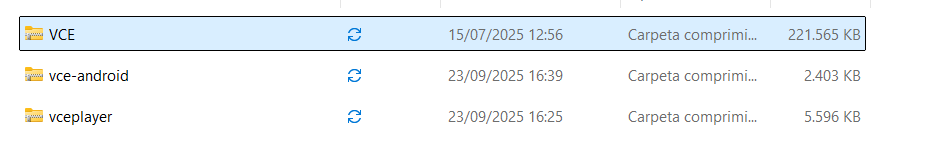

### Uso de VCE Designer:

> Para crear las preguntas de certificación, utilizamos el programa **VCE EXAM DESIGNER**
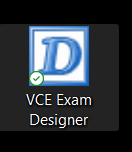

⚠️⚠️**NO EJECUTAR EL QUE DICE designer**⚠️⚠️

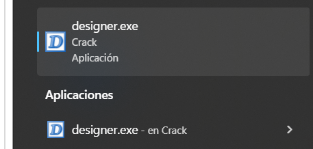

Creamos un nuevo modelo de examen mediante el menú **File, New, Standard Exam**

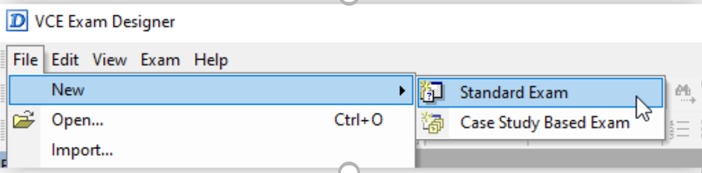

Una vez creado el primer examen, en la parte central podremos poner el título del examen que verán los alumnos.  La nota para superar el examen y el tiempo que van a tener para realizarlo. 

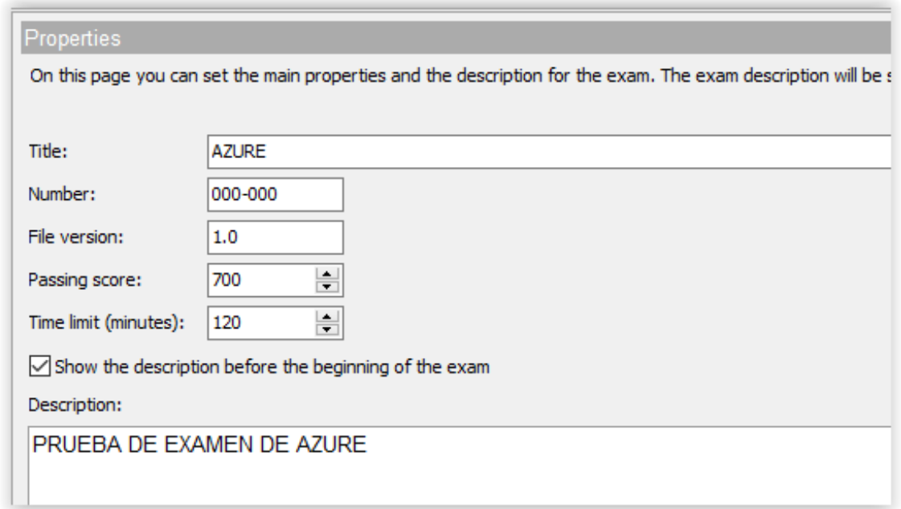

En la parte de la izquierda, **Exam Explorer**, estarán todas las preguntas que incluyamos. Vamos a visualizar como crear preguntas tipo **Test**, ya sean con respuesta múltiple o simple.

Si seleccionamos **Question 1**, es una pregunta tipo **Test**.  Podremos visualizar en la parte central el ENUNCIADO DE LA PREGUNTA (**Question**) y las diferentes respuestas que incluiremos para la pregunta.  También podemos incluir explicaciones para la respuesta.

**Debemos seleccionar la respuesta correcta para la pregunta.**

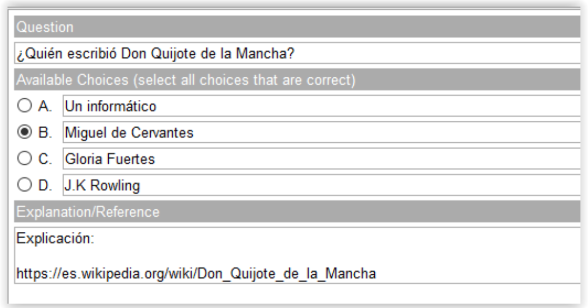

En la parte de la izquierda del programa tenemos la ventana **Properties**, dónde podremos cambiar el número de respuestas o indicar si la pregunta es simple (Single) o de múltiple respuesta. 

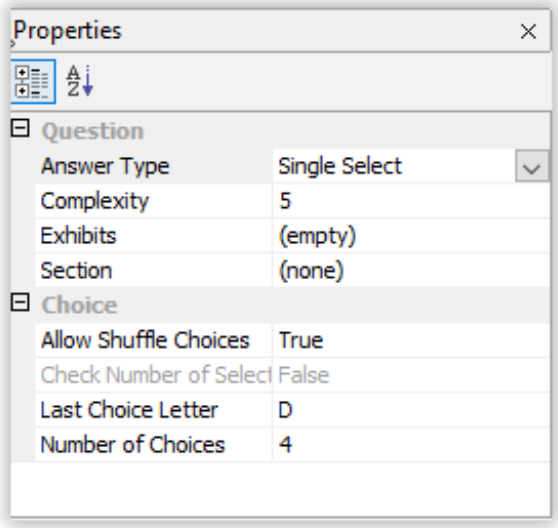

Para crear más preguntas nos dirigimos a la ventana **Exam Explorer** y, sobre el nombre del examen (**Exam A**), pulsaremos e indicaremos el tipo de pregunta que vayamos a incluir. 

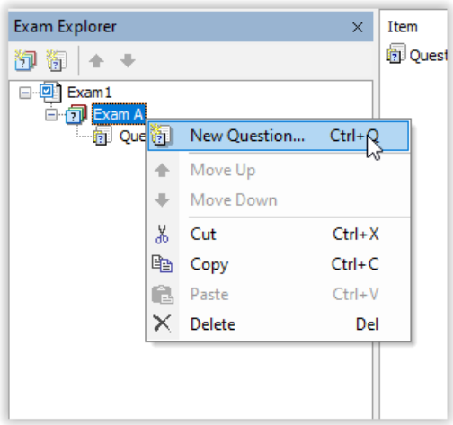

Existen muchos tipos de preguntas a incluir, desde arrastrar soltar (Select and Place) hasta para seleccionar desde desplegables (Hot Area). 

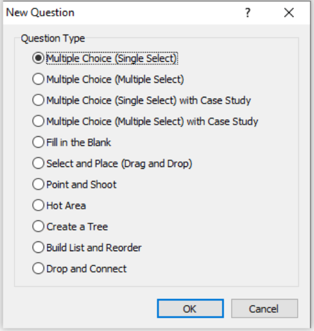

### **GENERAR PREGUNTAS DE TIPO ARRASTRAR Y SOLTAR (Drag and Drop)
 **

Para realizar este tipo de preguntas es necesario tener una imagen con las opciones posibles y los huecos disponibles para las respuestas.  Como, por ejemplo:

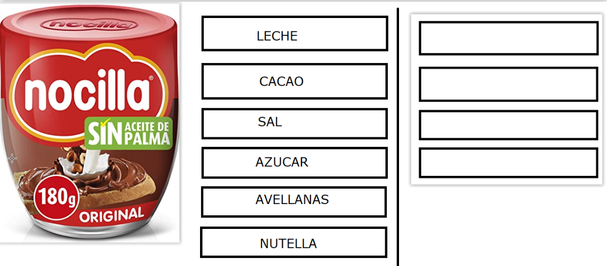

Debemos crear una nueva pregunta sobre el examen actual y seleccionar el tipo **Select and Place (Drag and Drop)** tal y como podemos observar: 

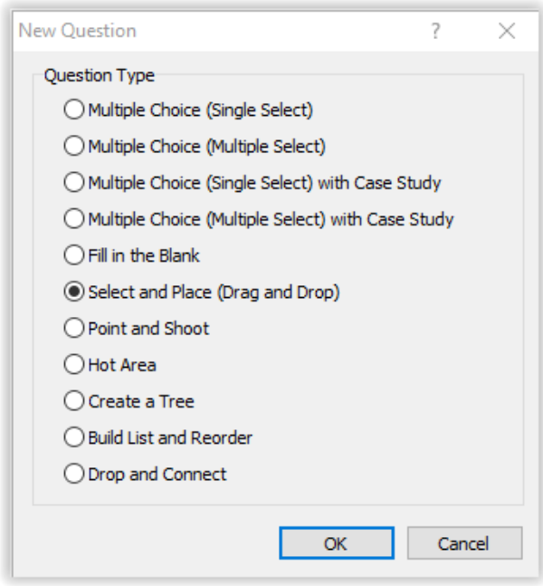

La parte central de la pregunta contiene un espacio para el supuesto (**Question**) y otro espacio para la explicación. 

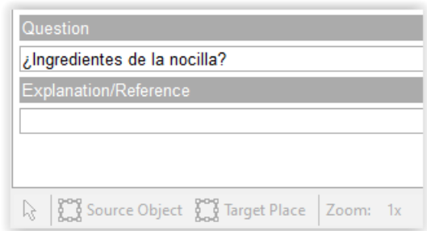

En las ventanas de la izquierda, tendremos la ventana de **Properties**, dónde podremos seleccionar la imagen que utilizaremos para arrastrar y soltar opciones.  Lo haremos mediante la propiedad **Background Image** 

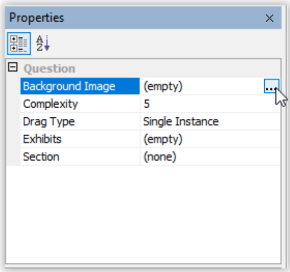

Mediante **Load**, seleccionamos la imagen y pulsamos en **OK **después de cargarla. 

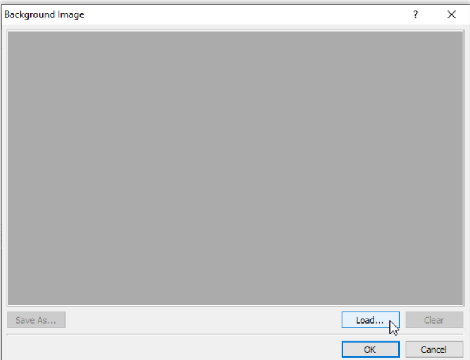

Con la opción **Source Object**, seleccionaremos los lugares de la imagen dónde el usuario podrá realizar el arrastre. 

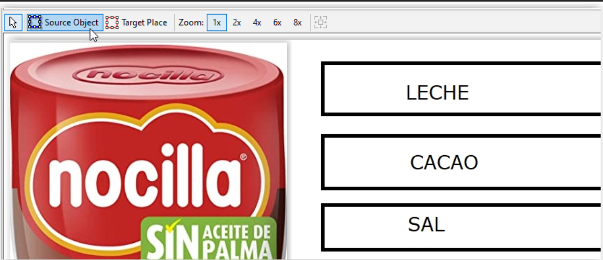

Seleccionamos tantas áreas como necesitemos en nuestro ejemplo. 

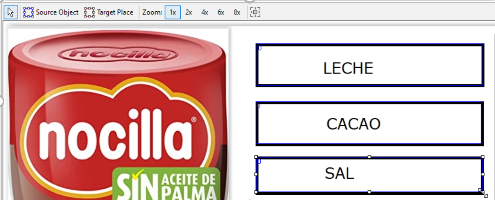

Con la opción **Target Place** seleccionaremos los lugares dónde el usuario arrastrará sus respuestas. 

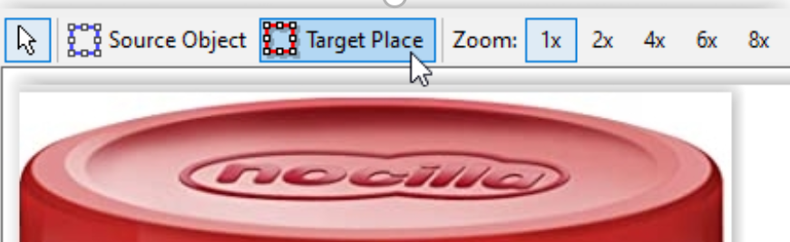

Podremos visualizar que, en color rojo, quedan los espacios en cada área de respuesta. 

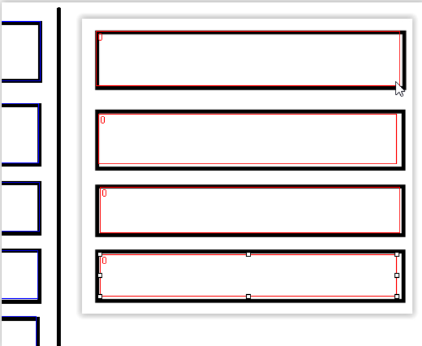

Posteriormente, para dar solución a la respuesta, tenemos una pestaña **Answer** en la parte inferior izquierda de la pregunta. 

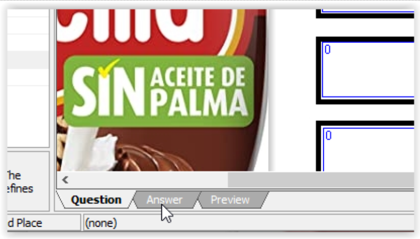

Incluiremos ahí las respuestas correctas en su orden para la solución: 

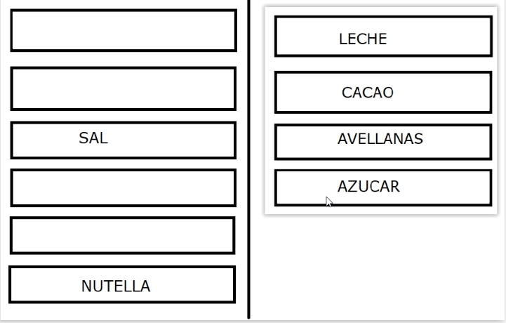

### Numeración de las preguntas:

En el apartado de** Explanation/Reference **debes utilizar la siguiente notación: 

> NOTACION: **#247  Q19-T05**

> **#247→ ** es la numeración del VCE Exam Designer
**Q19-T05** → es la numeración de ExamTopics: ***Question 19 Topic 05***

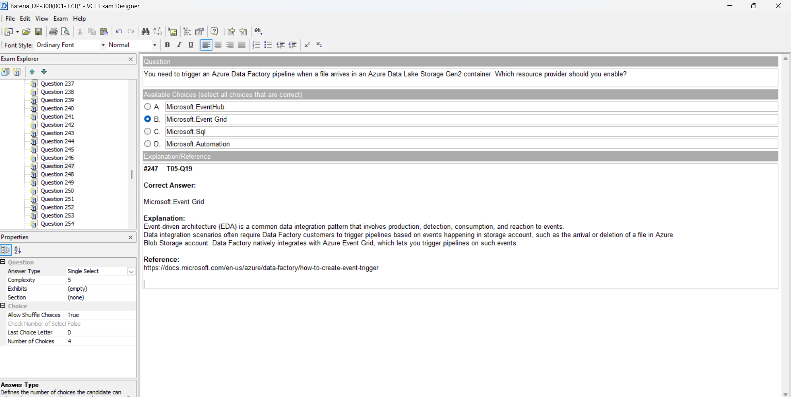

### Herramientas de apoyo para reforzar el apartado de **Explanation/Reference:**

- Discusiones de ExamTopics
- Foros en la web
- NotebookLM
-  ChatGPT, Gemini, Grok, Claude (via MCP Server)
### VCE Player para estudiar las preguntas 

Player no hace falta instalarlo, directamente se ejecuta dando doble click

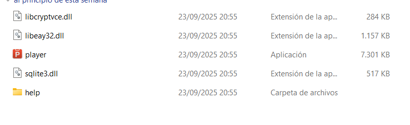

Seleccionar fichero .vce y configurar con tus preferencias personales

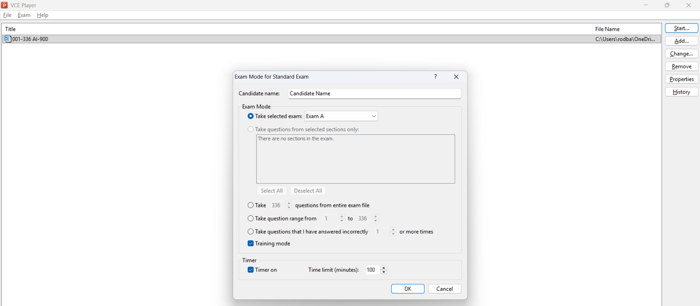

