# 📋Clase 08 - Servicios de Azure para DB SQL y NoSQL

### 1.1 Comparación de los servicios de Azure SQL

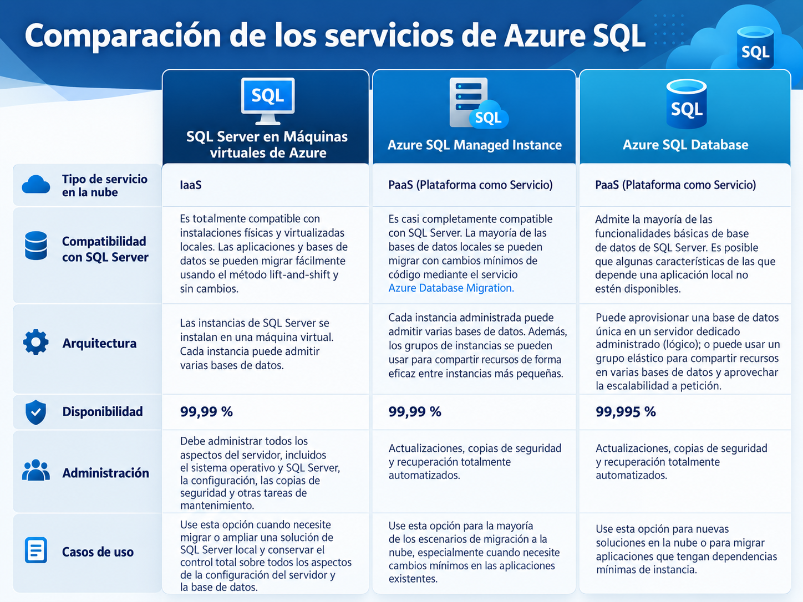

### 1.2 Servicios de Azure para bases de datos de código abierto

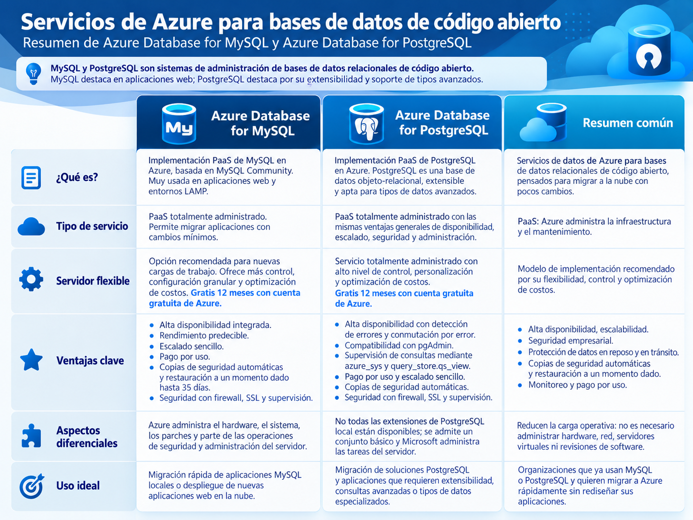

### 1.3 Ejercicio

[https://microsoftlearning.github.io/DP-900T00A-Azure-Data-Fundamentals/Instructions/Labs/dp900-01-sql-lab.html](https://microsoftlearning.github.io/DP-900T00A-Azure-Data-Fundamentals/Instructions/Labs/dp900-01-sql-lab.html)

# **Exploración de Azure Storage**

### 2.1 Azure Blob Storage

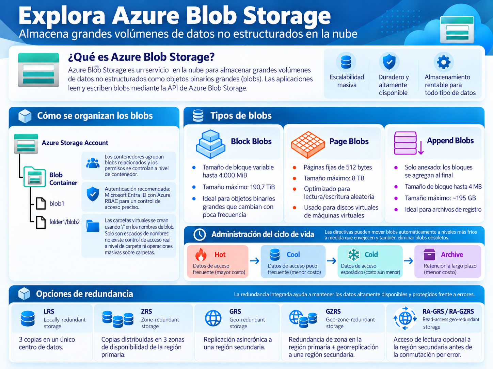

### 2.2 Azure Data Lake Storage Gen2 (ADLS2)

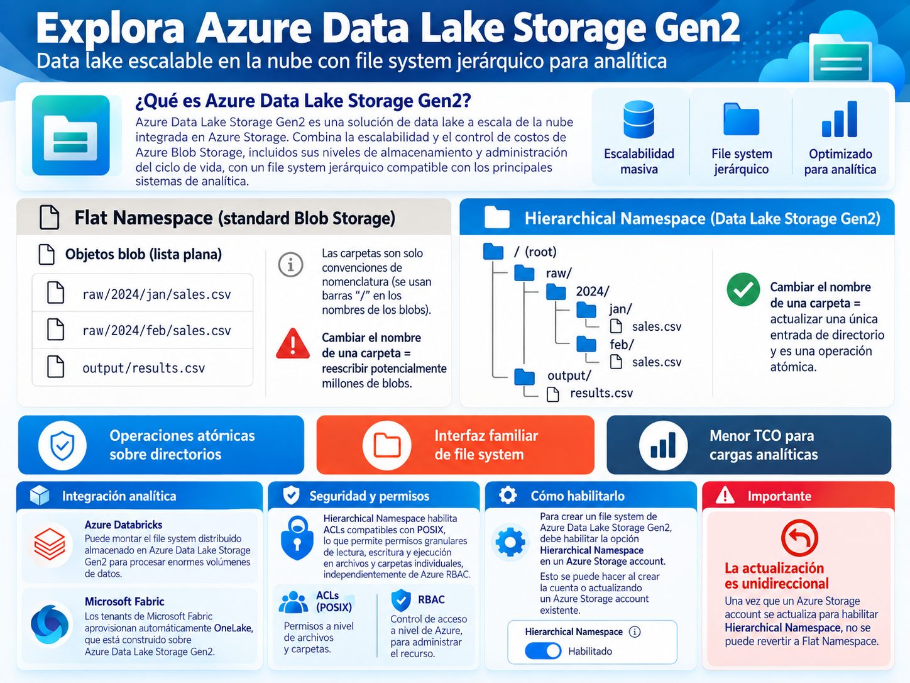

### 2.3 Azure Files

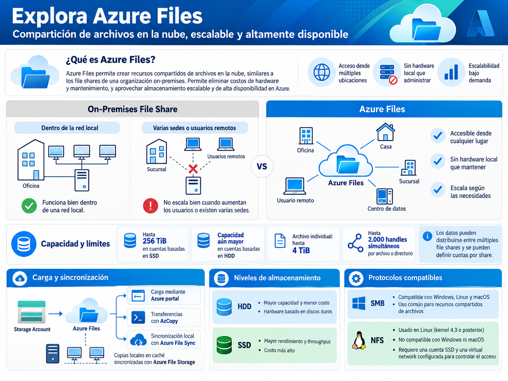

### 2.4 Azure Tables

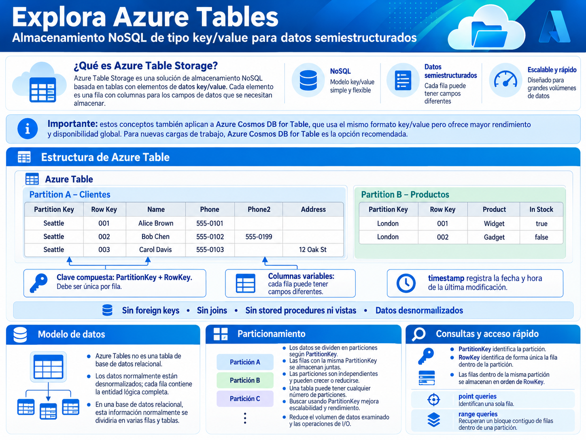

### 2.5 Ejercicio

[https://microsoftlearning.github.io/DP-900T00A-Azure-Data-Fundamentals/Instructions/Labs/dp900-02-storage-lab.html](https://microsoftlearning.github.io/DP-900T00A-Azure-Data-Fundamentals/Instructions/Labs/dp900-02-storage-lab.html)

# E**xploración de Azure Cosmos DB**

### 3.1 ¿ Qué es Azure Cosmos DB?

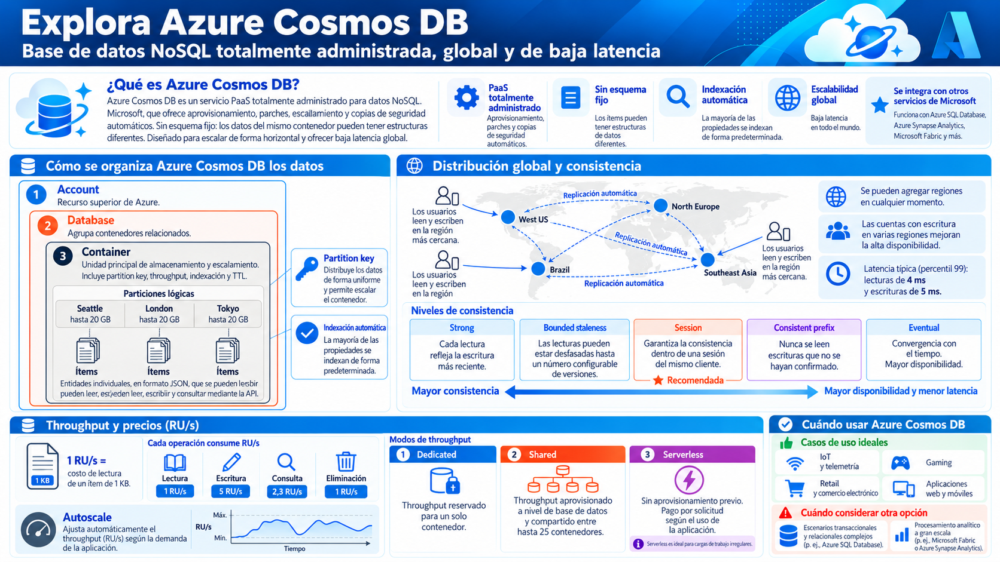

### **3.2 Identifa las APIs de Azure Cosmos DB**

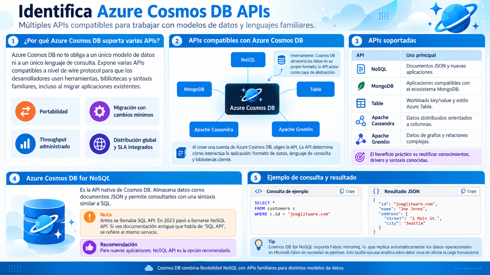

### 3.3 **Cosmos DB for MongoDB**

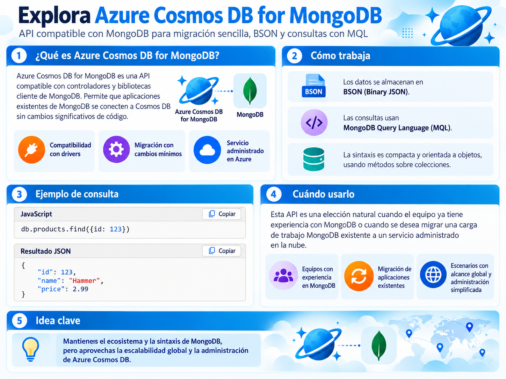

### 3.4 **Cosmos DB for Table**

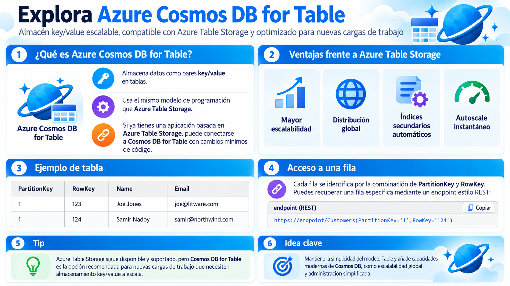

### **3.5 Cosmos DB for Apache Cassandra.**

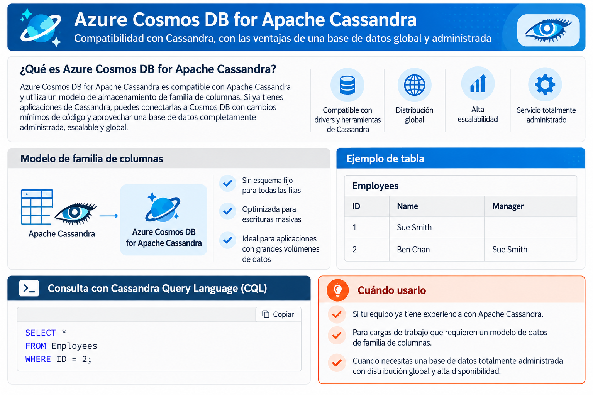

### **3.6 Cosmos DB for Apache Gremlin**

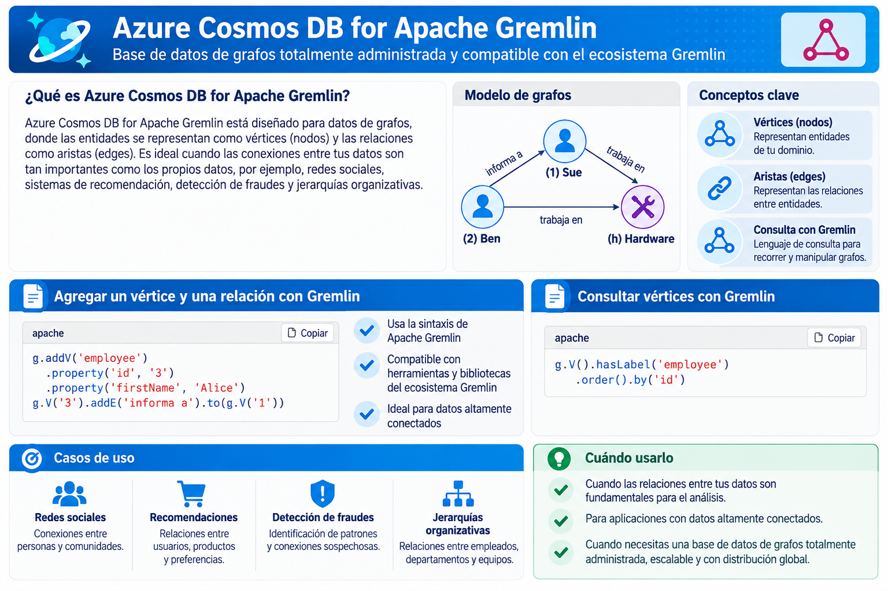

### 3.7 Ejercicio:

[https://microsoftlearning.github.io/DP-900T00A-Azure-Data-Fundamentals/Instructions/Labs/dp900-03-cosmos-lab.html](https://microsoftlearning.github.io/DP-900T00A-Azure-Data-Fundamentals/Instructions/Labs/dp900-03-cosmos-lab.html)

