# 📋Clase 14 - CTAS y Temp Tables

# Sesion 1: CTAS (**C**reate **T**able **A**s **S**elect)

> En SQL, una **tabla** es una estructura que almacena datos en filas y columnas.

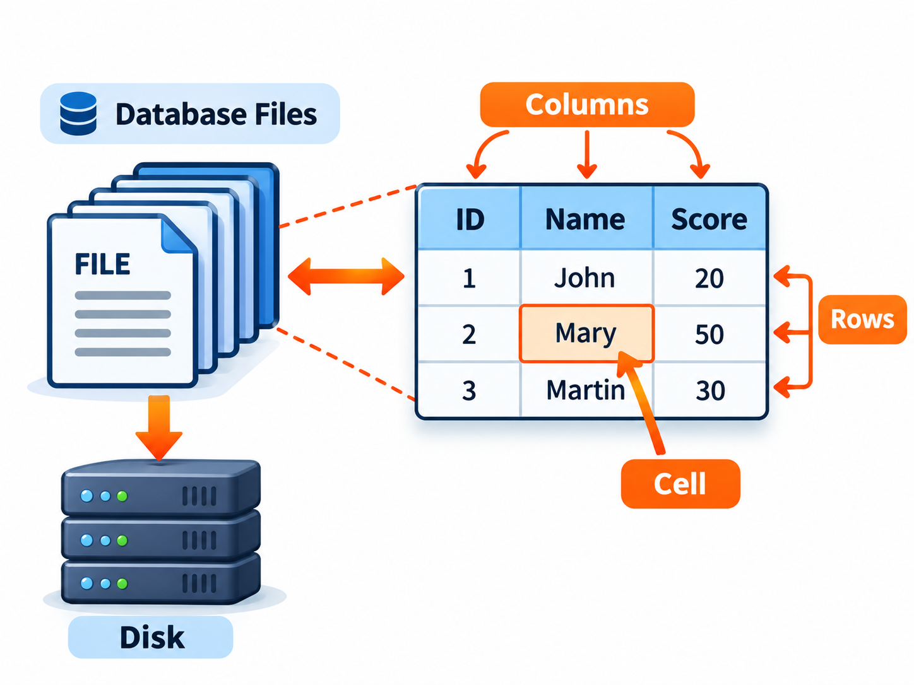

**Tipos de tablas:**

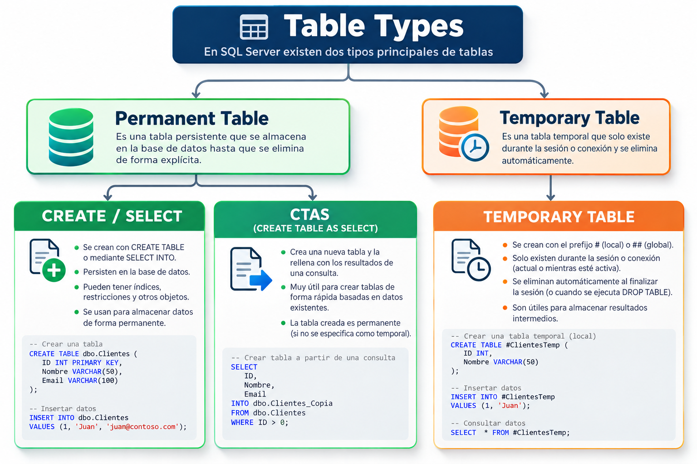

2. CTAS vs CREATE/INSERT

> **CREATE / INSERT**
1. CREATE:  Define the structure of the table.
2. INSERT:  Insert data into the table.
> **CTAS - CREATE TABLE AS SELECT**
Create a new table based on the result of an SQL query
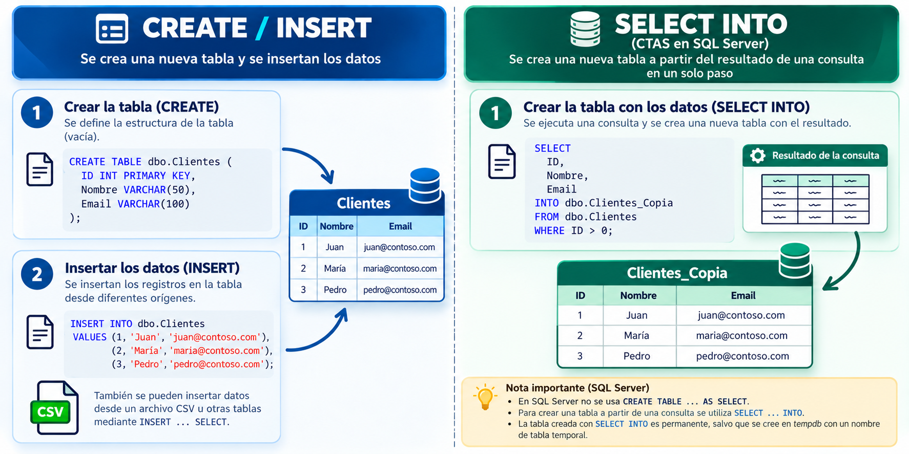

> 👉 Con CTAS, **una sola sentencia** crea la tabla y copia los datos.

| Característica | CTAS (`CREATE TABLE AS SELECT`) | CREATE + INSERT |
| --- | --- | --- |
| Creación de estructura | Automática (según el SELECT) | Manual (definida columna a columna) |
| Carga de datos | Inmediata durante la creación | Requiere paso adicional (`INSERT`) |
| Rendimiento | 🚀 Más rápido (operación interna optimizada) | Más lento (inserciones por lotes) |
| Flexibilidad | Menos control sobre tipos de datos | Control total sobre la definición |
| Uso típico | Crear tablas derivadas o temporales | Crear estructuras personalizadas |

## 🔍 3. CTAS vs Views


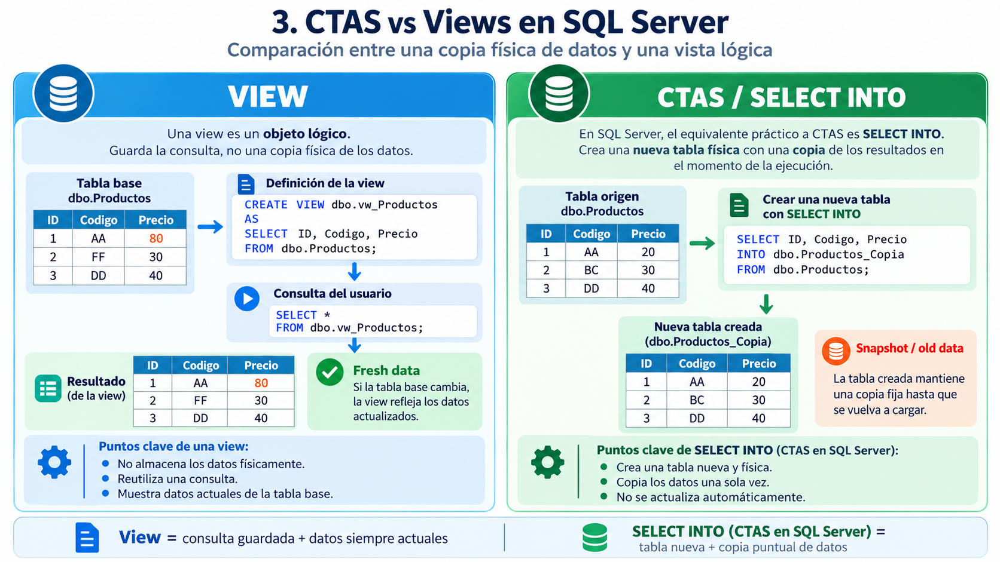

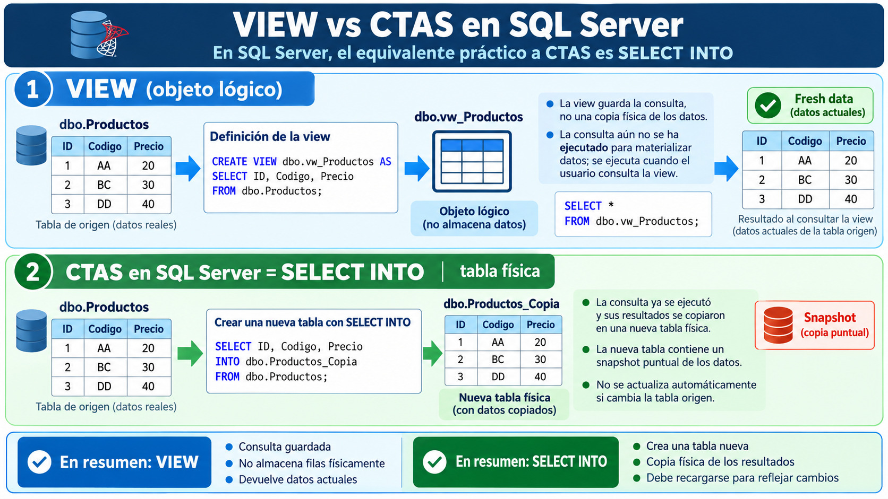

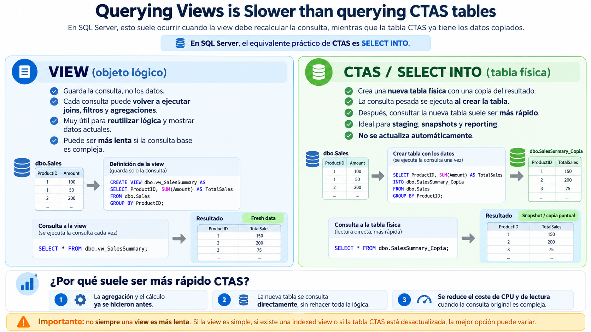

Casos de uso:

1. Optimizar el rendimiento
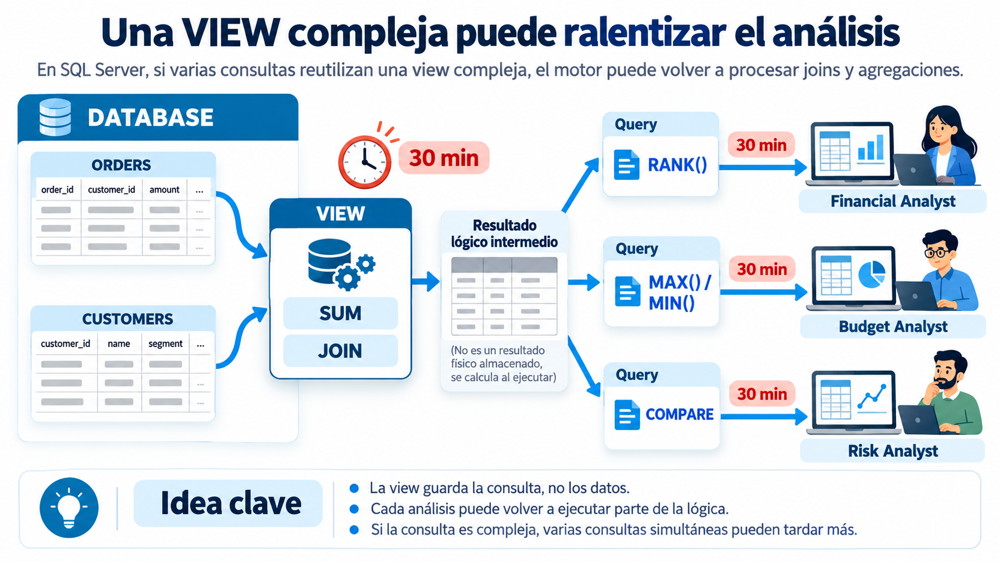

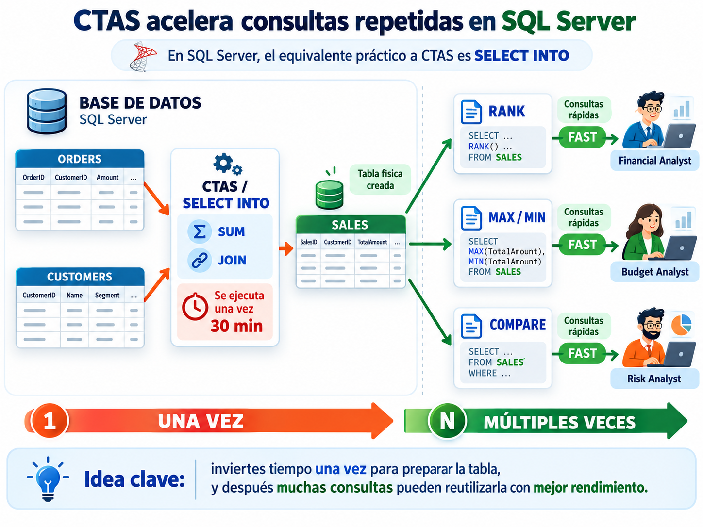
2. Crear Snapshots
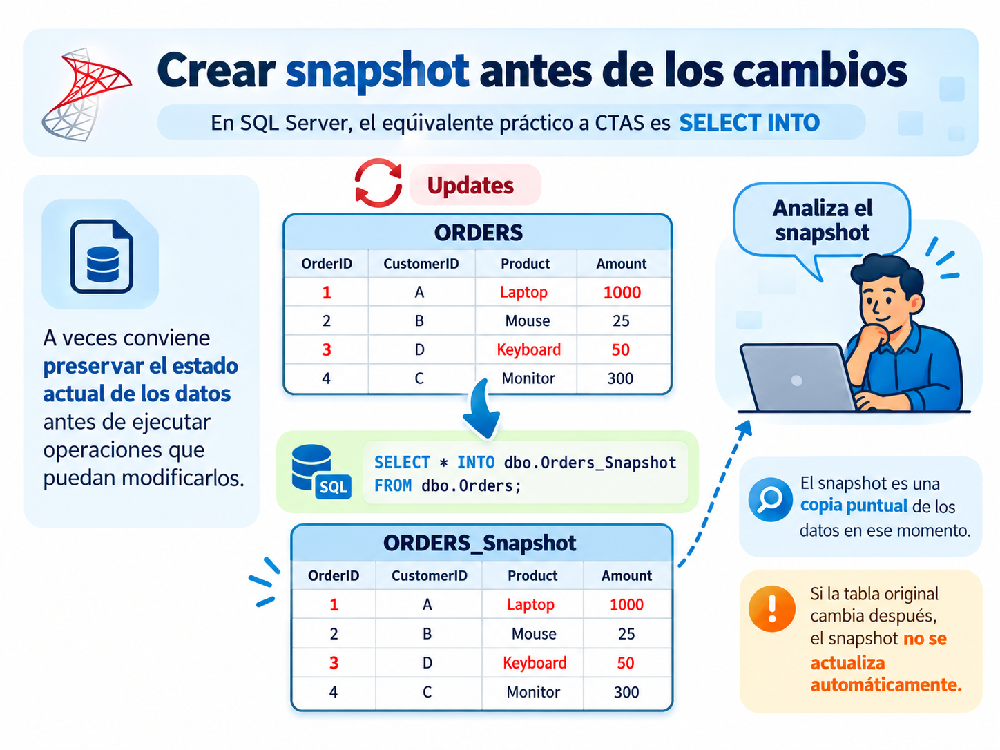
3. Physical Data Marts in Datawarehouse (DWH)
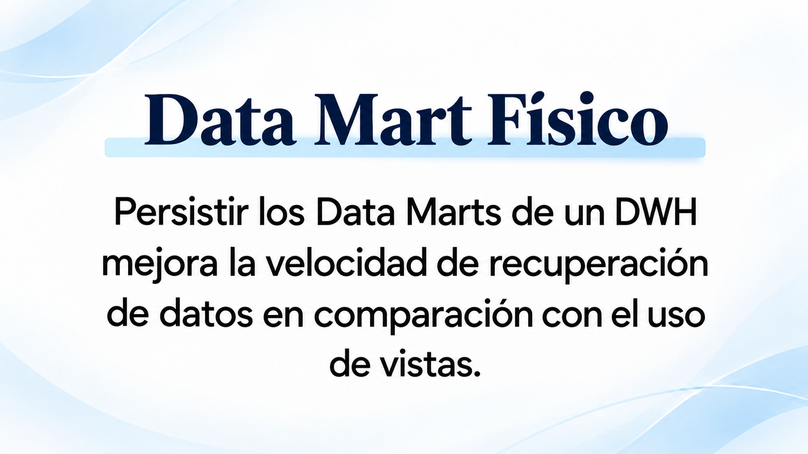

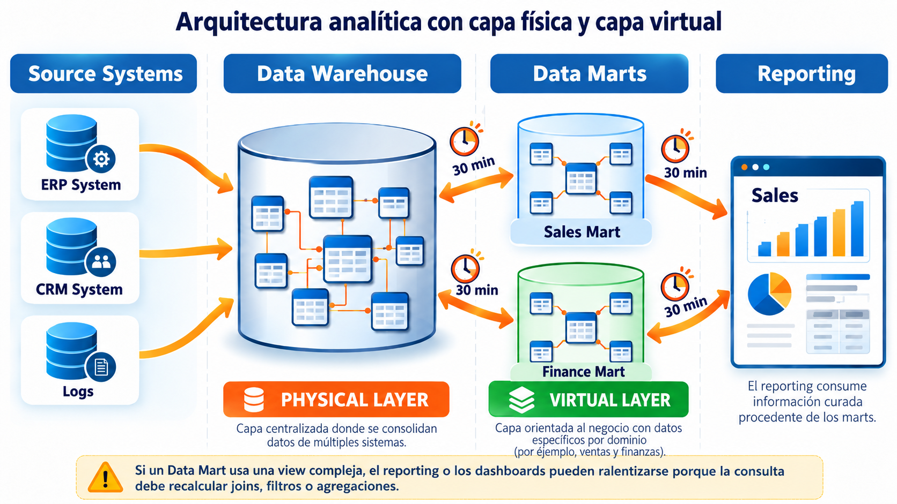

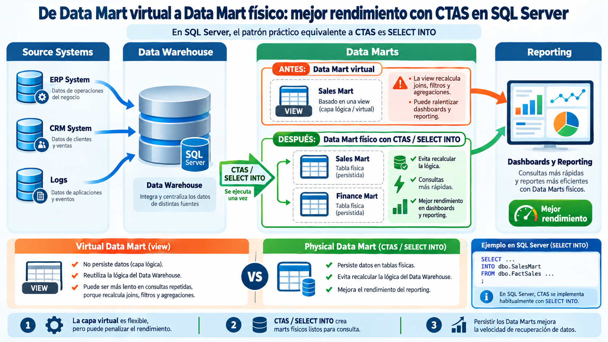
> 📘 **Hint:**
- Usa **CTAS** cuando necesites **persistir los datos** o **mejorar el rendimiento**.
- Usa **VIEWS** cuando necesites **consultas dinámicas y actualizadas**.

## 🧩 4. CTAS Syntax

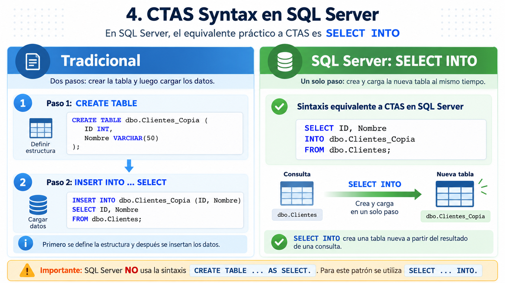

## ⚙️ 5. How DB Executes CTAS

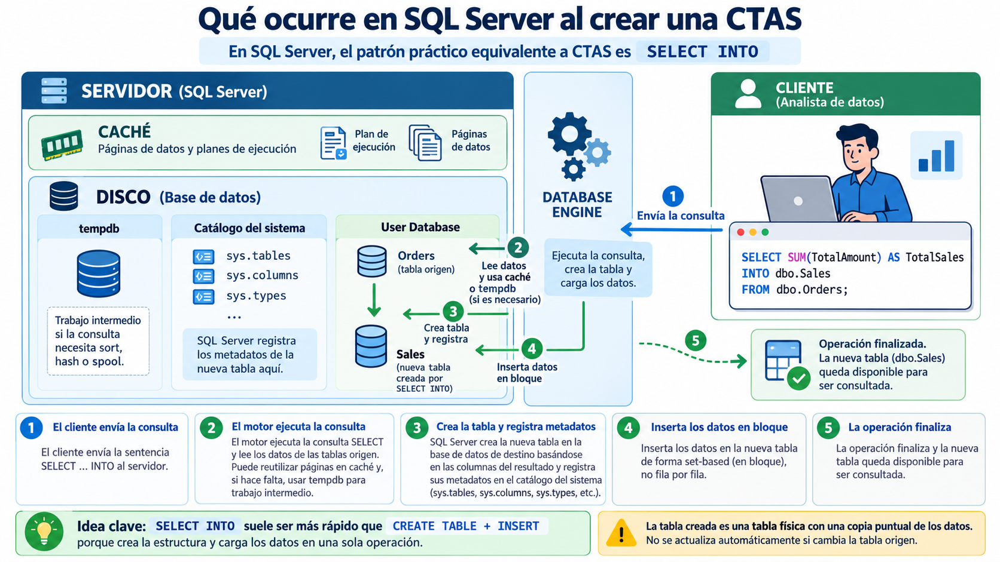

---

## Preparación

Ejecuta este script antes de empezar. Garantiza el punto de partida (43 reproducciones y 10 usuarios) aunque no hayas hecho las cargas de clases anteriores. Se puede ejecutar varias veces.

```sql
USE SonoraDB;
GO

-- 1. Cargas de la clase de subconsultas y CTE
INSERT INTO dbo.reproducciones
    (reproduccion_id, usuario_id, cancion_id, fecha_hora, segundos_escuchados, dispositivo, tipo_contenido)
SELECT s.reproduccion_id, s.usuario_id, s.cancion_id, s.fecha_hora,
       s.segundos_escuchados, s.dispositivo, s.tipo_contenido
FROM dbo.stg_reproducciones AS s
WHERE NOT EXISTS (SELECT 1 FROM dbo.reproducciones AS r WHERE r.reproduccion_id = s.reproduccion_id);

INSERT INTO dbo.usuarios (usuario_id, nombre_usuario, email, pais, plan_suscripcion, fecha_alta)
SELECT s.usuario_id, s.nombre_usuario, s.email, s.pais, s.plan_suscripcion, s.fecha_alta
FROM dbo.stg_usuarios AS s
WHERE NOT EXISTS (SELECT 1 FROM dbo.usuarios AS u WHERE u.usuario_id = s.usuario_id);
GO

-- 2. Lote del 22/09
DROP TABLE IF EXISTS dbo.stg_reproducciones_2209;

CREATE TABLE dbo.stg_reproducciones_2209 (
    reproduccion_id      int,
    usuario_id           int,
    cancion_id           int,
    fecha_hora           datetime2(0),
    segundos_escuchados  int,
    dispositivo          nvarchar(20),
    tipo_contenido       nvarchar(10)
);

INSERT INTO dbo.stg_reproducciones_2209
    (reproduccion_id, usuario_id, cancion_id, fecha_hora, segundos_escuchados, dispositivo, tipo_contenido) VALUES
(37, 5,  NULL, '2026-09-21 22:00', 30,  N'Móvil', N'Anuncio'),
(38, 5,  104,  '2026-09-21 22:01', 190, N'Móvil', N'Canción'),
(39, 8,  106,  '2026-09-22 07:30', 12,  N'Móvil', N'Canción'),
(40, 10, 103,  '2026-09-22 09:00', 176, N'Móvil', N'Canción'),
(41, 9,  NULL, '2026-09-22 09:10', 30,  N'Web',   N'Anuncio'),
(42, 9,  111,  '2026-09-22 09:11', 356, N'Web',   N'Canción'),
(43, 1,  114,  '2026-09-22 10:00', 25,  N'Móvil', N'Canción');

INSERT INTO dbo.reproducciones
    (reproduccion_id, usuario_id, cancion_id, fecha_hora, segundos_escuchados, dispositivo, tipo_contenido)
SELECT s.reproduccion_id, s.usuario_id, s.cancion_id, s.fecha_hora,
       s.segundos_escuchados, s.dispositivo, s.tipo_contenido
FROM dbo.stg_reproducciones_2209 AS s
WHERE NOT EXISTS (SELECT 1 FROM dbo.reproducciones AS r WHERE r.reproduccion_id = s.reproduccion_id);
GO

-- 3. Comprobación del punto de partida
SELECT (SELECT COUNT(*) FROM dbo.reproducciones) AS reproducciones,
       (SELECT COUNT(*) FROM dbo.usuarios)       AS usuarios;
```

**Salida esperada de la comprobación:**

| reproducciones | usuarios |
| --- | --- |
| 43 | 10 |

> En esta clase se crean muchas tablas nuevas. Ninguna modifica de forma permanente las tablas de Sonora: al terminar, `reproducciones` sigue con 43 filas y `usuarios` con 10. Al final del documento hay un script de limpieza opcional que borra todo lo creado.

---

### Sintaxis

```sql
-- Forma general en T-SQL
SELECT columnas
INTO esquema.tabla_nueva      -- INTO va después de la lista de columnas y antes de FROM
FROM esquema.tabla_origen
WHERE condicion;

-- Copia completa de una tabla
SELECT *
INTO dbo.tabla_copia
FROM dbo.tabla_origen;

-- Solo la estructura, sin filas
SELECT *
INTO dbo.tabla_vacia
FROM dbo.tabla_origen
WHERE 1 = 0;                  -- condición que nunca se cumple

-- Patrón re-ejecutable: borrar si existe y volver a crear
DROP TABLE IF EXISTS dbo.tabla_nueva;

SELECT columnas
INTO dbo.tabla_nueva
FROM dbo.tabla_origen;
```

**Reglas de T-SQL que conviene recordar:**

- La tabla de destino **no puede existir**. Si existe, aparece el error **Msg 2714** (*There is already an object named ...*). Es justo lo contrario de `INSERT INTO ... SELECT`, que necesita que la tabla ya exista.
- `SELECT ... INTO` hace dos cosas: crea la tabla y la carga. En la pestaña Messages verás `(n rows affected)` con el número de filas cargadas.
- Las columnas que se copian tal cual desde una tabla conservan su nombre, su tipo de dato y si admiten `NULL` o no.
- **No se copian** la clave primaria, las claves foráneas, las restricciones `UNIQUE`, `CHECK` y `DEFAULT`, ni los índices. Si la tabla nueva los necesita, se añaden después con `ALTER TABLE`.
- El origen puede ser una tabla, varias tablas unidas con `JOIN`, una vista o una CTE.
- Una tabla no tiene orden. Aunque el `SELECT ... INTO` lleve `ORDER BY`, al consultar la tabla nueva hay que volver a ordenar.
### Ejemplo 1. Copia completa de una tabla antes de un cambio masivo

**Contexto:** Marketing va a lanzar una promoción que regala el plan Premium a los usuarios Free **de España**. Antes de tocar `usuarios`, Raúl pide una copia de la tabla.

**Paso 1.** Crear la copia:

```sql
DROP TABLE IF EXISTS dbo.usuarios_copia;

SELECT *
INTO dbo.usuarios_copia
FROM dbo.usuarios;
```

**Salida esperada (pestaña Messages):** `(10 rows affected)`.

**Paso 2.** Alguien ejecuta el script de la promoción y olvida el filtro de país:

```sql
UPDATE dbo.usuarios
SET plan_suscripcion = N'Premium'
WHERE plan_suscripcion = N'Free';
```

**Salida:** `(4 rows affected)`. Se esperaban 2 (marta_rock y pau.synth, los dos usuarios Free de España).

**Paso 3.** La copia permite ver exactamente qué ha cambiado, comparando fila a fila:

```sql
SELECT u.nombre_usuario,
       u.pais,
       c.plan_suscripcion AS plan_antes,
       u.plan_suscripcion AS plan_ahora
FROM dbo.usuarios AS u
JOIN dbo.usuarios_copia AS c ON c.usuario_id = u.usuario_id
WHERE u.plan_suscripcion <> c.plan_suscripcion
ORDER BY u.nombre_usuario;
```

**Salida esperada:**

| nombre_usuario | pais | plan_antes | plan_ahora |
| --- | --- | --- | --- |
| dani_dj | CO | Free | Premium |
| marta_rock | ES | Free | Premium |
| nachox | MX | Free | Premium |
| pau.synth | ES | Free | Premium |

**Paso 4.** Restaurar el plan original desde la copia, solo en las filas que han cambiado:

```sql
UPDATE dbo.usuarios
SET plan_suscripcion = (SELECT c.plan_suscripcion
                        FROM dbo.usuarios_copia AS c
                        WHERE c.usuario_id = dbo.usuarios.usuario_id)
WHERE EXISTS (
    SELECT 1
    FROM dbo.usuarios_copia AS c
    WHERE c.usuario_id = dbo.usuarios.usuario_id
      AND c.plan_suscripcion <> dbo.usuarios.plan_suscripcion
);
```

**Salida esperada:** `(4 rows affected)`. Si ahora repites la consulta del Paso 3, devuelve 0 filas: `usuarios` vuelve a estar como al principio.

> La copia es independiente de la original: el `UPDATE` del Paso 2 no la tocó. Esa es la propiedad que la convierte en una red de seguridad. Antes de continuar, comprueba que la consulta del Paso 3 devuelve 0 filas.

### Ejemplo 2. Elegir columnas y filas

**Pregunta de negocio:** el equipo de relación con sellos quiere una tabla solo con los lanzamientos de 2026, sin los identificadores de artista ni de género.

**Paso 1.** El `SELECT` decide qué columnas y qué filas tendrá la tabla nueva:

```sql
DROP TABLE IF EXISTS dbo.canciones_2026;

SELECT cancion_id, titulo, duracion_seg, fecha_lanzamiento
INTO dbo.canciones_2026
FROM dbo.canciones
WHERE fecha_lanzamiento >= '2026-01-01';
```

**Salida esperada (Messages):** `(9 rows affected)`.

**Paso 2.** Consultar la tabla nueva como cualquier otra:

```sql
SELECT cancion_id, titulo, duracion_seg, fecha_lanzamiento
FROM dbo.canciones_2026
ORDER BY fecha_lanzamiento;
```

**Salida esperada:**

| cancion_id | titulo | duracion_seg | fecha_lanzamiento |
| --- | --- | --- | --- |
| 106 | Corriente Alterna | 234 | 2026-02-10 |
| 104 | Calle 23 | 190 | 2026-03-15 |
| 109 | Diamantes Rotos | 182 | 2026-04-30 |
| 111 | Marea Alta | 356 | 2026-05-19 |
| 101 | Verano en Bucle | 185 | 2026-06-12 |
| 103 | Perreo Lunar | 176 | 2026-07-01 |
| 108 | Humo Violeta | 167 | 2026-08-22 |
| 113 | Galaxia Dembow | 158 | 2026-09-04 |
| 114 | Sin Cobertura | 175 | 2026-09-18 |

**Paso 3.** Comprobar qué estructura ha creado SQL Server. La vista del sistema `INFORMATION_SCHEMA.COLUMNS` tiene una fila por cada columna de cada tabla de la base de datos:

```sql
SELECT COLUMN_NAME, DATA_TYPE, CHARACTER_MAXIMUM_LENGTH, IS_NULLABLE
FROM INFORMATION_SCHEMA.COLUMNS
WHERE TABLE_SCHEMA = N'dbo'
  AND TABLE_NAME = N'canciones_2026'
ORDER BY ORDINAL_POSITION;
```

**Salida esperada:**

| COLUMN_NAME | DATA_TYPE | CHARACTER_MAXIMUM_LENGTH | IS_NULLABLE |
| --- | --- | --- | --- |
| cancion_id | int | NULL | NO |
| titulo | nvarchar | 150 | NO |
| duracion_seg | int | NULL | NO |
| fecha_lanzamiento | date | NULL | NO |

> Nadie ha escrito `nvarchar(150)` ni `NOT NULL`: la tabla nueva los ha heredado de las columnas de `canciones`. Usaremos esta consulta a `INFORMATION_SCHEMA.COLUMNS` durante toda la clase para ver qué ha decidido el motor.

### Ejemplo 3. La tabla de destino no puede existir

**Paso 1.** Ejecutar otra vez la instrucción del ejemplo anterior, sin el `DROP`:

```sql
SELECT cancion_id, titulo, duracion_seg, fecha_lanzamiento
INTO dbo.canciones_2026
FROM dbo.canciones
WHERE fecha_lanzamiento >= '2026-01-01';
```

**Salida:**

```plain text
Msg 2714, Level 16, State 6
There is already an object named 'canciones_2026' in the database.
```

**Paso 2.** Elegir la instrucción según la situación:

| Situación | Instrucción |
| --- | --- |
| La tabla no existe y quiero crearla con datos | `SELECT ... INTO` |
| La tabla ya existe y quiero añadirle filas | `INSERT INTO ... SELECT` |
| La tabla puede existir y quiero rehacerla desde cero | `DROP TABLE IF EXISTS` + `SELECT ... INTO` |

**Paso 3.** La tercera opción convierte el script en re-ejecutable:

```sql
DROP TABLE IF EXISTS dbo.canciones_2026;

SELECT cancion_id, titulo, duracion_seg, fecha_lanzamiento
INTO dbo.canciones_2026
FROM dbo.canciones
WHERE fecha_lanzamiento >= '2026-01-01';
```

**Salida esperada:** `(9 rows affected)`, la primera vez y todas las siguientes.

> Por eso todos los ejemplos de esta clase empiezan con `DROP TABLE IF EXISTS`. Un script de datos que solo funciona la primera vez no sirve para automatizar una carga.

### Ejemplo 4. Copiar solo la estructura

**Contexto de ingeniería de datos:** mañana llegará un nuevo lote de reproducciones. Hace falta una tabla de staging vacía con las mismas columnas que `reproducciones`, sin escribir el `CREATE TABLE` a mano.

**Paso 1.** Usar una condición que nunca se cumple. El `SELECT` no devuelve filas, pero sí define las columnas:

```sql
DROP TABLE IF EXISTS dbo.stg_reproducciones_2309;

SELECT *
INTO dbo.stg_reproducciones_2309
FROM dbo.reproducciones
WHERE 1 = 0;
```

**Salida esperada (Messages):** `(0 rows affected)`.

**Paso 2.** Comprobar que la tabla existe, está vacía y tiene las siete columnas:

```sql
SELECT COUNT(*) AS filas
FROM dbo.stg_reproducciones_2309;

SELECT COLUMN_NAME, DATA_TYPE, IS_NULLABLE
FROM INFORMATION_SCHEMA.COLUMNS
WHERE TABLE_SCHEMA = N'dbo'
  AND TABLE_NAME = N'stg_reproducciones_2309'
ORDER BY ORDINAL_POSITION;
```

**Salida esperada:** `filas` vale **0** y la segunda consulta devuelve:

| COLUMN_NAME | DATA_TYPE | IS_NULLABLE |
| --- | --- | --- |
| reproduccion_id | int | NO |
| usuario_id | int | NO |
| cancion_id | int | YES |
| fecha_hora | datetime2 | NO |
| segundos_escuchados | int | NO |
| dispositivo | nvarchar | NO |
| tipo_contenido | nvarchar | NO |

> La tabla nueva hereda los tipos y los `NOT NULL`, pero no la clave primaria, las claves foráneas ni el `CHECK` de `tipo_contenido`. El siguiente ejemplo lo demuestra.

### Ejemplo 5. Qué se hereda y qué no

**Paso 1.** Crear una copia completa de `reproducciones`:

```sql
DROP TABLE IF EXISTS dbo.reproducciones_copia;

SELECT *
INTO dbo.reproducciones_copia
FROM dbo.reproducciones;
```

**Salida esperada:** `(43 rows affected)`.

**Paso 2.** Insertar en la copia tres filas que la tabla original rechazaría:

```sql
-- a) reproduccion_id repetido: en la original, Msg 2627 (clave primaria)
INSERT INTO dbo.reproducciones_copia
    (reproduccion_id, usuario_id, cancion_id, fecha_hora, segundos_escuchados, dispositivo, tipo_contenido)
VALUES (1, 1, 103, '2026-09-23 09:00', 176, N'Móvil', N'Canción');

-- b) el usuario 999 no existe: en la original, Msg 547 (clave foránea)
INSERT INTO dbo.reproducciones_copia
    (reproduccion_id, usuario_id, cancion_id, fecha_hora, segundos_escuchados, dispositivo, tipo_contenido)
VALUES (900, 999, 103, '2026-09-23 09:00', 176, N'Móvil', N'Canción');

-- c) tipo de contenido no permitido: en la original, Msg 547 (CHECK)
INSERT INTO dbo.reproducciones_copia
    (reproduccion_id, usuario_id, cancion_id, fecha_hora, segundos_escuchados, dispositivo, tipo_contenido)
VALUES (901, 1, 103, '2026-09-23 09:00', 176, N'Móvil', N'Podcast');
```

**Salida:** `(1 row affected)` las tres veces. La copia lo acepta todo.

**Paso 3.** En cambio, el `NOT NULL` sí se ha heredado:

```sql
INSERT INTO dbo.reproducciones_copia
    (reproduccion_id, usuario_id, cancion_id, fecha_hora, segundos_escuchados, dispositivo, tipo_contenido)
VALUES (902, NULL, 103, '2026-09-23 09:00', 176, N'Móvil', N'Canción');
```

**Salida:**

```plain text
Msg 515, Level 16, State 2
Cannot insert the value NULL into column 'usuario_id', table 'SonoraDB.dbo.reproducciones_copia';
column does not allow nulls. INSERT fails.
```

**Paso 4.** Comprobar el daño: la copia tiene filas de más y un identificador repetido.

```sql
SELECT COUNT(*) AS filas,
       COUNT(DISTINCT reproduccion_id) AS ids_distintos
FROM dbo.reproducciones_copia;
```

**Salida esperada:**

| filas | ids_distintos |
| --- | --- |
| 46 | 45 |

**Paso 5.** Borrar las filas de prueba y añadir la clave primaria con `ALTER TABLE`:

```sql
DELETE FROM dbo.reproducciones_copia
WHERE fecha_hora = '2026-09-23 09:00';

ALTER TABLE dbo.reproducciones_copia
ADD CONSTRAINT PK_reproducciones_copia PRIMARY KEY (reproduccion_id);
```

**Salida esperada:** `(3 rows affected)` en el `DELETE`. Si ahora repites el `INSERT` a) del Paso 2:

```plain text
Msg 2627, Level 14, State 1
Violation of PRIMARY KEY constraint 'PK_reproducciones_copia'. Cannot insert duplicate key
in object 'dbo.reproducciones_copia'. The duplicate key value is (1).
```

| Se hereda | No se hereda |
| --- | --- |
| Nombres de columna | Clave primaria |
| Tipos de dato y longitudes | Claves foráneas |
| `NULL` / `NOT NULL` de las columnas copiadas tal cual | Restricciones `UNIQUE`, `CHECK` y `DEFAULT` |
|  | Índices |

> Una tabla recién creada con CTAS es un contenedor sin reglas. En una tabla de staging eso es lo que se busca: que reciba los datos tal como llegan. En una tabla que van a consultar otros equipos, las reglas hay que añadirlas después.

---

## 2. La estructura la decide la consulta: nombres y tipos

### Definición

En un `CREATE TABLE` tú declaras cada columna: nombre, tipo, longitud y si admite `NULL`. En un CTAS no declaras nada: SQL Server **deduce** la estructura a partir de cada expresión del `SELECT`.

Mientras se copian columnas tal cual, la deducción es la esperada. Los problemas aparecen con las columnas **calculadas**:

| Lo que escribes en el `SELECT` | Lo que crea SQL Server | Riesgo |
| --- | --- | --- |
| Una expresión sin alias: `COUNT(*)` | Nada: error **Msg 1038** | Toda columna necesita un nombre |
| Dos columnas con el mismo nombre | Nada: error **Msg 2705** | Habitual con `SELECT *` sobre un `JOIN` |
| `SUM(segundos) / 60.0` | `numeric(17,6)` | Seis decimales que nadie pidió |
| `AVG(columna_int)` | `int` | La media pierde los decimales |
| Un texto literal: `N'Pendiente'` | `nvarchar(9)`: la longitud exacta del literal | Un texto más largo ya no cabe |
| `NULL` | `int` | La columna no admite fechas ni textos |

La regla que resuelve todos los casos: **en un CTAS, cada columna calculada lleva un alias y un ****`CAST`**** con el tipo que quieres**.

### Analogía

Una tienda online embala cada pedido en una **caja cortada a la medida exacta** de lo que envías hoy. Para ese envío es perfecta. El problema llega cuando quieres reutilizar la caja: si mañana el objeto mide un centímetro más, no cabe.

Eso hace SQL Server con un literal en un CTAS: `N'Pendiente'` tiene 9 caracteres, así que crea una columna `nvarchar(9)`. El día que quieras guardar `N'No contactar'` (12 caracteres), no cabrá. El `CAST` equivale a pedir la caja del tamaño que vas a necesitar, no del tamaño de lo que envías hoy.

### Sintaxis

```sql
SELECT columna_tal_cual,                                   -- hereda nombre y tipo
       expresion                         AS nombre,        -- alias obligatorio
       CAST(expresion AS decimal(8,1))   AS nombre_num,    -- tipo numérico explícito
       CAST(N'texto' AS nvarchar(20))    AS nombre_txt,    -- longitud explícita
       CAST(NULL AS date)                AS nombre_fecha   -- columna vacía con tipo
INTO dbo.tabla_nueva
FROM dbo.tabla_origen;

-- Ver qué estructura se ha creado
SELECT COLUMN_NAME, DATA_TYPE, CHARACTER_MAXIMUM_LENGTH, NUMERIC_PRECISION, NUMERIC_SCALE
FROM INFORMATION_SCHEMA.COLUMNS
WHERE TABLE_SCHEMA = N'dbo'
  AND TABLE_NAME = N'tabla_nueva'
ORDER BY ORDINAL_POSITION;
```

**Reglas de T-SQL que conviene recordar:**

- Toda expresión (agregado, cálculo, literal, `CASE`) necesita un alias. Sin él, error **Msg 1038**.
- Los nombres de columna no pueden repetirse dentro de la tabla. Si se repiten, error **Msg 2705**.
- En `INFORMATION_SCHEMA.COLUMNS`, `CHARACTER_MAXIMUM_LENGTH` es la longitud de las columnas de texto, y `NUMERIC_PRECISION` y `NUMERIC_SCALE` son el número total de dígitos y los decimales de las columnas numéricas.
- Las columnas calculadas no heredan el `NOT NULL` de nadie: el motor decide si admiten `NULL`, y en la mayoría de los casos sí lo admiten. Si la columna debe ser obligatoria, se declara después con `ALTER TABLE ... ALTER COLUMN ... NOT NULL`.
### Ejemplo 6. Toda columna necesita un nombre

**Pregunta de negocio:** Producto quiere una tabla con el consumo por dispositivo: reproducciones válidas, usuarios distintos y minutos escuchados.

**Paso 1.** El primer intento. Como consulta suelta funciona; como CTAS, no:

```sql
SELECT dispositivo,
       COUNT(*),
       COUNT(DISTINCT usuario_id),
       SUM(segundos_escuchados) / 60.0
INTO dbo.resumen_dispositivo
FROM dbo.reproducciones
WHERE tipo_contenido = N'Canción'
  AND segundos_escuchados >= 30
GROUP BY dispositivo;
```

**Salida:**

```plain text
Msg 1038, Level 15, State 5
An object or column name is missing or empty. For SELECT INTO statements, verify each column
has a name. For other statements, look for empty alias names. Aliases defined as "" or [] are
not allowed. Change the alias to a valid name.
```

En una consulta normal, SSMS muestra esas columnas como *(No column name)*. Una tabla no puede tener columnas sin nombre.

**Paso 2.** Añadir un alias a cada expresión:

```sql
DROP TABLE IF EXISTS dbo.resumen_dispositivo;

SELECT dispositivo,
       COUNT(*)                        AS reproducciones,
       COUNT(DISTINCT usuario_id)      AS usuarios,
       SUM(segundos_escuchados) / 60.0 AS minutos
INTO dbo.resumen_dispositivo
FROM dbo.reproducciones
WHERE tipo_contenido = N'Canción'
  AND segundos_escuchados >= 30
GROUP BY dispositivo;
```

**Salida esperada (Messages):** `(4 rows affected)`.

**Paso 3.** Consultar el resultado:

```sql
SELECT dispositivo, reproducciones, usuarios
FROM dbo.resumen_dispositivo
ORDER BY reproducciones DESC, dispositivo;
```

**Salida esperada:**

| dispositivo | reproducciones | usuarios |
| --- | --- | --- |
| Móvil | 17 | 6 |
| Web | 7 | 4 |
| Escritorio | 4 | 1 |
| Smart TV | 4 | 1 |

### Ejemplo 7. Los tipos que deduce el motor y cómo controlarlos

**Paso 1.** Ver qué tipos ha creado SQL Server para la tabla del ejemplo anterior:

```sql
SELECT COLUMN_NAME, DATA_TYPE, CHARACTER_MAXIMUM_LENGTH, NUMERIC_PRECISION, NUMERIC_SCALE
FROM INFORMATION_SCHEMA.COLUMNS
WHERE TABLE_SCHEMA = N'dbo'
  AND TABLE_NAME = N'resumen_dispositivo'
ORDER BY ORDINAL_POSITION;
```

**Salida esperada:**

| COLUMN_NAME | DATA_TYPE | CHARACTER_MAXIMUM_LENGTH | NUMERIC_PRECISION | NUMERIC_SCALE |
| --- | --- | --- | --- | --- |
| dispositivo | nvarchar | 20 | NULL | NULL |
| reproducciones | int | NULL | 10 | 0 |
| usuarios | int | NULL | 10 | 0 |
| minutos | numeric | NULL | 17 | 6 |

`dispositivo` hereda el `nvarchar(20)` de la tabla original. `COUNT` devuelve `int`. La división entre `60.0` produce un `numeric(17,6)`: 17 dígitos en total, 6 de ellos decimales.

**Paso 2.** Comprobar el efecto en los datos:

```sql
SELECT dispositivo, minutos
FROM dbo.resumen_dispositivo
WHERE dispositivo = N'Móvil';
```

**Salida esperada:**

| dispositivo | minutos |
| --- | --- |
| Móvil | 53.983333 |

**Paso 3.** Rehacer la tabla indicando el tipo con `CAST`:

```sql
DROP TABLE IF EXISTS dbo.resumen_dispositivo;

SELECT dispositivo,
       COUNT(*)                                               AS reproducciones,
       COUNT(DISTINCT usuario_id)                             AS usuarios,
       CAST(SUM(segundos_escuchados) / 60.0 AS decimal(8,1))  AS minutos
INTO dbo.resumen_dispositivo
FROM dbo.reproducciones
WHERE tipo_contenido = N'Canción'
  AND segundos_escuchados >= 30
GROUP BY dispositivo;

SELECT dispositivo, reproducciones, usuarios, minutos
FROM dbo.resumen_dispositivo
ORDER BY reproducciones DESC, dispositivo;
```

**Salida esperada:**

| dispositivo | reproducciones | usuarios | minutos |
| --- | --- | --- | --- |
| Móvil | 17 | 6 | 54.0 |
| Web | 7 | 4 | 25.9 |
| Escritorio | 4 | 1 | 21.5 |
| Smart TV | 4 | 1 | 12.1 |

Si repites la consulta del Paso 1, la fila de `minutos` es ahora `decimal`, precisión 8, escala 1.

> El mismo cuidado hace falta con `AVG`: sobre una columna `int` devuelve un `int` y la columna creada no tendrá decimales. La solución es la que ya conoces, `AVG(columna * 1.0)`, envuelta en un `CAST` con el tipo final.

### Ejemplo 8. Literales y `NULL`: la caja a medida

**Contexto:** Marketing prepara una campaña para ofrecer Premium a los usuarios Free. Quiere una tabla de seguimiento con una columna `estado`, que empieza en `Pendiente`, y una columna `fecha_envio`, que empieza vacía.

**Paso 1.** El primer intento:

```sql
DROP TABLE IF EXISTS dbo.campana_premium;

SELECT usuario_id,
       nombre_usuario,
       N'Pendiente' AS estado,
       NULL         AS fecha_envio
INTO dbo.campana_premium
FROM dbo.usuarios
WHERE plan_suscripcion = N'Free';
```

**Salida esperada (Messages):** `(4 rows affected)`. No hay ningún error ni aviso.

**Paso 2.** Ver los tipos de las dos columnas nuevas:

```sql
SELECT COLUMN_NAME, DATA_TYPE, CHARACTER_MAXIMUM_LENGTH
FROM INFORMATION_SCHEMA.COLUMNS
WHERE TABLE_SCHEMA = N'dbo'
  AND TABLE_NAME = N'campana_premium'
  AND COLUMN_NAME IN (N'estado', N'fecha_envio');
```

**Salida esperada:**

| COLUMN_NAME | DATA_TYPE | CHARACTER_MAXIMUM_LENGTH |
| --- | --- | --- |
| estado | nvarchar | 9 |
| fecha_envio | int | NULL |

`estado` mide 9 caracteres, los de la palabra `Pendiente`. `fecha_envio` es un `int`, porque un `NULL` sin tipo se crea como `int`.

**Paso 3.** El problema aparece cuando Marketing empieza a usar la tabla:

```sql
UPDATE dbo.campana_premium
SET estado = N'No contactar'
WHERE nombre_usuario = N'nachox';
```

```plain text
Msg 2628, Level 16, State 1
String or binary data would be truncated in table 'SonoraDB.dbo.campana_premium',
column 'estado'. Truncated value: 'No contac'.
```

```sql
UPDATE dbo.campana_premium
SET fecha_envio = '2026-09-25'
WHERE nombre_usuario = N'dani_dj';
```

```plain text
Msg 245, Level 16, State 1
Conversion failed when converting the varchar value '2026-09-25' to data type int.
```

**Paso 4.** Rehacer la tabla con los tipos explícitos:

```sql
DROP TABLE IF EXISTS dbo.campana_premium;

SELECT usuario_id,
       nombre_usuario,
       CAST(N'Pendiente' AS nvarchar(20)) AS estado,
       CAST(NULL AS date)                 AS fecha_envio
INTO dbo.campana_premium
FROM dbo.usuarios
WHERE plan_suscripcion = N'Free';
```

**Paso 5.** Repetir los dos `UPDATE` del Paso 3 y consultar la tabla:

```sql
UPDATE dbo.campana_premium
SET estado = N'No contactar'
WHERE nombre_usuario = N'nachox';

UPDATE dbo.campana_premium
SET fecha_envio = '2026-09-25'
WHERE nombre_usuario = N'dani_dj';

SELECT usuario_id, nombre_usuario, estado, fecha_envio
FROM dbo.campana_premium
ORDER BY usuario_id;
```

**Salida esperada:** `(1 row affected)` en cada `UPDATE` y:

| usuario_id | nombre_usuario | estado | fecha_envio |
| --- | --- | --- | --- |
| 2 | marta_rock | Pendiente | NULL |
| 5 | dani_dj | Pendiente | 2026-09-25 |
| 7 | nachox | No contactar | NULL |
| 9 | pau.synth | Pendiente | NULL |

> Este fallo es traicionero porque el CTAS termina bien. El error aparece días después, en el proceso de otra persona. Tras un CTAS con columnas calculadas, revisa siempre los tipos en `INFORMATION_SCHEMA.COLUMNS`.

### Ejemplo 9. Tabla ancha a partir de varios `JOIN`

**Pregunta de negocio:** una agencia externa va a analizar los hábitos de escucha. No conoce el modelo de datos de Sonora, así que necesita una sola tabla con una fila por reproducción válida y todo ya unido: usuario, país, plan, canción, artista y género.

**Paso 1.** El atajo de `SELECT *` no funciona sobre un `JOIN`:

```sql
SELECT *
INTO dbo.detalle_reproducciones
FROM dbo.reproducciones AS r
JOIN dbo.usuarios  AS u ON u.usuario_id = r.usuario_id
JOIN dbo.canciones AS c ON c.cancion_id = r.cancion_id;
```

**Salida:** error **Msg 2705**. Los nombres de columna de una tabla deben ser únicos, y `usuario_id` aparece dos veces: una por `reproducciones` y otra por `usuarios`.

**Paso 2.** Lista explícita de columnas, con alias donde hay nombres que chocan o que no se entienden fuera de su tabla:

```sql
DROP TABLE IF EXISTS dbo.detalle_reproducciones;

SELECT r.reproduccion_id,
       CAST(r.fecha_hora AS date) AS dia,
       u.nombre_usuario           AS usuario,
       u.pais                     AS pais_usuario,
       u.plan_suscripcion,
       c.titulo,
       a.nombre                   AS artista,
       g.nombre                   AS genero,
       r.segundos_escuchados
INTO dbo.detalle_reproducciones
FROM dbo.reproducciones AS r
JOIN dbo.usuarios  AS u ON u.usuario_id = r.usuario_id
JOIN dbo.canciones AS c ON c.cancion_id = r.cancion_id
JOIN dbo.artistas  AS a ON a.artista_id = c.artista_id
JOIN dbo.generos   AS g ON g.genero_id  = c.genero_id
WHERE r.tipo_contenido = N'Canción'
  AND r.segundos_escuchados >= 30;
```

**Salida esperada (Messages):** `(32 rows affected)`.

**Paso 3.** Ver una muestra:

```sql
SELECT TOP (5) reproduccion_id, dia, usuario, pais_usuario, plan_suscripcion,
               titulo, artista, genero, segundos_escuchados
FROM dbo.detalle_reproducciones
ORDER BY reproduccion_id;
```

**Salida esperada:**

| reproduccion_id | dia | usuario | pais_usuario | plan_suscripcion | titulo | artista | genero | segundos_escuchados |
| --- | --- | --- | --- | --- | --- | --- | --- | --- |
| 1 | 2026-09-14 | alexbeats | ES | Premium | Perreo Lunar | MC Brisa | Reguetón | 176 |
| 2 | 2026-09-14 | alexbeats | ES | Premium | Humo Violeta | Nébula | Trap | 167 |
| 3 | 2026-09-14 | alexbeats | ES | Premium | Perreo Lunar | MC Brisa | Reguetón | 176 |
| 4 | 2026-09-14 | marta_rock | ES | Free | Corriente Alterna | Los Voltios | Indie | 234 |
| 6 | 2026-09-14 | marta_rock | ES | Free | Forja | Hierro Fundido | Metal | 120 |

**Paso 4.** La agencia ya puede responder preguntas sin un solo `JOIN`:

```sql
SELECT pais_usuario,
       COUNT(*) AS reproducciones,
       CAST(SUM(segundos_escuchados) / 60.0 AS decimal(8,1)) AS minutos
FROM dbo.detalle_reproducciones
GROUP BY pais_usuario
ORDER BY reproducciones DESC;
```

**Salida esperada:**

| pais_usuario | reproducciones | minutos |
| --- | --- | --- |
| ES | 15 | 48.4 |
| MX | 9 | 38.3 |
| AR | 4 | 11.3 |
| CO | 3 | 12.4 |
| PR | 1 | 2.9 |

> La tabla ancha repite datos: el plan de alexbeats está escrito en cada una de sus filas. Si mañana alexbeats cambia de plan, `detalle_reproducciones` seguirá diciendo `Premium`, porque es una foto. Es el precio de entregar los datos ya unidos, y hay que explicárselo a quien recibe la tabla.

---

## 3. CTAS en las cargas de datos

### Definición

Hasta aquí, CTAS ha servido para crear tablas sueltas. En el trabajo diario de un equipo de datos se combina con lo que ya conoces (CTE, vistas, `NOT EXISTS`, transacciones) en unos pocos patrones que se repiten:

| Patrón | En qué consiste | Cuándo se usa |
| --- | --- | --- |
| Guardar el resultado de un pipeline de CTE | El `SELECT` final de una cadena de CTE lleva `INTO` | El cálculo es costoso y se consulta muchas veces |
| Foto (*snapshot*) | CTAS sobre una vista o una consulta en un momento concreto | Las cifras no deben cambiar: cierres, informes entregados |
| Reconstrucción completa | `DROP TABLE IF EXISTS` + CTAS en cada carga | Tablas pequeñas o medianas que se recalculan enteras |
| Reconstrucción con intercambio | CTAS en una tabla `_nueva`, validar y sustituir la tabla en uso | Otros procesos leen la tabla y no puede faltar ni estar vacía |
| Consolidación | CTAS sobre varios orígenes con `UNION ALL` | Juntar lotes o fuentes con la misma estructura |

La reconstrucción completa es la alternativa a la carga incremental con `NOT EXISTS`:

|  | Carga incremental (`INSERT ... SELECT ... WHERE NOT EXISTS`) | Reconstrucción completa (`DROP` + CTAS) |
| --- | --- | --- |
| Qué hace | Añade solo las filas nuevas | Borra la tabla y la crea otra vez entera |
| ¿Es re-ejecutable? | Sí | Sí |
| ¿Recoge correcciones en filas ya cargadas? | No | Sí, porque lo recalcula todo |
| Coste | Proporcional a lo nuevo | Proporcional al total |
| Encaja en | Tablas grandes que solo crecen, como `reproducciones` | Resúmenes, rankings y tablas de resultados |

### Analogía

Una tienda de ropa cambia el **escaparate** cada temporada. Hay dos formas de hacerlo.

La primera: vaciar el escaparate por la mañana y montarlo durante el día. Mientras dura el montaje, quien pasa por la calle ve un escaparate vacío o a medias. Eso es `DROP TABLE` seguido de un CTAS lento: durante un rato la tabla no existe.

La segunda: montar el escaparate nuevo en un panel, **en la trastienda**, revisarlo con calma y, cuando está perfecto, cambiar un panel por otro en un instante. Quien pasa por la calle solo ve el antiguo o el nuevo, nunca el vacío. Eso es el patrón de reconstrucción con intercambio: se construye la tabla `_nueva`, se valida, y la sustitución dura un instante.

### Sintaxis

```sql
-- CTE + CTAS: WITH va primero; INTO va en el SELECT final
WITH paso1 AS (
    SELECT ...
),
paso2 AS (
    SELECT ... FROM paso1 ...
)
SELECT columnas
INTO dbo.tabla_nueva
FROM paso2;

-- Foto de una vista
SELECT columnas
INTO dbo.foto_de_la_vista
FROM dbo.vw_vista;

-- Consolidación: INTO solo en el primer SELECT
SELECT columnas
INTO dbo.tabla_nueva
FROM dbo.origen_1
UNION ALL
SELECT columnas
FROM dbo.origen_2;

-- Reconstrucción con intercambio
DROP TABLE IF EXISTS dbo.tabla_nueva;

SELECT columnas
INTO dbo.tabla_nueva
FROM ...;
GO
-- (aquí se valida dbo.tabla_nueva)

BEGIN TRAN;
    DROP TABLE IF EXISTS dbo.tabla;
    EXEC sp_rename N'dbo.tabla_nueva', N'tabla';
COMMIT;
```

**Reglas de T-SQL que conviene recordar:**

- La instrucción anterior a un `WITH` debe terminar en punto y coma. Con el patrón `DROP TABLE IF EXISTS ...;` seguido de `WITH`, ese punto y coma es obligatorio.
- En un `UNION ALL`, el `INTO` se escribe **solo en el primer ****`SELECT`**. Los nombres de columna de la tabla nueva también salen del primer `SELECT`.
- `sp_rename` cambia el nombre de una tabla. El primer argumento es el nombre actual con su esquema; el segundo es el nombre nuevo **sin esquema**. Al ejecutarlo aparece siempre este aviso, que es informativo: *Caution: Changing any part of an object name could break scripts and stored procedures.*
- Los nombres de las restricciones son únicos en la base de datos. Dos tablas no pueden tener a la vez una clave primaria llamada `PK_tabla` (error **Msg 2714**). En el intercambio, la clave primaria se crea cuando la tabla antigua ya se ha borrado.
- SQL Server revisa un lote entero antes de ejecutarlo. Si en el mismo lote borras una tabla que existe y la recreas con columnas distintas, las instrucciones posteriores que usen las columnas nuevas fallan con **Msg 207** (*Invalid column name*) y no se ejecuta nada. Separa con `GO` la creación de la tabla y su uso.
### Ejemplo 10. Guardar el resultado de un pipeline de CTE

**Pregunta de negocio:** el resumen por género principal (cada subgénero cuenta para su género principal) se consulta a diario desde varios informes. En lugar de recorrer el árbol de géneros cada vez, se guarda el resultado en una tabla.

**Paso 1.** La CTE recursiva `arbol` asigna cada género a su género principal y la CTE `validas` aplica la regla de negocio. Es la misma lógica que ya conoces.
**Paso 2.** El `SELECT` final lleva el `INTO`.

```sql
DROP TABLE IF EXISTS dbo.resumen_genero_principal;

WITH arbol AS (
    SELECT genero_id, genero_id AS raiz_id
    FROM dbo.generos
    WHERE genero_padre_id = (SELECT genero_id FROM dbo.generos WHERE genero_padre_id IS NULL)

    UNION ALL

    SELECT g.genero_id, a.raiz_id
    FROM dbo.generos AS g
    JOIN arbol AS a ON g.genero_padre_id = a.genero_id
),
validas AS (
    SELECT reproduccion_id, usuario_id, cancion_id, segundos_escuchados
    FROM dbo.reproducciones
    WHERE tipo_contenido = N'Canción'
      AND segundos_escuchados >= 30
)
SELECT gp.nombre                    AS genero_principal,
       COUNT(v.reproduccion_id)     AS reproducciones,
       COUNT(DISTINCT v.usuario_id) AS oyentes,
       CAST(COALESCE(SUM(v.segundos_escuchados), 0) / 60.0 AS decimal(8,1)) AS minutos
INTO dbo.resumen_genero_principal
FROM arbol AS a
JOIN dbo.generos AS gp ON gp.genero_id = a.raiz_id
LEFT JOIN dbo.canciones AS c ON c.genero_id  = a.genero_id
LEFT JOIN validas       AS v ON v.cancion_id = c.cancion_id
GROUP BY gp.nombre;
```

**Salida esperada (Messages):** `(4 rows affected)`. Puede aparecer también el aviso *Warning: Null value is eliminated by an aggregate or other SET operation*. Es informativo: lo provocan las canciones sin reproducciones válidas, que el `LEFT JOIN` deja con `NULL`.

**Paso 3.** A partir de ahora, los informes consultan la tabla:

```sql
SELECT genero_principal, reproducciones, oyentes, minutos
FROM dbo.resumen_genero_principal
ORDER BY reproducciones DESC;
```

**Salida esperada:**

| genero_principal | reproducciones | oyentes | minutos |
| --- | --- | --- | --- |
| Urbano | 17 | 7 | 50.5 |
| Rock | 7 | 2 | 25.4 |
| Electrónica | 5 | 3 | 28.0 |
| Pop | 3 | 2 | 9.5 |

> La consulta del Paso 3 no tiene recursión, ni `JOIN`, ni regla de negocio: todo eso se pagó una vez, al crear la tabla. A cambio, la tabla no se entera de las reproducciones que lleguen después.

### Ejemplo 11. Vista frente a CTAS: en directo o en foto

**Contexto:** Finanzas quiere las cifras de consumo por plan. Unas veces las necesita al día y otras necesita que no se muevan.

**Paso 1.** Crear una vista con el cálculo:

```sql
CREATE OR ALTER VIEW dbo.vw_escuchas_por_plan
AS
SELECT u.plan_suscripcion,
       COUNT(*) AS reproducciones,
       CAST(SUM(r.segundos_escuchados) / 60.0 AS decimal(8,1)) AS minutos
FROM dbo.reproducciones AS r
JOIN dbo.usuarios AS u ON u.usuario_id = r.usuario_id
WHERE r.tipo_contenido = N'Canción'
  AND r.segundos_escuchados >= 30
GROUP BY u.plan_suscripcion;
GO
```

**Paso 2.** Hacer una foto de la vista con CTAS:

```sql
DROP TABLE IF EXISTS dbo.foto_escuchas_por_plan;

SELECT plan_suscripcion, reproducciones, minutos
INTO dbo.foto_escuchas_por_plan
FROM dbo.vw_escuchas_por_plan;
```

**Salida esperada (Messages):** `(3 rows affected)`. En este momento, vista y tabla devuelven lo mismo:

| plan_suscripcion | reproducciones | minutos |
| --- | --- | --- |
| Premium | 17 | 61.0 |
| Free | 11 | 41.1 |
| Familiar | 4 | 11.3 |

**Paso 3.** Simular la llegada de dos reproducciones nuevas de pau.synth (usuario Free) dentro de una transacción, comparar y deshacer. Ejecuta el bloque completo de una vez:

```sql
BEGIN TRAN;

INSERT INTO dbo.reproducciones
    (reproduccion_id, usuario_id, cancion_id, fecha_hora, segundos_escuchados, dispositivo, tipo_contenido)
VALUES
(44, 9, 103, '2026-09-23 08:00', 176, N'Móvil', N'Canción'),
(45, 9, 113, '2026-09-23 08:03', 158, N'Móvil', N'Canción');

SELECT 'vista' AS origen, plan_suscripcion, reproducciones, minutos
FROM dbo.vw_escuchas_por_plan
WHERE plan_suscripcion = N'Free'
UNION ALL
SELECT 'tabla', plan_suscripcion, reproducciones, minutos
FROM dbo.foto_escuchas_por_plan
WHERE plan_suscripcion = N'Free';

ROLLBACK;
```

**Salida esperada:**

| origen | plan_suscripcion | reproducciones | minutos |
| --- | --- | --- | --- |
| vista | Free | 13 | 46.7 |
| tabla | Free | 11 | 41.1 |

La vista ve las dos reproducciones nuevas; la tabla sigue mostrando el momento en que se creó. Tras el `ROLLBACK`, `reproducciones` vuelve a tener 43 filas.

| Necesidad | Herramienta |
| --- | --- |
| "Quiero la cifra de ahora mismo" | Vista |
| "Quiero la cifra de ahora mismo y la consulta es lenta" | Vista indexada |
| "Quiero la cifra tal como estaba el día del cierre" | CTAS |
| "Quiero entregar los datos a alguien de fuera" | CTAS |

### Ejemplo 12. Reconstrucción completa con clave primaria

**Contexto de ingeniería de datos:** la pantalla de inicio de la app muestra el ranking de canciones. El ranking se recalcula entero en cada carga: es una tabla pequeña y así recoge cualquier corrección en los datos.

**Paso 1.** Script completo: borrar si existe, crear con CTAS y añadir las reglas que el CTAS no pone.

```sql
DROP TABLE IF EXISTS dbo.ranking_canciones;

SELECT c.cancion_id,
       c.titulo,
       a.nombre AS artista,
       COUNT(*) AS reproducciones_validas
INTO dbo.ranking_canciones
FROM dbo.reproducciones AS r
JOIN dbo.canciones AS c ON c.cancion_id = r.cancion_id
JOIN dbo.artistas  AS a ON a.artista_id = c.artista_id
WHERE r.tipo_contenido = N'Canción'
  AND r.segundos_escuchados >= 30
GROUP BY c.cancion_id, c.titulo, a.nombre;

ALTER TABLE dbo.ranking_canciones
ALTER COLUMN cancion_id int NOT NULL;

ALTER TABLE dbo.ranking_canciones
ADD CONSTRAINT PK_ranking_canciones PRIMARY KEY (cancion_id);
```

**Salida esperada (Messages):** `(13 rows affected)`.

**Paso 2.** Consultar el ranking:

```sql
SELECT TOP (5) titulo, artista, reproducciones_validas
FROM dbo.ranking_canciones
ORDER BY reproducciones_validas DESC, titulo;
```

**Salida esperada:**

| titulo | artista | reproducciones_validas |
| --- | --- | --- |
| Perreo Lunar | MC Brisa | 7 |
| Corriente Alterna | Los Voltios | 3 |
| Galaxia Dembow | MC Brisa | 3 |
| Marea Alta | DJ Coral | 3 |
| Cables Sueltos | Los Voltios | 2 |

**Paso 3.** Ejecutar otra vez el script del Paso 1: mismo resultado, `(13 rows affected)`, sin errores y sin duplicados.

> Una clave primaria exige columnas `NOT NULL`. En una tabla creada con CTAS conviene declararlo de forma explícita con `ALTER COLUMN` antes de crear la clave, en lugar de confiar en lo que haya deducido el motor. Además, la clave primaria actúa como control de calidad: si el CTAS hubiera generado dos filas para la misma canción, el `ALTER TABLE` fallaría.

### Ejemplo 13. Reconstrucción con intercambio

**Contexto:** Producto pide añadir al ranking los minutos escuchados de cada canción. La app lee `ranking_canciones` continuamente, así que la tabla no puede desaparecer mientras se construye la versión nueva.

**Paso 1.** Construir la versión nueva en la trastienda, con otro nombre:

```sql
DROP TABLE IF EXISTS dbo.ranking_canciones_nueva;

SELECT c.cancion_id,
       c.titulo,
       a.nombre AS artista,
       COUNT(*) AS reproducciones_validas,
       CAST(SUM(r.segundos_escuchados) / 60.0 AS decimal(8,1)) AS minutos
INTO dbo.ranking_canciones_nueva
FROM dbo.reproducciones AS r
JOIN dbo.canciones AS c ON c.cancion_id = r.cancion_id
JOIN dbo.artistas  AS a ON a.artista_id = c.artista_id
WHERE r.tipo_contenido = N'Canción'
  AND r.segundos_escuchados >= 30
GROUP BY c.cancion_id, c.titulo, a.nombre;

ALTER TABLE dbo.ranking_canciones_nueva
ALTER COLUMN cancion_id int NOT NULL;
GO
```

**Salida esperada (Messages):** `(13 rows affected)`. Mientras tanto, la app sigue leyendo `ranking_canciones` sin enterarse.

**Paso 2.** Validar la tabla nueva antes de ponerla en uso:

```sql
SELECT (SELECT COUNT(*) FROM dbo.ranking_canciones_nueva) AS filas_nueva,
       (SELECT COUNT(*) FROM dbo.ranking_canciones)       AS filas_actual,
       (SELECT COUNT(*)
        FROM (SELECT cancion_id
              FROM dbo.ranking_canciones_nueva
              GROUP BY cancion_id
              HAVING COUNT(*) > 1) AS repetidas)          AS ids_repetidos;
```

**Salida esperada:**

| filas_nueva | filas_actual | ids_repetidos |
| --- | --- | --- |
| 13 | 13 | 0 |

**Paso 3.** El intercambio, dentro de una transacción: o se hacen los tres pasos o no se hace ninguno.

```sql
BEGIN TRAN;

    DROP TABLE IF EXISTS dbo.ranking_canciones;

    EXEC sp_rename N'dbo.ranking_canciones_nueva', N'ranking_canciones';

    ALTER TABLE dbo.ranking_canciones
    ADD CONSTRAINT PK_ranking_canciones PRIMARY KEY (cancion_id);

COMMIT;
GO
```

**Salida esperada (Messages):** el aviso *Caution: Changing any part of an object name could break scripts and stored procedures.*

**Paso 4.** La app sigue consultando el mismo nombre de tabla y ya encuentra la columna nueva:

```sql
SELECT TOP (3) titulo, artista, reproducciones_validas, minutos
FROM dbo.ranking_canciones
ORDER BY reproducciones_validas DESC, titulo;
```

**Salida esperada:**

| titulo | artista | reproducciones_validas | minutos |
| --- | --- | --- | --- |
| Perreo Lunar | MC Brisa | 7 | 20.5 |
| Corriente Alterna | Los Voltios | 3 | 11.7 |
| Galaxia Dembow | MC Brisa | 3 | 7.9 |

> La clave primaria se crea después del `DROP` porque su nombre, `PK_ranking_canciones`, lo tenía la tabla antigua. Si la validación del Paso 2 hubiera dado un resultado inesperado (0 filas, identificadores repetidos), bastaría con no ejecutar el Paso 3: la app seguiría con el ranking anterior, que es mejor que un ranking roto.

### Ejemplo 14. Consolidar varios lotes con `UNION ALL`

**Contexto de ingeniería de datos:** Elena quiere revisar en una sola tabla todo lo que ha enviado la app en los dos últimos lotes: `stg_reproducciones` (lote del 21/09) y `stg_reproducciones_2209` (lote del 22/09).

**Paso 1.** CTAS sobre un `UNION ALL`. El `INTO` va solo en el primer `SELECT`:

```sql
DROP TABLE IF EXISTS dbo.stg_lotes;

SELECT reproduccion_id, usuario_id, cancion_id, fecha_hora,
       segundos_escuchados, dispositivo, tipo_contenido
INTO dbo.stg_lotes
FROM dbo.stg_reproducciones
UNION ALL
SELECT reproduccion_id, usuario_id, cancion_id, fecha_hora,
       segundos_escuchados, dispositivo, tipo_contenido
FROM dbo.stg_reproducciones_2209;
```

**Salida esperada (Messages):** `(14 rows affected)`.

**Paso 2.** Buscar filas que llegaron en más de un lote:

```sql
SELECT reproduccion_id, COUNT(*) AS veces
FROM dbo.stg_lotes
GROUP BY reproduccion_id
HAVING COUNT(*) > 1
ORDER BY reproduccion_id;
```

**Salida esperada:**

| reproduccion_id | veces |
| --- | --- |
| 37 | 2 |
| 38 | 2 |

**Paso 3.** Rehacer la tabla sin duplicados. El `UNION ALL` pasa a ser una tabla derivada y el `INTO` va en la consulta externa, con `DISTINCT`:

```sql
DROP TABLE IF EXISTS dbo.stg_lotes;

SELECT DISTINCT l.reproduccion_id, l.usuario_id, l.cancion_id, l.fecha_hora,
                l.segundos_escuchados, l.dispositivo, l.tipo_contenido
INTO dbo.stg_lotes
FROM (
    SELECT reproduccion_id, usuario_id, cancion_id, fecha_hora,
           segundos_escuchados, dispositivo, tipo_contenido
    FROM dbo.stg_reproducciones
    UNION ALL
    SELECT reproduccion_id, usuario_id, cancion_id, fecha_hora,
           segundos_escuchados, dispositivo, tipo_contenido
    FROM dbo.stg_reproducciones_2209
) AS l;
```

**Salida esperada (Messages):** `(12 rows affected)`. La consulta del Paso 2 devuelve ahora 0 filas.

> `DISTINCT` elimina las filas 37 y 38 repetidas porque son idénticas en todas sus columnas. Si la app reenviara una fila con el mismo `reproduccion_id` pero algún dato distinto, `DISTINCT` conservaría las dos y habría que decidir con qué versión quedarse.

---

# Parte 02 · Ejercicios de refuerzo

> Todos los ejercicios se resuelven sobre `SonoraDB` con el punto de partida de la clase (43 reproducciones y 10 usuarios). Recuerda: una reproducción es **válida** si es de tipo `Canción` y tiene al menos 30 segundos escuchados. Todos los scripts deben poder ejecutarse varias veces sin error.

### Ejercicio 1

El equipo de catálogo va a corregir a mano varios nombres de artistas. Antes de que empiece, crea una copia completa de `artistas` en la tabla `artistas_copia` y comprueba cuántas filas tiene.

**Salida esperada:** `(9 rows affected)` al crear la tabla, y la comprobación devuelve:

### Ejercicio 2

Laura Gil quiere una tabla solo con los usuarios de los mercados de Latinoamérica (México `MX`, Argentina `AR`, Colombia `CO` y Puerto Rico `PR`) para su equipo. Crea la tabla `usuarios_latam` con el identificador, el nombre de usuario, el país y el plan. No incluyas el email ni la fecha de alta. Consulta el resultado ordenado por país y nombre de usuario.

**Salida esperada:**

| usuario_id | nombre_usuario | pais | plan_suscripcion |
| --- | --- | --- | --- |
| 4 | sofi.trap | AR | Familiar |
| 8 | vale_indie | AR | Premium |
| 5 | dani_dj | CO | Free |
| 3 | juanpi | MX | Premium |
| 7 | nachox | MX | Free |
| 10 | kiara_perreo | PR | Premium |

### Ejercicio 3

Mañana llega un lote de altas de usuarios. Crea la tabla `stg_usuarios_2309`, vacía y con las mismas columnas que `usuarios`. Después comprueba que no tiene filas y lista los nombres de sus columnas con `INFORMATION_SCHEMA.COLUMNS`.

Responde además, sin ejecutar nada: ¿podrías insertar dos veces una fila con `usuario_id = 1` en `stg_usuarios_2309`? ¿Y una fila con el `email` a `NULL`?

**Salida esperada:** `(0 rows affected)` al crear la tabla, `filas` vale 0 y las columnas son:

---

usuario_id

---

nombre_usuario

---

email

---

pais

---

plan_suscripcion

---

fecha_alta

---

### Ejercicio 4

El equipo comercial quiere analizar por separado los anuncios emitidos. Crea la tabla `anuncios_emitidos` con el identificador de la reproducción, el usuario, la fecha y hora y el dispositivo de cada reproducción de tipo `Anuncio`. Escribe el script de forma que pueda ejecutarse dos veces seguidas sin error y compruébalo. Consulta el resultado ordenado por identificador.

**Salida esperada:**

| reproduccion_id | usuario_id | fecha_hora | dispositivo |
| --- | --- | --- | --- |
| 5 | 2 | 2026-09-14 10:06:00 | Web |
| 12 | 5 | 2026-09-15 21:00:00 | Móvil |
| 19 | 7 | 2026-09-16 16:24:00 | Móvil |
| 32 | 2 | 2026-09-20 18:00:00 | Web |
| 37 | 5 | 2026-09-21 22:00:00 | Móvil |
| 41 | 9 | 2026-09-22 09:10:00 | Web |

### Ejercicio 5

Marketing quiere saber de qué países son los artistas que escucha cada mercado. Un compañero ha escrito este CTAS para cruzar el país del usuario con el país del artista en las reproducciones válidas, pero no funciona:

```sql
SELECT u.pais, a.pais, COUNT(*)
INTO dbo.cruce_paises
FROM dbo.reproducciones AS r
JOIN dbo.usuarios  AS u ON u.usuario_id = r.usuario_id
JOIN dbo.canciones AS c ON c.cancion_id = r.cancion_id
JOIN dbo.artistas  AS a ON a.artista_id = c.artista_id
WHERE r.tipo_contenido = N'Canción'
  AND r.segundos_escuchados >= 30
GROUP BY u.pais, a.pais;
```

Explica los dos problemas que tiene y corrígelo. La tabla debe tener las columnas `pais_usuario`, `pais_artista` y `reproducciones`. Muestra las 5 combinaciones con más reproducciones, desempatando por país del usuario y país del artista.

**Salida esperada:** la tabla tiene 16 filas y las 5 primeras son:

| pais_usuario | pais_artista | reproducciones |
| --- | --- | --- |
| ES | PR | 5 |
| ES | ES | 4 |
| AR | PR | 3 |
| ES | AR | 3 |
| MX | ES | 3 |

### Ejercicio 6

El equipo editorial quiere una ficha de cada canción para preparar playlists por duración. Crea la tabla `canciones_ficha` con:

- `cancion_id` y `titulo`, tal cual.
- `duracion_min`: la duración en minutos con un decimal, de tipo `decimal(4,1)`.
- `categoria`: `Larga` si dura 300 segundos o más, `Media` si dura entre 180 y 299, y `Corta` en el resto de casos. Tipo `nvarchar(10)`.
Comprueba los tipos creados con `INFORMATION_SCHEMA.COLUMNS` y cuenta las canciones de cada categoría.

**Salida esperada de los tipos:**

| COLUMN_NAME | DATA_TYPE | CHARACTER_MAXIMUM_LENGTH | NUMERIC_PRECISION | NUMERIC_SCALE |
| --- | --- | --- | --- | --- |
| cancion_id | int | NULL | 10 | 0 |
| titulo | nvarchar | 150 | NULL | NULL |
| duracion_min | decimal | NULL | 4 | 1 |
| categoria | nvarchar | 10 | NULL | NULL |

**Salida esperada del recuento:**

| categoria | canciones |
| --- | --- |
| Corta | 4 |
| Larga | 4 |
| Media | 7 |

### Ejercicio 7

Carmen Lozano va a revisar los lanzamientos recientes antes de proponerlos para portada. Crea la tabla `seguimiento_lanzamientos` con las canciones lanzadas desde el 01/08/2026 (identificador, título y fecha de lanzamiento) y tres columnas de seguimiento:

- `estado`: empieza con el valor `Sin revisar`. Debe admitir textos de hasta 30 caracteres.
- `revisado_por`: empieza vacía. Guardará nombres de hasta 100 caracteres.
- `fecha_revision`: empieza vacía. Guardará fechas.
Después registra la primera revisión: Galaxia Dembow pasa a estado `Revisado: apta para portada`, revisada por Carmen Lozano el 23/09/2026. Consulta la tabla ordenada por fecha de lanzamiento.

**Salida esperada:** `(3 rows affected)` al crear la tabla, `(1 row affected)` en la actualización y:

| cancion_id | titulo | fecha_lanzamiento | estado | revisado_por | fecha_revision |
| --- | --- | --- | --- | --- | --- |
| 108 | Humo Violeta | 2026-08-22 | Sin revisar | NULL | NULL |
| 113 | Galaxia Dembow | 2026-09-04 | Revisado: apta para portada | Carmen Lozano | 2026-09-23 |
| 114 | Sin Cobertura | 2026-09-18 | Sin revisar | NULL | NULL |

### Ejercicio 8

Una distribuidora digital necesita el catálogo de Sonora en una sola tabla, sin identificadores internos de artista ni de género. Crea la tabla `catalogo_completo` con una fila por canción y las columnas `cancion_id`, `titulo`, `artista`, `pais_artista`, `genero` y `genero_padre` (el nombre del género del que cuelga el género de la canción). Después, usando solo la tabla nueva, cuenta las canciones por `genero_padre`, de mayor a menor y, en caso de empate, por nombre.

**Salida esperada:** `(15 rows affected)` al crear la tabla y:

| genero_padre | canciones |
| --- | --- |
| Urbano | 6 |
| Electrónica | 3 |
| Rock | 3 |
| Música | 2 |
| Reguetón | 1 |

### Ejercicio 9

El equipo de producto quiere una tabla con la actividad de cada usuario para segmentar mensajes dentro de la app. Crea la tabla `actividad_usuarios` con una fila por usuario (deben aparecer los 10) y las columnas `usuario_id`, `nombre_usuario`, `plan_suscripcion`, `validas` (reproducciones válidas), `saltos` (canciones con menos de 30 segundos escuchados) y `anuncios`. Calcula los tres recuentos en una CTE y crea la tabla a partir de ella. Consulta el resultado ordenado por identificador.

**Salida esperada:**

| usuario_id | nombre_usuario | plan_suscripcion | validas | saltos | anuncios |
| --- | --- | --- | --- | --- | --- |
| 1 | alexbeats | Premium | 6 | 1 | 0 |
| 2 | marta_rock | Free | 4 | 0 | 2 |
| 3 | juanpi | Premium | 6 | 0 | 0 |
| 4 | sofi.trap | Familiar | 4 | 2 | 0 |
| 5 | dani_dj | Free | 3 | 0 | 2 |
| 6 | lucia.m | Premium | 4 | 1 | 0 |
| 7 | nachox | Free | 3 | 0 | 1 |
| 8 | vale_indie | Premium | 0 | 1 | 0 |
| 9 | pau.synth | Free | 1 | 0 | 1 |
| 10 | kiara_perreo | Premium | 1 | 0 | 0 |

### Ejercicio 10

Recursos Humanos consulta el organigrama a menudo y no quiere depender de una consulta recursiva. Con una CTE recursiva sobre `empleados`, crea la tabla `organigrama_plano` con `empleado_id`, `nombre`, `puesto`, `nivel` (el CEO es nivel 0) y `ruta` (con el formato `Irene Salas > Tomás Vidal > ...`). Después, usando solo la tabla nueva y sin recursión:

a) Cuenta los empleados de cada nivel.
b) Lista, con `LIKE` sobre la ruta, a Raúl Benet y a todas las personas que dependen de él, ordenadas por nivel y nombre.

**Salida esperada:** `(10 rows affected)` al crear la tabla.

a)

| nivel | empleados |
| --- | --- |
| 0 | 1 |
| 1 | 2 |
| 2 | 3 |
| 3 | 4 |

b)

| nombre | puesto | nivel |
| --- | --- | --- |
| Raúl Benet | Head of Data | 2 |
| Carmen Lozano | Data Analyst | 3 |
| Elena Ruiz | Data Engineer | 3 |
| Pablo Ortega | Data Engineer | 3 |

### Ejercicio 11

Dirección quiere ver en qué países tiene Sonora presencia, ya sea por usuarios o por artistas. Crea la tabla `personas_por_pais` uniendo con `UNION ALL` los usuarios y los artistas, con tres columnas: `pais`, `tipo` (`Usuario` o `Artista`, de tipo `nvarchar(10)`) y `nombre`. Después, usando solo la tabla nueva, obtén por cada país cuántos usuarios y cuántos artistas hay, ordenando por número de usuarios de mayor a menor y por país.

**Salida esperada:** `(19 rows affected)` al crear la tabla y:

| pais | usuarios | artistas |
| --- | --- | --- |
| ES | 4 | 4 |
| AR | 2 | 1 |
| MX | 2 | 1 |
| CO | 1 | 1 |
| PR | 1 | 1 |
| DE | 0 | 1 |

### Ejercicio 12

Finanzas cierra hoy el recuento de usuarios por plan y necesita que esa cifra no cambie aunque después haya altas o cambios de plan.

a) Crea la tabla `foto_usuarios_plan` con el plan y el número de usuarios de cada uno.
b) Dentro de una transacción que termine en `ROLLBACK`, pasa a nachox al plan Premium y, antes de deshacer, escribe una consulta que compare la foto con el recuento actual y muestre solo los planes cuya cifra ha cambiado.

**Salida esperada de a):**

| plan_suscripcion | usuarios |
| --- | --- |
| Premium | 5 |
| Free | 4 |
| Familiar | 1 |

**Salida esperada de b):**

| plan_suscripcion | usuarios_foto | usuarios_ahora |
| --- | --- | --- |
| Free | 4 | 3 |
| Premium | 5 | 6 |

### Ejercicio 13

La app va a mostrar también un ranking de artistas, en la tabla `ranking_artistas`, que se recalculará entero en cada carga. Escribe un script re-ejecutable que:

4. Construya `ranking_artistas_nueva` con `artista_id`, `artista`, `reproducciones_validas` y `oyentes` (usuarios distintos con alguna reproducción válida del artista).
5. Valide que la tabla nueva tiene filas y que no hay ningún `artista_id` repetido.
6. Sustituya `ranking_artistas` por la tabla nueva dentro de una transacción y le añada la clave primaria `PK_ranking_artistas`.
Ejecuta el script completo dos veces y consulta el ranking ordenado por reproducciones de mayor a menor y por nombre de artista.

**Salida esperada de la validación:**

| filas | ids_repetidos |
| --- | --- |
| 8 | 0 |

**Salida esperada del ranking:**

| artista | reproducciones_validas | oyentes |
| --- | --- | --- |
| MC Brisa | 12 | 6 |
| Los Voltios | 5 | 2 |
| DJ Coral | 3 | 3 |
| Luna Roja | 3 | 2 |
| Nébula | 3 | 3 |
| Hierro Fundido | 2 | 2 |
| Kaiser Beats | 2 | 2 |
| Verso Libre | 2 | 2 |

# Sesión 2 - Tablas temporales (Temp Tables)

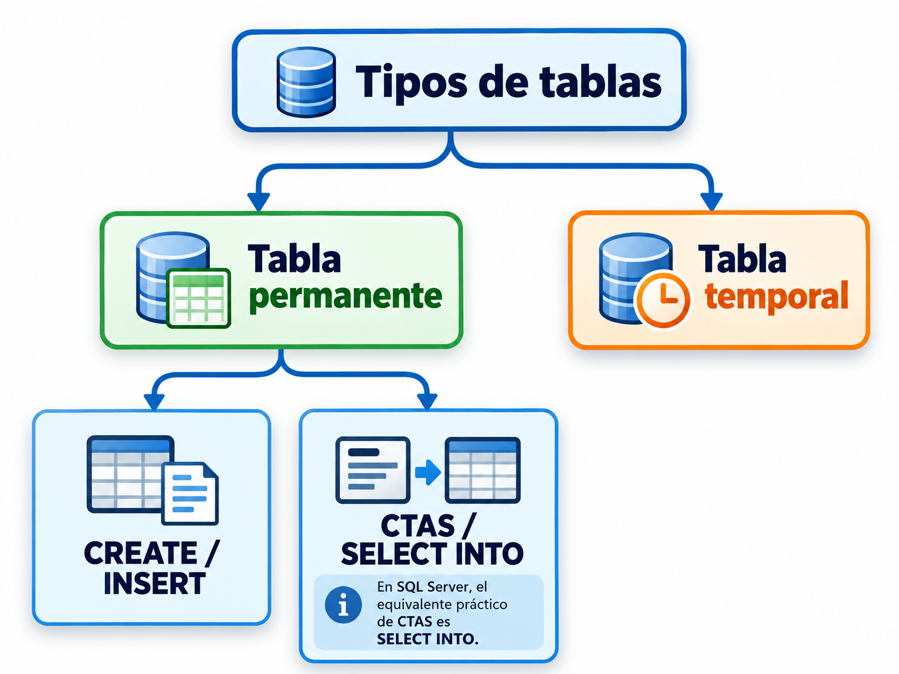

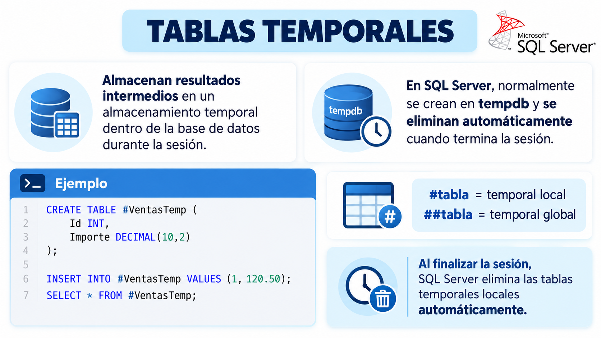

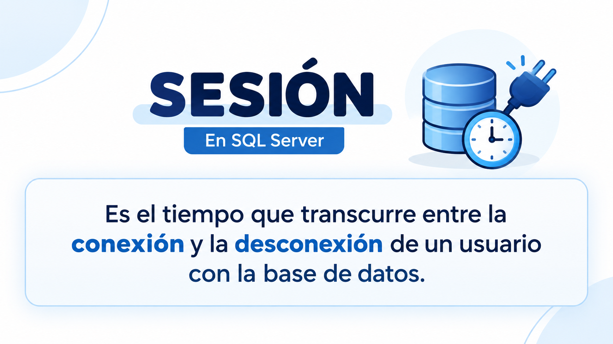

## CTAS vs Tablas temporales

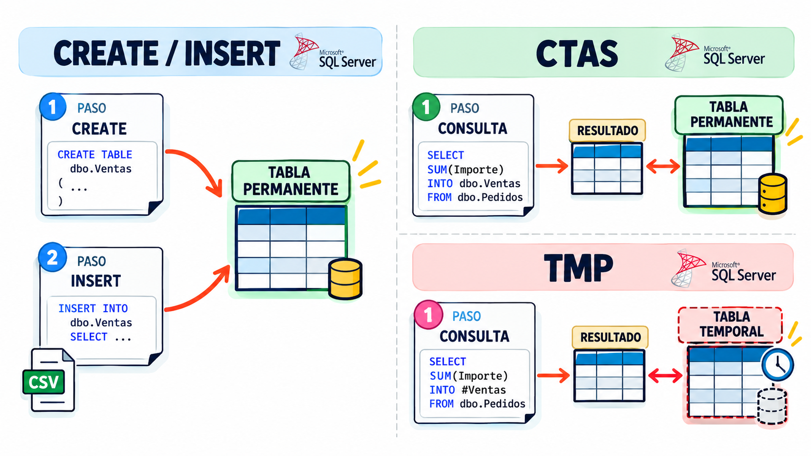

## Syntax

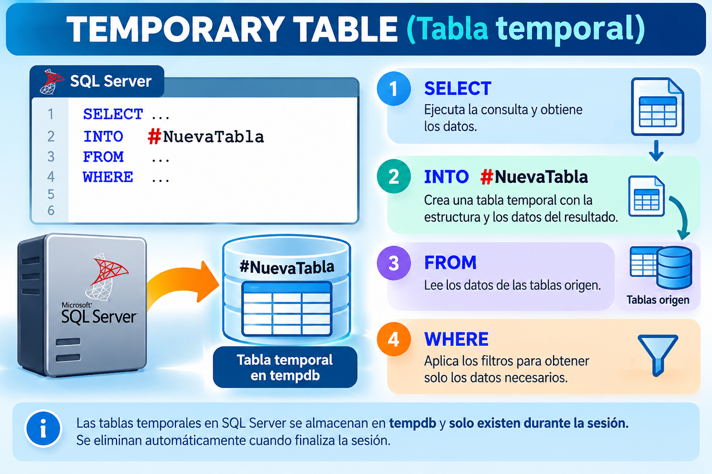

## Casos de uso

### 1. Intermediate results

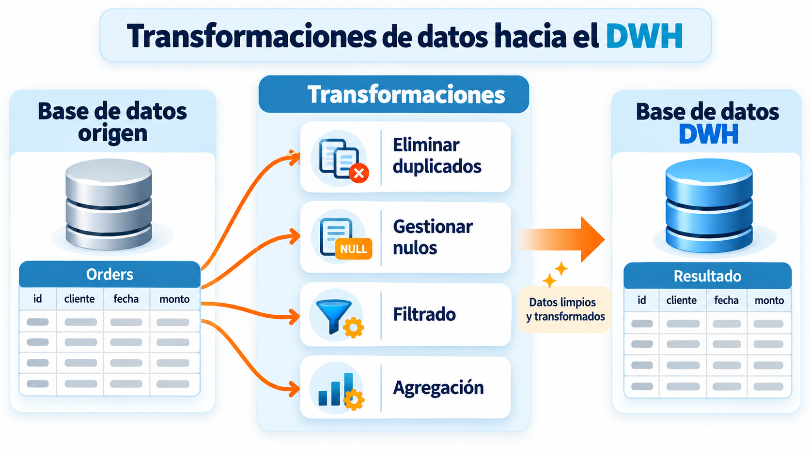

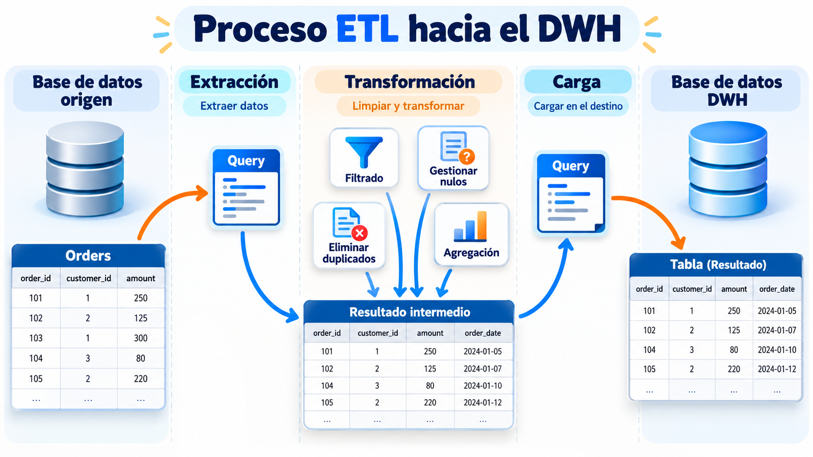

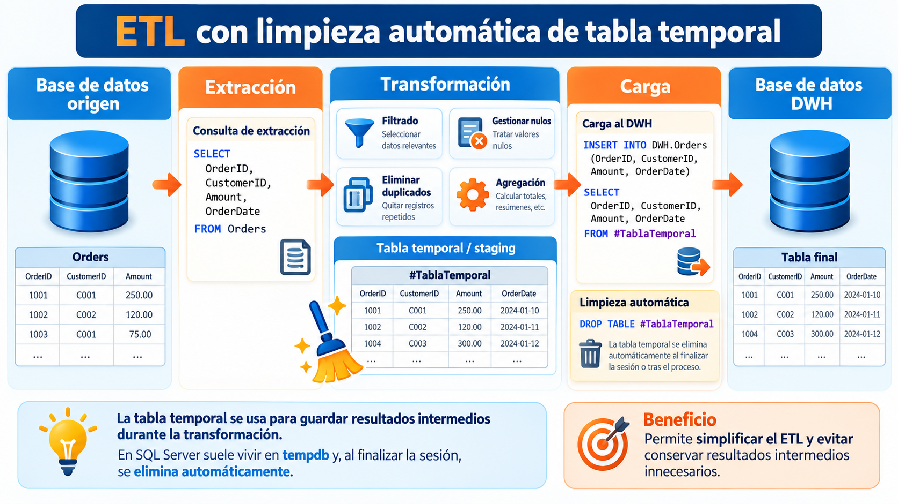

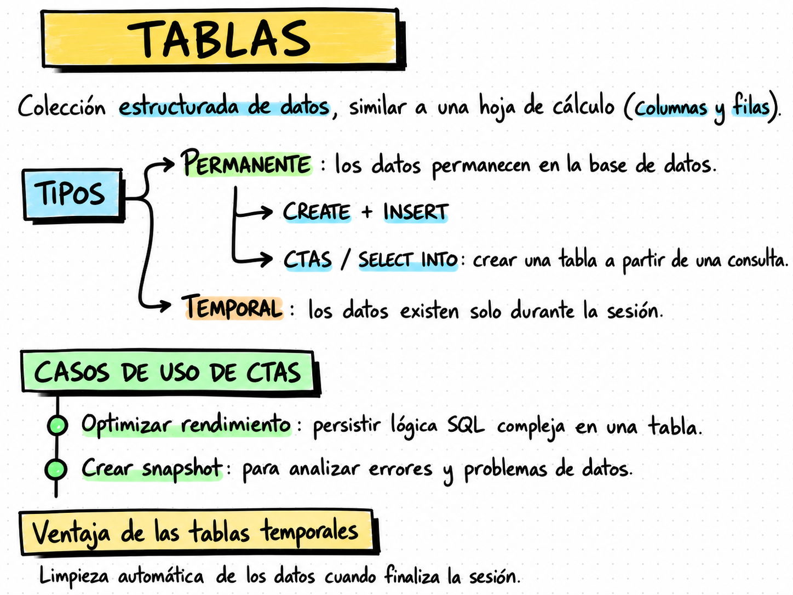

---

## Punto de partida

Seguimos con **Sonora**, la plataforma de streaming musical, y con la base de datos `SonoraDB`. Ejecuta este script antes de empezar. Garantiza el punto de partida (43 reproducciones y 10 usuarios) aunque no hayas hecho las cargas de clases anteriores, y crea los dos lotes nuevos que usaremos hoy. Se puede ejecutar varias veces.

```sql
USE SonoraDB;
GO

-- 1. Cargas de las clases anteriores (idempotentes)
INSERT INTO dbo.reproducciones
    (reproduccion_id, usuario_id, cancion_id, fecha_hora, segundos_escuchados, dispositivo, tipo_contenido)
SELECT s.reproduccion_id, s.usuario_id, s.cancion_id, s.fecha_hora,
       s.segundos_escuchados, s.dispositivo, s.tipo_contenido
FROM dbo.stg_reproducciones AS s
WHERE NOT EXISTS (SELECT 1 FROM dbo.reproducciones AS r WHERE r.reproduccion_id = s.reproduccion_id);

INSERT INTO dbo.usuarios (usuario_id, nombre_usuario, email, pais, plan_suscripcion, fecha_alta)
SELECT s.usuario_id, s.nombre_usuario, s.email, s.pais, s.plan_suscripcion, s.fecha_alta
FROM dbo.stg_usuarios AS s
WHERE NOT EXISTS (SELECT 1 FROM dbo.usuarios AS u WHERE u.usuario_id = s.usuario_id);
GO

-- 2. Lote del 22/09
DROP TABLE IF EXISTS dbo.stg_reproducciones_2209;

CREATE TABLE dbo.stg_reproducciones_2209 (
    reproduccion_id      int,
    usuario_id           int,
    cancion_id           int,
    fecha_hora           datetime2(0),
    segundos_escuchados  int,
    dispositivo          nvarchar(20),
    tipo_contenido       nvarchar(10)
);

INSERT INTO dbo.stg_reproducciones_2209
    (reproduccion_id, usuario_id, cancion_id, fecha_hora, segundos_escuchados, dispositivo, tipo_contenido) VALUES
(37, 5,  NULL, '2026-09-21 22:00', 30,  N'Móvil', N'Anuncio'),
(38, 5,  104,  '2026-09-21 22:01', 190, N'Móvil', N'Canción'),
(39, 8,  106,  '2026-09-22 07:30', 12,  N'Móvil', N'Canción'),
(40, 10, 103,  '2026-09-22 09:00', 176, N'Móvil', N'Canción'),
(41, 9,  NULL, '2026-09-22 09:10', 30,  N'Web',   N'Anuncio'),
(42, 9,  111,  '2026-09-22 09:11', 356, N'Web',   N'Canción'),
(43, 1,  114,  '2026-09-22 10:00', 25,  N'Móvil', N'Canción');

INSERT INTO dbo.reproducciones
    (reproduccion_id, usuario_id, cancion_id, fecha_hora, segundos_escuchados, dispositivo, tipo_contenido)
SELECT s.reproduccion_id, s.usuario_id, s.cancion_id, s.fecha_hora,
       s.segundos_escuchados, s.dispositivo, s.tipo_contenido
FROM dbo.stg_reproducciones_2209 AS s
WHERE NOT EXISTS (SELECT 1 FROM dbo.reproducciones AS r WHERE r.reproduccion_id = s.reproduccion_id);
GO

-- 3. Si resolviste el caso de la clase anterior y no ejecutaste su limpieza, se retira su lote
DELETE FROM dbo.reproducciones WHERE reproduccion_id > 43;
GO

-- 4. Lote de altas de usuarios recibido el 23/09 (se usa en la sección 4 de la teoría)
DROP TABLE IF EXISTS dbo.stg_usuarios_2309;

CREATE TABLE dbo.stg_usuarios_2309 (
    usuario_id        int,
    nombre_usuario    nvarchar(50),
    email             nvarchar(150),
    pais              char(2),
    plan_suscripcion  nvarchar(20),
    fecha_alta        date
);

INSERT INTO dbo.stg_usuarios_2309
    (usuario_id, nombre_usuario, email, pais, plan_suscripcion, fecha_alta) VALUES
(10, N'kiara_perreo', N'kiara.perreo@mail.com', 'PR', N'Premium',  '2026-09-21'),
(11, N'teo.bass',     N'teo.bass@mail.com',     'ES', N'Free',     '2026-09-22'),
(12, N'ines_wave',    N'ines.wave@mail.com',    'CO', N'Premium',  '2026-09-22'),
(12, N'ines_wave',    N'ines.wave@mail.com',    'CO', N'Premium',  '2026-09-22'),
(13, N'rober.mx',     N'rober.mx@mail.com',     'MX', N'Premiun',  '2026-09-23'),
(14, N'cami_ar',      NULL,                     'AR', N'Familiar', '2026-09-23'),
(15, N'lola.pop',     N'lola.pop@mail.com',     'ES', N'Family',   '2026-09-23'),
(16, N'max_techno',   N'max.techno@mail.com',   'CO', N'Free',     '2026-09-23');
GO

-- 5. Lote de novedades de catálogo enviado por los sellos (se usa en los ejercicios 11 y 12)
DROP TABLE IF EXISTS dbo.stg_canciones_2509;

CREATE TABLE dbo.stg_canciones_2509 (
    cancion_id         int,
    titulo             nvarchar(150),
    artista_id         int,
    genero_id          int,
    duracion_seg       int,
    fecha_lanzamiento  date
);

INSERT INTO dbo.stg_canciones_2509
    (cancion_id, titulo, artista_id, genero_id, duracion_seg, fecha_lanzamiento) VALUES
(114, N'Sin Cobertura',  5,  7,  175, '2026-09-18'),
(116, N'Órbita',         9,  2,  192, '2026-09-25'),
(117, N'Asfalto Mojado', 8,  8,  221, '2026-09-25'),
(117, N'Asfalto Mojado', 8,  8,  221, '2026-09-25'),
(118, N'Voltaje',        4,  9,  0,   '2026-09-25'),
(119, N'Bruma',          15, 11, 240, '2026-09-25'),
(120, N'Cumbia Digital', 7,  11, 263, '2026-09-25');
GO

-- 6. Comprobación del punto de partida
SELECT (SELECT COUNT(*) FROM dbo.reproducciones)     AS reproducciones,
       (SELECT COUNT(*) FROM dbo.usuarios)           AS usuarios,
       (SELECT COUNT(*) FROM dbo.canciones)          AS canciones,
       (SELECT COUNT(*) FROM dbo.stg_usuarios_2309)  AS lote_altas,
       (SELECT COUNT(*) FROM dbo.stg_canciones_2509) AS lote_canciones;
```

**Salida esperada de la comprobación:**

| reproducciones | usuarios | canciones | lote_altas | lote_canciones |
| --- | --- | --- | --- | --- |
| 43 | 10 | 15 | 8 | 7 |

> **Regla de negocio de siempre:** una reproducción es **válida** cuando es de tipo `Canción` y se han escuchado al menos 30 segundos. La **semana de análisis** va del 16/09/2026 al 22/09/2026 y se filtra con `fecha_hora >= '2026-09-16' AND fecha_hora < '2026-09-23'`.

> **Trabaja toda la Parte 01 en la misma ventana de consulta de SSMS.** Las tablas temporales viven mientras esa ventana siga abierta. Si la cierras, desaparecen y tendrás que volver a ejecutar el Paso 1 del Ejemplo 1. La llamaremos **ventana 1**.

> Los mensajes de error se muestran en inglés, que es el idioma por defecto de la instancia. Si tu instancia está en español, el número de mensaje (`Msg`) es el mismo aunque cambie el texto.

> En esta clase no se crea ningún objeto nuevo en `SonoraDB` y las tablas de Sonora terminan igual que empiezan: 43 reproducciones, 10 usuarios y 15 canciones.

---

# Parte 01 · Teoría

## 1. Tablas temporales locales (`#tabla`)

### Definición

Una **tabla temporal local** es una tabla real, con sus columnas, sus tipos y sus filas, que tiene tres particularidades:

- Su nombre empieza por una almohadilla: `#validas_semana`.
- **Solo la ve la sesión que la ha creado.** Ninguna otra conexión puede consultarla ni modificarla.
- **Se borra sola** cuando esa sesión se cierra.
No se guarda en `SonoraDB`, sino en **`tempdb`**, una base de datos del sistema que comparte toda la instancia y que SQL Server vacía cada vez que arranca. Da igual en qué base de datos estés trabajando: la tabla temporal siempre va a `tempdb`.

Por lo demás se comporta como cualquier tabla: admite `INSERT`, `UPDATE`, `DELETE`, `ALTER TABLE`, `JOIN` con otras tablas, clave primaria e índices.

**¿Qué es una sesión?** Cada conexión abierta contra SQL Server. En SSMS, **cada ventana de consulta es una sesión distinta**, aunque todas sean tuyas y estén conectadas a la misma base de datos. Cada sesión tiene un número, que SSMS muestra entre paréntesis junto a tu usuario en la barra de estado inferior de la ventana y que también devuelve `SELECT @@SPID`.

**¿Para qué sirve?** Para guardar un **resultado intermedio** que necesitas durante un rato y que no quieres dejar en la base de datos:

- Un cálculo costoso que vas a usar en varias consultas seguidas.
- Un lote de datos que hay que limpiar y validar antes de cargarlo en su tabla definitiva.
- Una prueba que no debe tocar las tablas reales.
Así encaja con lo que ya conocemos:

|  | CTE | Vista | Tabla creada con `SELECT ... INTO` | Tabla temporal local |
| --- | --- | --- | --- | --- |
| ¿Guarda datos? | No | No (salvo que sea indexada) | Sí, en la base de datos | Sí, en `tempdb` |
| ¿Cuánto vive? | Una instrucción | Hasta que se borra con `DROP` | Hasta que se borra con `DROP` | Lo que dure la sesión |
| ¿Quién la ve? | La instrucción que sigue al `WITH` | Cualquier sesión | Cualquier sesión | Solo la sesión que la creó |
| ¿Se recalcula cada vez que se usa? | Sí | Sí | No | No |
| ¿Deja algo que limpiar? | No | Sí | Sí | No |

La tabla temporal ocupa el hueco que quedaba: **guarda el resultado como una tabla, pero no ensucia la base de datos ni molesta a nadie más**.

### Analogía

Reservas una sala de reuniones para trabajar toda la mañana. En la **pizarra de la sala** vas apuntando resultados intermedios: las cifras de la semana, una lista de pendientes, un cálculo a medias. Puedes escribir, corregir y borrar tantas veces como quieras.

- Solo ve la pizarra quien está dentro de **tu** sala.
- La sala de al lado puede tener su propia pizarra con el mismo título, "Cifras de la semana", y no se mezclan.
- Cuando termina la reserva y sales, el personal de limpieza la borra. No tienes que acordarte de hacerlo.
La sala es la sesión, la pizarra es la tabla temporal y el edificio donde están todas las salas es `tempdb`.

### Sintaxis

```sql
-- Forma 1: definir la estructura y después llenarla
CREATE TABLE #nombre (
    columna1  tipo  NOT NULL PRIMARY KEY,
    columna2  tipo  NULL
);

INSERT INTO #nombre (columna1, columna2)
SELECT ... FROM ...;

-- Forma 2: crearla y llenarla a la vez; la estructura se deduce de la consulta
SELECT columnas
INTO #nombre
FROM ...;

-- Usarla como cualquier tabla
SELECT ... FROM #nombre AS t JOIN dbo.otra_tabla AS o ON ...;

-- Borrarla antes de que termine la sesión (opcional)
DROP TABLE IF EXISTS #nombre;
```

**Reglas de T-SQL que conviene recordar:**

- El nombre empieza por `#` y admite como máximo **116 caracteres**. No hace falta escribir `dbo.` delante.
- Vive hasta que la sesión se cierra o hasta que la borras con `DROP TABLE`. **Sobrevive a ****`GO`**: los lotes siguientes de la misma ventana la siguen viendo.
- Si intentas crearla y ya existe en tu sesión, aparece el error **Msg 2714** (*There is already an object named...*). Por eso los scripts empiezan con `DROP TABLE IF EXISTS #nombre;`.
- Si la consultas desde otra sesión, o después de cerrar la tuya, aparece el error **Msg 208** (*Invalid object name*).
- Dentro de un mismo lote no puede haber **dos instrucciones que creen la misma tabla temporal**, aunque haya un `DROP` entre ellas. Hay que separarlas con `GO` o usar nombres distintos.
- Admite `PRIMARY KEY`, `UNIQUE`, `CHECK`, `DEFAULT`, `NOT NULL` e índices. **No admite ****`FOREIGN KEY`**: si la escribes, SQL Server crea la tabla, se salta la restricción y avisa con un mensaje.
- **No pongas nombre a las restricciones** de una tabla temporal (`CONSTRAINT PK_lote PRIMARY KEY`). El nombre de la tabla es privado de cada sesión, pero el de la restricción no: si dos sesiones ejecutan el mismo script a la vez, la segunda falla con Msg 2714.
- Una vista no puede leer de una tabla temporal (error **Msg 4508**).
### Ejemplo 1. Guardar un resultado y reutilizarlo en varias consultas

**Pregunta de negocio:** Carmen Lozano (Data Analyst) prepara el informe de la semana de análisis. Necesita tres cifras distintas sobre las mismas reproducciones válidas: el reparto por plan, el reparto por dispositivo y las tres canciones más escuchadas.

Con una CTE habría que repetir el `WITH` completo en cada una de las tres consultas, porque una CTE solo vive durante una instrucción, y SQL Server volvería a leer y filtrar `reproducciones` las tres veces. Con una tabla temporal, el filtro se ejecuta **una sola vez**.

**Paso 1.** Guardar las reproducciones válidas de la semana en una tabla temporal. Es el mismo `SELECT ... INTO` de la clase anterior, con una tabla `#` como destino:

```sql
DROP TABLE IF EXISTS #validas_semana;

SELECT r.reproduccion_id, r.usuario_id, r.cancion_id, r.fecha_hora,
       r.segundos_escuchados, r.dispositivo
INTO #validas_semana
FROM dbo.reproducciones AS r
WHERE r.tipo_contenido = N'Canción'
  AND r.segundos_escuchados >= 30
  AND r.fecha_hora >= '2026-09-16'
  AND r.fecha_hora <  '2026-09-23';
```

**Salida esperada (pestaña Messages de SSMS):** `(22 rows affected)`.

**Paso 2.** Primera consulta, el reparto por plan:

```sql
SELECT u.plan_suscripcion,
       COUNT(*) AS reproducciones,
       CAST(SUM(v.segundos_escuchados) / 60.0 AS decimal(6,1)) AS minutos
FROM #validas_semana AS v
JOIN dbo.usuarios AS u ON u.usuario_id = v.usuario_id
GROUP BY u.plan_suscripcion
ORDER BY reproducciones DESC;
```

**Salida esperada:**

| plan_suscripcion | reproducciones | minutos |
| --- | --- | --- |
| Premium | 12 | 39.5 |
| Free | 8 | 29.3 |
| Familiar | 2 | 5.6 |

**Paso 3.** Segunda consulta, en otra instrucción distinta, el reparto por dispositivo. La tabla sigue ahí:

```sql
SELECT dispositivo,
       COUNT(*) AS reproducciones,
       CAST(SUM(segundos_escuchados) / 60.0 AS decimal(6,1)) AS minutos
FROM #validas_semana
GROUP BY dispositivo
ORDER BY reproducciones DESC, dispositivo;
```

**Salida esperada:**

| dispositivo | reproducciones | minutos |
| --- | --- | --- |
| Móvil | 12 | 36.6 |
| Smart TV | 4 | 12.1 |
| Web | 4 | 17.0 |
| Escritorio | 2 | 8.7 |

**Paso 4.** Tercera consulta, las tres canciones más escuchadas:

```sql
SELECT TOP (3) c.titulo, a.nombre AS artista, COUNT(*) AS reproducciones
FROM #validas_semana AS v
JOIN dbo.canciones AS c ON c.cancion_id = v.cancion_id
JOIN dbo.artistas  AS a ON a.artista_id = c.artista_id
GROUP BY c.titulo, a.nombre
ORDER BY reproducciones DESC, c.titulo;
```

**Salida esperada:**

| titulo | artista | reproducciones |
| --- | --- | --- |
| Perreo Lunar | MC Brisa | 4 |
| Galaxia Dembow | MC Brisa | 3 |
| Cables Sueltos | Los Voltios | 2 |

> La regla de negocio (canción, 30 segundos, semana) está escrita en un único sitio. Si mañana cambia el criterio, se corrige el Paso 1 y las tres consultas siguen valiendo.

> `#validas_semana` es una **foto**: si después de crearla entra una reproducción nueva en `reproducciones`, la tabla temporal no se entera. Para refrescarla hay que volver a ejecutar el Paso 1.

### Ejemplo 2. Definir la estructura con `CREATE TABLE`

**Pregunta de negocio:** Carmen quiere ahora una ficha de actividad por usuario (reproducciones y minutos de la semana) para consultarla varias veces. Como va a ser la base de otros cálculos, conviene controlar la estructura: tipos exactos, columnas obligatorias y una fila por usuario como máximo.

**Paso 1.** Crear la tabla temporal con su estructura y llenarla a partir de la tabla temporal del Ejemplo 1:

```sql
DROP TABLE IF EXISTS #actividad_usuario;

CREATE TABLE #actividad_usuario (
    usuario_id      int           NOT NULL PRIMARY KEY,
    reproducciones  int           NOT NULL,
    minutos         decimal(6,1)  NOT NULL
);

INSERT INTO #actividad_usuario (usuario_id, reproducciones, minutos)
SELECT usuario_id,
       COUNT(*),
       CAST(SUM(segundos_escuchados) / 60.0 AS decimal(6,1))
FROM #validas_semana
GROUP BY usuario_id;
```

**Salida esperada (Messages):** `(9 rows affected)`.

**Paso 2.** Usarla: ¿qué usuarios han escuchado más minutos que la media de la semana?

```sql
SELECT u.nombre_usuario, a.reproducciones, a.minutos,
       CAST((SELECT AVG(minutos) FROM #actividad_usuario) AS decimal(6,1)) AS media_semana
FROM #actividad_usuario AS a
JOIN dbo.usuarios AS u ON u.usuario_id = a.usuario_id
WHERE a.minutos > (SELECT AVG(minutos) FROM #actividad_usuario)
ORDER BY a.minutos DESC;
```

**Salida esperada:**

| nombre_usuario | reproducciones | minutos | media_semana |
| --- | --- | --- | --- |
| juanpi | 4 | 15.9 | 8.3 |
| lucia.m | 4 | 12.1 | 8.3 |
| nachox | 3 | 9.7 | 8.3 |
| alexbeats | 3 | 8.7 | 8.3 |

**Paso 3.** Comprobar que la clave primaria protege la tabla. Ejecuta otra vez **solo el ****`INSERT`** del Paso 1:

**Salida esperada:** error **Msg 2627** (*Violation of PRIMARY KEY constraint... Cannot insert duplicate key...*). No se inserta ninguna fila y la tabla sigue con 9.

> En la subconsulta de la media aparece dos veces `#actividad_usuario`. Con una CTE, SQL Server habría calculado la agregación dos veces; aquí lee dos veces una tabla de 9 filas que ya está calculada.

¿Cuándo usar cada forma de crearla?

|  | `SELECT ... INTO #tabla` | `CREATE TABLE #tabla` + `INSERT` |
| --- | --- | --- |
| Estructura | Se deduce de la consulta | La decides tú |
| Clave primaria y restricciones | No se crean | Las que definas |
| Código | Una instrucción | Dos instrucciones |
| Úsala cuando... | Necesitas un resultado intermedio rápido | La tabla es la base de varios pasos y quieres garantías sobre sus datos |

### Ejemplo 3. Alcance y fin de vida: la sesión

**Contexto:** Elena Ruiz (Data Engineer) quiere confirmar que su tabla temporal no la ve nadie más y que no choca con la de otro compañero que use el mismo nombre.

**Paso 1.** En la ventana 1, comprobar el número de sesión:

```sql
SELECT @@SPID AS sesion;
```

**Salida esperada:** un número, por ejemplo **57**. Es el mismo que aparece entre paréntesis en la barra de estado inferior de la ventana. En tu equipo será otro.

**Paso 2.** Abre una ventana nueva con **New Query** (`Ctrl+N`). La llamaremos **ventana 2**. Ejecuta en ella:

```sql
USE SonoraDB;

SELECT @@SPID AS sesion;

SELECT COUNT(*) AS filas FROM #validas_semana;
```

**Salida esperada:** un número de sesión distinto, por ejemplo **63**, y a continuación el error **Msg 208** (*Invalid object name '#validas_semana'*). La tabla existe, pero es de la otra sesión.

**Paso 3.** En la ventana 2, crear una tabla temporal **con el mismo nombre** y otro contenido (solo las reproducciones desde la web):

```sql
SELECT reproduccion_id, usuario_id, cancion_id
INTO #validas_semana
FROM dbo.reproducciones
WHERE tipo_contenido = N'Canción'
  AND segundos_escuchados >= 30
  AND fecha_hora >= '2026-09-16'
  AND fecha_hora <  '2026-09-23'
  AND dispositivo = N'Web';

SELECT COUNT(*) AS filas FROM #validas_semana;
```

**Salida esperada en la ventana 2:** `(4 rows affected)` y después:

filas

---

4

---

No hay conflicto. Si ejecutas `SELECT COUNT(*) AS filas FROM #validas_semana;` en la ventana 1, sigue devolviendo **22**. Cada sesión ve la suya.

**Paso 4.** Ver cómo lo consigue SQL Server. Desde cualquiera de las dos ventanas:

```sql
SELECT TABLE_NAME
FROM tempdb.INFORMATION_SCHEMA.TABLES
WHERE TABLE_NAME LIKE N'#validas%';
```

**Salida esperada:** dos filas. Cada nombre empieza por `#validas_semana`, sigue con una larga serie de guiones bajos y termina en un sufijo distinto, por ejemplo `...___00000000002B` y `...___00000000002C`. SQL Server añade ese sufijo para distinguir las tablas de cada sesión. Por eso el nombre que tú escribes no puede pasar de 116 caracteres.

**Paso 5.** Cierra la ventana 2 (cuando SSMS pregunte si quieres guardar, responde que no). Vuelve a la ventana 1 y repite la consulta del Paso 4.

**Salida esperada:** una sola fila. Al cerrarse la sesión de la ventana 2, SQL Server ha borrado su tabla temporal sin que nadie se lo pida.

> Esta es la razón por la que dos personas, o dos ejecuciones simultáneas de la misma carga, pueden usar `#lote` a la vez sin pisarse. Con una tabla normal llamada `dbo.lote` se estarían borrando los datos la una a la otra.

### Ejemplo 4. Scripts que se pueden ejecutar varias veces

**Contexto:** una tabla temporal dura toda la sesión. Eso es cómodo, pero obliga a escribir los scripts pensando en que la tabla puede seguir ahí de una ejecución anterior.

**Paso 1.** Comprobar que la tabla sobrevive a `GO`. En la ventana 1:

```sql
SELECT COUNT(*) AS filas FROM #validas_semana;
GO

SELECT COUNT(*) AS filas FROM #validas_semana;
GO
```

**Salida esperada:** **22** en los dos lotes. `GO` termina un lote, no la sesión.

**Paso 2.** Intentar crearla otra vez sin borrarla antes:

```sql
SELECT reproduccion_id
INTO #validas_semana
FROM dbo.reproducciones;
```

**Salida esperada:** error **Msg 2714** (*There is already an object named '#validas_semana' in the database*). La tabla original no se toca.

**Paso 3.** El patrón correcto: borrar si existe y crear. Este bloque se puede ejecutar tantas veces como haga falta:

```sql
DROP TABLE IF EXISTS #moviles;

SELECT reproduccion_id, usuario_id
INTO #moviles
FROM #validas_semana
WHERE dispositivo = N'Móvil';
```

**Salida esperada (Messages):** `(12 rows affected)`, en la primera ejecución y en todas las siguientes.

**Paso 4.** Una limitación que sorprende. Este lote borra la tabla y la vuelve a crear con otra estructura:

```sql
DROP TABLE IF EXISTS #moviles;

SELECT reproduccion_id
INTO #moviles
FROM #validas_semana
WHERE dispositivo = N'Móvil';

DROP TABLE #moviles;

SELECT reproduccion_id, usuario_id, cancion_id
INTO #moviles
FROM #validas_semana
WHERE dispositivo = N'Móvil';
```

**Salida esperada:** error **Msg 2714** y no se ejecuta ninguna instrucción del lote. SQL Server revisa el lote entero antes de empezar y no acepta que la misma tabla temporal se cree dos veces en él, aunque haya un `DROP` en medio.

**Paso 5.** La solución es separar las dos creaciones en lotes distintos con `GO`:

```sql
DROP TABLE IF EXISTS #moviles;

SELECT reproduccion_id
INTO #moviles
FROM #validas_semana
WHERE dispositivo = N'Móvil';
GO

DROP TABLE #moviles;

SELECT reproduccion_id, usuario_id, cancion_id
INTO #moviles
FROM #validas_semana
WHERE dispositivo = N'Móvil';
GO
```

**Salida esperada (Messages):** `(12 rows affected)` dos veces.

> **Regla práctica:** cada tabla temporal de un script se crea una sola vez, precedida de su `DROP TABLE IF EXISTS`. Si necesitas una versión distinta, dale otro nombre.

### Ejemplo 5. Una tabla temporal se modifica como cualquier tabla

**Pregunta de negocio:** Laura Gil (Marketing) quiere segmentar a los oyentes de la semana para una campaña: **Intensivo** si ha escuchado 10 minutos o más, **Habitual** si ha escuchado entre 6 y 10, y **Ocasional** el resto. La campaña solo irá a intensivos y habituales. Hay que probar la segmentación sin tocar ninguna tabla de Sonora.

**Paso 1.** Añadir una columna a la tabla temporal del Ejemplo 2:

```sql
ALTER TABLE #actividad_usuario ADD segmento nvarchar(10) NULL;
GO
```

> El `GO` es necesario si vas a usar la columna nueva a continuación. SQL Server revisa cada lote antes de ejecutarlo, y en ese momento la columna `segmento` todavía no existe.

**Paso 2.** Rellenar la columna:

```sql
UPDATE #actividad_usuario
SET segmento = CASE
                   WHEN minutos >= 10 THEN N'Intensivo'
                   WHEN minutos >= 6  THEN N'Habitual'
                   ELSE N'Ocasional'
               END;
```

**Salida esperada (Messages):** `(9 rows affected)`.

**Paso 3.** Quitar a los que no entran en la campaña:

```sql
DELETE FROM #actividad_usuario
WHERE segmento = N'Ocasional';
```

**Salida esperada (Messages):** `(3 rows affected)`.

**Paso 4.** Ver el resultado:

```sql
SELECT u.nombre_usuario, u.plan_suscripcion, a.minutos, a.segmento
FROM #actividad_usuario AS a
JOIN dbo.usuarios AS u ON u.usuario_id = a.usuario_id
ORDER BY a.minutos DESC;
```

**Salida esperada:**

| nombre_usuario | plan_suscripcion | minutos | segmento |
| --- | --- | --- | --- |
| juanpi | Premium | 15.9 | Intensivo |
| lucia.m | Premium | 12.1 | Intensivo |
| nachox | Free | 9.7 | Habitual |
| alexbeats | Premium | 8.7 | Habitual |
| marta_rock | Free | 7.2 | Habitual |
| dani_dj | Free | 6.5 | Habitual |

**Paso 5.** Comprobar que Sonora no se ha enterado de nada:

```sql
SELECT (SELECT COUNT(*) FROM dbo.usuarios)       AS usuarios,
       (SELECT COUNT(*) FROM dbo.reproducciones) AS reproducciones;
```

**Salida esperada:**

| usuarios | reproducciones |
| --- | --- |
| 10 | 43 |

> Hemos añadido una columna, actualizado y borrado filas, y en `SonoraDB` no ha cambiado nada. Una tabla temporal es un banco de pruebas: si la segmentación no convence, se vuelve a crear desde el Ejemplo 2 y se prueba otra.

### Ejemplo 6. Lo que una tabla temporal no admite

**Contexto:** el equipo de producto está diseñando la función "canciones favoritas". Elena prueba la estructura en una tabla temporal antes de proponerla.

**Paso 1.** Crear la tabla con claves ajenas a `usuarios` y `canciones`:

```sql
DROP TABLE IF EXISTS #favoritas;

CREATE TABLE #favoritas (
    usuario_id  int NOT NULL REFERENCES dbo.usuarios (usuario_id),
    cancion_id  int NOT NULL REFERENCES dbo.canciones (cancion_id),
    PRIMARY KEY (usuario_id, cancion_id)
);
```

**Salida esperada (Messages):** avisos que empiezan por *Skipping FOREIGN KEY constraint...* y terminan en *FOREIGN KEY constraints are not enforced on local or global temporary tables*. No es un error: la tabla se crea, pero **sin** las claves ajenas.

**Paso 2.** Comprobar la consecuencia. El usuario 999 no existe:

```sql
INSERT INTO #favoritas (usuario_id, cancion_id) VALUES (999, 101);

SELECT usuario_id, cancion_id FROM #favoritas;
```

**Salida esperada:** `(1 row affected)` y la fila aparece:

| usuario_id | cancion_id |
| --- | --- |
| 999 | 101 |

La clave primaria sí funciona (prueba a ejecutar el `INSERT` otra vez y verás el error Msg 2627), pero nada impide guardar un usuario inexistente.

**Paso 3.** Intentar crear una vista sobre una tabla temporal. Ejecuta este bloque solo, sin nada más seleccionado:

```sql
CREATE VIEW dbo.v_validas_semana AS
SELECT reproduccion_id, usuario_id, cancion_id
FROM #validas_semana;
```

**Salida esperada:** error **Msg 4508** (*Views or functions are not allowed on temporary tables. Table names that begin with '#' denote temporary tables*). Tiene sentido: una vista es un objeto permanente que cualquier sesión puede consultar, y no puede depender de una tabla que solo ve una sesión y que va a desaparecer.

> **Consecuencia para ingeniería de datos:** en una tabla temporal, la integridad referencial la compruebas tú, con `EXISTS` y `NOT EXISTS`. Lo haremos en la sección 4.

---

## 2. Tablas temporales globales (`##tabla`)

### Definición

Una **tabla temporal global** se escribe con dos almohadillas (`##top_semana`) y se diferencia de la local en dos cosas:

- **La ven todas las sesiones** de la instancia. Cualquier conexión puede consultarla, modificarla e incluso borrarla.
- **Se borra sola** cuando se cierra la sesión que la creó **y** ninguna otra sesión está ejecutando en ese momento una instrucción que la use.
También se guarda en `tempdb`. Como es visible para todos, su nombre **no** lleva sufijo: si dos sesiones intentan crear `##top_semana`, la segunda falla.

Se usa mucho menos que la local. Sirve para **compartir un resultado puntual entre sesiones** sin crear una tabla en la base de datos: enseñarle unas cifras a un compañero para que las revise, o dejar un resultado a la vista mientras se depura un proceso.

### Analogía

Si la tabla local es la pizarra de tu sala de reuniones, la tabla global es la **pizarra del pasillo**. Cualquiera que pase puede leerla, añadir algo o borrar una línea. Solo puede haber una pizarra con ese título en el pasillo. Y cuando quien la colgó se marcha de la oficina, se retira, salvo que en ese instante haya alguien leyéndola: entonces se espera a que termine.

### Sintaxis

```sql
-- Crear (las mismas dos formas que con una local)
CREATE TABLE ##nombre (columna tipo, ...);

SELECT columnas
INTO ##nombre
FROM ...;

-- Usar desde cualquier sesión
SELECT ... FROM ##nombre;

-- Borrar
DROP TABLE IF EXISTS ##nombre;
```

**Reglas de T-SQL que conviene recordar:**

- El nombre empieza por `##` y es **único en toda la instancia**. Si ya existe, creada por ti o por otra persona, aparece el error **Msg 2714**.
- Cualquier sesión puede leerla, modificarla y borrarla. **No pongas en ella datos que no deba ver todo el que tenga acceso a la instancia** (emails, datos personales).
- Desaparece cuando termina la sesión que la creó. Las demás sesiones reciben entonces el error **Msg 208** al consultarla.
- No sirve para procesos que se ejecutan varias veces a la vez: todas las ejecuciones compartirían la misma tabla. Para eso están las locales.
- Igual que las locales, no admite `FOREIGN KEY` ni puede usarse en una vista.
### Ejemplo 7. Compartir un resultado con otra sesión

**Contexto:** Elena ha calculado las cinco canciones más escuchadas de la semana. Laura Gil quiere revisarlas desde su equipo antes de usarlas en la newsletter. No tiene sentido crear una tabla en `SonoraDB` para una revisión de diez minutos.

**Paso 1.** En la ventana 1 (la de Elena), crear la tabla global a partir de la local:

```sql
DROP TABLE IF EXISTS ##top_semana;

SELECT TOP (5) c.titulo, a.nombre AS artista, COUNT(*) AS reproducciones
INTO ##top_semana
FROM #validas_semana AS v
JOIN dbo.canciones AS c ON c.cancion_id = v.cancion_id
JOIN dbo.artistas  AS a ON a.artista_id = c.artista_id
GROUP BY c.titulo, a.nombre
ORDER BY reproducciones DESC, c.titulo;
```

**Salida esperada (Messages):** `(5 rows affected)`.

**Paso 2.** Abre una ventana nueva (`Ctrl+N`), que hará de sesión de Laura. La llamaremos **ventana 2**. Consulta la tabla:

```sql
SELECT titulo, artista, reproducciones
FROM ##top_semana
ORDER BY reproducciones DESC, titulo;
```

**Salida esperada en la ventana 2:**

| titulo | artista | reproducciones |
| --- | --- | --- |
| Perreo Lunar | MC Brisa | 4 |
| Galaxia Dembow | MC Brisa | 3 |
| Cables Sueltos | Los Voltios | 2 |
| Calle 23 | MC Brisa | 2 |
| Corriente Alterna | Los Voltios | 2 |

**Paso 3.** Laura sabe que Los Voltios están renegociando su contrato y no deben aparecer en la newsletter. Los quita desde la ventana 2:

```sql
DELETE FROM ##top_semana
WHERE artista = N'Los Voltios';
```

**Salida esperada (Messages):** `(2 rows affected)`.

**Paso 4.** Vuelve a la ventana 1 y consulta:

```sql
SELECT titulo, artista, reproducciones
FROM ##top_semana
ORDER BY reproducciones DESC, titulo;
```

**Salida esperada en la ventana 1:**

| titulo | artista | reproducciones |
| --- | --- | --- |
| Perreo Lunar | MC Brisa | 4 |
| Galaxia Dembow | MC Brisa | 3 |
| Calle 23 | MC Brisa | 2 |

> Las dos sesiones trabajan sobre **la misma** tabla. Eso es lo que la hace útil para compartir, y también lo que la hace peligrosa: Laura ha borrado dos filas de una tabla de Elena sin pedir permiso a nadie.

### Ejemplo 8. Nombre único y fin de vida de una tabla global

**No cierres todavía la ventana 2.**

**Paso 1.** En la ventana 2, intentar crear una tabla global con un nombre que ya existe:

```sql
CREATE TABLE ##top_semana (titulo nvarchar(150) NOT NULL);
```

**Salida esperada:** error **Msg 2714** (*There is already an object named '##top_semana' in the database*). Con una tabla local esto habría funcionado; con una global, el nombre es de todos.

**Paso 2.** En la ventana 2, Laura crea su propia tabla global con una nota para Elena:

```sql
CREATE TABLE ##notas_campana (nota nvarchar(100) NOT NULL);

INSERT INTO ##notas_campana (nota)
VALUES (N'He quitado a Los Voltios de la propuesta');
```

**Paso 3.** En la ventana 1, Elena la lee:

```sql
SELECT nota FROM ##notas_campana;
```

**Salida esperada en la ventana 1:**

nota

---

He quitado a Los Voltios de la propuesta

---

**Paso 4.** Cierra la ventana 2 sin guardar. Vuelve a la ventana 1 y repite la consulta del Paso 3.

**Salida esperada:** error **Msg 208** (*Invalid object name '##notas_campana'*). La sesión que creó la tabla ha terminado y SQL Server la ha borrado, aunque otra sesión la estuviera usando un momento antes.

**Paso 5.** `##top_semana` sigue existiendo, porque la creó la ventana 1 y esa sesión sigue abierta. Como ya no hace falta, Elena la borra:

```sql
DROP TABLE IF EXISTS ##top_semana;
```

> **Regla práctica:** una tabla global se crea para un momento concreto y se borra con `DROP` en cuanto ha cumplido su función. No la dejes viva "por si acaso": ocupa un nombre que nadie más puede usar y cualquiera puede cambiarla.

---

## 3. Variables de tabla (`@tabla`)

### Definición

Una **variable de tabla** es una tabla pequeña que se **declara** con `DECLARE`, lleva una arroba delante del nombre (`@mercados`) y solo existe **durante el lote** en el que se declara. Cuando el lote termina (al llegar a un `GO` o al final de lo que has ejecutado), desaparece.

Es la más efímera de las tres. Está pensada para **listas cortas de valores** que necesitas en una consulta y que no están en ninguna tabla: una equivalencia de códigos, una lista de países, una tabla de tarifas.

Dos ideas para no llevarse sorpresas:

- **No vive "en memoria".** Igual que las tablas temporales, se guarda en `tempdb`.
- **No participa en las transacciones.** Un `ROLLBACK` no deshace lo que se ha escrito en una variable de tabla.
### Analogía

Si la tabla temporal es la pizarra de la sala, la variable de tabla es un **pósit**. Apuntas en él cuatro datos para la intervención que estás haciendo, lo usas mientras hablas y lo tiras al terminar. Caben pocas cosas y, una vez escrito, no le puedes añadir columnas.

Tiene además una propiedad curiosa. Si en mitad de la reunión alguien dice "borrad todo lo que hemos apuntado en la última media hora", se borra la pizarra, pero **el pósit sigue en tu mano** con lo que habías escrito.

### Sintaxis

```sql
-- Declarar: la estructura se define aquí y ya no se puede cambiar
DECLARE @nombre TABLE (
    columna1  tipo  NOT NULL PRIMARY KEY,
    columna2  tipo  NULL
);

-- Llenar
INSERT INTO @nombre (columna1, columna2)
VALUES (valor, valor), (valor, valor);

-- Usar: en un JOIN siempre con alias
SELECT t.columna1, v.columna2
FROM dbo.tabla AS t
JOIN @nombre AS v ON v.columna1 = t.columna1;
```

**Reglas de T-SQL que conviene recordar:**

- **El ****`DECLARE`****, el ****`INSERT`**** y la consulta que la usa deben ejecutarse juntos**, en el mismo lote. Si seleccionas y ejecutas solo la consulta, aparece el error **Msg 1087** (*Must declare the table variable*).
- No se puede crear con `SELECT ... INTO @nombre`. Siempre `DECLARE` y después `INSERT`.
- No admite `ALTER TABLE` ni `DROP TABLE`. Su estructura, incluida la clave primaria, se define entera en el `DECLARE`.
- Para referirte a sus columnas en un `JOIN` necesitas un alias: `JOIN @mercados AS m`.
- `ROLLBACK` no deshace sus cambios.
- Úsala con **pocas filas**. SQL Server sabe cuántas filas tiene una tabla `#temporal` y cómo se reparten sus valores, y con eso decide cómo ejecutar los `JOIN`. De una variable de tabla sabe mucho menos, y con miles de filas las consultas pueden ir bastante más lentas.
### Ejemplo 9. Una lista corta de equivalencias

**Pregunta de negocio:** Nuria Campos (CMO) quiere comparar la semana en los dos grandes mercados de Sonora: **España** y **Latinoamérica**. En `SonoraDB` solo hay códigos de país; la agrupación en mercados no está en ninguna tabla.

Ejecuta el bloque completo de una vez:

```sql
DECLARE @mercados TABLE (
    pais     char(2)       NOT NULL PRIMARY KEY,
    mercado  nvarchar(20)  NOT NULL
);

INSERT INTO @mercados (pais, mercado) VALUES
('ES', N'España'),
('MX', N'Latinoamérica'),
('AR', N'Latinoamérica'),
('CO', N'Latinoamérica'),
('PR', N'Latinoamérica');

SELECT m.mercado,
       COUNT(*) AS reproducciones,
       COUNT(DISTINCT v.usuario_id) AS oyentes,
       CAST(SUM(v.segundos_escuchados) / 60.0 AS decimal(6,1)) AS minutos
FROM #validas_semana AS v
JOIN dbo.usuarios AS u ON u.usuario_id = v.usuario_id
JOIN @mercados    AS m ON m.pais = u.pais
GROUP BY m.mercado
ORDER BY minutos DESC;
```

**Salida esperada:**

| mercado | reproducciones | oyentes | minutos |
| --- | --- | --- | --- |
| Latinoamérica | 12 | 5 | 40.5 |
| España | 10 | 4 | 33.9 |

> En una misma consulta conviven una tabla temporal (`#validas_semana`), una tabla de Sonora (`usuarios`) y una variable de tabla (`@mercados`). Para el `JOIN` son tres tablas más.

> Si mañana Sonora abre Chile, basta con añadir una fila `('CL', N'Latinoamérica')`. La consulta no cambia.

### Ejemplo 10. Alcance: el lote

**Contexto:** el error más frecuente con variables de tabla no tiene que ver con SQL, sino con qué parte del script se ejecuta.

**Paso 1.** Ejecuta este script completo. Fíjate en el `GO` que hay en medio:

```sql
DECLARE @planes_pago TABLE (plan_suscripcion nvarchar(20) NOT NULL PRIMARY KEY);

INSERT INTO @planes_pago (plan_suscripcion)
VALUES (N'Premium'), (N'Familiar');
GO

SELECT COUNT(*) AS usuarios_pago
FROM dbo.usuarios AS u
JOIN @planes_pago AS p ON p.plan_suscripcion = u.plan_suscripcion;
GO
```

**Salida esperada:** el primer lote devuelve `(2 rows affected)` y el segundo falla con el error **Msg 1087** (*Must declare the table variable "@planes_pago"*). El `GO` ha cerrado el lote y la variable ha desaparecido con él.

**Paso 2.** Quitar el `GO` intermedio y ejecutar todo junto:

```sql
DECLARE @planes_pago TABLE (plan_suscripcion nvarchar(20) NOT NULL PRIMARY KEY);

INSERT INTO @planes_pago (plan_suscripcion)
VALUES (N'Premium'), (N'Familiar');

SELECT COUNT(*) AS usuarios_pago
FROM dbo.usuarios AS u
JOIN @planes_pago AS p ON p.plan_suscripcion = u.plan_suscripcion;
```

**Salida esperada:**

usuarios_pago

---

6

---

**Paso 3.** Selecciona con el ratón **solo el ****`SELECT`** del Paso 2 y pulsa `F5`.

**Salida esperada:** otra vez el error **Msg 1087**. Lo que seleccionas y ejecutas en SSMS es un lote, y en ese lote no hay ningún `DECLARE`.

> Compara con el Ejemplo 4: una tabla `#temporal` sobrevive a `GO` y a ejecuciones sucesivas; una variable de tabla, no. Si necesitas ir ejecutando el trabajo paso a paso, como hacemos en clase, la tabla `#temporal` es más cómoda.

### Ejemplo 11. Transacciones: la tabla temporal se deshace, la variable no

**Contexto:** Elena quiere probar un borrado sobre `#validas_semana` y dejar anotado lo que ha hecho, aunque al final deshaga la prueba.

Ejecuta el bloque completo de una vez:

```sql
DECLARE @bitacora TABLE (
    paso   nvarchar(60)  NOT NULL,
    filas  int           NOT NULL
);

BEGIN TRAN;

    INSERT INTO @bitacora (paso, filas)
    SELECT N'Reproducciones de Móvil borradas', COUNT(*)
    FROM #validas_semana
    WHERE dispositivo = N'Móvil';

    DELETE FROM #validas_semana
    WHERE dispositivo = N'Móvil';

ROLLBACK;

SELECT COUNT(*) AS filas_tabla_temporal FROM #validas_semana;

SELECT paso, filas FROM @bitacora;
```

**Salida esperada:**

filas_tabla_temporal

---

22

---

| paso | filas |
| --- | --- |
| Reproducciones de Móvil borradas | 12 |

**Paso a paso:**

7. Dentro de la transacción se anota en `@bitacora` cuántas filas se van a borrar y después se borran 12 filas de `#validas_semana`.
8. `ROLLBACK` deshace el `DELETE`: la tabla temporal vuelve a tener sus 22 filas.
9. La fila de `@bitacora` **sigue ahí**. La variable de tabla no se ha enterado del `ROLLBACK`.
> Este comportamiento tiene un uso práctico: guardar en una variable de tabla la información de lo que estaba pasando dentro de una transacción para poder consultarla **después** de deshacerla. Y tiene un riesgo: si esperabas que el `ROLLBACK` lo dejara todo como estaba, la variable de tabla es la excepción.

### Las tres, cara a cara

|  | `#local` | `##global` | `@variable de tabla` |
| --- | --- | --- | --- |
| ¿Quién la ve? | Solo la sesión que la crea | Todas las sesiones | Solo el lote que la declara |
| ¿Cuándo desaparece? | Al cerrar la sesión, o con `DROP` | Al cerrar la sesión que la creó, o con `DROP` | Al terminar el lote |
| ¿Sobrevive a `GO`? | Sí | Sí | No |
| ¿Cómo se crea? | `CREATE TABLE` o `SELECT ... INTO` | `CREATE TABLE` o `SELECT ... INTO` | `DECLARE ... TABLE` |
| ¿Admite `ALTER TABLE`? | Sí | Sí | No |
| ¿`ROLLBACK` deshace sus cambios? | Sí | Sí | No |
| ¿Mismo nombre en dos sesiones? | Sin conflicto | Error Msg 2714 | Sin conflicto |
| Volumen recomendado | Cualquiera | Cualquiera | Pocas filas |
| Uso típico | Resultados intermedios y staging | Compartir un resultado puntual | Listas cortas de valores |

---

## 4. Tablas temporales como zona de staging

### Definición

En ingeniería de datos, los datos casi nunca llegan limpios. Un lote puede traer filas repetidas, filas que ya se cargaron ayer, códigos mal escritos y valores que la tabla de destino no admite. Si se carga directamente pueden pasar dos cosas, y las dos son malas:

- **El lote rompe la carga.** Un `INSERT` es todo o nada: si una sola fila incumple una restricción de la tabla de destino (clave primaria repetida, columna obligatoria vacía, clave ajena inexistente), falla el `INSERT` completo y no entra ninguna fila, tampoco las correctas.
- **El lote se cuela.** Los valores incorrectos que ninguna restricción vigila entran sin avisar y contaminan todos los informes posteriores.
La **zona de staging** es un espacio intermedio donde el lote se prepara antes de tocar el destino. Con tablas temporales, el patrón tiene cinco pasos:

10. **Aterrizar:** copiar el lote a una tabla temporal, sin duplicados exactos.
11. **Descartar** lo que ya está cargado en el destino.
12. **Normalizar:** corregir los valores que tienen arreglo.
13. **Validar:** apartar a una tabla de rechazos, con su motivo, las filas que no tienen arreglo.
14. **Cargar** en el destino lo que queda, que ya está limpio.
¿Por qué en tablas temporales y no en tablas normales?

- Todo el trabajo sucio ocurre **fuera** de `SonoraDB`. Si algo sale mal a mitad, el destino no se ha tocado.
- No queda nada que limpiar: al cerrar la sesión, las tablas de trabajo desaparecen.
- Dos ejecuciones simultáneas de la misma carga no se pisan, porque cada sesión tiene su propia `#lote`.
- La tabla de staging original (`dbo.stg_...`) queda intacta, tal como llegó, por si hay que revisar qué envió el origen.
### Analogía

Piensa en el **muelle de descarga** de un almacén. El camión no descarga directamente en las estanterías. La mercancía se deja primero en el muelle, donde se cuenta, se compara con el albarán y se revisa. Las cajas repetidas se devuelven, las que traen la etiqueta mal puesta se reetiquetan y las que llegan rotas se apartan en una zona de incidencias con una nota que explica el motivo. Solo lo que pasa la revisión sube a las estanterías. Al final del turno, el muelle queda vacío para el siguiente camión.

Las estanterías son la tabla de destino, el muelle es la tabla temporal y la zona de incidencias es la tabla de rechazos.

### Sintaxis

No hay instrucciones nuevas. El patrón combina lo que ya conoces:

```sql
-- 1. Aterrizar sin duplicados exactos
DROP TABLE IF EXISTS #lote;

SELECT DISTINCT columnas
INTO #lote
FROM dbo.stg_origen;

-- 2. Descartar lo que ya está en el destino
DELETE FROM #lote
WHERE EXISTS (SELECT 1 FROM dbo.destino AS d WHERE d.clave = #lote.clave);

-- 3. Normalizar
UPDATE #lote
SET columna = valor_correcto
WHERE columna = valor_recibido;

-- 4. Validar: apartar con su motivo y quitar del lote
INSERT INTO #rechazadas (clave, motivo)
SELECT clave, N'Motivo del rechazo'
FROM #lote
WHERE condicion_que_incumple;

DELETE FROM #lote
WHERE condicion_que_incumple;

-- 5. Cargar
INSERT INTO dbo.destino (columnas)
SELECT columnas
FROM #lote AS l
WHERE NOT EXISTS (SELECT 1 FROM dbo.destino AS d WHERE d.clave = l.clave);
```

**Detalles que conviene recordar:**

- En un `DELETE` o un `UPDATE` sobre la tabla temporal, la subconsulta se refiere a sus columnas con el nombre de la tabla delante: `#lote.clave`. **No lo omitas.** Si escribes solo `clave`, SQL Server lo interpreta como la columna de la tabla de dentro de la subconsulta, la condición se cumple siempre y el `DELETE` vacía el lote entero.
- Cada regla de validación se escribe dos veces con la misma condición: una en el `INSERT` a rechazos y otra en el `DELETE`. El orden de las reglas importa: una fila que incumple dos reglas se queda con el motivo de la primera.
- El `NOT EXISTS` del paso 5 parece redundante después del paso 2, pero mantiene la carga idempotente aunque alguien ejecute ese paso suelto.
### Ejemplo 12. Aterrizar el lote y descartar lo que sobra

**Contexto:** ha llegado el lote de altas de usuarios del 23/09 a `dbo.stg_usuarios_2309`. Elena tiene que cargarlo en `usuarios`.

**Paso 1.** Mirar qué ha llegado:

```sql
SELECT usuario_id, nombre_usuario, email, pais, plan_suscripcion, fecha_alta
FROM dbo.stg_usuarios_2309
ORDER BY usuario_id;
```

**Salida esperada:**

| usuario_id | nombre_usuario | email | pais | plan_suscripcion | fecha_alta |
| --- | --- | --- | --- | --- | --- |
| 10 | kiara_perreo | kiara.perreo@mail.com | PR | Premium | 2026-09-21 |
| 11 | teo.bass | teo.bass@mail.com | ES | Free | 2026-09-22 |
| 12 | ines_wave | ines.wave@mail.com | CO | Premium | 2026-09-22 |
| 12 | ines_wave | ines.wave@mail.com | CO | Premium | 2026-09-22 |
| 13 | rober.mx | rober.mx@mail.com | MX | Premiun | 2026-09-23 |
| 14 | cami_ar | NULL | AR | Familiar | 2026-09-23 |
| 15 | lola.pop | lola.pop@mail.com | ES | Family | 2026-09-23 |
| 16 | max_techno | max.techno@mail.com | CO | Free | 2026-09-23 |

Ocho filas y cinco problemas:

| Fila | Problema | Qué pasaría al cargar directamente |
| --- | --- | --- |
| 10 | Ya existe en `usuarios` | El `NOT EXISTS` de siempre la filtra |
| 12 (dos veces) | Duplicada dentro del lote | Error de clave primaria: no se carga nada |
| 14 | Email vacío | Error de columna obligatoria: no se carga nada |
| 13 | Plan `Premiun`, mal escrito | Entra sin avisar: `usuarios` no tiene restricción sobre el plan |
| 15 | Plan `Family`, de la versión en inglés de la app | Entra sin avisar |

**Paso 2.** Intentar la carga directa con el patrón de siempre:

```sql
INSERT INTO dbo.usuarios (usuario_id, nombre_usuario, email, pais, plan_suscripcion, fecha_alta)
SELECT s.usuario_id, s.nombre_usuario, s.email, s.pais, s.plan_suscripcion, s.fecha_alta
FROM dbo.stg_usuarios_2309 AS s
WHERE NOT EXISTS (SELECT 1 FROM dbo.usuarios AS u WHERE u.usuario_id = s.usuario_id);
```

**Salida esperada:** un error de restricción y **ninguna fila insertada**. Según la fila con la que tropiece primero el motor, será **Msg 2627** (clave primaria duplicada, por el usuario 12) o **Msg 515** (*Cannot insert the value NULL into column 'email'*, por el usuario 14). `usuarios` sigue con 10 filas: los cuatro usuarios correctos tampoco han entrado.

**Paso 3.** Aterrizar el lote en una tabla temporal, sin duplicados exactos:

```sql
DROP TABLE IF EXISTS #altas;

SELECT DISTINCT usuario_id, nombre_usuario, email, pais, plan_suscripcion, fecha_alta
INTO #altas
FROM dbo.stg_usuarios_2309;
```

**Salida esperada (Messages):** `(7 rows affected)`. De las ocho filas recibidas, una era copia exacta de otra.

**Paso 4.** Comprobar que ya no hay ningún `usuario_id` repetido:

```sql
SELECT usuario_id, COUNT(*) AS veces
FROM #altas
GROUP BY usuario_id
HAVING COUNT(*) > 1;
```

**Salida esperada:** 0 filas.

**Paso 5.** Descartar los usuarios que ya existen en el destino:

```sql
DELETE FROM #altas
WHERE EXISTS (SELECT 1 FROM dbo.usuarios AS u WHERE u.usuario_id = #altas.usuario_id);
```

**Salida esperada (Messages):** `(1 row affected)`. Era kiara_perreo, que ya se cargó. Quedan 6 filas en `#altas`.

> Hemos borrado filas con toda tranquilidad porque `#altas` es una copia de trabajo. El lote original sigue entero en `dbo.stg_usuarios_2309`, con sus ocho filas.

### Ejemplo 13. Normalizar y apartar los rechazos

**Contexto:** quedan 6 altas. Dos traen el plan mal y una no tiene email. Negocio ha decidido qué hacer con cada caso:

- `Family` es el nombre del plan Familiar en la versión en inglés de la app. **Tiene arreglo:** se corrige.
- `Premiun` es una errata, pero no se puede dar por hecho qué plan contrató el usuario. **No tiene arreglo:** se rechaza y se devuelve al equipo de backend.
- Un alta sin email no se puede cargar. **Se rechaza.**
**Paso 1.** Normalizar lo que tiene arreglo:

```sql
UPDATE #altas
SET plan_suscripcion = N'Familiar'
WHERE plan_suscripcion = N'Family';
```

**Salida esperada (Messages):** `(1 row affected)`.

**Paso 2.** Crear la tabla de rechazos:

```sql
DROP TABLE IF EXISTS #altas_rechazadas;

CREATE TABLE #altas_rechazadas (
    usuario_id      int           NOT NULL,
    nombre_usuario  nvarchar(50)  NULL,
    motivo          nvarchar(60)  NOT NULL
);
```

**Paso 3.** Primera regla: el email es obligatorio. Se apartan las filas que la incumplen y se quitan del lote:

```sql
INSERT INTO #altas_rechazadas (usuario_id, nombre_usuario, motivo)
SELECT usuario_id, nombre_usuario, N'Email vacío'
FROM #altas
WHERE email IS NULL;

DELETE FROM #altas
WHERE email IS NULL;
```

**Salida esperada (Messages):** `(1 row affected)` dos veces.

**Paso 4.** Segunda regla: el plan debe ser uno de los tres que ofrece Sonora:

```sql
INSERT INTO #altas_rechazadas (usuario_id, nombre_usuario, motivo)
SELECT usuario_id, nombre_usuario, N'Plan no reconocido'
FROM #altas
WHERE plan_suscripcion NOT IN (N'Free', N'Premium', N'Familiar');

DELETE FROM #altas
WHERE plan_suscripcion NOT IN (N'Free', N'Premium', N'Familiar');
```

**Salida esperada (Messages):** `(1 row affected)` dos veces.

**Paso 5.** Revisar las dos tablas:

```sql
SELECT usuario_id, nombre_usuario, motivo
FROM #altas_rechazadas
ORDER BY usuario_id;

SELECT usuario_id, nombre_usuario, pais, plan_suscripcion
FROM #altas
ORDER BY usuario_id;
```

**Salida esperada:**

| usuario_id | nombre_usuario | motivo |
| --- | --- | --- |
| 13 | rober.mx | Plan no reconocido |
| 14 | cami_ar | Email vacío |

| usuario_id | nombre_usuario | pais | plan_suscripcion |
| --- | --- | --- | --- |
| 11 | teo.bass | ES | Free |
| 12 | ines_wave | CO | Premium |
| 15 | lola.pop | ES | Familiar |
| 16 | max_techno | CO | Free |

> La tabla de rechazos es tan importante como la carga. Es lo que Elena enviará al equipo de backend: qué filas no han entrado y por qué. Un rechazo sin motivo obliga a investigar; un rechazo con motivo se arregla en origen.

> Aquí `NOT IN` es seguro porque la lista es de valores fijos, sin ningún `NULL`. La trampa que vimos con `NOT IN` aparece cuando la lista sale de una subconsulta que puede devolver nulos.

### Ejemplo 14. Cargar y cuadrar las cifras

**Contexto:** `#altas` contiene ya solo filas limpias. Queda cargar y comprobar que las cifras cuadran.

**Paso 1.** Cargar. Para conservar el punto de partida de la clase, la carga se hace dentro de una transacción que al final se deshace. Ejecuta el bloque completo:

```sql
BEGIN TRAN;

    INSERT INTO dbo.usuarios (usuario_id, nombre_usuario, email, pais, plan_suscripcion, fecha_alta)
    SELECT a.usuario_id, a.nombre_usuario, a.email, a.pais, a.plan_suscripcion, a.fecha_alta
    FROM #altas AS a
    WHERE NOT EXISTS (SELECT 1 FROM dbo.usuarios AS u WHERE u.usuario_id = a.usuario_id);

    SELECT COUNT(*) AS usuarios_tras_la_carga FROM dbo.usuarios;

ROLLBACK;

SELECT COUNT(*) AS usuarios_tras_el_rollback FROM dbo.usuarios;
```

**Salida esperada:** `(4 rows affected)` en Messages y:

usuarios_tras_la_carga

---

14

---

usuarios_tras_el_rollback

---

10

---

> En una carga real, la transacción terminaría con `COMMIT`. Fíjate en que el `ROLLBACK` ha deshecho el `INSERT` en `usuarios`, pero `#altas` y `#altas_rechazadas` no se han visto afectadas, porque sus cambios se hicieron antes de abrir la transacción.

**Paso 2.** Cuadrar las cifras. Toda fila recibida tiene que estar justificada:

```sql
SELECT (SELECT COUNT(*) FROM dbo.stg_usuarios_2309) AS recibidas,
       (SELECT COUNT(*) FROM #altas_rechazadas)     AS rechazadas,
       (SELECT COUNT(*) FROM #altas)                AS listas_para_cargar;
```

**Salida esperada:**

| recibidas | rechazadas | listas_para_cargar |
| --- | --- | --- |
| 8 | 2 | 4 |

Las dos filas que faltan para llegar a ocho son la duplicada del Ejemplo 12 (Paso 3) y la que ya existía (Paso 5): **8 = 1 duplicada + 1 ya cargada + 2 rechazadas + 4 listas**.

> **El cuadre es la prueba de que no se ha perdido nada por el camino.** En una carga de ocho filas se ve a simple vista; en una de ocho millones, es la única forma de saberlo.

> Todo el proceso se puede repetir desde el Paso 3 del Ejemplo 12 tantas veces como haga falta: cada tabla temporal empieza con su `DROP TABLE IF EXISTS` y `SonoraDB` no ha cambiado.

### ¿Qué herramienta uso en cada caso?

| Necesito... | Herramienta |
| --- | --- |
| Ordenar una consulta larga en pasos con nombre | CTE |
| Recorrer una jerarquía | CTE recursiva |
| Dar a otros una consulta ya preparada y siempre actualizada | Vista |
| Guardar una foto que debe conservarse y que otros van a consultar | Tabla creada con `SELECT ... INTO` |
| Reutilizar un resultado en varias instrucciones de mi sesión | Tabla temporal `#` |
| Limpiar y validar un lote antes de cargarlo | Tabla temporal `#` |
| Enseñar un resultado a otra sesión durante un rato | Tabla temporal `##` |
| Una lista corta de valores para una consulta | Variable de tabla `@` |

---

# Parte 02 · Ejercicios de refuerzo

> Todos los ejercicios se resuelven sobre `SonoraDB` con el punto de partida de la clase (43 reproducciones, 10 usuarios y 15 canciones). Recuerda: una reproducción es **válida** si es de tipo `Canción` y tiene al menos 30 segundos escuchados, y la semana de análisis va del 16/09/2026 al 22/09/2026. Todos los scripts deben poder ejecutarse varias veces en la misma ventana sin error, y ninguno debe crear objetos en `SonoraDB`.

### Ejercicio 1

El equipo de relación con sellos va a hacer varias consultas sobre los lanzamientos de este año. Guarda en la tabla temporal `#lanzamientos_2026` las canciones lanzadas en 2026, con su identificador, su título, el nombre del artista y la fecha de lanzamiento. Después, consulta sobre ella cuántos lanzamientos tiene cada artista, ordenados de más a menos y, en caso de empate, por nombre.

**Salida esperada:** `(9 rows affected)` al crear la tabla, y la consulta devuelve:

| artista | lanzamientos |
| --- | --- |
| MC Brisa | 3 |
| Nébula | 3 |
| DJ Coral | 1 |
| Los Voltios | 1 |
| Luna Roja | 1 |

### Ejercicio 2

Finanzas necesita trabajar durante la mañana con la lista de usuarios de pago (planes `Premium` y `Familiar`). Crea con `CREATE TABLE` la tabla temporal `#usuarios_pago`, con el identificador como clave primaria, el nombre de usuario, el país y el plan, y llénala con un `INSERT ... SELECT`. Consulta cuántos usuarios de pago hay por país, de más a menos y por país en caso de empate. Por último, ejecuta de nuevo solo el `INSERT` y explica qué ocurre.

**Salida esperada:** `(6 rows affected)` al llenar la tabla, y la consulta devuelve:

| pais | usuarios_pago |
| --- | --- |
| AR | 2 |
| ES | 2 |
| MX | 1 |
| PR | 1 |

### Ejercicio 3

Hugo Marín ha escrito este script para revisar las canciones de más de cinco minutos. La primera vez funciona y devuelve 4. Cuando lo ejecuta por segunda vez en la misma ventana, falla.

```sql
SELECT cancion_id, titulo, duracion_seg
INTO #largas
FROM dbo.canciones
WHERE duracion_seg > 300;

SELECT COUNT(*) AS canciones_largas FROM #largas;
```

Explica qué error aparece y por qué, y corrige el script para que se pueda ejecutar todas las veces que haga falta. Responde también: si Hugo abre una ventana nueva y ejecuta allí el script original, sin corregir, ¿falla la primera vez?

**Salida esperada del script corregido, en cualquier ejecución:**

canciones_largas

---

4

---

### Ejercicio 4

Sin ejecutarlo, indica qué devuelve cada uno de los tres lotes de este script. Después ejecútalo para comprobarlo.

```sql
DROP TABLE IF EXISTS #paises;

CREATE TABLE #paises (pais char(2) NOT NULL);
DECLARE @paises TABLE (pais char(2) NOT NULL);

INSERT INTO #paises (pais) VALUES ('ES'), ('MX');
INSERT INTO @paises (pais) VALUES ('ES'), ('MX');

SELECT COUNT(*) AS a FROM #paises;
SELECT COUNT(*) AS b FROM @paises;
GO

SELECT COUNT(*) AS c FROM #paises;
SELECT COUNT(*) AS d FROM @paises;
GO

SELECT COUNT(*) AS e FROM #paises;
GO
```

**Salida esperada:** el primer lote devuelve `a = 2` y `b = 2`. El segundo lote no devuelve ningún resultado, solo un error. El tercer lote devuelve `e = 2`.

### Ejercicio 5

Carmen va a responder tres preguntas sobre **todas** las reproducciones válidas del histórico, no solo las de la semana. Guarda esas reproducciones en `#validas` (identificador, usuario, canción, segundos y dispositivo) y responde, usando siempre esa tabla:

a) Reproducciones válidas y minutos (con un decimal) por país del usuario, ordenado por reproducciones de mayor a menor.

b) Títulos de las canciones del catálogo que no tienen ninguna reproducción válida, por orden alfabético.

c) Usuarios que no tienen ninguna reproducción válida, con su plan.

**Salida esperada:** `(32 rows affected)` al crear la tabla.

a)

| pais | reproducciones | minutos |
| --- | --- | --- |
| ES | 15 | 48.4 |
| MX | 9 | 38.3 |
| AR | 4 | 11.3 |
| CO | 3 | 12.4 |
| PR | 1 | 2.9 |

b)

titulo

---

Latido

---

Sin Cobertura

---

c)

| nombre_usuario | plan_suscripcion |
| --- | --- |
| vale_indie | Premium |

### Ejercicio 6

Finanzas quiere estimar los royalties de la semana de análisis por plan. La tarifa no está en ninguna tabla de Sonora: se pagan **0,08 €** por cada minuto válido escuchado por un usuario `Premium` o `Familiar` y **0,02 €** por cada minuto válido de un usuario `Free`. Guarda las tarifas en una variable de tabla `@tarifas` y calcula, a partir de `#validas_semana` (la tabla del Ejemplo 1; si ya no existe en tu sesión, vuelve a crearla), los minutos con un decimal, la tarifa y el importe con dos decimales por plan. Ordena por importe de mayor a menor.

**Salida esperada:**

| plan_suscripcion | minutos | euros_minuto | importe |
| --- | --- | --- | --- |
| Premium | 39.5 | 0.08 | 3.16 |
| Free | 29.3 | 0.02 | 0.59 |
| Familiar | 5.6 | 0.08 | 0.45 |

### Ejercicio 7

El equipo editorial quiere clasificar el catálogo por duración para montar playlists, sin modificar la tabla `canciones`. Copia en `#catalogo` el identificador, el título y la duración de todas las canciones. Añade una columna `formato` y rellénala: `Corta` si dura menos de 180 segundos, `Estándar` si dura entre 180 y 300 (ambos incluidos) y `Larga` si dura más de 300. Muestra cuántas canciones hay de cada formato, de más a menos y por formato en caso de empate. Después borra de `#catalogo` las canciones cortas y comprueba cuántas filas quedan en `#catalogo` y cuántas en `canciones`.

**Salida esperada:**

| formato | canciones |
| --- | --- |
| Estándar | 7 |
| Corta | 4 |
| Larga | 4 |

Tras el borrado:

| filas_catalogo_temporal | filas_canciones |
| --- | --- |
| 11 | 15 |

### Ejercicio 8

Nuria Campos quiere revisar desde su equipo las cifras por artista de la semana de análisis antes de la reunión con los sellos. Publica en una tabla temporal global `##artistas_semana` el nombre de cada artista, sus reproducciones válidas de la semana y sus minutos con un decimal. Después abre una segunda ventana de consulta y, desde ella, muestra solo los artistas con más de una reproducción, ordenados por reproducciones de mayor a menor.

Responde además:

a) ¿Qué le ocurre a la consulta de Nuria si cierras la primera ventana?

b) ¿Por qué no sería buena idea incluir en esta tabla el email de los oyentes de cada artista?

**Salida esperada:** `(8 rows affected)` al crear la tabla. Desde la segunda ventana:

| artista | reproducciones | minutos |
| --- | --- | --- |
| MC Brisa | 9 | 26.0 |
| Los Voltios | 4 | 14.4 |
| Luna Roja | 3 | 9.5 |
| Verso Libre | 2 | 7.1 |

### Ejercicio 9

Finanzas está simulando una subida de precio del plan Premium. Sin ejecutarlo, indica qué devuelven las dos consultas finales de este script. Después ejecútalo completo, de una vez, para comprobarlo.

```sql
DROP TABLE IF EXISTS #precios;

CREATE TABLE #precios (
    plan_suscripcion  nvarchar(20)  NOT NULL PRIMARY KEY,
    precio_mes        decimal(5,2)  NOT NULL
);

INSERT INTO #precios (plan_suscripcion, precio_mes)
VALUES (N'Premium', 10.99), (N'Familiar', 17.99);

DECLARE @cambios TABLE (
    plan_suscripcion  nvarchar(20)  NOT NULL,
    precio_nuevo      decimal(5,2)  NOT NULL
);

BEGIN TRAN;

    UPDATE #precios
    SET precio_mes = 11.99
    WHERE plan_suscripcion = N'Premium';

    INSERT INTO @cambios (plan_suscripcion, precio_nuevo)
    VALUES (N'Premium', 11.99);

ROLLBACK;

SELECT plan_suscripcion, precio_mes FROM #precios ORDER BY plan_suscripcion;

SELECT plan_suscripcion, precio_nuevo FROM @cambios;
```

**Salida esperada:**

| plan_suscripcion | precio_mes |
| --- | --- |
| Familiar | 17.99 |
| Premium | 10.99 |

| plan_suscripcion | precio_nuevo |
| --- | --- |
| Premium | 11.99 |

### Ejercicio 10

Varias consultas del equipo necesitan saber a qué **género principal** pertenece cada género (los géneros principales son los hijos directos de `Música`, y cada subgénero, a cualquier profundidad, cuenta para su género principal). Recorrer el árbol con una CTE recursiva en cada consulta es repetir código. Calcula el árbol una sola vez y guárdalo en `#arbol_generos`, con el identificador de cada género y el nombre de su género principal. Después, usando esa tabla, responde:

a) ¿Cuántas canciones del catálogo hay en cada género principal? Ordena de más a menos y por nombre en caso de empate.

b) ¿Cuántas reproducciones válidas (de todo el histórico) y cuántos minutos, con un decimal, tiene cada género principal? Ordena por reproducciones de mayor a menor.

**Salida esperada:** `(12 rows affected)` al crear la tabla.

a)

| genero_principal | canciones |
| --- | --- |
| Urbano | 7 |
| Electrónica | 3 |
| Rock | 3 |
| Pop | 2 |

b)

| genero_principal | reproducciones | minutos |
| --- | --- | --- |
| Urbano | 17 | 50.5 |
| Rock | 7 | 25.4 |
| Electrónica | 5 | 28.0 |
| Pop | 3 | 9.5 |

### Ejercicio 11

Los sellos han enviado el lote de novedades que se publican el viernes 25/09. Está en `dbo.stg_canciones_2509` y hay que prepararlo antes de cargarlo en `canciones`. Aterriza el lote en la tabla temporal `#novedades` sin duplicados exactos, comprueba que no queda ningún `cancion_id` repetido y descarta las canciones que ya existen en el catálogo. Muestra lo que queda, ordenado por identificador.

**Salida esperada:** `(6 rows affected)` al aterrizar, 0 filas en la comprobación de repetidos y `(1 row affected)` al descartar. Quedan:

| cancion_id | titulo | artista_id | duracion_seg |
| --- | --- | --- | --- |
| 116 | Órbita | 9 | 192 |
| 117 | Asfalto Mojado | 8 | 221 |
| 118 | Voltaje | 4 | 0 |
| 119 | Bruma | 15 | 240 |
| 120 | Cumbia Digital | 7 | 263 |

### Ejercicio 12

Continúa con `#novedades`. El equipo de catálogo ha fijado dos reglas, que se aplican en este orden:

15. El artista debe existir en `artistas`. Motivo de rechazo: `Artista inexistente`.
16. La duración debe ser mayor que cero. Motivo de rechazo: `Duración no válida`.
Aparta en `#novedades_rechazadas` las canciones que incumplen cada regla, con su identificador, su título y el motivo, y quítalas de `#novedades`. Después carga las canciones limpias en `canciones` dentro de una transacción, comprueba cuántas canciones hay en el catálogo y deshaz la transacción para conservar el punto de partida.

**Salida esperada de los rechazos:**

| cancion_id | titulo | motivo |
| --- | --- | --- |
| 118 | Voltaje | Duración no válida |
| 119 | Bruma | Artista inexistente |

**Salida esperada de la carga:** `(3 rows affected)`. Dentro de la transacción, `canciones` tiene 18 filas. Después del `ROLLBACK`, vuelve a tener 15.

---

