# 📋Clase 15 - Stored Procedures - Triggers

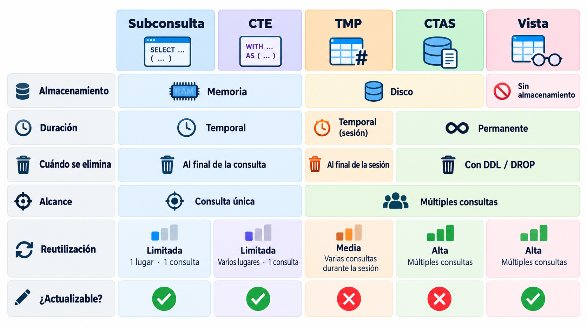

# Sesión 1: Stored Procedures

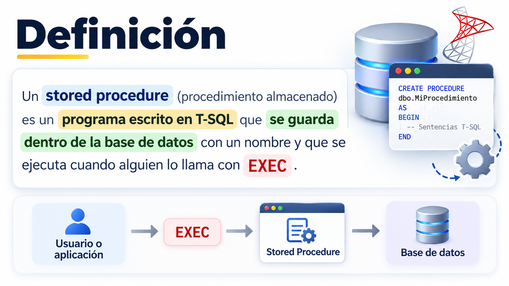

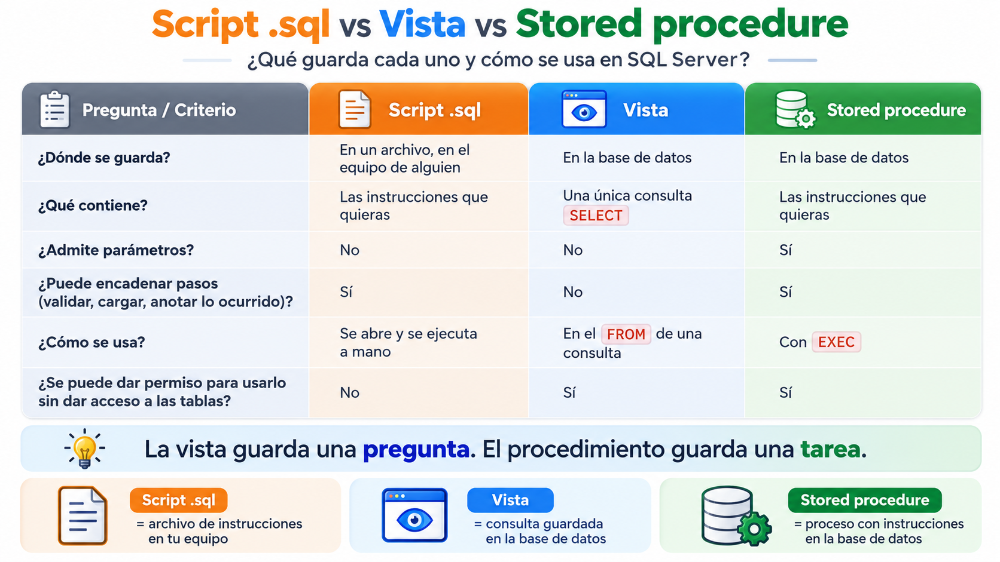

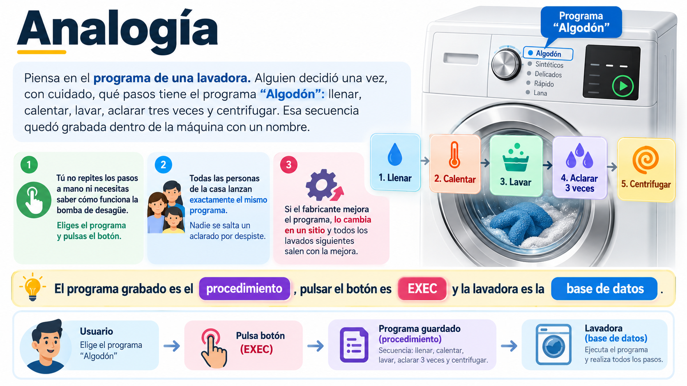

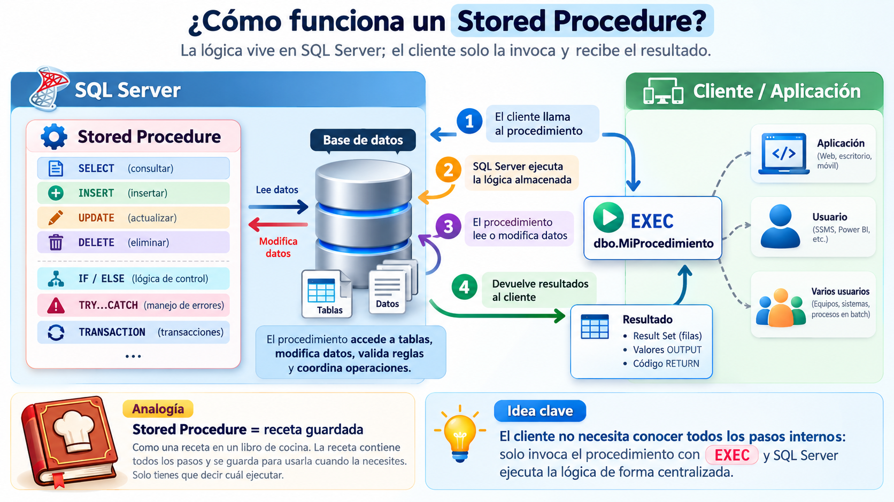

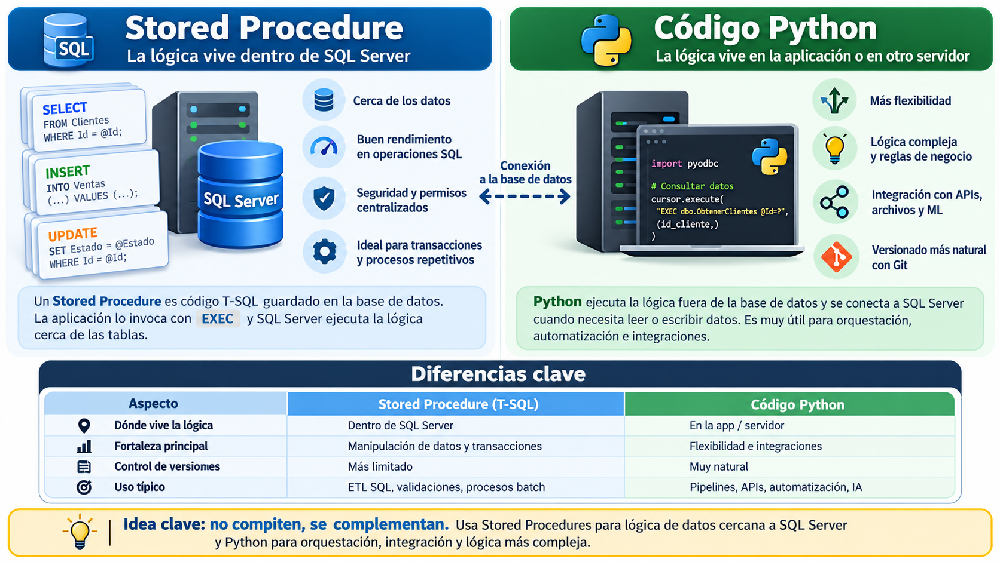

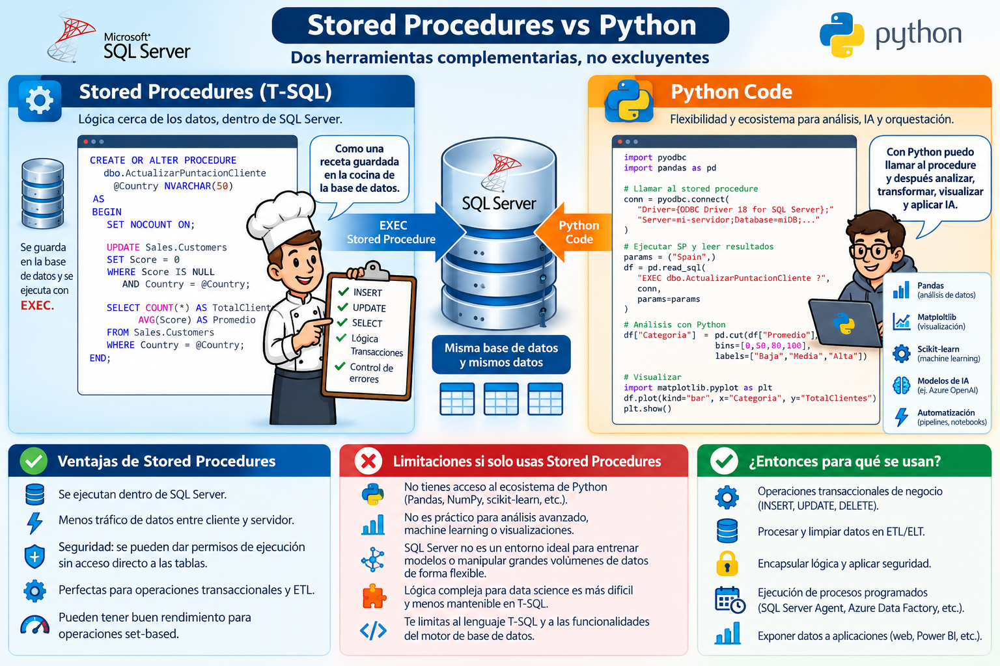

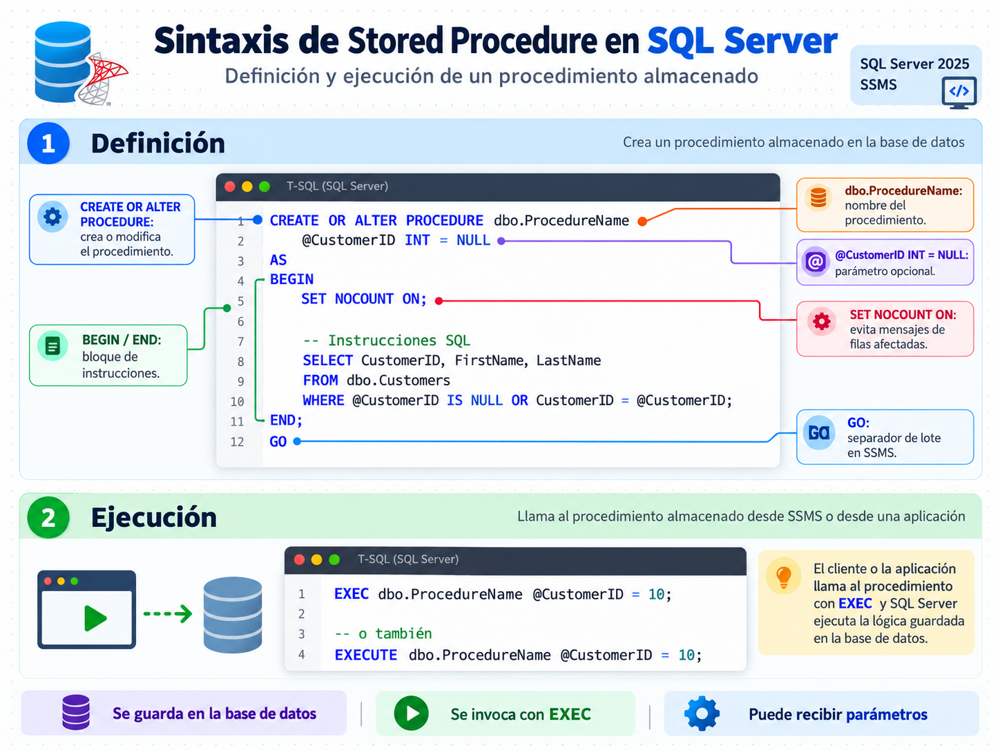

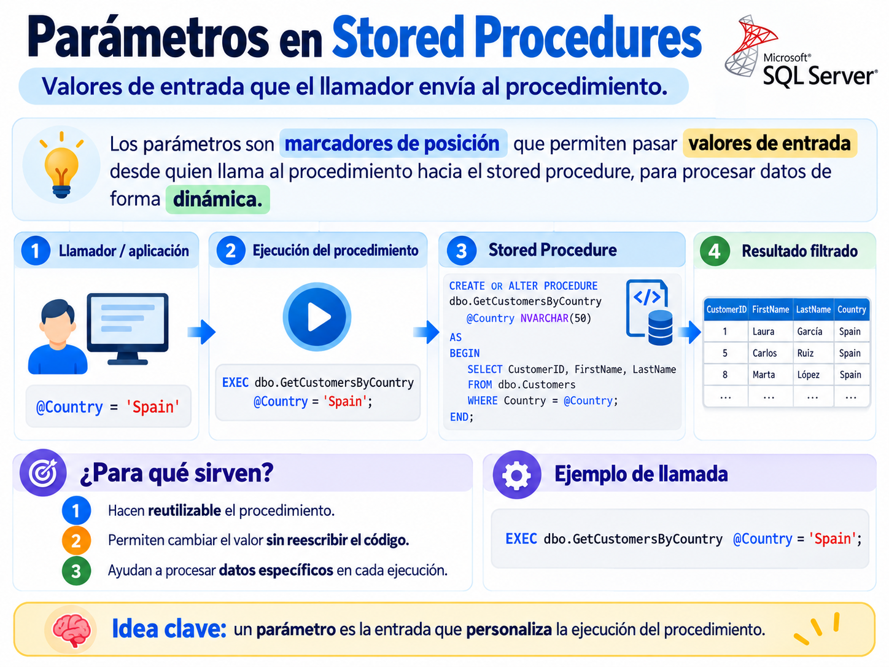

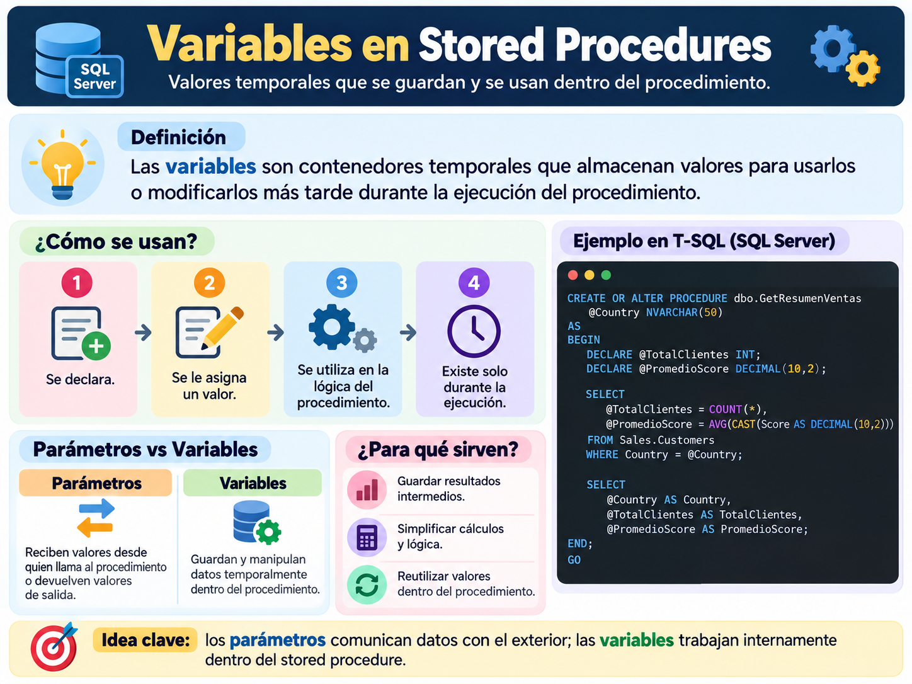

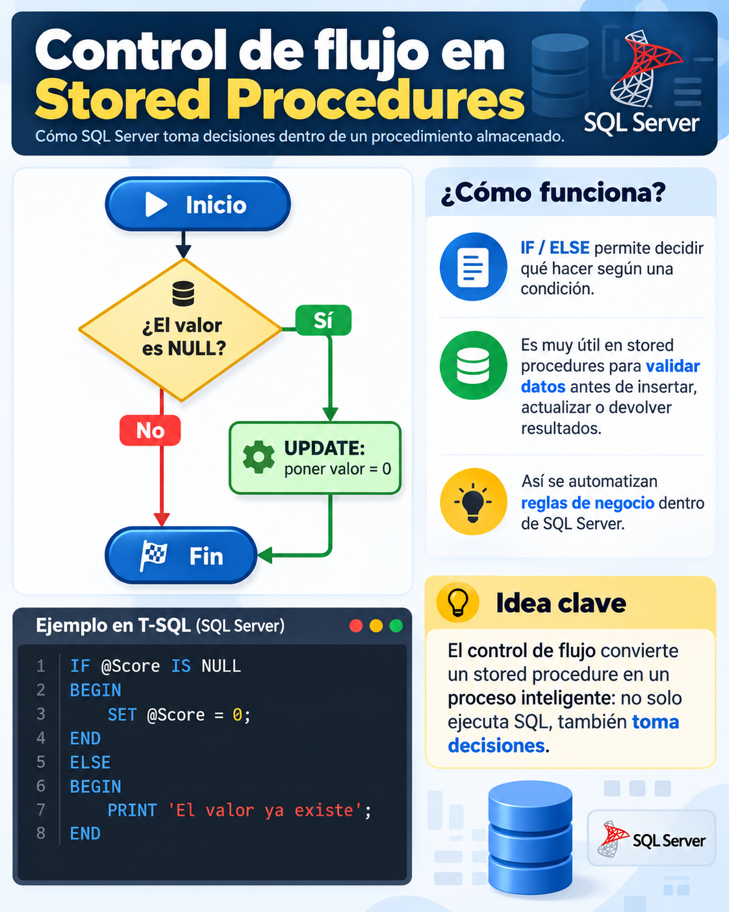

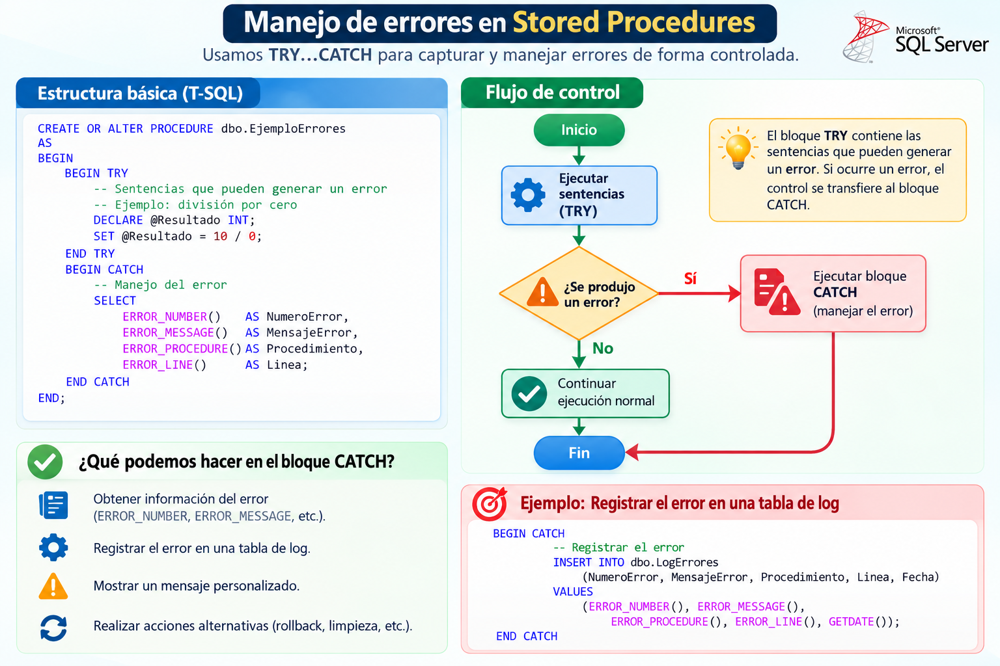

# Punto de partida

---

Seguimos con **Sonora**, la plataforma de streaming musical, y con la base de datos `SonoraDB`. Ejecuta este script antes de empezar. Garantiza el punto de partida (43 reproducciones, 10 usuarios, 15 canciones y 9 artistas) aunque no hayas hecho l099as cargas de clases anteriores, y crea los lotes nuevos que usaremos hoy. Se puede ejecutar varias veces.

```sql
USE SonoraDB;
GO

-- 1. Cargas de las clases anteriores (idempotentes)
INSERT INTO dbo.reproducciones
    (reproduccion_id, usuario_id, cancion_id, fecha_hora, segundos_escuchados, dispositivo, tipo_contenido)
SELECT s.reproduccion_id, s.usuario_id, s.cancion_id, s.fecha_hora,
       s.segundos_escuchados, s.dispositivo, s.tipo_contenido
FROM dbo.stg_reproducciones AS s
WHERE NOT EXISTS (SELECT 1 FROM dbo.reproducciones AS r WHERE r.reproduccion_id = s.reproduccion_id);

INSERT INTO dbo.usuarios (usuario_id, nombre_usuario, email, pais, plan_suscripcion, fecha_alta)
SELECT s.usuario_id, s.nombre_usuario, s.email, s.pais, s.plan_suscripcion, s.fecha_alta
FROM dbo.stg_usuarios AS s
WHERE NOT EXISTS (SELECT 1 FROM dbo.usuarios AS u WHERE u.usuario_id = s.usuario_id);
GO

-- 2. Lote del 22/09
DROP TABLE IF EXISTS dbo.stg_reproducciones_2209;

CREATE TABLE dbo.stg_reproducciones_2209 (
    reproduccion_id      int,
    usuario_id           int,
    cancion_id           int,
    fecha_hora           datetime2(0),
    segundos_escuchados  int,
    dispositivo          nvarchar(20),
    tipo_contenido       nvarchar(10)
);

INSERT INTO dbo.stg_reproducciones_2209
    (reproduccion_id, usuario_id, cancion_id, fecha_hora, segundos_escuchados, dispositivo, tipo_contenido) VALUES
(37, 5,  NULL, '2026-09-21 22:00', 30,  N'Móvil', N'Anuncio'),
(38, 5,  104,  '2026-09-21 22:01', 190, N'Móvil', N'Canción'),
(39, 8,  106,  '2026-09-22 07:30', 12,  N'Móvil', N'Canción'),
(40, 10, 103,  '2026-09-22 09:00', 176, N'Móvil', N'Canción'),
(41, 9,  NULL, '2026-09-22 09:10', 30,  N'Web',   N'Anuncio'),
(42, 9,  111,  '2026-09-22 09:11', 356, N'Web',   N'Canción'),
(43, 1,  114,  '2026-09-22 10:00', 25,  N'Móvil', N'Canción');

INSERT INTO dbo.reproducciones
    (reproduccion_id, usuario_id, cancion_id, fecha_hora, segundos_escuchados, dispositivo, tipo_contenido)
SELECT s.reproduccion_id, s.usuario_id, s.cancion_id, s.fecha_hora,
       s.segundos_escuchados, s.dispositivo, s.tipo_contenido
FROM dbo.stg_reproducciones_2209 AS s
WHERE NOT EXISTS (SELECT 1 FROM dbo.reproducciones AS r WHERE r.reproduccion_id = s.reproduccion_id);
GO

-- 3. Volver al punto de partida: se retira lo cargado o modificado en clases, ejercicios y casos anteriores
DELETE FROM dbo.reproducciones WHERE reproduccion_id > 43;
DELETE FROM dbo.usuarios       WHERE usuario_id > 10;
DELETE FROM dbo.artistas       WHERE artista_id > 9;

UPDATE dbo.usuarios
SET plan_suscripcion = N'Free'
WHERE nombre_usuario = N'marta_rock';
GO

-- 4. Buzón de entrada: la tabla donde la app deja cada lote de reproducciones.
--    Ahora contiene el lote del 23/09 (se usa en la sección 6 de la teoría)
DROP TABLE IF EXISTS dbo.stg_reproducciones_app;

CREATE TABLE dbo.stg_reproducciones_app (
    reproduccion_id      int,
    usuario_id           int,
    cancion_id           int,
    fecha_hora           datetime2(0),
    segundos_escuchados  int,
    dispositivo          nvarchar(20),
    tipo_contenido       nvarchar(10)
);

INSERT INTO dbo.stg_reproducciones_app
    (reproduccion_id, usuario_id, cancion_id, fecha_hora, segundos_escuchados, dispositivo, tipo_contenido) VALUES
(42, 9, 111,  '2026-09-22 09:11', 356, N'Web',      N'Canción'),
(43, 1, 114,  '2026-09-22 10:00', 25,  N'Móvil',    N'Canción'),
(44, 2, 107,  '2026-09-23 08:20', 198, N'Web',      N'Canción'),
(45, 6, 113,  '2026-09-23 12:05', 158, N'Smart TV', N'Canción'),
(46, 5, NULL, '2026-09-23 13:00', 30,  N'Móvil',    N'Anuncio'),
(47, 5, 104,  '2026-09-23 13:01', 190, N'Móvil',    N'Canción');
GO

-- 5. Lote de altas de usuarios del 23/09 (se usa en el Ejercicio 13)
DROP TABLE IF EXISTS dbo.stg_usuarios_2309;

CREATE TABLE dbo.stg_usuarios_2309 (
    usuario_id        int,
    nombre_usuario    nvarchar(50),
    email             nvarchar(150),
    pais              char(2),
    plan_suscripcion  nvarchar(20),
    fecha_alta        date
);

INSERT INTO dbo.stg_usuarios_2309
    (usuario_id, nombre_usuario, email, pais, plan_suscripcion, fecha_alta) VALUES
(10, N'kiara_perreo', N'kiara.perreo@mail.com', 'PR', N'Premium',  '2026-09-21'),
(11, N'teo.bass',     N'teo.bass@mail.com',     'ES', N'Free',     '2026-09-22'),
(12, N'ines_wave',    N'ines.wave@mail.com',    'CO', N'Premium',  '2026-09-22'),
(12, N'ines_wave',    N'ines.wave@mail.com',    'CO', N'Premium',  '2026-09-22'),
(13, N'rober.mx',     N'rober.mx@mail.com',     'MX', N'Premiun',  '2026-09-23'),
(14, N'cami_ar',      NULL,                     'AR', N'Familiar', '2026-09-23'),
(15, N'lola.pop',     N'lola.pop@mail.com',     'ES', N'Family',   '2026-09-23'),
(16, N'max_techno',   N'max.techno@mail.com',   'CO', N'Free',     '2026-09-23');
GO

-- 6. Comprobación del punto de partida
SELECT (SELECT COUNT(*) FROM dbo.reproducciones)         AS reproducciones,
       (SELECT COUNT(*) FROM dbo.usuarios)               AS usuarios,
       (SELECT COUNT(*) FROM dbo.canciones)              AS canciones,
       (SELECT COUNT(*) FROM dbo.artistas)               AS artistas,
       (SELECT COUNT(*) FROM dbo.stg_reproducciones_app) AS lote_app;
```

**Salida esperada de la comprobación:**

| reproducciones | usuarios | canciones | artistas | lote_app |
| --- | --- | --- | --- | --- |
| 43 | 10 | 15 | 9 | 6 |

> **Regla de negocio de siempre:** una reproducción es **válida** cuando es de tipo `Canción` y se han escuchado al menos 30 segundos. La **semana de análisis** va del 16/09/2026 al 22/09/2026 y se filtra con `fecha_hora >= '2026-09-16' AND fecha_hora < '2026-09-23'`.

> **Hoy sí se crean objetos en ****`SonoraDB`****:** procedimientos y algunas tablas de apoyo. Todos se crean en el esquema `dbo` y los procedimientos llevan el prefijo `usp_`. Al final del documento hay un script de limpieza que los borra.

> Los mensajes de error se muestran en inglés, que es el idioma por defecto de la instancia. Si tu instancia está en español, el número de mensaje (`Msg`) es el mismo aunque cambie el texto. Cuando el error se produce dentro de un procedimiento, SSMS añade al mensaje el nombre del procedimiento y el número de línea.

---

### Sintaxis

```sql
-- Crear o modificar
CREATE OR ALTER PROCEDURE dbo.usp_nombre
AS
BEGIN
    SET NOCOUNT ON;

    -- instrucciones
END;
GO

-- Ejecutar
EXEC dbo.usp_nombre;

-- Ver su código
EXEC sp_helptext N'dbo.usp_nombre';

-- Borrar
DROP PROCEDURE IF EXISTS dbo.usp_nombre;
```

**Reglas de T-SQL que conviene recordar:**

- `CREATE PROCEDURE` tiene que ser **la primera instrucción de su lote**. Si hay algo delante sin un `GO`, aparece el error **Msg 111** (*'CREATE/ALTER PROCEDURE' must be the first statement in a query batch*).
- El cuerpo del procedimiento **llega hasta el final del lote**, no hasta el `END`. Todo lo que escribas entre el `AS` y el siguiente `GO` forma parte del procedimiento. Por eso el `GO` de después es obligatorio.
- `CREATE PROCEDURE` falla con el error **Msg 2714** si el procedimiento ya existe. `CREATE OR ALTER PROCEDURE` lo crea si no existe y lo sustituye si existe, así que el script se puede ejecutar las veces que haga falta.
- Crear un procedimiento **no lo ejecuta**. SQL Server solo comprueba que el código está bien escrito y lo guarda.
- Escribe siempre el esquema, al crearlo y al llamarlo: `dbo.usp_top_canciones`.
- No uses el prefijo `sp_` para tus procedimientos: está reservado para los del sistema. La convención más extendida es `usp_` (*user stored procedure*).
- `SET NOCOUNT ON` al principio del cuerpo hace que el procedimiento no envíe el mensaje `(n rows affected)` de cada instrucción. Es la práctica habitual: un procedimiento puede ejecutar decenas de instrucciones y esos mensajes solo hacen ruido.
- Si llamas a un procedimiento que no existe, aparece el error **Msg 2812** (*Could not find stored procedure*).
- Las tablas `#temporales` creadas dentro de un procedimiento se borran solas cuando el procedimiento termina.
### Ejemplo 1. Guardar una consulta como procedimiento y ejecutarla

**Contexto:** cada lunes, Carmen Lozano (Data Analyst) abre el mismo script para sacar las tres canciones más escuchadas de la semana de análisis. Elena Ruiz (Data Engineer) lo guarda en la base de datos para que cualquiera pueda lanzarlo.

**Paso 1.** Crear el procedimiento:

```sql
CREATE OR ALTER PROCEDURE dbo.usp_top_canciones
AS
BEGIN
    SET NOCOUNT ON;

    SELECT TOP (3) c.titulo, COUNT(*) AS reproducciones
    FROM dbo.reproducciones AS r
    JOIN dbo.canciones AS c ON c.cancion_id = r.cancion_id
    WHERE r.tipo_contenido = N'Canción'
      AND r.segundos_escuchados >= 30
      AND r.fecha_hora >= '2026-09-16'
      AND r.fecha_hora <  '2026-09-23'
    GROUP BY c.titulo
    ORDER BY reproducciones DESC, c.titulo;
END;
GO
```

**Salida esperada (pestaña Messages de SSMS):** `Commands completed successfully.` No aparece ningún resultado: el procedimiento se ha guardado, pero todavía no se ha ejecutado.

**Paso 2.** Ejecutarlo:

```sql
EXEC dbo.usp_top_canciones;
```

**Salida esperada:**

| titulo | reproducciones |
| --- | --- |
| Perreo Lunar | 4 |
| Galaxia Dembow | 3 |
| Cables Sueltos | 2 |

> En la pestaña Messages ya no aparece `(3 rows affected)`. Es el efecto de `SET NOCOUNT ON`.

**Paso 3.** Comprobar dónde ha quedado guardado. En el Object Explorer de SSMS, despliega **Databases > SonoraDB > Programmability > Stored Procedures** (si no lo ves, botón derecho y **Refresh**). También se puede consultar:

```sql
SELECT ROUTINE_SCHEMA, ROUTINE_NAME, CREATED, LAST_ALTERED
FROM INFORMATION_SCHEMA.ROUTINES
WHERE ROUTINE_TYPE = N'PROCEDURE'
ORDER BY ROUTINE_NAME;
```

**Salida esperada:** una fila por procedimiento. Entre ellas estará `dbo` · `usp_top_canciones`, con la fecha y la hora en que lo has creado.

> A partir de ahora, Carmen no necesita el archivo de Elena, ni saber qué tablas hay que unir, ni recordar la regla de los 30 segundos. Le basta una línea. Y si mañana cambia la regla, se corrige en el procedimiento y todo el mundo obtiene la cifra nueva.

### Ejemplo 2. Modificar un procedimiento, y el `GO` que no puede faltar

**Contexto:** Carmen pide que el resultado incluya el nombre del artista.

**Paso 1.** Intentar crearlo otra vez con `CREATE PROCEDURE`, sin `OR ALTER`:

```sql
CREATE PROCEDURE dbo.usp_top_canciones
AS
BEGIN
    SELECT 1 AS prueba;
END;
GO
```

**Salida esperada:** error **Msg 2714** (*There is already an object named 'usp_top_canciones' in the database*). El procedimiento original no se toca.

**Paso 2.** Modificarlo con `CREATE OR ALTER`:

```sql
CREATE OR ALTER PROCEDURE dbo.usp_top_canciones
AS
BEGIN
    SET NOCOUNT ON;

    SELECT TOP (3) c.titulo, a.nombre AS artista, COUNT(*) AS reproducciones
    FROM dbo.reproducciones AS r
    JOIN dbo.canciones AS c ON c.cancion_id = r.cancion_id
    JOIN dbo.artistas  AS a ON a.artista_id = c.artista_id
    WHERE r.tipo_contenido = N'Canción'
      AND r.segundos_escuchados >= 30
      AND r.fecha_hora >= '2026-09-16'
      AND r.fecha_hora <  '2026-09-23'
    GROUP BY c.titulo, a.nombre
    ORDER BY reproducciones DESC, c.titulo;
END;
GO

EXEC dbo.usp_top_canciones;
```

**Salida esperada:**

| titulo | artista | reproducciones |
| --- | --- | --- |
| Perreo Lunar | MC Brisa | 4 |
| Galaxia Dembow | MC Brisa | 3 |
| Cables Sueltos | Los Voltios | 2 |

**Paso 3.** Ver el código que hay guardado en la base de datos:

```sql
EXEC sp_helptext N'dbo.usp_top_canciones';
```

**Salida esperada:** una columna `Text` con el código del procedimiento, línea a línea, tal como lo escribiste en el Paso 2. Es la versión que se ejecuta de verdad, diga lo que diga el archivo que tenga cada uno en su equipo.

**Paso 4.** El error del `GO` olvidado. Crea este procedimiento de prueba, bien escrito, y ejecútalo:

```sql
CREATE OR ALTER PROCEDURE dbo.usp_prueba_go
AS
BEGIN
    SELECT N'Hola desde el procedimiento' AS mensaje;
END;
GO

EXEC dbo.usp_prueba_go;
```

**Salida esperada:**

mensaje

---

Hola desde el procedimiento

---

**Paso 5.** Ahora ejecuta el mismo script **sin el ****`GO`** intermedio:

```sql
CREATE OR ALTER PROCEDURE dbo.usp_prueba_go
AS
BEGIN
    SELECT N'Hola desde el procedimiento' AS mensaje;
END;

EXEC dbo.usp_prueba_go;
```

**Salida esperada:** `Commands completed successfully.` y **ningún resultado**. El `EXEC` no se ha ejecutado: como no hay `GO`, SQL Server lo ha guardado **dentro** del procedimiento. Ahora el procedimiento se llama a sí mismo.

**Paso 6.** Ejecutarlo:

```sql
EXEC dbo.usp_prueba_go;
```

**Salida esperada:** el mismo resultado repetido decenas de veces y, al final, el error **Msg 217** (*Maximum stored procedure, function, trigger, or view nesting level exceeded (limit 32)*). El procedimiento se ha llamado a sí mismo una y otra vez hasta que SQL Server lo ha cortado en el nivel 32.

**Paso 7.** Borrar el procedimiento de prueba:

```sql
DROP PROCEDURE IF EXISTS dbo.usp_prueba_go;
```

> **Regla práctica:** un `GO` antes de `CREATE OR ALTER PROCEDURE` y otro justo después del `END;`. Si un procedimiento hace cosas que no has escrito, mira su código con `sp_helptext`: lo más probable es que se haya quedado dentro una línea de prueba.

---

## 2. Parámetros: de entrada, con valor por defecto y de salida

### Definición

Un **parámetro** es un valor que el procedimiento recibe (o devuelve) cada vez que se ejecuta. Convierte un procedimiento que hace siempre lo mismo en uno que sirve para cualquier semana, cualquier usuario o cualquier país.

Hay tres variantes:

- **De entrada:** el valor lo aporta quien llama. Es obligatorio.
- **De entrada con valor por defecto:** si quien llama no lo indica, el procedimiento usa el valor por defecto. Es opcional.
- **De salida (****`OUTPUT`****):** el procedimiento lo rellena y quien llama lo recoge en una variable al terminar.
Un procedimiento puede entregar información de tres formas, y cada una tiene su destinatario:

| Forma | Qué devuelve | Para quién |
| --- | --- | --- |
| Conjunto de resultados (`SELECT`) | Una tabla | Una persona que mira el resultado, o una herramienta de informes |
| Parámetro `OUTPUT` | Uno o varios valores sueltos, de cualquier tipo | Otro código T-SQL que necesita ese valor para seguir trabajando |
| Código de retorno (`RETURN`) | Un único número entero | Quien llama y solo necesita saber si terminó bien (`0`) o no |

Para recoger un parámetro `OUTPUT` hace falta una **variable**: una caja con nombre, que empieza por `@`, donde se guarda un valor mientras dura el lote. Se declara con `DECLARE @nombre tipo;`. Las veremos a fondo en la sección 3.

### Analogía

Piensa en el **formulario de reserva de un restaurante**.

- La fecha y el número de personas son **obligatorios**: sin ellos no hay reserva.
- La zona es **opcional**: si no dices nada, te sientan en el salón interior. Solo lo indicas si quieres terraza.
- Al terminar, el restaurante te entrega un **número de reserva**. No lo has aportado tú: lo genera el restaurante y tú lo apuntas para usarlo después.
La fecha y los comensales son parámetros de entrada, la zona es un parámetro con valor por defecto y el número de reserva es un parámetro de salida. La libreta donde lo apuntas es la variable.

### Sintaxis

```sql
CREATE OR ALTER PROCEDURE dbo.usp_nombre
    @obligatorio  tipo,
    @opcional     tipo = valor_por_defecto,
    @salida       tipo OUTPUT
AS
BEGIN
    SET NOCOUNT ON;

    -- los parámetros se usan como si fueran valores
    SELECT ... WHERE columna = @obligatorio;

    SET @salida = ...;
END;
GO

-- Llamada por posición: los valores, en el orden en que se definieron
EXEC dbo.usp_nombre valor1, valor2;

-- Llamada por nombre: el orden da igual y se pueden omitir los opcionales
EXEC dbo.usp_nombre @obligatorio = valor1;

-- Recoger un parámetro de salida
DECLARE @resultado tipo;

EXEC dbo.usp_nombre @obligatorio = valor1, @salida = @resultado OUTPUT;

SELECT @resultado;
```

**Reglas de T-SQL que conviene recordar:**

- Los parámetros se escriben entre el nombre del procedimiento y el `AS`, separados por comas. Cada uno lleva `@` y un tipo. Usa el mismo tipo que la columna con la que se va a comparar.
- Si falta un parámetro obligatorio, aparece el error **Msg 201** (*Procedure or function ... expects parameter '@...', which was not supplied*).
- Si pasas más valores de los que hay, aparece el error **Msg 8144** (*... has too many arguments specified*).
- En una misma llamada, cuando un parámetro se pasa por nombre, **todos los siguientes** deben pasarse por nombre (error **Msg 119**).
- **Llama siempre por nombre** en el código que se va a quedar (otros procedimientos, cargas). Si alguien añade un parámetro en medio, una llamada por posición cambia de significado sin avisar.
- La palabra `OUTPUT` se escribe **dos veces**: en la definición y en la llamada. Si se olvida en la llamada, no hay error: la variable se queda en `NULL`.
- En la llamada solo se admiten **constantes o variables**, no funciones ni operaciones. `EXEC dbo.usp_x DATEADD(DAY, 1, '2026-09-16');` es un error de sintaxis. El cálculo se hace antes, en una variable.
- Un parámetro sustituye a un **valor**. No puede sustituir al nombre de una tabla o de una columna.
### Ejemplo 3. Parámetros de entrada

**Contexto:** el procedimiento del Ejemplo 2 tiene las fechas escritas dentro. La semana que viene habría que modificarlo. Con dos parámetros sirve para cualquier periodo.

**Paso 1.** Añadir los parámetros `@desde` y `@hasta` (este último, sin incluir):

```sql
CREATE OR ALTER PROCEDURE dbo.usp_top_canciones
    @desde  date,
    @hasta  date
AS
BEGIN
    SET NOCOUNT ON;

    SELECT TOP (3) c.titulo, a.nombre AS artista, COUNT(*) AS reproducciones
    FROM dbo.reproducciones AS r
    JOIN dbo.canciones AS c ON c.cancion_id = r.cancion_id
    JOIN dbo.artistas  AS a ON a.artista_id = c.artista_id
    WHERE r.tipo_contenido = N'Canción'
      AND r.segundos_escuchados >= 30
      AND r.fecha_hora >= @desde
      AND r.fecha_hora <  @hasta
    GROUP BY c.titulo, a.nombre
    ORDER BY reproducciones DESC, c.titulo;
END;
GO
```

**Paso 2.** Llamarlo por posición, con la semana de análisis:

```sql
EXEC dbo.usp_top_canciones '2026-09-16', '2026-09-23';
```

**Salida esperada:**

| titulo | artista | reproducciones |
| --- | --- | --- |
| Perreo Lunar | MC Brisa | 4 |
| Galaxia Dembow | MC Brisa | 3 |
| Cables Sueltos | Los Voltios | 2 |

**Paso 3.** Llamarlo por nombre, con los dos días anteriores a la semana (14 y 15 de septiembre). Fíjate en que los parámetros van en otro orden:

```sql
EXEC dbo.usp_top_canciones @hasta = '2026-09-16', @desde = '2026-09-14';
```

**Salida esperada:**

| titulo | artista | reproducciones |
| --- | --- | --- |
| Perreo Lunar | MC Brisa | 3 |
| Humo Violeta | Nébula | 2 |
| Marea Alta | DJ Coral | 2 |

**Paso 4.** Olvidar un parámetro obligatorio:

```sql
EXEC dbo.usp_top_canciones '2026-09-16';
```

**Salida esperada:** error **Msg 201** (*Procedure or function 'usp_top_canciones' expects parameter '@hasta', which was not supplied*).

> El mismo procedimiento responde ahora a cualquier periodo sin tocar su código. La regla de negocio (canción y 30 segundos) sigue escrita en un único sitio.

### Ejemplo 4. Valores por defecto y filtros opcionales

**Contexto:** Laura Gil (Marketing) quiere a veces cinco canciones en lugar de tres, y a veces solo lo que escuchan los usuarios de un plan concreto. Carmen quiere seguir llamando al procedimiento como hasta ahora.

**Paso 1.** Añadir dos parámetros opcionales. `@top` vale 3 si no se indica. `@plan` vale `NULL` si no se indica, y `NULL` significa "todos los planes":

```sql
CREATE OR ALTER PROCEDURE dbo.usp_top_canciones
    @desde  date,
    @hasta  date,
    @top    int           = 3,
    @plan   nvarchar(20)  = NULL
AS
BEGIN
    SET NOCOUNT ON;

    SELECT TOP (@top) c.titulo, a.nombre AS artista, COUNT(*) AS reproducciones
    FROM dbo.reproducciones AS r
    JOIN dbo.canciones AS c ON c.cancion_id = r.cancion_id
    JOIN dbo.artistas  AS a ON a.artista_id = c.artista_id
    JOIN dbo.usuarios  AS u ON u.usuario_id = r.usuario_id
    WHERE r.tipo_contenido = N'Canción'
      AND r.segundos_escuchados >= 30
      AND r.fecha_hora >= @desde
      AND r.fecha_hora <  @hasta
      AND (@plan IS NULL OR u.plan_suscripcion = @plan)
    GROUP BY c.titulo, a.nombre
    ORDER BY reproducciones DESC, c.titulo;
END;
GO
```

**Paso 2.** La llamada de Carmen sigue funcionando sin cambios y devuelve lo mismo que en el Ejemplo 3:

```sql
EXEC dbo.usp_top_canciones @desde = '2026-09-16', @hasta = '2026-09-23';
```

**Paso 3.** Cinco canciones:

```sql
EXEC dbo.usp_top_canciones @desde = '2026-09-16', @hasta = '2026-09-23', @top = 5;
```

**Salida esperada:**

| titulo | artista | reproducciones |
| --- | --- | --- |
| Perreo Lunar | MC Brisa | 4 |
| Galaxia Dembow | MC Brisa | 3 |
| Cables Sueltos | Los Voltios | 2 |
| Calle 23 | MC Brisa | 2 |
| Corriente Alterna | Los Voltios | 2 |

**Paso 4.** Solo usuarios del plan Free. Al llamar por nombre se puede saltar `@top`, que toma su valor por defecto:

```sql
EXEC dbo.usp_top_canciones @desde = '2026-09-16', @hasta = '2026-09-23', @plan = N'Free';
```

**Salida esperada:**

| titulo | artista | reproducciones |
| --- | --- | --- |
| Calle 23 | MC Brisa | 2 |
| Cables Sueltos | Los Voltios | 1 |
| Corriente Alterna | Los Voltios | 1 |

> La condición `(@plan IS NULL OR u.plan_suscripcion = @plan)` es el patrón del **filtro opcional**. Si `@plan` es `NULL`, la primera parte es cierta para todas las filas y el filtro no actúa. Si trae un valor, solo pasan las filas de ese plan. Los paréntesis son imprescindibles: sin ellos, el `OR` se mezclaría con los `AND` anteriores.

> Los parámetros nuevos se añaden **al final y con valor por defecto**. Así las llamadas que ya existían siguen funcionando.

### Ejemplo 5. Parámetros de salida (`OUTPUT`)

**Contexto:** Elena necesita las cifras de un periodo (reproducciones válidas y minutos) no para verlas en una tabla, sino para **usarlas después** en su código: compararlas, guardarlas o decidir algo con ellas.

**Paso 1.** Crear el procedimiento con dos parámetros de salida:

```sql
CREATE OR ALTER PROCEDURE dbo.usp_cifras_periodo
    @desde           date,
    @hasta           date,
    @reproducciones  int           OUTPUT,
    @minutos         decimal(8,1)  OUTPUT
AS
BEGIN
    SET NOCOUNT ON;

    SELECT @reproducciones = COUNT(*),
           @minutos        = CAST(COALESCE(SUM(segundos_escuchados), 0) / 60.0 AS decimal(8,1))
    FROM dbo.reproducciones
    WHERE tipo_contenido = N'Canción'
      AND segundos_escuchados >= 30
      AND fecha_hora >= @desde
      AND fecha_hora <  @hasta;
END;
GO
```

> Este `SELECT` no devuelve una tabla: **guarda** el resultado de cada columna en un parámetro. Es la forma `SELECT @variable = expresión`.

**Paso 2.** Llamarlo recogiendo los resultados en dos variables. Ejecuta el bloque completo de una vez:

```sql
DECLARE @n int, @min decimal(8,1);

EXEC dbo.usp_cifras_periodo
     @desde = '2026-09-16',
     @hasta = '2026-09-23',
     @reproducciones = @n OUTPUT,
     @minutos = @min OUTPUT;

SELECT @n AS reproducciones, @min AS minutos;
```

**Salida esperada:**

| reproducciones | minutos |
| --- | --- |
| 22 | 74.4 |

**Paso 3.** Repetir la llamada **sin** la palabra `OUTPUT`:

```sql
DECLARE @n int, @min decimal(8,1);

EXEC dbo.usp_cifras_periodo
     @desde = '2026-09-16',
     @hasta = '2026-09-23',
     @reproducciones = @n,
     @minutos = @min;

SELECT @n AS reproducciones, @min AS minutos;
```

**Salida esperada:**

| reproducciones | minutos |
| --- | --- |
| NULL | NULL |

No hay ningún error. El procedimiento ha calculado las cifras, pero como la llamada no dice `OUTPUT`, no se las ha devuelto a las variables.

**Paso 4.** Usar los valores devueltos. Dos llamadas al mismo procedimiento y una comparación:

```sql
DECLARE @n_semana int, @min_semana decimal(8,1);
DECLARE @n_previo int, @min_previo decimal(8,1);

EXEC dbo.usp_cifras_periodo
     @desde = '2026-09-16', @hasta = '2026-09-23',
     @reproducciones = @n_semana OUTPUT, @minutos = @min_semana OUTPUT;

EXEC dbo.usp_cifras_periodo
     @desde = '2026-09-14', @hasta = '2026-09-16',
     @reproducciones = @n_previo OUTPUT, @minutos = @min_previo OUTPUT;

SELECT @n_semana AS repro_semana,
       @n_previo AS repro_dos_dias_previos,
       CAST(@min_semana / 7 AS decimal(5,1)) AS minutos_dia_semana,
       CAST(@min_previo / 2 AS decimal(5,1)) AS minutos_dia_previos;
```

**Salida esperada:**

| repro_semana | repro_dos_dias_previos | minutos_dia_semana | minutos_dia_previos |
| --- | --- | --- | --- |
| 22 | 10 | 10.6 | 19.5 |

> Con un `SELECT` normal, el procedimiento habría mostrado dos tablas en pantalla y el código no habría podido hacer nada con ellas. Con `OUTPUT`, cada cifra queda en una variable y se puede seguir trabajando. Es la forma en que un procedimiento le pasa datos a otro.

---

## 3. Variables y control de flujo: `IF` y `WHILE`

### Definición

Hasta aquí, un procedimiento es una consulta con nombre y parámetros. Lo que lo convierte en un **programa** son tres cosas:

- **Variables:** guardan un valor (un número, una fecha, un texto) para usarlo más adelante. Se declaran con `DECLARE`, se les da valor con `SET` o con `SELECT @variable = ...` y viven hasta que termina el lote o el procedimiento.
- **Decisiones (****`IF ... ELSE`****):** ejecutan un bloque de instrucciones u otro según se cumpla una condición.
- **Repeticiones (****`WHILE`****):** ejecutan un bloque una y otra vez mientras se cumpla una condición.
Con ellas aparecen cuatro piezas de apoyo:

| Pieza | Para qué sirve |
| --- | --- |
| `BEGIN ... END` | Agrupa varias instrucciones en un bloque, para que un `IF` o un `WHILE` las trate como una sola |
| `@@ROWCOUNT` | Devuelve cuántas filas ha afectado **la instrucción que se acaba de ejecutar** |
| `PRINT` | Escribe un texto en la pestaña Messages |
| `RETURN` | Sale del procedimiento en ese punto. Puede devolver un número entero: por convenio, `0` es "todo bien" |

### Analogía

Piensa en un **repartidor de paquetes** con su furgoneta.

- Lleva una **hoja** donde va apuntando cuántos paquetes ha entregado y cuántos le quedan. Son sus variables: valores que cambian durante la jornada.
- En cada portal **decide**: si hay alguien en casa, entrega el paquete; si no, deja un aviso en el buzón. Es un `IF ... ELSE`.
- Y **repite** lo mismo, portal tras portal, mientras queden paquetes en la furgoneta. Es un `WHILE`. Si nadie actualizara la cuenta de paquetes pendientes, el repartidor no terminaría nunca.
### Sintaxis

```sql
-- Variables
DECLARE @contador int = 0;            -- con valor inicial
DECLARE @total int, @dia date;        -- varias a la vez; sin valor inicial valen NULL

SET @dia = '2026-09-16';
SET @total = (SELECT COUNT(*) FROM dbo.tabla);    -- una subconsulta escalar
SELECT @total = COUNT(*) FROM dbo.tabla;          -- forma equivalente

-- Filas afectadas por la instrucción anterior
DELETE FROM dbo.tabla WHERE ...;
SET @contador = @@ROWCOUNT;

-- Decisión
IF condicion
BEGIN
    -- instrucciones si se cumple
END
ELSE
BEGIN
    -- instrucciones si no se cumple
END;

-- Repetición
WHILE condicion
BEGIN
    -- instrucciones
    SET @contador = @contador + 1;    -- algo tiene que cambiar para que el bucle termine
END;

-- Salir del procedimiento con un código
RETURN 1;

-- Recoger ese código al llamar
DECLARE @estado int;
EXEC @estado = dbo.usp_nombre;
```

**Reglas de T-SQL que conviene recordar:**

- Una variable vive hasta el final del **lote** o del procedimiento, igual que una variable de tabla. Si en SSMS seleccionas y ejecutas solo la línea que la usa, aparece el error **Msg 137** (*Must declare the scalar variable*).
- Una variable sin valor vale `NULL`, y cualquier operación con `NULL` da `NULL`. `SET @contador = @contador + 1` no cuenta nada si `@contador` no se inició a 0.
- `@@ROWCOUNT` cambia con **cada** instrucción, incluidos `SET`, `IF` y `PRINT`. Guárdalo en una variable en la línea inmediatamente posterior a la instrucción que te interesa.
- Sin `BEGIN ... END`, un `IF` o un `WHILE` solo controlan **la instrucción siguiente**. Es el error más frecuente con `IF`.
- Para comparar con `NULL` se usa `IS NULL`. La condición `IF @x = NULL` no se cumple nunca.
- `IF EXISTS (SELECT 1 FROM ...)` es la forma de preguntar "¿hay alguna fila que...?".
- `PRINT` solo admite texto. Los números y las fechas se convierten con `CAST(... AS nvarchar(n))` y se unen con `+`.
- SQL trabaja con **conjuntos**. Un `INSERT ... SELECT` de un millón de filas es una instrucción; un `WHILE` que las inserta de una en una es un millón de instrucciones, y tarda muchísimo más. `WHILE` se reserva para repetir **tareas** (un día, un lote, un reintento), no para recorrer filas.
### Ejemplo 6. Variables y `@@ROWCOUNT`: refrescar una tabla resumen

**Contexto:** los cuadros de mando de Sonora consultan cada pocos minutos las cifras diarias de reproducciones válidas. En lugar de recalcularlas cada vez sobre `reproducciones`, Raúl Benet (Head of Data) quiere una tabla resumen con una fila por día, y un procedimiento que la refresque para el periodo que se le indique.

**Paso 1.** Antes del procedimiento, las variables en un lote normal. Ejecuta el bloque completo de una vez:

```sql
DECLARE @inicio date = '2026-09-16';
DECLARE @total int;

SET @total = (SELECT COUNT(*) FROM dbo.reproducciones WHERE fecha_hora >= @inicio);

SELECT @inicio AS inicio, @total AS reproducciones_desde_inicio;
```

**Salida esperada:**

| inicio | reproducciones_desde_inicio |
| --- | --- |
| 2026-09-16 | 30 |

Si ahora seleccionas con el ratón solo la última línea y pulsas `F5`, aparece el error **Msg 137** (*Must declare the scalar variable "@inicio"*): en ese lote no hay ningún `DECLARE`.

**Paso 2.** Crear la tabla resumen:

```sql
DROP TABLE IF EXISTS dbo.resumen_diario;

CREATE TABLE dbo.resumen_diario (
    dia             date          NOT NULL PRIMARY KEY,
    reproducciones  int           NOT NULL,
    oyentes         int           NOT NULL,
    minutos         decimal(8,1)  NOT NULL
);
GO
```

**Paso 3.** Crear el procedimiento. Borra las filas del periodo, las vuelve a calcular y cuenta cuántas ha borrado y cuántas ha insertado:

```sql
CREATE OR ALTER PROCEDURE dbo.usp_refrescar_resumen_diario
    @desde  date,
    @hasta  date
AS
BEGIN
    SET NOCOUNT ON;

    DECLARE @borradas int, @insertadas int;

    DELETE FROM dbo.resumen_diario
    WHERE dia >= @desde
      AND dia <  @hasta;

    SET @borradas = @@ROWCOUNT;

    INSERT INTO dbo.resumen_diario (dia, reproducciones, oyentes, minutos)
    SELECT CAST(r.fecha_hora AS date),
           COUNT(*),
           COUNT(DISTINCT r.usuario_id),
           CAST(SUM(r.segundos_escuchados) / 60.0 AS decimal(8,1))
    FROM dbo.reproducciones AS r
    WHERE r.tipo_contenido = N'Canción'
      AND r.segundos_escuchados >= 30
      AND r.fecha_hora >= @desde
      AND r.fecha_hora <  @hasta
    GROUP BY CAST(r.fecha_hora AS date);

    SET @insertadas = @@ROWCOUNT;

    SELECT @borradas AS filas_borradas, @insertadas AS filas_insertadas;
END;
GO
```

**Paso 4.** Ejecutarlo para la semana de análisis:

```sql
EXEC dbo.usp_refrescar_resumen_diario @desde = '2026-09-16', @hasta = '2026-09-23';
```

**Salida esperada:**

| filas_borradas | filas_insertadas |
| --- | --- |
| 0 | 7 |

**Paso 5.** Ejecutarlo otra vez, con los mismos parámetros:

**Salida esperada:**

| filas_borradas | filas_insertadas |
| --- | --- |
| 7 | 7 |

**Paso 6.** Ver el resumen:

```sql
SELECT dia, reproducciones, oyentes, minutos
FROM dbo.resumen_diario
ORDER BY dia;
```

**Salida esperada:**

| dia | reproducciones | oyentes | minutos |
| --- | --- | --- | --- |
| 2026-09-16 | 5 | 3 | 16.3 |
| 2026-09-17 | 3 | 2 | 10.5 |
| 2026-09-18 | 3 | 2 | 8.2 |
| 2026-09-19 | 3 | 3 | 9.3 |
| 2026-09-20 | 3 | 3 | 10.4 |
| 2026-09-21 | 3 | 3 | 10.9 |
| 2026-09-22 | 2 | 2 | 8.9 |

> Aunque `SET NOCOUNT ON` oculta los mensajes `(n rows affected)`, `@@ROWCOUNT` sigue funcionando. Así es como un procedimiento sabe cuántas filas ha tocado.

> El procedimiento se puede ejecutar dos, tres o diez veces y la tabla queda siempre igual: siete filas, sin duplicados. Borra lo que va a recalcular antes de insertarlo. Volveremos sobre esta idea en la sección 6.

### Ejemplo 7. `IF ... ELSE`: validar antes de actuar

**Contexto:** alguien ha llamado al procedimiento con las fechas al revés y no ha pasado nada: ni un error, ni un aviso. Un procedimiento que recibe parámetros absurdos y calla es una fuente de malentendidos. Además, a una carga no se le pide que devuelva tablas, sino que **informe** de lo que ha hecho.

**Paso 1.** La trampa de `IF` sin `BEGIN ... END`. Ejecuta este lote:

```sql
DECLARE @filas_nuevas int = 0;

IF @filas_nuevas > 0
    PRINT N'Hay filas nuevas.';
    PRINT N'Lanzando la carga...';
```

**Salida esperada (Messages):**

```plain text
Lanzando la carga...
```

No hay filas nuevas y, aun así, la carga se lanza. El sangrado engaña: el `IF` solo controla el primer `PRINT`. El segundo se ejecuta siempre. Con `BEGIN ... END` alrededor de los dos, no se escribiría nada.

**Paso 2.** Modificar el procedimiento. Valida los parámetros, informa con `PRINT` y devuelve un código con `RETURN`:

```sql
CREATE OR ALTER PROCEDURE dbo.usp_refrescar_resumen_diario
    @desde  date,
    @hasta  date
AS
BEGIN
    SET NOCOUNT ON;

    DECLARE @insertadas int;
    DECLARE @periodo nvarchar(40) = CAST(@desde AS nvarchar(10)) + N' y ' + CAST(@hasta AS nvarchar(10));

    IF @desde IS NULL OR @hasta IS NULL OR @desde >= @hasta
    BEGIN
        PRINT N'Periodo no válido: @desde debe ser anterior a @hasta.';
        RETURN 1;
    END;

    DELETE FROM dbo.resumen_diario
    WHERE dia >= @desde
      AND dia <  @hasta;

    INSERT INTO dbo.resumen_diario (dia, reproducciones, oyentes, minutos)
    SELECT CAST(r.fecha_hora AS date),
           COUNT(*),
           COUNT(DISTINCT r.usuario_id),
           CAST(SUM(r.segundos_escuchados) / 60.0 AS decimal(8,1))
    FROM dbo.reproducciones AS r
    WHERE r.tipo_contenido = N'Canción'
      AND r.segundos_escuchados >= 30
      AND r.fecha_hora >= @desde
      AND r.fecha_hora <  @hasta
    GROUP BY CAST(r.fecha_hora AS date);

    SET @insertadas = @@ROWCOUNT;

    IF @insertadas = 0
        PRINT N'Aviso: sin reproducciones válidas entre ' + @periodo + N'.';
    ELSE
        PRINT N'Resumen actualizado entre ' + @periodo + N'. Días con datos: '
              + CAST(@insertadas AS nvarchar(10)) + N'.';

    RETURN 0;
END;
GO
```

**Paso 3.** Llamarlo con las fechas al revés, recogiendo el código de retorno:

```sql
DECLARE @estado int;

EXEC @estado = dbo.usp_refrescar_resumen_diario @desde = '2026-09-23', @hasta = '2026-09-16';

SELECT @estado AS estado;
```

**Salida esperada:** en Messages, `Periodo no válido: @desde debe ser anterior a @hasta.` y en Results:

estado

---

1

---

El `RETURN 1` ha cortado la ejecución: no se ha borrado ni insertado nada.

**Paso 4.** Llamarlo con la semana de análisis y con una semana sin datos:

```sql
DECLARE @estado int;

EXEC @estado = dbo.usp_refrescar_resumen_diario @desde = '2026-09-16', @hasta = '2026-09-23';
SELECT @estado AS estado;

EXEC @estado = dbo.usp_refrescar_resumen_diario @desde = '2026-10-05', @hasta = '2026-10-12';
SELECT @estado AS estado;
```

**Salida esperada (Messages):**

```plain text
Resumen actualizado entre 2026-09-16 y 2026-09-23. Días con datos: 7.
Aviso: sin reproducciones válidas entre 2026-10-05 y 2026-10-12.
```

En Results, `estado` vale **0** las dos veces.

> **Valida primero, actúa después.** Las comprobaciones van al principio del procedimiento, antes de la primera instrucción que modifica datos. Así, si algo no cuadra, se sale sin haber tocado nada.

> El código de retorno tiene un punto débil: quien llama **tiene que acordarse de mirarlo**. Si nadie recoge `@estado`, el fallo pasa desapercibido. En la sección 4 veremos una forma de avisar que no se puede ignorar.

### Ejemplo 8. `WHILE`: repetir una tarea día a día

**Contexto:** la tabla resumen solo tiene la semana de análisis. Raúl quiere reconstruirla desde el primer día con datos (14/09) hasta el 23/09 incluido, **día a día**: si la reconstrucción de un día concreto diera problemas, los días anteriores ya estarían hechos y se podría retomar desde ese punto.

**Paso 1.** Crear un procedimiento que recorre el periodo con un `WHILE` y, en cada vuelta, llama al procedimiento del Ejemplo 7 para un único día:

```sql
CREATE OR ALTER PROCEDURE dbo.usp_reconstruir_resumen_diario
    @desde  date,
    @hasta  date
AS
BEGIN
    SET NOCOUNT ON;

    DECLARE @dia date = @desde;
    DECLARE @dia_siguiente date;
    DECLARE @vueltas int = 0;

    WHILE @dia < @hasta
    BEGIN
        SET @dia_siguiente = DATEADD(DAY, 1, @dia);

        EXEC dbo.usp_refrescar_resumen_diario @desde = @dia, @hasta = @dia_siguiente;

        SET @dia = @dia_siguiente;
        SET @vueltas = @vueltas + 1;
    END;

    PRINT N'Días procesados: ' + CAST(@vueltas AS nvarchar(10)) + N'.';
END;
GO
```

**Paso a paso:**

1. `@dia` empieza en la fecha inicial.
2. En cada vuelta se calcula el día siguiente **en una variable**, porque en la llamada con `EXEC` no se puede escribir `DATEADD(...)` directamente.
3. Se llama al procedimiento de refresco para el tramo de un día.
4. `@dia` avanza. Sin esa línea, la condición `@dia < @hasta` sería siempre cierta y el bucle no terminaría.
**Paso 2.** Ejecutarlo:

```sql
EXEC dbo.usp_reconstruir_resumen_diario @desde = '2026-09-14', @hasta = '2026-09-24';
```

**Salida esperada (Messages):**

```plain text
Resumen actualizado entre 2026-09-14 y 2026-09-15. Días con datos: 1.
Resumen actualizado entre 2026-09-15 y 2026-09-16. Días con datos: 1.
Resumen actualizado entre 2026-09-16 y 2026-09-17. Días con datos: 1.
Resumen actualizado entre 2026-09-17 y 2026-09-18. Días con datos: 1.
Resumen actualizado entre 2026-09-18 y 2026-09-19. Días con datos: 1.
Resumen actualizado entre 2026-09-19 y 2026-09-20. Días con datos: 1.
Resumen actualizado entre 2026-09-20 y 2026-09-21. Días con datos: 1.
Resumen actualizado entre 2026-09-21 y 2026-09-22. Días con datos: 1.
Resumen actualizado entre 2026-09-22 y 2026-09-23. Días con datos: 1.
Aviso: sin reproducciones válidas entre 2026-09-23 y 2026-09-24.
Días procesados: 10.
```

**Paso 3.** Ver el resumen completo:

```sql
SELECT dia, reproducciones, oyentes, minutos
FROM dbo.resumen_diario
ORDER BY dia;
```

**Salida esperada:**

| dia | reproducciones | oyentes | minutos |
| --- | --- | --- | --- |
| 2026-09-14 | 6 | 3 | 21.4 |
| 2026-09-15 | 4 | 3 | 17.6 |
| 2026-09-16 | 5 | 3 | 16.3 |
| 2026-09-17 | 3 | 2 | 10.5 |
| 2026-09-18 | 3 | 2 | 8.2 |
| 2026-09-19 | 3 | 3 | 9.3 |
| 2026-09-20 | 3 | 3 | 10.4 |
| 2026-09-21 | 3 | 3 | 10.9 |
| 2026-09-22 | 2 | 2 | 8.9 |

> Un procedimiento puede llamar a otro. `usp_reconstruir_resumen_diario` no sabe cómo se calcula el resumen: solo sabe repetir, día a día, una tarea que ya está resuelta. Si mañana cambia la regla de negocio, se corrige en un único procedimiento y los dos quedan al día.

> El bucle repite **diez tareas**, no recorre filas. Cada vuelta sigue siendo una operación de conjunto (un `DELETE` y un `INSERT ... SELECT`). Ese es el uso correcto de `WHILE` en una carga de datos.

---

## 4. Manejo de errores: `TRY ... CATCH` y `THROW`

### Definición

En T-SQL, cuando una instrucción falla, lo habitual es que **solo falle esa instrucción**: SQL Server muestra el error y **sigue ejecutando la siguiente**. Para un script de consultas es cómodo. Para una carga es peligroso: el paso 2 falla, el paso 3 se ejecuta igualmente y los datos quedan a medias.

`TRY ... CATCH` cambia ese comportamiento:

- Las instrucciones normales se escriben en el bloque `BEGIN TRY ... END TRY`.
- Si alguna falla, la ejecución **salta de inmediato** al bloque `BEGIN CATCH ... END CATCH`. El resto del bloque `TRY` no se ejecuta.
- Si no falla nada, el bloque `CATCH` se ignora.
Dentro del `CATCH` hay funciones que describen el error capturado:

| Función | Devuelve |
| --- | --- |
| `ERROR_NUMBER()` | El número del error (el `Msg`) |
| `ERROR_MESSAGE()` | El texto del error |
| `ERROR_LINE()` | La línea donde se produjo |
| `ERROR_PROCEDURE()` | El procedimiento donde se produjo (`NULL` si fue en un lote suelto) |
| `ERROR_SEVERITY()` y `ERROR_STATE()` | La gravedad y el estado (el `Level` y el `State` del mensaje) |

`THROW` es la instrucción que **lanza** un error. Tiene dos usos:

- **Con argumentos**, crea un error propio: `THROW 50001, N'El periodo no es válido.', 1;`. Sirve para las reglas de negocio que el motor no vigila.
- **Sin argumentos**, y solo dentro de un `CATCH`, **vuelve a lanzar** el error que se acaba de capturar, tal como llegó.
### Analogía

Piensa en el **diferencial del cuadro eléctrico** de casa.

- Mientras todo va bien, no hace nada.
- Cuando hay una derivación en un enchufe, **salta**: corta la corriente en ese instante. Lo que estaba funcionando en el circuito se para. No espera a que termine el programa de la lavadora.
- Tú vas al cuadro, miras qué ha saltado y **decides**: subir la palanca, desenchufar un aparato o **llamar al electricista** porque no es algo que puedas arreglar tú.
El circuito es el bloque `TRY`, ir al cuadro es el bloque `CATCH` y llamar al electricista es `THROW`: pasar el problema a quien está por encima.

Una instalación sin diferencial es el script sin `TRY ... CATCH`: la avería se produce y todo lo demás sigue encendido como si nada.

### Sintaxis

```sql
BEGIN TRY
    -- instrucciones que pueden fallar
END TRY
BEGIN CATCH
    -- qué hacer si algo ha fallado
    SELECT ERROR_NUMBER() AS numero, ERROR_MESSAGE() AS mensaje;

    THROW;      -- volver a lanzar el error capturado
END CATCH;

-- Lanzar un error propio
IF condicion_que_no_debe_darse
    THROW 50001, N'Texto del error.', 1;
```

**Reglas de T-SQL que conviene recordar:**

- Entre `END TRY` y `BEGIN CATCH` no puede haber nada.
- En un `THROW` con argumentos, el número debe ser **50000 o mayor** (los inferiores son del sistema), el texto va después y el último valor (el estado) es un número entre 0 y 255 que puedes usar para distinguir desde qué punto se lanzó.
- **La instrucción anterior a un ****`THROW`**** debe terminar en punto y coma.** Es una regla del lenguaje, y saltársela puede hacer que el `THROW` no se ejecute.
- `THROW` sin argumentos solo es válido dentro de un bloque `CATCH`.
- Después de un `THROW`, el procedimiento termina y el error sube a quien lo llamó. Si quien lo llamó tiene su propio `TRY ... CATCH`, lo captura allí. Si nadie lo captura, llega a SSMS en rojo.
- Fuera de un `CATCH`, las funciones `ERROR_...()` devuelven `NULL`.
- `TRY ... CATCH` captura los errores que se producen **al ejecutar** (una clave duplicada, una división por cero, un valor que no cabe). No captura los errores de sintaxis del propio lote: con un error de sintaxis, el lote ni siquiera empieza.
- **Un ****`CATCH`**** que no vuelve a lanzar el error lo oculta.** El procedimiento termina "bien" y nadie se entera de que falló.
### Ejemplo 9. Sin `TRY ... CATCH`, el error no detiene nada

**Contexto:** Elena quiere que todo el equipo vea con sus propios ojos qué hace SQL Server cuando una instrucción falla en mitad de un script.

**Paso 1.** Tres inserciones en una tabla temporal con clave primaria. La segunda repite la clave:

```sql
DROP TABLE IF EXISTS #prueba;

CREATE TABLE #prueba (id int NOT NULL PRIMARY KEY);

INSERT INTO #prueba (id) VALUES (1);
INSERT INTO #prueba (id) VALUES (1);
INSERT INTO #prueba (id) VALUES (2);

SELECT id FROM #prueba ORDER BY id;
```

**Salida esperada:** en Messages, el error **Msg 2627** (*Violation of PRIMARY KEY constraint... The duplicate key value is (1)*). Y en Results:

id

---

1

---

2

---

La segunda inserción ha fallado y **la tercera se ha ejecutado igualmente**. El script ha llegado hasta el final.

**Paso 2.** Las mismas tres inserciones dentro de un `TRY`:

```sql
DROP TABLE IF EXISTS #prueba;

CREATE TABLE #prueba (id int NOT NULL PRIMARY KEY);

BEGIN TRY
    INSERT INTO #prueba (id) VALUES (1);
    INSERT INTO #prueba (id) VALUES (1);
    INSERT INTO #prueba (id) VALUES (2);
END TRY
BEGIN CATCH
    SELECT ERROR_NUMBER()  AS numero,
           ERROR_LINE()    AS linea,
           ERROR_MESSAGE() AS mensaje;
END CATCH;

SELECT id FROM #prueba ORDER BY id;
```

**Salida esperada:** dos resultados y ningún mensaje en rojo. El primero describe el error:

| numero | linea | mensaje |
| --- | --- | --- |
| 2627 | 7 | Violation of PRIMARY KEY constraint... The duplicate key value is (1). |

Y el segundo muestra la tabla:

id

---

1

---

**Paso a paso:**

5. La primera inserción funciona.
6. La segunda falla. La ejecución **salta al ****`CATCH`**.
7. La tercera inserción **no se ejecuta**.
8. El `CATCH` muestra el número, la línea y el texto del error. Después, el script continúa con lo que hay detrás de `END CATCH`.
> El número de línea se cuenta desde el principio del lote. Si has copiado el bloque con alguna línea en blanco de más, verás otro número.

> Fíjate en que el error ya no aparece en rojo. El `CATCH` lo ha capturado y, como no lo ha vuelto a lanzar, para SSMS la ejecución ha terminado bien. Aquí es intencionado, porque queríamos verlo en una tabla. En una carga sería un problema, como veremos en el Ejemplo 10.

### Ejemplo 10. `THROW`: errores propios, y no ocultar los ajenos

**Contexto:** en el Ejemplo 7, el procedimiento de refresco avisaba de un periodo no válido con un `PRINT` y un `RETURN 1`. Si quien llama no mira el código de retorno, el fallo no existe. Un error lanzado con `THROW` no se puede ignorar.

**Paso 1.** Sustituir el `PRINT` y el `RETURN 1` por un `THROW`:

```sql
CREATE OR ALTER PROCEDURE dbo.usp_refrescar_resumen_diario
    @desde  date,
    @hasta  date
AS
BEGIN
    SET NOCOUNT ON;

    DECLARE @insertadas int;
    DECLARE @periodo nvarchar(40) = CAST(@desde AS nvarchar(10)) + N' y ' + CAST(@hasta AS nvarchar(10));

    IF @desde IS NULL OR @hasta IS NULL OR @desde >= @hasta
        THROW 50001, N'Periodo no válido: @desde debe ser anterior a @hasta.', 1;

    DELETE FROM dbo.resumen_diario
    WHERE dia >= @desde
      AND dia <  @hasta;

    INSERT INTO dbo.resumen_diario (dia, reproducciones, oyentes, minutos)
    SELECT CAST(r.fecha_hora AS date),
           COUNT(*),
           COUNT(DISTINCT r.usuario_id),
           CAST(SUM(r.segundos_escuchados) / 60.0 AS decimal(8,1))
    FROM dbo.reproducciones AS r
    WHERE r.tipo_contenido = N'Canción'
      AND r.segundos_escuchados >= 30
      AND r.fecha_hora >= @desde
      AND r.fecha_hora <  @hasta
    GROUP BY CAST(r.fecha_hora AS date);

    SET @insertadas = @@ROWCOUNT;

    IF @insertadas = 0
        PRINT N'Aviso: sin reproducciones válidas entre ' + @periodo + N'.';
    ELSE
        PRINT N'Resumen actualizado entre ' + @periodo + N'. Días con datos: '
              + CAST(@insertadas AS nvarchar(10)) + N'.';
END;
GO
```

**Paso 2.** Llamarlo con las fechas al revés, sin recoger nada:

```sql
EXEC dbo.usp_refrescar_resumen_diario @desde = '2026-09-23', @hasta = '2026-09-16';
```

**Salida esperada:** en rojo, el error **Msg 50001** (*Periodo no válido: @desde debe ser anterior a @hasta.*), con el nombre del procedimiento y la línea donde se lanzó. El procedimiento ha terminado en el `THROW`: no ha borrado ni insertado nada.

**Paso 3.** Quien llama puede capturar ese error con su propio `TRY ... CATCH`:

```sql
BEGIN TRY
    EXEC dbo.usp_refrescar_resumen_diario @desde = '2026-09-23', @hasta = '2026-09-16';

    PRINT N'Esta línea no se ejecuta.';
END TRY
BEGIN CATCH
    SELECT ERROR_NUMBER()    AS numero,
           ERROR_PROCEDURE() AS procedimiento,
           ERROR_MESSAGE()   AS mensaje;
END CATCH;
```

**Salida esperada:**

| numero | procedimiento | mensaje |
| --- | --- | --- |
| 50001 | dbo.usp_refrescar_resumen_diario | Periodo no válido: @desde debe ser anterior a @hasta. |

El error se ha producido **dentro** del procedimiento y se ha capturado **fuera**, en el lote que lo llamó. `ERROR_PROCEDURE()` dice dónde nació.

**Paso 4.** El error que se oculta. Este es el `CATCH` que más daño hace en una carga:

```sql
BEGIN TRY
    EXEC dbo.usp_refrescar_resumen_diario @desde = '2026-09-23', @hasta = '2026-09-16';
END TRY
BEGIN CATCH
    PRINT N'Algo ha fallado en el refresco.';
END CATCH;
```

**Salida esperada (Messages):** solo el texto `Algo ha fallado en el refresco.`, en negro. Ningún `Msg`, nada en rojo. Para SSMS, y para cualquier herramienta que lance este código de madrugada, **la ejecución ha terminado correctamente**. El resumen no se ha refrescado y nadie lo sabe.

**Paso 5.** La versión correcta: hacer lo que haga falta en el `CATCH` y **volver a lanzar** el error:

```sql
BEGIN TRY
    EXEC dbo.usp_refrescar_resumen_diario @desde = '2026-09-23', @hasta = '2026-09-16';
END TRY
BEGIN CATCH
    PRINT N'Algo ha fallado en el refresco.';

    THROW;
END CATCH;
```

**Salida esperada (Messages):** el texto `Algo ha fallado en el refresco.` y, a continuación, en rojo, el error **Msg 50001** original, con su número, su procedimiento y su texto intactos.

> **Regla práctica:** el `CATCH` de una carga termina siempre con `THROW;`. El `CATCH` sirve para dejar las cosas ordenadas y anotar lo ocurrido, no para fingir que no ha pasado nada.

> Fíjate en el punto y coma del `PRINT` anterior al `THROW`. Sin él, el lenguaje puede interpretar `THROW` como parte de la instrucción anterior.

---

## 5. Transacciones dentro de un procedimiento

### Definición

Una **transacción** agrupa varias modificaciones para que se comporten como una sola: **o se guardan todas, o no se guarda ninguna**. Ya conoces las tres instrucciones: `BEGIN TRAN` abre la transacción, `COMMIT` la confirma y `ROLLBACK` la deshace entera.

Hasta ahora las hemos usado para probar cosas y deshacerlas. En un procedimiento tienen otro papel: proteger las operaciones de **varios pasos que no pueden quedarse a medias**. Cambiar el plan de un usuario y anotar el cambio en su historial. Borrar el resumen de un periodo e insertar el nuevo. Cargar las filas buenas de un lote y guardar las rechazadas.

Hay una sorpresa: **escribir ****`BEGIN TRAN`**** y ****`COMMIT`**** no basta**. Como vimos en la sección 4, cuando una instrucción falla, la siguiente se ejecuta. Y la siguiente puede ser el `COMMIT`, que confirma lo que se había hecho hasta el fallo. Para que la transacción proteja de verdad hacen falta tres piezas más:

| Pieza | Qué aporta |
| --- | --- |
| `SET XACT_ABORT ON` | Si una instrucción falla, la transacción entera queda anulada: ya no se puede confirmar, solo deshacer |
| `TRY ... CATCH` | Si una instrucción falla, se salta al `CATCH` y no se llega al `COMMIT` |
| `IF @@TRANCOUNT > 0 ROLLBACK;` en el `CATCH` | Deshace la transacción si se había llegado a abrir. `@@TRANCOUNT` devuelve cuántas transacciones tiene abiertas la sesión |

### Analogía

Piensa en una **transferencia bancaria** de 500 euros entre dos cuentas. Son dos apuntes: restar 500 en una cuenta y sumar 500 en la otra.

- Si se hacen los dos, la operación es correcta.
- Si no se hace ninguno, no ha pasado nada y se puede reintentar.
- Si se hace **solo uno**, hay 500 euros que han desaparecido o que han salido de la nada.
El banco no ofrece "medias transferencias". Si el sistema se cae después del primer apunte, lo anula. Eso es una transacción: el segundo apunte y el primero viajan juntos o no viaja ninguno.

### Sintaxis

Esta es la **plantilla** de un procedimiento que modifica datos en varios pasos. Conviene aprenderla tal cual:

```sql
CREATE OR ALTER PROCEDURE dbo.usp_nombre
    @parametro tipo
AS
BEGIN
    SET NOCOUNT ON;
    SET XACT_ABORT ON;

    BEGIN TRY
        -- 1. Validaciones (con THROW si algo no cuadra)

        BEGIN TRAN;

            -- 2. Modificaciones que van juntas

        COMMIT;
    END TRY
    BEGIN CATCH
        IF @@TRANCOUNT > 0 ROLLBACK;

        THROW;
    END CATCH;
END;
GO
```

**Reglas de T-SQL que conviene recordar:**

- **Valida antes de abrir la transacción** y mantén dentro solo las modificaciones. Mientras una transacción está abierta, las filas que ha tocado quedan bloqueadas para las demás sesiones.
- El `ROLLBACK` del `CATCH` lleva punto y coma, porque detrás viene un `THROW`.
- `IF @@TRANCOUNT > 0` evita un segundo error: si el fallo se produjo antes del `BEGIN TRAN` (en una validación, por ejemplo), no hay transacción que deshacer, y un `ROLLBACK` suelto fallaría.
- Una transacción que se abre y no se cierra **se queda abierta** en la sesión, con sus bloqueos. Si un script falla a mitad y dudas, ejecuta `SELECT @@TRANCOUNT;`. Si no devuelve 0, ejecuta `ROLLBACK;`.
- Una **única** instrucción (`INSERT`, `UPDATE` o `DELETE`) ya es todo o nada por sí misma. La transacción explícita hace falta a partir de **dos** modificaciones.
- No llames a un procedimiento que sigue esta plantilla desde dentro de otra transacción abierta por ti. Si el procedimiento falla, su `ROLLBACK` deshace también la tuya.
- Las variables de tabla, como vimos, no participan en las transacciones. Las variables normales, tampoco: un `ROLLBACK` no les devuelve su valor anterior.
### Ejemplo 11. Una transacción que no protege

**Contexto:** Finanzas necesita que cada cambio de plan de un usuario quede anotado en un historial, porque de él sale la facturación. Hugo Marín (Backend Lead) ha escrito un procedimiento que hace las dos cosas dentro de una transacción.

**Paso 1.** Crear la tabla de historial. Solo admite los tres planes que ofrece Sonora:

```sql
DROP TABLE IF EXISTS dbo.historial_planes;

CREATE TABLE dbo.historial_planes (
    cambio_id      int IDENTITY(1,1) NOT NULL PRIMARY KEY,
    usuario_id     int           NOT NULL,
    plan_anterior  nvarchar(20)  NOT NULL,
    plan_nuevo     nvarchar(20)  NOT NULL,
    fecha_cambio   datetime2(0)  NOT NULL DEFAULT SYSDATETIME(),
    CONSTRAINT CK_historial_planes_plan
        CHECK (plan_nuevo IN (N'Free', N'Premium', N'Familiar'))
);
GO
```

> `SYSDATETIME()` devuelve la fecha y la hora del servidor en el momento de la ejecución. Aquí rellena la columna cuando no se indica otro valor.

**Paso 2.** Crear el procedimiento de Hugo:

```sql
CREATE OR ALTER PROCEDURE dbo.usp_cambiar_plan
    @nombre_usuario  nvarchar(50),
    @plan_nuevo      nvarchar(20)
AS
BEGIN
    SET NOCOUNT ON;

    DECLARE @usuario_id int, @plan_anterior nvarchar(20);

    SELECT @usuario_id    = usuario_id,
           @plan_anterior = plan_suscripcion
    FROM dbo.usuarios
    WHERE nombre_usuario = @nombre_usuario;

    BEGIN TRAN;

        UPDATE dbo.usuarios
        SET plan_suscripcion = @plan_nuevo
        WHERE usuario_id = @usuario_id;

        INSERT INTO dbo.historial_planes (usuario_id, plan_anterior, plan_nuevo)
        VALUES (@usuario_id, @plan_anterior, @plan_nuevo);

    COMMIT;
END;
GO
```

**Paso 3.** Un agente de soporte pasa a marta_rock a Premium, pero se equivoca al teclear el plan:

```sql
EXEC dbo.usp_cambiar_plan @nombre_usuario = N'marta_rock', @plan_nuevo = N'Premiun';
```

**Salida esperada:** error **Msg 547** (*The INSERT statement conflicted with the CHECK constraint "CK_historial_planes_plan"...*). El historial ha rechazado el plan `Premiun`.

**Paso 4.** Comprobar cómo ha quedado todo:

```sql
SELECT nombre_usuario, plan_suscripcion
FROM dbo.usuarios
WHERE nombre_usuario = N'marta_rock';

SELECT COUNT(*) AS cambios_en_historial FROM dbo.historial_planes;
```

**Salida esperada:**

| nombre_usuario | plan_suscripcion |
| --- | --- |
| marta_rock | Premiun |

cambios_en_historial

---

0

---

**Paso a paso, qué ha ocurrido:**

9. `BEGIN TRAN` abre la transacción.
10. El `UPDATE` funciona: `usuarios` no tiene ninguna restricción sobre el plan.
11. El `INSERT` falla por la restricción `CHECK`. Solo se anula esa instrucción.
12. La ejecución **continúa** y llega al `COMMIT`, que confirma lo que había: el `UPDATE`.
El resultado es el peor posible: marta_rock tiene un plan que no existe y en el historial no hay rastro del cambio. Había `BEGIN TRAN` y `COMMIT`, y la operación se ha quedado a medias.

**Paso 5.** Reparar el dato a mano:

```sql
UPDATE dbo.usuarios
SET plan_suscripcion = N'Free'
WHERE nombre_usuario = N'marta_rock';
```

### Ejemplo 12. La plantilla completa: todo o nada

**Contexto:** Elena reescribe el procedimiento de Hugo con la plantilla y aprovecha para validar lo que el motor no comprueba por sí solo.

**Paso 1.** Reescribir el procedimiento:

```sql
CREATE OR ALTER PROCEDURE dbo.usp_cambiar_plan
    @nombre_usuario  nvarchar(50),
    @plan_nuevo      nvarchar(20)
AS
BEGIN
    SET NOCOUNT ON;
    SET XACT_ABORT ON;

    DECLARE @usuario_id int, @plan_anterior nvarchar(20);

    BEGIN TRY
        SELECT @usuario_id    = usuario_id,
               @plan_anterior = plan_suscripcion
        FROM dbo.usuarios
        WHERE nombre_usuario = @nombre_usuario;

        IF @usuario_id IS NULL
            THROW 50002, N'El usuario no existe.', 1;

        IF @plan_anterior = @plan_nuevo
            THROW 50003, N'El usuario ya tiene ese plan.', 1;

        BEGIN TRAN;

            UPDATE dbo.usuarios
            SET plan_suscripcion = @plan_nuevo
            WHERE usuario_id = @usuario_id;

            INSERT INTO dbo.historial_planes (usuario_id, plan_anterior, plan_nuevo)
            VALUES (@usuario_id, @plan_anterior, @plan_nuevo);

        COMMIT;
    END TRY
    BEGIN CATCH
        IF @@TRANCOUNT > 0 ROLLBACK;

        THROW;
    END CATCH;
END;
GO
```

**Paso 2.** Repetir la llamada con el plan mal escrito:

```sql
EXEC dbo.usp_cambiar_plan @nombre_usuario = N'marta_rock', @plan_nuevo = N'Premiun';
```

**Salida esperada:** el mismo error **Msg 547** de antes. La diferencia está en los datos. Repite las dos consultas de comprobación del Ejemplo 11:

| nombre_usuario | plan_suscripcion |
| --- | --- |
| marta_rock | Free |

cambios_en_historial

---

0

---

El `INSERT` ha fallado, la ejecución ha saltado al `CATCH`, el `ROLLBACK` ha deshecho el `UPDATE` y el `THROW` ha devuelto el error original. **No ha cambiado nada.**

**Paso 3.** Un usuario que no existe:

```sql
EXEC dbo.usp_cambiar_plan @nombre_usuario = N'marta_pop', @plan_nuevo = N'Premium';
```

**Salida esperada:** error **Msg 50002** (*El usuario no existe.*). Este error se lanza antes del `BEGIN TRAN`. En el `CATCH`, `@@TRANCOUNT` vale 0 y el `ROLLBACK` no se ejecuta.

**Paso 4.** El cambio correcto:

```sql
EXEC dbo.usp_cambiar_plan @nombre_usuario = N'marta_rock', @plan_nuevo = N'Premium';

SELECT nombre_usuario, plan_suscripcion
FROM dbo.usuarios
WHERE nombre_usuario = N'marta_rock';

SELECT usuario_id, plan_anterior, plan_nuevo
FROM dbo.historial_planes
ORDER BY cambio_id;
```

**Salida esperada:**

| nombre_usuario | plan_suscripcion |
| --- | --- |
| marta_rock | Premium |

| usuario_id | plan_anterior | plan_nuevo |
| --- | --- | --- |
| 2 | Free | Premium |

**Paso 5.** Para conservar el punto de partida de la clase, devolver a marta_rock a su plan con el mismo procedimiento:

```sql
EXEC dbo.usp_cambiar_plan @nombre_usuario = N'marta_rock', @plan_nuevo = N'Free';
```

El historial queda con dos filas (Free a Premium y Premium a Free) y marta_rock vuelve a estar en Free.

> Si consultas la columna `cambio_id`, verás que la numeración no empieza en 1. Una columna `IDENTITY` no reutiliza los números de las inserciones que fallaron o que se deshicieron, y aquí ha habido dos intentos fallidos. Los huecos en una numeración `IDENTITY` son normales.

> Sin la validación del Paso 3, un usuario inexistente no habría dado ningún error por sí solo: el `UPDATE` habría afectado a cero filas y el `INSERT` habría fallado con un mensaje poco claro. Las reglas que el motor no vigila las tiene que vigilar el procedimiento.

---

## 6. El procedimiento de carga: log de ejecuciones e idempotencia

### Definición

Un procedimiento de carga se ejecuta de madrugada, sin nadie mirando la pestaña Messages. Por la mañana, el equipo necesita responder a cuatro preguntas sin haber estado allí: **¿se ejecutó?, ¿terminó?, ¿cuántas filas movió? y, si falló, ¿por qué?**

Para eso existe la **tabla de log de ejecuciones**: una tabla normal en la que el propio procedimiento escribe **una fila cada vez que se ejecuta**, con la hora de inicio, la hora de fin, las filas leídas, insertadas y rechazadas, el estado final y el mensaje de error si lo hubo.

La segunda idea de esta sección es la **idempotencia**. Una operación es idempotente cuando **ejecutarla dos veces deja los datos igual que ejecutarla una**. En una carga no es un lujo: las cargas se repiten. Porque falló a mitad y hay que relanzarla, porque el planificador la disparó dos veces o porque el origen reenvió el lote. Si la carga no es idempotente, cada repetición duplica datos.

Ya has usado las tres técnicas que la consiguen:

| Técnica | Cómo funciona | Dónde la hemos usado |
| --- | --- | --- |
| Insertar solo lo que falta | `INSERT ... SELECT ... WHERE NOT EXISTS (...)` | En todas las cargas de reproducciones y usuarios |
| Borrar y volver a insertar el periodo | `DELETE` del tramo seguido de `INSERT` del tramo | En `usp_refrescar_resumen_diario` |
| Crear o sustituir | `CREATE OR ALTER`, `DROP ... IF EXISTS` | En todos los scripts de objetos |

Con estas dos piezas, más todo lo anterior, se monta el **procedimiento de carga completo**, que recorre siempre las mismas cuatro etapas:

13. **Anotar el inicio** en el log.
14. **Staging:** llevar el lote a una tabla temporal, sin duplicados ni filas ya cargadas, y **validar** cada fila.
15. **Cargar**, dentro de una transacción, las filas buenas en el destino y las rechazadas en su tabla.
16. **Anotar el final** en el log: `OK` con sus cifras, o `Error` con su mensaje.
### Analogía

Para el log, piensa en la **hoja de control de limpieza** que cuelga en la puerta de los aseos de un centro comercial. Cada pasada deja una línea: la hora, quién ha pasado y una firma. Nadie del centro estaba delante mirando, pero el encargado, al llegar, sabe con un vistazo si la pasada de las seis se hizo. Y si falta una línea, sabe exactamente dónde preguntar.

Para la idempotencia, piensa en el **botón de llamada de un ascensor**. Pulsarlo una vez llama al ascensor. Pulsarlo diez veces, con impaciencia, **no trae diez ascensores**: el resultado es el mismo. Una buena carga se comporta como ese botón.

### Sintaxis

No hay instrucciones nuevas, salvo `SCOPE_IDENTITY()`, que devuelve el último valor `IDENTITY` que ha generado tu código. Se usa para saber qué `log_id` le ha tocado a la fila que acabas de insertar en el log.

```sql
CREATE OR ALTER PROCEDURE dbo.usp_carga
AS
BEGIN
    SET NOCOUNT ON;
    SET XACT_ABORT ON;

    DECLARE @log_id int, @insertadas int;

    -- 1. Anotar el inicio: antes del TRY y fuera de cualquier transacción
    INSERT INTO dbo.log_cargas (proceso, inicio, estado)
    VALUES (N'usp_carga', SYSDATETIME(), N'En curso');

    SET @log_id = SCOPE_IDENTITY();

    BEGIN TRY
        -- 2. Staging y validación

        -- 3. Carga
        BEGIN TRAN;
            INSERT INTO dbo.destino (...) SELECT ... WHERE NOT EXISTS (...);
            SET @insertadas = @@ROWCOUNT;
        COMMIT;

        -- 4. Anotar el final correcto
        UPDATE dbo.log_cargas
        SET fin = SYSDATETIME(), filas_insertadas = @insertadas, estado = N'OK'
        WHERE log_id = @log_id;
    END TRY
    BEGIN CATCH
        IF @@TRANCOUNT > 0 ROLLBACK;

        -- 4. Anotar el final con error: siempre DESPUÉS del ROLLBACK
        UPDATE dbo.log_cargas
        SET fin = SYSDATETIME(), estado = N'Error', mensaje_error = ERROR_MESSAGE()
        WHERE log_id = @log_id;

        THROW;
    END CATCH;
END;
```

**Detalles que conviene recordar:**

- La fila `En curso` se inserta **antes del ****`TRY`**. Si el servidor se apaga a mitad de la carga, esa fila queda como prueba de que el proceso empezó y no terminó.
- En el `CATCH`, **primero el ****`ROLLBACK`**** y después la anotación en el log**. Al revés no funciona: lo escrito dentro de una transacción se deshace con ella, y además, con `XACT_ABORT ON`, una transacción que ha fallado ya no admite escrituras.
- El log se escribe y no se toca: una fila por ejecución, también las que fallan. No se borra para "dejarlo limpio".
- Guarda en el log el **texto completo** del error con `ERROR_MESSAGE()`. Por la mañana es lo primero que se va a buscar.
- La tabla de rechazos lleva el `log_id` de la ejecución que apartó cada fila. Así se sabe qué rechazó cada carga.
### Ejemplo 13. La tabla de log y una primera carga que deja rastro

**Contexto:** la app deja cada lote de reproducciones en la tabla `dbo.stg_reproducciones_app`, que hace de buzón de entrada. Ahora mismo contiene el lote del 23/09: seis filas, dos de ellas reenvíos de filas ya cargadas (la 42 y la 43). Elena quiere que la carga sea un procedimiento y que cada ejecución quede anotada.

**Paso 1.** Crear la tabla de log:

```sql
DROP TABLE IF EXISTS dbo.rechazos_carga;
DROP TABLE IF EXISTS dbo.log_cargas;

CREATE TABLE dbo.log_cargas (
    log_id            int IDENTITY(1,1) NOT NULL PRIMARY KEY,
    proceso           nvarchar(100)   NOT NULL,
    inicio            datetime2(0)    NOT NULL,
    fin               datetime2(0)    NULL,
    filas_leidas      int             NULL,
    filas_insertadas  int             NULL,
    filas_rechazadas  int             NULL,
    estado            nvarchar(10)    NOT NULL,
    mensaje_error     nvarchar(4000)  NULL
);
GO
```

**Paso 2.** Crear la primera versión del procedimiento. La carga es la de siempre (`INSERT ... WHERE NOT EXISTS`), envuelta en el log:

```sql
CREATE OR ALTER PROCEDURE dbo.usp_cargar_reproducciones
AS
BEGIN
    SET NOCOUNT ON;
    SET XACT_ABORT ON;

    DECLARE @log_id int, @leidas int, @insertadas int;

    INSERT INTO dbo.log_cargas (proceso, inicio, estado)
    VALUES (N'usp_cargar_reproducciones', SYSDATETIME(), N'En curso');

    SET @log_id = SCOPE_IDENTITY();

    BEGIN TRY
        SET @leidas = (SELECT COUNT(*) FROM dbo.stg_reproducciones_app);

        INSERT INTO dbo.reproducciones
            (reproduccion_id, usuario_id, cancion_id, fecha_hora, segundos_escuchados, dispositivo, tipo_contenido)
        SELECT s.reproduccion_id, s.usuario_id, s.cancion_id, s.fecha_hora,
               s.segundos_escuchados, s.dispositivo, s.tipo_contenido
        FROM dbo.stg_reproducciones_app AS s
        WHERE NOT EXISTS (SELECT 1 FROM dbo.reproducciones AS r WHERE r.reproduccion_id = s.reproduccion_id);

        SET @insertadas = @@ROWCOUNT;

        UPDATE dbo.log_cargas
        SET fin = SYSDATETIME(),
            filas_leidas = @leidas,
            filas_insertadas = @insertadas,
            estado = N'OK'
        WHERE log_id = @log_id;
    END TRY
    BEGIN CATCH
        UPDATE dbo.log_cargas
        SET fin = SYSDATETIME(),
            filas_leidas = @leidas,
            estado = N'Error',
            mensaje_error = ERROR_MESSAGE()
        WHERE log_id = @log_id;

        THROW;
    END CATCH;
END;
GO
```

> Esta versión no abre una transacción explícita porque solo hay **una** instrucción que modifica el destino, y una única instrucción ya es todo o nada.

**Paso 3.** Ejecutar la carga y consultar el log:

```sql
EXEC dbo.usp_cargar_reproducciones;

SELECT log_id, proceso, inicio, fin, filas_leidas, filas_insertadas, estado, mensaje_error
FROM dbo.log_cargas
ORDER BY log_id;

SELECT COUNT(*) AS reproducciones FROM dbo.reproducciones;
```

**Salida esperada:** en `inicio` y `fin` verás la fecha y la hora de tu ejecución.

| log_id | proceso | inicio | fin | filas_leidas | filas_insertadas | estado | mensaje_error |
| --- | --- | --- | --- | --- | --- | --- | --- |
| 1 | usp_cargar_reproducciones | (tu fecha y hora) | (tu fecha y hora) | 6 | 4 | OK | NULL |

reproducciones

---

47

---

> El procedimiento no ha devuelto nada por pantalla. Todo lo que hay que saber de esta ejecución está en una fila del log, que seguirá ahí mañana, la semana que viene y el día que alguien pregunte qué pasó el 23 de septiembre.

### Ejemplo 14. Idempotencia: ejecutar dos veces no duplica

**Contexto:** el planificador ha tenido un problema y ha lanzado la carga por segunda vez con el mismo lote en el buzón.

**Paso 1.** Ejecutar otra vez y consultar:

```sql
EXEC dbo.usp_cargar_reproducciones;

SELECT log_id, filas_leidas, filas_insertadas, estado
FROM dbo.log_cargas
ORDER BY log_id;

SELECT COUNT(*) AS reproducciones FROM dbo.reproducciones;
```

**Salida esperada:**

| log_id | filas_leidas | filas_insertadas | estado |
| --- | --- | --- | --- |
| 1 | 6 | 4 | OK |
| 2 | 6 | 0 | OK |

reproducciones

---

47

---

La segunda ejecución ha leído las mismas seis filas y **no ha insertado ninguna**. `reproducciones` sigue con 47 filas.

**Paso 2.** Entender qué la hace idempotente. Compara las dos partes del procedimiento:

| Parte | ¿Idempotente? | Por qué |
| --- | --- | --- |
| La carga en `reproducciones` | Sí | El `NOT EXISTS` solo deja pasar las filas que aún no están en el destino |
| La anotación en `log_cargas` | No, a propósito | Cada ejecución **debe** dejar su propia fila: el log cuenta ejecuciones, no datos |

> **La prueba de idempotencia de una carga es ejecutarla dos veces seguidas** y comprobar que el destino no cambia y que la segunda fila del log dice `0` filas insertadas. Es una prueba de dos minutos que evita la incidencia más frecuente en un pipeline: los datos duplicados.

> Sin el `NOT EXISTS`, la segunda ejecución habría fallado con un error de clave primaria, porque `reproducciones` tiene `PRIMARY KEY`. En una tabla de destino sin clave primaria habría sido peor: no habría fallado, y los datos se habrían duplicado en silencio.

### Ejemplo 15. Cuando la carga falla, el log lo cuenta

**Contexto:** llega el lote del 24/09. La app ha tenido una mala noche y el lote trae filas que no pueden entrar en `reproducciones`.

**Paso 1.** Sustituir el contenido del buzón por el lote nuevo:

```sql
DELETE FROM dbo.stg_reproducciones_app;

INSERT INTO dbo.stg_reproducciones_app
    (reproduccion_id, usuario_id, cancion_id, fecha_hora, segundos_escuchados, dispositivo, tipo_contenido) VALUES
(47, 5,  104, '2026-09-23 13:01', 190, N'Móvil',      N'Canción'),
(48, 8,  106, '2026-09-24 07:45', 234, N'Móvil',      N'Canción'),
(49, 99, 103, '2026-09-24 09:10', 176, N'Móvil',      N'Canción'),
(50, 4,  114, '2026-09-24 10:30', 175, N'Móvil',      N'Canción'),
(51, 3,  130, '2026-09-24 11:00', 200, N'Escritorio', N'Canción'),
(52, 3,  105, '2026-09-24 11:05', 412, N'Escritorio', N'Canción'),
(53, 9,  108, '2026-09-24 12:00', -5,  N'Web',        N'Canción'),
(54, 10, 113, '2026-09-24 18:15', 158, N'Móvil',      N'Canción');
```

Ocho filas: la 47 es un reenvío, la 49 es de un usuario que no existe (99), la 51 apunta a una canción que no está en el catálogo (130) y la 53 trae segundos negativos.

**Paso 2.** Ejecutar la carga:

```sql
EXEC dbo.usp_cargar_reproducciones;
```

**Salida esperada:** error **Msg 547** (*The INSERT statement conflicted with the FOREIGN KEY constraint...*). Según la fila con la que tropiece primero el motor, el mensaje nombrará la tabla `dbo.usuarios` o la tabla `dbo.canciones`.

**Paso 3.** Consultar el log y el destino:

```sql
SELECT log_id, filas_leidas, filas_insertadas, estado, mensaje_error
FROM dbo.log_cargas
ORDER BY log_id;

SELECT COUNT(*) AS reproducciones FROM dbo.reproducciones;
```

**Salida esperada:**

| log_id | filas_leidas | filas_insertadas | estado | mensaje_error |
| --- | --- | --- | --- | --- |
| 1 | 6 | 4 | OK | NULL |
| 2 | 6 | 0 | OK | NULL |
| 3 | 8 | NULL | Error | The INSERT statement conflicted with the FOREIGN KEY constraint... |

reproducciones

---

47

---

**Paso a paso, qué ha ocurrido:**

17. Antes del `TRY`, el procedimiento anota la fila 3 con estado `En curso`.
18. El `INSERT` falla por la clave ajena. No entra **ninguna** de las ocho filas, tampoco las cuatro correctas.
19. La ejecución salta al `CATCH`, que cambia la fila 3 a `Error` y guarda el mensaje.
20. El `THROW` devuelve el error a quien llamó. Por eso lo has visto en rojo.
> El procedimiento ha fallado **bien**: no ha dejado nada a medias, lo ha contado en el log y ha avisado a quien lo llamó. Lo que no es aceptable es el resultado de negocio: por tres filas defectuosas se han quedado fuera cuatro reproducciones correctas. Eso se arregla validando antes de cargar.

### Ejemplo 16. El procedimiento de carga completo: staging, validación, carga y log

**Contexto:** Elena incorpora al procedimiento la zona de staging de la clase anterior. El lote se lleva a una tabla temporal, cada fila se valida y, en una misma transacción, las buenas se cargan y las defectuosas se guardan en una tabla de rechazos con su motivo.

Los controles se aplican en este orden. Una fila que incumple varios se queda con el motivo del primero:

| Orden | Control | Motivo de rechazo |
| --- | --- | --- |
| 1 | El usuario debe existir en `usuarios` | `Usuario inexistente` |
| 2 | Si la fila trae `cancion_id`, la canción debe existir en `canciones` | `Canción fuera de catálogo` |
| 3 | Los segundos no pueden ser negativos ni superar la duración de la canción | `Segundos fuera de rango` |

**Paso 1.** Crear la tabla de rechazos. Es una tabla permanente, porque el equipo de backend tiene que poder consultarla al día siguiente:

```sql
DROP TABLE IF EXISTS dbo.rechazos_carga;

CREATE TABLE dbo.rechazos_carga (
    log_id               int           NOT NULL,
    reproduccion_id      int           NULL,
    usuario_id           int           NULL,
    cancion_id           int           NULL,
    segundos_escuchados  int           NULL,
    motivo               nvarchar(60)  NOT NULL
);
GO
```

**Paso 2.** Crear la versión completa del procedimiento:

```sql
CREATE OR ALTER PROCEDURE dbo.usp_cargar_reproducciones
AS
BEGIN
    SET NOCOUNT ON;
    SET XACT_ABORT ON;

    DECLARE @log_id int, @leidas int, @insertadas int, @rechazadas int;

    -- 1. Anotar el inicio
    INSERT INTO dbo.log_cargas (proceso, inicio, estado)
    VALUES (N'usp_cargar_reproducciones', SYSDATETIME(), N'En curso');

    SET @log_id = SCOPE_IDENTITY();

    BEGIN TRY
        SET @leidas = (SELECT COUNT(*) FROM dbo.stg_reproducciones_app);

        -- 2. Staging: sin duplicados, sin filas ya cargadas y con cada fila validada
        SELECT DISTINCT
               s.reproduccion_id, s.usuario_id, s.cancion_id, s.fecha_hora,
               s.segundos_escuchados, s.dispositivo, s.tipo_contenido,
               CASE
                   WHEN NOT EXISTS (SELECT 1 FROM dbo.usuarios AS u
                                    WHERE u.usuario_id = s.usuario_id)
                       THEN N'Usuario inexistente'
                   WHEN s.cancion_id IS NOT NULL
                        AND NOT EXISTS (SELECT 1 FROM dbo.canciones AS c
                                        WHERE c.cancion_id = s.cancion_id)
                       THEN N'Canción fuera de catálogo'
                   WHEN s.segundos_escuchados < 0
                        OR EXISTS (SELECT 1 FROM dbo.canciones AS c
                                   WHERE c.cancion_id = s.cancion_id
                                     AND s.segundos_escuchados > c.duracion_seg)
                       THEN N'Segundos fuera de rango'
               END AS motivo
        INTO #lote_carga
        FROM dbo.stg_reproducciones_app AS s
        WHERE NOT EXISTS (SELECT 1 FROM dbo.reproducciones AS r
                          WHERE r.reproduccion_id = s.reproduccion_id);

        -- 3. Carga: rechazos y filas buenas, todo o nada
        BEGIN TRAN;

            INSERT INTO dbo.rechazos_carga
                (log_id, reproduccion_id, usuario_id, cancion_id, segundos_escuchados, motivo)
            SELECT @log_id, l.reproduccion_id, l.usuario_id, l.cancion_id, l.segundos_escuchados, l.motivo
            FROM #lote_carga AS l
            WHERE l.motivo IS NOT NULL;

            SET @rechazadas = @@ROWCOUNT;

            INSERT INTO dbo.reproducciones
                (reproduccion_id, usuario_id, cancion_id, fecha_hora, segundos_escuchados, dispositivo, tipo_contenido)
            SELECT l.reproduccion_id, l.usuario_id, l.cancion_id, l.fecha_hora,
                   l.segundos_escuchados, l.dispositivo, l.tipo_contenido
            FROM #lote_carga AS l
            WHERE l.motivo IS NULL
              AND NOT EXISTS (SELECT 1 FROM dbo.reproducciones AS r
                              WHERE r.reproduccion_id = l.reproduccion_id);

            SET @insertadas = @@ROWCOUNT;

        COMMIT;

        -- 4. Anotar el final correcto
        UPDATE dbo.log_cargas
        SET fin = SYSDATETIME(),
            filas_leidas = @leidas,
            filas_insertadas = @insertadas,
            filas_rechazadas = @rechazadas,
            estado = N'OK'
        WHERE log_id = @log_id;
    END TRY
    BEGIN CATCH
        IF @@TRANCOUNT > 0 ROLLBACK;

        -- 4. Anotar el final con error, después del ROLLBACK
        UPDATE dbo.log_cargas
        SET fin = SYSDATETIME(),
            filas_leidas = @leidas,
            estado = N'Error',
            mensaje_error = ERROR_MESSAGE()
        WHERE log_id = @log_id;

        THROW;
    END CATCH;
END;
GO
```

**Cómo leer la etapa de staging:**

- `SELECT DISTINCT` quita los duplicados exactos del lote.
- El `WHERE NOT EXISTS` descarta las filas que ya están en `reproducciones`.
- El `CASE` revisa los controles **en orden** y se queda con el primero que se incumple. Si la fila los pasa todos, `motivo` queda en `NULL`. Una fila con `motivo` a `NULL` es una fila buena.
- La tabla temporal `#lote_carga` existe solo mientras se ejecuta el procedimiento.
**Paso 3.** Ejecutar la carga con el mismo lote que falló en el Ejemplo 15:

```sql
EXEC dbo.usp_cargar_reproducciones;

SELECT log_id, filas_leidas, filas_insertadas, filas_rechazadas, estado
FROM dbo.log_cargas
ORDER BY log_id;

SELECT log_id, reproduccion_id, usuario_id, cancion_id, segundos_escuchados, motivo
FROM dbo.rechazos_carga
ORDER BY log_id, reproduccion_id;

SELECT COUNT(*) AS reproducciones FROM dbo.reproducciones;
```

**Salida esperada:**

| log_id | filas_leidas | filas_insertadas | filas_rechazadas | estado |
| --- | --- | --- | --- | --- |
| 1 | 6 | 4 | NULL | OK |
| 2 | 6 | 0 | NULL | OK |
| 3 | 8 | NULL | NULL | Error |
| 4 | 8 | 4 | 3 | OK |

| log_id | reproduccion_id | usuario_id | cancion_id | segundos_escuchados | motivo |
| --- | --- | --- | --- | --- | --- |
| 4 | 49 | 99 | 103 | 176 | Usuario inexistente |
| 4 | 51 | 3 | 130 | 200 | Canción fuera de catálogo |
| 4 | 53 | 9 | 108 | -5 | Segundos fuera de rango |

reproducciones

---

51

---

**El cuadre:** de las 8 filas leídas, 4 se han insertado, 3 se han rechazado y 1 (la 47) ya estaba cargada. **8 = 4 + 3 + 1.**

**Paso 4.** La prueba de idempotencia: ejecutar otra vez.

```sql
EXEC dbo.usp_cargar_reproducciones;

SELECT log_id, filas_leidas, filas_insertadas, filas_rechazadas, estado
FROM dbo.log_cargas
WHERE log_id >= 4
ORDER BY log_id;

SELECT COUNT(*) AS reproducciones FROM dbo.reproducciones;
```

**Salida esperada:**

| log_id | filas_leidas | filas_insertadas | filas_rechazadas | estado |
| --- | --- | --- | --- | --- |
| 4 | 8 | 4 | 3 | OK |
| 5 | 8 | 0 | 3 | OK |

reproducciones

---

51

---

El destino no cambia. Las tres filas defectuosas se vuelven a rechazar, porque siguen en el buzón y siguen siendo defectuosas: quedan anotadas otra vez en `rechazos_carga`, ahora con el `log_id` 5. Cada ejecución responde de lo que ha visto.

> El mismo lote que en el Ejemplo 15 tumbó la carga entera ahora entra limpio: las cuatro filas buenas están en `reproducciones`, las tres defectuosas están apartadas con su motivo para devolvérselas a backend y todo ha quedado anotado. Nadie ha tenido que abrir un script.

> Si el lote trajera un problema que ningún control vigila (por ejemplo, una fila sin dispositivo, que es una columna obligatoria en `reproducciones`), el `INSERT` fallaría. La transacción desharía también los rechazos de esa ejecución, el log diría `Error` con el mensaje exacto y el equipo sabría qué control nuevo hay que añadir. Una validación nunca es completa. Por eso la red de seguridad sigue debajo.

---

## 7. Ejecutar sin tocar las tablas: el permiso `EXECUTE`

### Definición

Con las vistas vimos el **encadenamiento de propiedad**: un usuario puede leer una vista sin tener permiso sobre las tablas que hay debajo, siempre que la vista y las tablas tengan el mismo propietario. Con los procedimientos ocurre lo mismo, y es todavía más útil.

El permiso para ejecutar un procedimiento se llama `EXECUTE`. Un usuario que tiene `EXECUTE` sobre `dbo.usp_cargar_reproducciones` puede lanzar la carga, y la carga puede leer, insertar, actualizar y borrar en las tablas de `dbo`, **sin que ese usuario tenga ningún permiso sobre ellas**.

Es el modelo que se sigue con las cuentas que lanzan las cargas automáticas: la cuenta puede hacer **exactamente lo que hace el procedimiento** y nada más. No puede insertar una fila a mano, ni borrar el log, ni leer los emails de los usuarios.

### Analogía

Piensa en la **ventanilla de un banco**. Tú no entras en la cámara acorazada. Rellenas una orden (un ingreso, una transferencia) y la entregas en la ventanilla. El empleado, que sí tiene acceso, hace la operación siguiendo el procedimiento del banco. Tienes permiso para **pedir operaciones concretas**, no para tocar el dinero.

### Sintaxis

```sql
-- Usuario de prueba sin login
CREATE USER nombre_usuario WITHOUT LOGIN;

-- Permiso de ejecución sobre un procedimiento concreto
GRANT EXECUTE ON OBJECT::dbo.usp_nombre TO nombre_usuario;

-- Probar como si fuéramos ese usuario
EXECUTE AS USER = N'nombre_usuario';
-- ... llamadas ...
REVERT;
```

**Detalles que conviene recordar:**

- `EXECUTE AS USER` cambia de identidad y `EXEC` lanza un procedimiento. Se parecen en el nombre y no tienen nada que ver.
- Mientras estás suplantando a otro usuario, la ventana sigue siendo ese usuario hasta que ejecutas `REVERT`. Si una prueba falla a mitad, ejecuta `REVERT;` antes de seguir.
- El encadenamiento de propiedad cubre `SELECT`, `INSERT`, `UPDATE` y `DELETE` sobre objetos del mismo propietario, y también las llamadas a otros procedimientos del mismo propietario.
### Ejemplo 17. Una cuenta de servicio que solo puede lanzar la carga

**Contexto:** Raúl va a dar de alta la cuenta con la que el planificador lanzará la carga cada noche. No quiere que esa cuenta pueda hacer nada más.

**Paso 1.** Crear el usuario de prueba y darle permiso de ejecución sobre un único procedimiento:

```sql
IF USER_ID(N'svc_carga') IS NULL
    CREATE USER svc_carga WITHOUT LOGIN;

GRANT EXECUTE ON OBJECT::dbo.usp_cargar_reproducciones TO svc_carga;
GO
```

**Paso 2.** Lanzar la carga como `svc_carga`:

```sql
EXECUTE AS USER = N'svc_carga';

EXEC dbo.usp_cargar_reproducciones;

REVERT;
GO

SELECT log_id, filas_leidas, filas_insertadas, filas_rechazadas, estado
FROM dbo.log_cargas
WHERE log_id >= 5
ORDER BY log_id;
```

**Salida esperada:**

| log_id | filas_leidas | filas_insertadas | filas_rechazadas | estado |
| --- | --- | --- | --- | --- |
| 5 | 8 | 0 | 3 | OK |
| 6 | 8 | 0 | 3 | OK |

La carga se ha ejecutado completa: ha leído el buzón, ha escrito en el log y ha guardado los rechazos. `svc_carga` no tiene permiso sobre ninguna de esas tablas.

**Paso 3.** Intentar, como `svc_carga`, hacer las mismas cosas a mano:

```sql
EXECUTE AS USER = N'svc_carga';

SELECT COUNT(*) AS filas FROM dbo.reproducciones;

DELETE FROM dbo.log_cargas;

EXEC dbo.usp_cambiar_plan @nombre_usuario = N'marta_rock', @plan_nuevo = N'Premium';

REVERT;
GO
```

**Salida esperada:** tres errores **Msg 229**, uno por instrucción:

```plain text
The SELECT permission was denied on the object 'reproducciones', database 'SonoraDB', schema 'dbo'.
The DELETE permission was denied on the object 'log_cargas', database 'SonoraDB', schema 'dbo'.
The EXECUTE permission was denied on the object 'usp_cambiar_plan', database 'SonoraDB', schema 'dbo'.
```

> La cuenta puede lanzar la carga y nada más. No puede leer las reproducciones, no puede borrar el log para tapar un fallo y no puede ejecutar otros procedimientos. Si mañana alguien se hace con esa cuenta, el daño que puede causar es ejecutar una carga idempotente.

> Si te fijas, el log tampoco se puede manipular desde esa cuenta. Un log que puede borrar el mismo proceso que lo escribe vale poco como prueba.

---

### ¿Qué herramienta uso en cada caso?

| Necesito... | Herramienta |
| --- | --- |
| Ordenar una consulta larga en pasos con nombre | CTE |
| Dar a otros una consulta ya preparada y siempre actualizada | Vista |
| Guardar una foto que debe conservarse | Tabla creada con `SELECT ... INTO` |
| Un resultado intermedio durante mi sesión, o limpiar un lote antes de cargarlo | Tabla temporal `#` |
| La misma consulta para distintos periodos, usuarios o países | Procedimiento con parámetros |
| Una tarea de varios pasos que debe ejecutarse siempre igual | Procedimiento |
| Varias modificaciones que no pueden quedarse a medias | Procedimiento con transacción, `XACT_ABORT ON` y `TRY ... CATCH` |
| Saber por la mañana qué pasó de madrugada | Tabla de log escrita por el propio procedimiento |
| Que una cuenta pueda lanzar una carga sin acceso a las tablas | `GRANT EXECUTE` sobre el procedimiento |

---

# Parte 02 · Ejercicios de refuerzo

> **Antes de empezar, ejecuta otra vez el script del punto de partida.** Devuelve `reproducciones` a 43 filas, `usuarios` a 10 y deja en el buzón el lote del 23/09. Los procedimientos y las tablas creados en la teoría se conservan.

> Recuerda: una reproducción es **válida** si es de tipo `Canción` y tiene al menos 30 segundos escuchados, y la semana de análisis va del 16/09/2026 al 22/09/2026. Todos los procedimientos se crean en `dbo`, con el prefijo `usp_`, con `CREATE OR ALTER` y con `SET NOCOUNT ON`.

### Ejercicio 1

Finanzas pregunta cada pocos días cuántos usuarios hay en cada plan. Crea el procedimiento `dbo.usp_usuarios_por_plan`, sin parámetros, que devuelva el plan y el número de usuarios, ordenado de más a menos. Ejecútalo.

**Salida esperada:**

| plan_suscripcion | usuarios |
| --- | --- |
| Premium | 5 |
| Free | 4 |
| Familiar | 1 |

### Ejercicio 2

El equipo de relación con sellos consulta a menudo el catálogo de un artista concreto. Crea `dbo.usp_canciones_de_artista`, que reciba el nombre del artista y devuelva el título, la duración en segundos y la fecha de lanzamiento de sus canciones, ordenadas por fecha de lanzamiento. Ejecútalo para `MC Brisa`.

Después ejecútalo para `Los Planetas`, que no está en el catálogo. ¿Qué devuelve? ¿Es fácil distinguir, desde fuera, entre "el artista no existe" y "el artista existe y no tiene canciones"?

**Salida esperada para MC Brisa:**

| titulo | duracion_seg | fecha_lanzamiento |
| --- | --- | --- |
| Calle 23 | 190 | 2026-03-15 |
| Perreo Lunar | 176 | 2026-07-01 |
| Galaxia Dembow | 158 | 2026-09-04 |

### Ejercicio 3

Sin ejecutarlas, indica qué ocurre con cada una de estas cinco llamadas al procedimiento `dbo.usp_top_canciones` tal como quedó en el Ejemplo 4 (parámetros `@desde`, `@hasta`, `@top = 3` y `@plan = NULL`, en ese orden). Después ejecútalas de una en una para comprobarlo.

```sql
-- a)
EXEC dbo.usp_top_canciones '2026-09-16';

-- b)
EXEC dbo.usp_top_canciones @plan = N'Familiar', @hasta = '2026-09-23', @desde = '2026-09-16';

-- c)
EXEC dbo.usp_top_canciones '2026-09-16', '2026-09-23', N'Free';

-- d)
EXEC dbo.usp_top_canciones @desde = '2026-09-16', '2026-09-23';

-- e)
EXEC dbo.usp_top_canciones '2026-09-23', '2026-09-16';
```

**Salida esperada:** tres de las cinco llamadas dan error, cada una con un `Msg` distinto. Una devuelve dos filas. Otra no da error y devuelve cero filas.

### Ejercicio 4

Marketing prepara campañas de bienvenida. Crea `dbo.usp_altas_desde`, con un parámetro obligatorio `@desde` (fecha) y un parámetro opcional `@pais` que, si no se indica, no filtra. Devuelve el nombre de usuario, el país, el plan y la fecha de alta de los usuarios dados de alta desde esa fecha, ordenados por fecha de alta y nombre de usuario.

Ejecútalo para las altas desde el 01/01/2026, primero sin país y después solo para España.

**Salida esperada sin país:**

| nombre_usuario | pais | plan_suscripcion | fecha_alta |
| --- | --- | --- | --- |
| sofi.trap | AR | Familiar | 2026-02-14 |
| vale_indie | AR | Premium | 2026-05-05 |
| dani_dj | CO | Free | 2026-08-30 |
| lucia.m | ES | Premium | 2026-09-01 |
| kiara_perreo | PR | Premium | 2026-09-21 |
| pau.synth | ES | Free | 2026-09-21 |

**Salida esperada para España:**

| nombre_usuario | pais | plan_suscripcion | fecha_alta |
| --- | --- | --- | --- |
| lucia.m | ES | Premium | 2026-09-01 |
| pau.synth | ES | Free | 2026-09-21 |

### Ejercicio 5

El equipo de atención al cliente necesita, dentro de sus propios scripts, las cifras de actividad de un usuario. Crea `dbo.usp_actividad_usuario`, que reciba el nombre de usuario y devuelva, en dos parámetros de salida, sus reproducciones válidas de todo el histórico y sus minutos con un decimal. El procedimiento no debe devolver ninguna tabla.

Llámalo para `alexbeats` y muestra las dos variables. Después llámalo para `vale_indie` y para un usuario que no existe, `fantasma`. ¿Se puede distinguir un caso del otro?

**Salida esperada para alexbeats:**

| reproducciones | minutos |
| --- | --- |
| 6 | 17.3 |

**Salida esperada para vale_indie y para fantasma:**

| reproducciones | minutos |
| --- | --- |
| 0 | 0.0 |

### Ejercicio 6

Marketing quiere saber en qué segmento cae un usuario en un periodo. Crea `dbo.usp_segmento_usuario`, con los parámetros `@nombre_usuario`, `@desde` y `@hasta`, que haga lo siguiente:

- Si el usuario no existe, escribe en Messages `Usuario no encontrado: ` seguido del nombre, y termina con código de retorno 1.
- Si existe, calcula sus minutos válidos del periodo (con un decimal) y le asigna un segmento: `Intensivo` si son 10 o más, `Habitual` si son 6 o más, `Ocasional` si son más de 0 y `Sin actividad` si son 0.
- Devuelve una fila con el nombre, los minutos y el segmento, y termina con código de retorno 0.
Pruébalo con la semana de análisis para `lucia.m`, `marta_rock`, `sofi.trap`, `vale_indie` y `fantasma`, recogiendo el código de retorno.

> Después de un `ELSE` se puede escribir otro `IF`. Así se encadenan más de dos casos.

**Salida esperada:**

| nombre_usuario | minutos | segmento |
| --- | --- | --- |
| lucia.m | 12.1 | Intensivo |

| nombre_usuario | minutos | segmento |
| --- | --- | --- |
| marta_rock | 7.2 | Habitual |

| nombre_usuario | minutos | segmento |
| --- | --- | --- |
| sofi.trap | 5.6 | Ocasional |

| nombre_usuario | minutos | segmento |
| --- | --- | --- |
| vale_indie | 0.0 | Sin actividad |

Para `fantasma`, ningún resultado, el mensaje `Usuario no encontrado: fantasma` y código de retorno 1.

### Ejercicio 7

Producto quiere una tabla con las cifras de cada día de un periodo, **incluidos los días sin actividad**. Ya existe un procedimiento que calcula las cifras de un periodo cualquiera: `dbo.usp_cifras_periodo`, del Ejemplo 5.

Crea `dbo.usp_cifras_por_dia`, con los parámetros `@desde` y `@hasta`, que recorra el periodo día a día con un `WHILE`. En cada vuelta debe llamar a `dbo.usp_cifras_periodo` para ese día, recoger sus dos parámetros de salida y guardarlos en una variable de tabla. Al terminar, devuelve la variable de tabla ordenada por día.

Ejecútalo del 20/09/2026 al 25/09/2026 (este último, sin incluir).

**Salida esperada:**

| dia | reproducciones | minutos |
| --- | --- | --- |
| 2026-09-20 | 3 | 10.4 |
| 2026-09-21 | 3 | 10.9 |
| 2026-09-22 | 2 | 8.9 |
| 2026-09-23 | 0 | 0.0 |
| 2026-09-24 | 0 | 0.0 |

### Ejercicio 8

Sin ejecutarlo, indica qué filas devuelve el `SELECT` final de este script. Después ejecútalo para comprobarlo.

```sql
DROP TABLE IF EXISTS #pasos;

CREATE TABLE #pasos (
    paso   int           NOT NULL PRIMARY KEY,
    texto  nvarchar(30)  NOT NULL
);

BEGIN TRY
    INSERT INTO #pasos (paso, texto) VALUES (1, N'inicio');
    INSERT INTO #pasos (paso, texto) VALUES (2, NULL);
    INSERT INTO #pasos (paso, texto) VALUES (3, N'después del fallo');
END TRY
BEGIN CATCH
    INSERT INTO #pasos (paso, texto) VALUES (4, N'en el CATCH');

    IF ERROR_NUMBER() = 2627
        INSERT INTO #pasos (paso, texto) VALUES (5, N'clave duplicada');
        INSERT INTO #pasos (paso, texto) VALUES (6, N'¿y esta?');
END CATCH;

INSERT INTO #pasos (paso, texto) VALUES (7, N'fin del script');

SELECT paso, texto FROM #pasos ORDER BY paso;
```

Responde además: ¿qué cambia si se añade una línea con `THROW;` justo antes de `END CATCH;`?

**Salida esperada:** el `SELECT` devuelve cuatro filas.

### Ejercicio 9

El equipo de catálogo da de alta artistas nuevos varias veces por semana y a veces se equivoca con el género. Crea `dbo.usp_alta_artista`, con los parámetros de entrada `@nombre`, `@pais` y `@genero` (el **nombre** del género, no su identificador) y un parámetro de salida `@artista_id`. El procedimiento debe:

- Lanzar el error 50010 (`El género indicado no existe.`) si el género no está en `generos`.
- Lanzar el error 50011 (`Ya existe un artista con ese nombre.`) si el nombre ya está en `artistas`.
- Calcular el identificador nuevo como el mayor `artista_id` existente más 1, insertar el artista y devolver el identificador.
Pruébalo con estas tres llamadas, en este orden: `Aurora Boreal` (`ES`) con el género `Synthwave`; `Aurora Boreal` (`ES`) con el género `House`; y otra vez la segunda llamada. Al terminar, borra el artista creado para conservar el punto de partida.

**Salida esperada:** la primera llamada da el error **Msg 50010**. La segunda devuelve el identificador **10** y el artista queda así:

| artista_id | nombre | pais | genero_id |
| --- | --- | --- | --- |
| 10 | Aurora Boreal | ES | 11 |

La tercera da el error **Msg 50011**.

### Ejercicio 10

Cuando un usuario se da de baja, Sonora debe borrar sus reproducciones, dejar constancia de la baja y borrar al usuario. Las tres cosas, o ninguna. Hugo Marín ha escrito esta versión. Ejecuta el script completo:

```sql
DROP TABLE IF EXISTS dbo.bajas_usuarios;

CREATE TABLE dbo.bajas_usuarios (
    usuario_id      int           NOT NULL PRIMARY KEY,
    nombre_usuario  nvarchar(50)  NOT NULL,
    motivo          nvarchar(30)  NOT NULL,
    fecha_baja      datetime2(0)  NOT NULL DEFAULT SYSDATETIME(),
    CONSTRAINT CK_bajas_usuarios_motivo
        CHECK (motivo IN (N'Solicitud del usuario', N'Impago', N'Fraude'))
);
GO

CREATE OR ALTER PROCEDURE dbo.usp_baja_usuario
    @nombre_usuario  nvarchar(50),
    @motivo          nvarchar(30)
AS
BEGIN
    SET NOCOUNT ON;

    DECLARE @usuario_id int;

    SET @usuario_id = (SELECT usuario_id FROM dbo.usuarios WHERE nombre_usuario = @nombre_usuario);

    BEGIN TRAN;

        DELETE FROM dbo.reproducciones
        WHERE usuario_id = @usuario_id;

        INSERT INTO dbo.bajas_usuarios (usuario_id, nombre_usuario, motivo)
        VALUES (@usuario_id, @nombre_usuario, @motivo);

        DELETE FROM dbo.usuarios
        WHERE usuario_id = @usuario_id;

    COMMIT;
END;
GO
```

a) Un agente de soporte tramita la baja de `pau.synth` con el motivo `Se ha cansado`. Ejecuta la llamada y comprueba cuántas filas hay en `reproducciones`, en `usuarios` y en `bajas_usuarios`. Explica qué ha ocurrido.

b) Ejecuta el script del punto de partida para recuperar al usuario y sus reproducciones.

c) Reescribe el procedimiento con la plantilla de la sección 5. Añade una validación que lance el error 50020 (`El usuario no existe.`) antes de abrir la transacción. Repite la llamada del apartado a) y vuelve a contar.

d) Tramita la baja de `pau.synth` con el motivo `Solicitud del usuario` y cuenta por última vez. Después ejecuta otra vez el script del punto de partida.

**Salida esperada:**

| Apartado | reproducciones | usuarios | bajas |
| --- | --- | --- | --- |
| a) Versión de Hugo, motivo no admitido | 41 | 9 | 0 |
| c) Versión con plantilla, motivo no admitido | 43 | 10 | 0 |
| d) Versión con plantilla, motivo admitido | 41 | 9 | 1 |

### Ejercicio 11

El procedimiento `dbo.usp_refrescar_resumen_diario` del Ejemplo 10 tiene dos carencias para ir a producción: su `DELETE` y su `INSERT` no van en una transacción, y no deja rastro en el log. Reescríbelo para que:

- Anote cada ejecución en `dbo.log_cargas` (la tabla del Ejemplo 13), con el proceso, el inicio, el fin, las filas insertadas, el estado y, si falla, el mensaje de error.
- Mantenga la validación del periodo con el error 50001. Una llamada con un periodo no válido también debe quedar anotada, con estado `Error`.
- Ejecute el `DELETE` y el `INSERT` como una sola operación.
- Vuelva a lanzar cualquier error.
Pruébalo con la semana de análisis y después con las fechas al revés. Consulta las dos últimas filas del log.

Responde además: sin la transacción, ¿qué verían los cuadros de mando si el `INSERT` fallara justo después del `DELETE`?

**Salida esperada de las dos últimas filas del log, de la más reciente a la más antigua:**

| proceso | filas_insertadas | estado | mensaje_error |
| --- | --- | --- | --- |
| usp_refrescar_resumen_diario | NULL | Error | Periodo no válido: @desde debe ser anterior a @hasta. |
| usp_refrescar_resumen_diario | 7 | OK | NULL |

### Ejercicio 12

Raúl revisa cinco fragmentos de código que van a ejecutarse dentro de procedimientos de carga. Sin ejecutarlos, indica para cada uno si es **idempotente** (ejecutarlo dos veces deja los datos igual que ejecutarlo una) y, si no lo es, qué ocurre en la segunda ejecución y cómo lo arreglarías.

```sql
-- A
INSERT INTO dbo.resumen_diario (dia, reproducciones, oyentes, minutos)
SELECT CAST(fecha_hora AS date), COUNT(*), COUNT(DISTINCT usuario_id),
       CAST(SUM(segundos_escuchados) / 60.0 AS decimal(8,1))
FROM dbo.reproducciones
WHERE tipo_contenido = N'Canción' AND segundos_escuchados >= 30
  AND fecha_hora >= '2026-09-16' AND fecha_hora < '2026-09-23'
GROUP BY CAST(fecha_hora AS date);

-- B: los sellos avisan de que a las canciones de Los Voltios les faltan 5 segundos de intro
UPDATE dbo.canciones
SET duracion_seg = duracion_seg + 5
WHERE artista_id = 4;

-- C
UPDATE dbo.usuarios
SET pais = 'PR'
WHERE nombre_usuario = N'kiara_perreo';

-- D
DELETE FROM dbo.stg_reproducciones_app
WHERE fecha_hora < '2026-09-23';

-- E
INSERT INTO dbo.log_cargas (proceso, inicio, estado)
VALUES (N'usp_carga_nocturna', SYSDATETIME(), N'En curso');
```

**Salida esperada:** dos fragmentos son idempotentes, dos no lo son y deben arreglarse, y uno no lo es y **no debe** arreglarse.

### Ejercicio 13

Convierte en un procedimiento completo la carga de altas de usuarios que hicimos a mano en la clase de tablas temporales. El lote está en `dbo.stg_usuarios_2309`. Crea la tabla de rechazos con este script:

```sql
DROP TABLE IF EXISTS dbo.rechazos_altas;

CREATE TABLE dbo.rechazos_altas (
    log_id          int           NOT NULL,
    usuario_id      int           NULL,
    nombre_usuario  nvarchar(50)  NULL,
    motivo          nvarchar(60)  NOT NULL
);
GO
```

Crea `dbo.usp_cargar_usuarios`, sin parámetros, con las cuatro etapas del Ejemplo 16:

21. Anota el inicio en `dbo.log_cargas`.
22. Lleva el lote a una tabla temporal sin duplicados exactos y sin usuarios ya existentes. El plan `Family` se corrige a `Familiar`. Cada fila se valida, en este orden: sin email, motivo `Email vacío`; con un plan que no sea `Free`, `Premium` o `Familiar`, motivo `Plan no reconocido`.
23. En una transacción, guarda los rechazos en `dbo.rechazos_altas` y carga las altas correctas en `usuarios`.
24. Anota el final en el log, con las filas leídas, insertadas y rechazadas. Si algo falla, anota el error y vuelve a lanzarlo.
Ejecútalo dos veces y consulta las dos últimas filas del log, los rechazos y el número de usuarios. Al terminar, borra los usuarios cargados (`usuario_id > 10`).

**Salida esperada de las dos últimas filas del log, en orden de ejecución:**

| proceso | filas_leidas | filas_insertadas | filas_rechazadas | estado |
| --- | --- | --- | --- | --- |
| usp_cargar_usuarios | 8 | 4 | 2 | OK |
| usp_cargar_usuarios | 8 | 0 | 2 | OK |

**Salida esperada de los rechazos de la primera ejecución:**

| usuario_id | nombre_usuario | motivo |
| --- | --- | --- |
| 13 | rober.mx | Plan no reconocido |
| 14 | cami_ar | Email vacío |

La tabla `usuarios` queda con 14 filas después de las dos ejecuciones.

---

# Sesión 2: Triggers

---

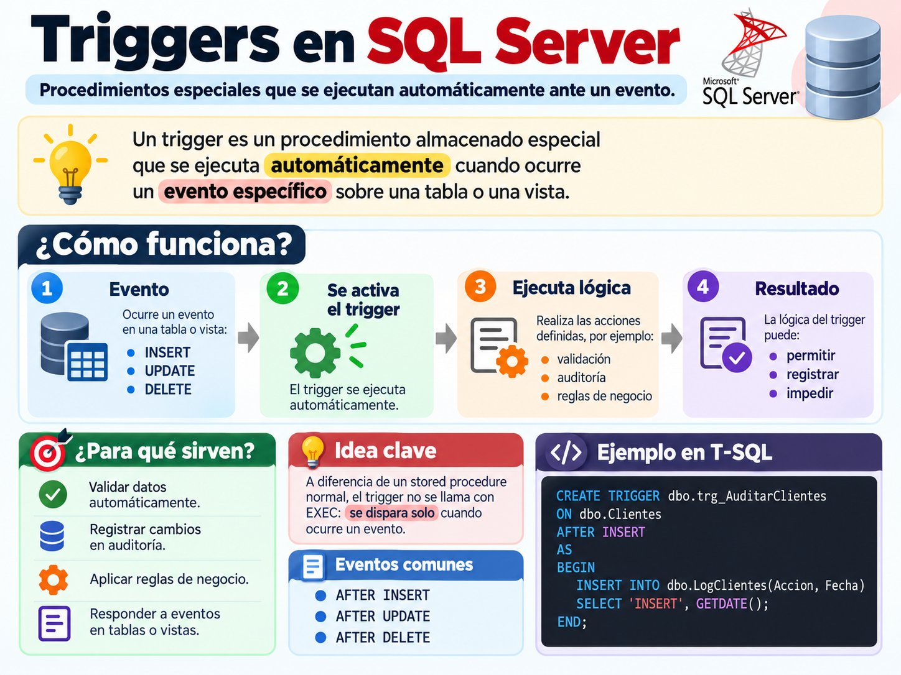

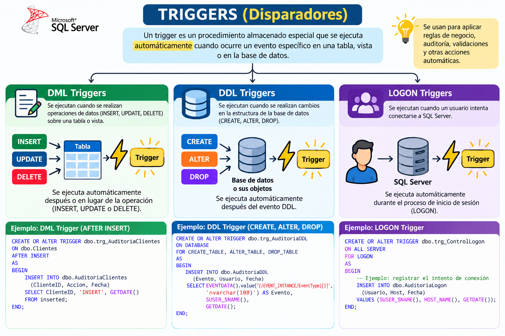

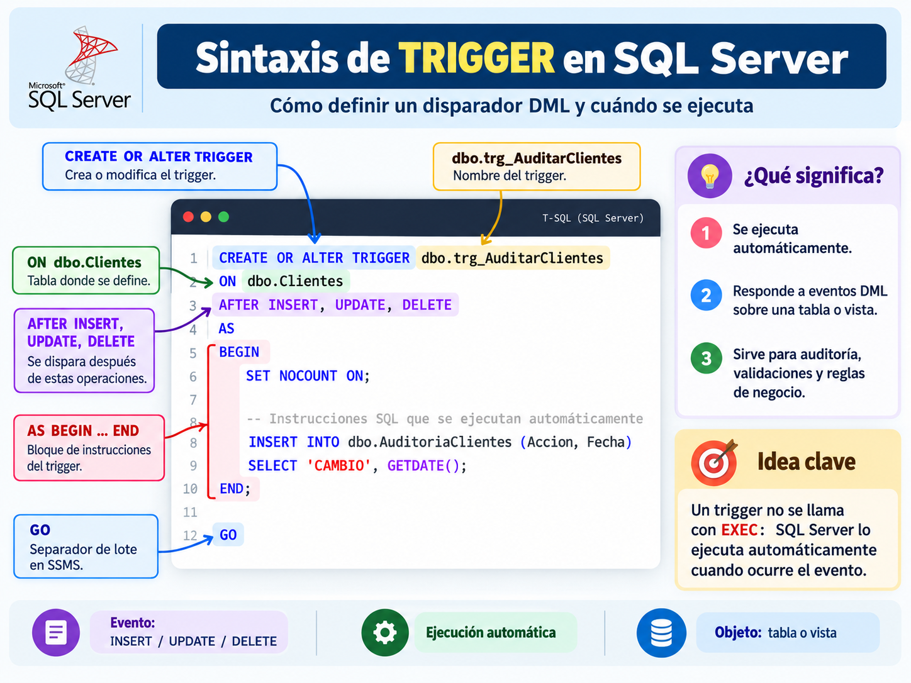

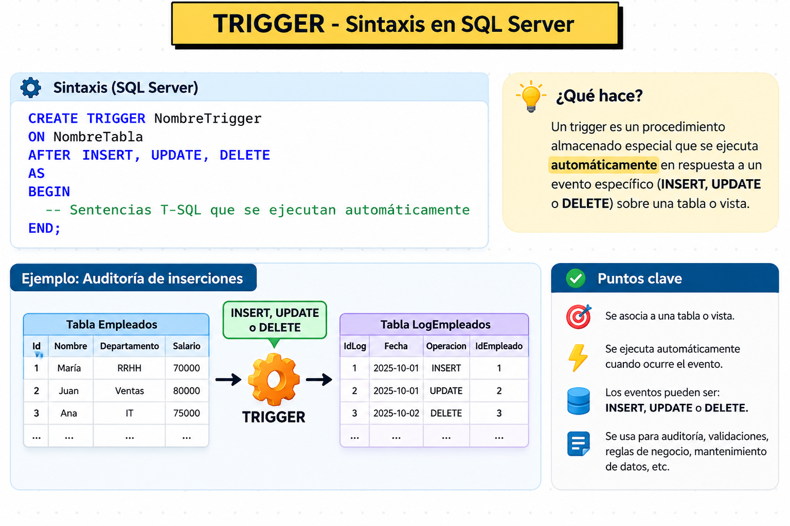

## Punto de partida

Seguimos con **Sonora**, la plataforma de streaming musical, y con la base de datos `SonoraDB`. Ejecuta este script antes de empezar. Retira cualquier trigger de esta clase que ya existiera, garantiza las cifras de siempre (43 reproducciones, 10 usuarios, 15 canciones y 9 artistas) y devuelve los planes de los usuarios y el catálogo a su estado original. Se puede ejecutar varias veces.

> Si conservas objetos de la clase de stored procedures con el mismo nombre (`dbo.historial_planes`, `dbo.bajas_usuarios`, `dbo.usp_cambiar_plan`), este script los borra. Hoy los volvemos a crear con otra forma.

```sql
USE SonoraDB;
GO

-- 0. Retirar los triggers de esta clase, por si ya existían.
--    Va lo primero: si siguieran activos, los pasos siguientes los dispararían.
DROP TRIGGER IF EXISTS trg_ddl_bitacora ON DATABASE;
DROP TRIGGER IF EXISTS trg_ddl_proteger_tablas ON DATABASE;
DROP TRIGGER IF EXISTS trg_ddl_vistas ON DATABASE;
DROP TRIGGER IF EXISTS trg_ddl_proteger_catalogo ON DATABASE;
GO

DROP TRIGGER IF EXISTS dbo.trg_artistas_aviso;
DROP TRIGGER IF EXISTS dbo.trg_usuarios_espia;
DROP TRIGGER IF EXISTS dbo.trg_usuarios_historial_planes;
DROP TRIGGER IF EXISTS dbo.trg_usuarios_baja;
DROP TRIGGER IF EXISTS dbo.trg_reproducciones_segundos;
DROP TRIGGER IF EXISTS dbo.trg_artistas_alta;
DROP TRIGGER IF EXISTS dbo.trg_canciones_aviso;
DROP TRIGGER IF EXISTS dbo.trg_usuarios_conteo;
DROP TRIGGER IF EXISTS dbo.trg_empleados_historial_puestos;
DROP TRIGGER IF EXISTS dbo.trg_reproducciones_contador;
DROP TRIGGER IF EXISTS dbo.trg_artistas_auditoria;
DROP TRIGGER IF EXISTS dbo.trg_reproducciones_fecha_alta;
DROP TRIGGER IF EXISTS dbo.trg_canciones_auditoria;
DROP TRIGGER IF EXISTS dbo.trg_canciones_reglas;
GO

-- 1. Retirar los objetos de apoyo de esta clase.
--    Al borrar una tabla o una vista se borran también sus triggers.
DROP VIEW IF EXISTS dbo.v_catalogo;
DROP VIEW IF EXISTS dbo.v_prueba_ddl;
DROP PROCEDURE IF EXISTS dbo.usp_cambiar_plan;

DROP TABLE IF EXISTS dbo.espia_trigger;
DROP TABLE IF EXISTS dbo.historial_planes;
DROP TABLE IF EXISTS dbo.bajas_usuarios;
DROP TABLE IF EXISTS dbo.log_cambios_esquema;
DROP TABLE IF EXISTS dbo.reproducciones_respaldo;
DROP TABLE IF EXISTS dbo.prueba_esquema;
DROP TABLE IF EXISTS dbo.prueba_libre;
DROP TABLE IF EXISTS dbo.altas_artistas;
DROP TABLE IF EXISTS dbo.conteo_trigger;
DROP TABLE IF EXISTS dbo.historial_puestos;
DROP TABLE IF EXISTS dbo.contador_canciones;
DROP TABLE IF EXISTS dbo.aud_artistas;
DROP TABLE IF EXISTS dbo.altas_web;
DROP TABLE IF EXISTS dbo.altas_web_rechazadas;
DROP TABLE IF EXISTS dbo.log_vistas;

DROP USER IF EXISTS svc_soporte;
GO

--    Y los del caso de estudio, por si se resolvió antes y no se limpió
DROP PROCEDURE IF EXISTS dbo.usp_sincronizar_catalogo;
DROP TABLE IF EXISTS dbo.aud_canciones;
DROP TABLE IF EXISTS dbo.rpt_catalogo;
DROP TABLE IF EXISTS dbo.ctl_sincronizacion;
GO

-- 2. Cargas de las clases anteriores (idempotentes)
INSERT INTO dbo.reproducciones
    (reproduccion_id, usuario_id, cancion_id, fecha_hora, segundos_escuchados, dispositivo, tipo_contenido)
SELECT s.reproduccion_id, s.usuario_id, s.cancion_id, s.fecha_hora,
       s.segundos_escuchados, s.dispositivo, s.tipo_contenido
FROM dbo.stg_reproducciones AS s
WHERE NOT EXISTS (SELECT 1 FROM dbo.reproducciones AS r WHERE r.reproduccion_id = s.reproduccion_id);

INSERT INTO dbo.usuarios (usuario_id, nombre_usuario, email, pais, plan_suscripcion, fecha_alta)
SELECT s.usuario_id, s.nombre_usuario, s.email, s.pais, s.plan_suscripcion, s.fecha_alta
FROM dbo.stg_usuarios AS s
WHERE NOT EXISTS (SELECT 1 FROM dbo.usuarios AS u WHERE u.usuario_id = s.usuario_id);
GO

-- 3. Lote del 22/09
DROP TABLE IF EXISTS dbo.stg_reproducciones_2209;

CREATE TABLE dbo.stg_reproducciones_2209 (
    reproduccion_id      int,
    usuario_id           int,
    cancion_id           int,
    fecha_hora           datetime2(0),
    segundos_escuchados  int,
    dispositivo          nvarchar(20),
    tipo_contenido       nvarchar(10)
);

INSERT INTO dbo.stg_reproducciones_2209
    (reproduccion_id, usuario_id, cancion_id, fecha_hora, segundos_escuchados, dispositivo, tipo_contenido) VALUES
(37, 5,  NULL, '2026-09-21 22:00', 30,  N'Móvil', N'Anuncio'),
(38, 5,  104,  '2026-09-21 22:01', 190, N'Móvil', N'Canción'),
(39, 8,  106,  '2026-09-22 07:30', 12,  N'Móvil', N'Canción'),
(40, 10, 103,  '2026-09-22 09:00', 176, N'Móvil', N'Canción'),
(41, 9,  NULL, '2026-09-22 09:10', 30,  N'Web',   N'Anuncio'),
(42, 9,  111,  '2026-09-22 09:11', 356, N'Web',   N'Canción'),
(43, 1,  114,  '2026-09-22 10:00', 25,  N'Móvil', N'Canción');

INSERT INTO dbo.reproducciones
    (reproduccion_id, usuario_id, cancion_id, fecha_hora, segundos_escuchados, dispositivo, tipo_contenido)
SELECT s.reproduccion_id, s.usuario_id, s.cancion_id, s.fecha_hora,
       s.segundos_escuchados, s.dispositivo, s.tipo_contenido
FROM dbo.stg_reproducciones_2209 AS s
WHERE NOT EXISTS (SELECT 1 FROM dbo.reproducciones AS r WHERE r.reproduccion_id = s.reproduccion_id);
GO

-- 4. Volver al punto de partida: se retira lo cargado o modificado en clases, ejercicios y casos
DELETE FROM dbo.reproducciones WHERE reproduccion_id > 43;
DELETE FROM dbo.usuarios       WHERE usuario_id > 10;
DELETE FROM dbo.canciones      WHERE cancion_id > 115;
DELETE FROM dbo.artistas       WHERE artista_id > 9;

UPDATE dbo.usuarios SET plan_suscripcion = N'Premium'  WHERE usuario_id IN (1, 3, 6, 8, 10);
UPDATE dbo.usuarios SET plan_suscripcion = N'Free'     WHERE usuario_id IN (2, 5, 7, 9);
UPDATE dbo.usuarios SET plan_suscripcion = N'Familiar' WHERE usuario_id = 4;

UPDATE dbo.empleados SET puesto = N'Data Engineer' WHERE empleado_id IN (5, 6);
UPDATE dbo.empleados SET jefe_id = 4 WHERE empleado_id = 7;

UPDATE dbo.canciones SET duracion_seg = 234 WHERE cancion_id = 106;
UPDATE dbo.canciones SET duracion_seg = 198 WHERE cancion_id = 107;
UPDATE dbo.canciones SET titulo = N'Diamantes Rotos' WHERE cancion_id = 109;
UPDATE dbo.canciones SET titulo = N'Sin Cobertura', duracion_seg = 175 WHERE cancion_id = 114;
UPDATE dbo.canciones SET titulo = N'Latido', duracion_seg = 330 WHERE cancion_id = 115;
GO

ALTER TABLE dbo.canciones DROP COLUMN IF EXISTS isrc;
GO

-- 5. Comprobación del punto de partida
SELECT (SELECT COUNT(*) FROM dbo.reproducciones) AS reproducciones,
       (SELECT COUNT(*) FROM dbo.usuarios)       AS usuarios,
       (SELECT COUNT(*) FROM dbo.canciones)      AS canciones,
       (SELECT COUNT(*) FROM dbo.artistas)       AS artistas,
       (SELECT COUNT(*) FROM sys.triggers)       AS triggers;
```

**Salida esperada de la comprobación:**

| reproducciones | usuarios | canciones | artistas | triggers |
| --- | --- | --- | --- | --- |
| 43 | 10 | 15 | 9 | 0 |

> **Regla de negocio de siempre:** una reproducción es **válida** cuando es de tipo `Canción` y se han escuchado al menos 30 segundos.

> **Hoy se crean objetos en ****`SonoraDB`**** que siguen actuando aunque nadie los llame.** Un trigger olvidado afecta a todo lo que se haga después sobre su tabla, también en las próximas clases. Por eso el script de limpieza del final de este documento no es opcional: ejecútalo al terminar.

> Los mensajes de error se muestran en inglés, que es el idioma por defecto de la instancia. Si tu instancia está en español, el número de mensaje (`Msg`) es el mismo aunque cambie el texto. Cuando el error se produce dentro de un trigger, SSMS añade al mensaje el nombre del trigger y el número de línea.

---

# Parte 01 · Teoría

## 1. Qué es un trigger: crear, disparar y localizar

### Definición

Un **trigger** (disparador) es un **programa escrito en T-SQL que se guarda unido a una tabla y que SQL Server ejecuta por su cuenta cada vez que alguien inserta, modifica o borra filas en ella**. Nadie lo llama: se dispara.

En la clase anterior, el procedimiento `usp_cambiar_plan` cambiaba el plan de un usuario y anotaba el cambio en un historial, las dos cosas o ninguna. Funcionaba, con una condición: que todo el mundo cambiara los planes **a través del procedimiento**. La semana pasada, un agente de soporte cambió un plan con un `UPDATE` escrito a mano en SSMS. El plan cambió. El historial no se enteró. Finanzas facturó con el plan antiguo.

Un procedimiento protege a quien pasa por él. Un trigger protege **la tabla**, entre quien entre y por donde entre.

|  | Stored procedure | Trigger |
| --- | --- | --- |
| ¿Quién lo pone en marcha? | Alguien que escribe `EXEC` | SQL Server, cuando ocurre el suceso |
| ¿A qué está unido? | A nada: es un objeto suelto del esquema | A una tabla o a una vista (o a la base de datos entera) |
| ¿Admite parámetros? | Sí | No. Recibe las filas afectadas en dos tablas especiales |
| ¿Devuelve algo? | Resultados, parámetros `OUTPUT`, código de retorno | Nada. Actúa o rechaza |
| ¿Se puede esquivar? | Sí: basta con no llamarlo | No: se dispara con cualquier instrucción, venga de donde venga |
| ¿En qué transacción trabaja? | En la que él abra | Siempre en la de la instrucción que lo ha disparado |

Un trigger se define respondiendo a tres preguntas:

25. **¿Sobre qué tabla?** Un trigger pertenece a una sola tabla.
26. **¿Ante qué operación?** `INSERT`, `UPDATE`, `DELETE`, o varias a la vez.
27. **¿En qué momento?** Después de la operación (`AFTER`) o en su lugar (`INSTEAD OF`).
Estos son los tipos que veremos:

| Tipo | Cuándo se dispara | Dónde se ve |
| --- | --- | --- |
| DML `AFTER` | **Después** de un `INSERT`, `UPDATE` o `DELETE` sobre una tabla | Secciones 1, 2 y 3 |
| DML `INSTEAD OF` | **En lugar de** un `INSERT`, `UPDATE` o `DELETE` sobre una tabla o una vista | Sección 4 |
| DDL | Después de un `CREATE`, `ALTER` o `DROP` en la base de datos | Sección 5 |

> DML son las instrucciones que tocan **datos** (`INSERT`, `UPDATE`, `DELETE`). DDL son las que tocan **estructura** (`CREATE`, `ALTER`, `DROP`).

### Analogía

Piensa en la **luz con sensor de movimiento** del portal de un edificio.

- Nadie pulsa un interruptor. La luz se enciende **porque ha pasado algo**: alguien ha cruzado el portal.
- Está instalada **en ese portal** y solo vigila ese portal. Lo que pase en el garaje no la enciende.
- **No distingue quién entra**: un vecino, el cartero o alguien que no debería estar allí. Se enciende igual.
- Quien cruza el portal no tiene que acordarse de nada, ni siquiera saber que el sensor existe.
El sensor es el trigger, el portal es la tabla y cruzarlo es el `INSERT`, el `UPDATE` o el `DELETE`. El interruptor de toda la vida, el que hay que acordarse de pulsar, es el procedimiento.

### Sintaxis

```sql
-- Crear o modificar
CREATE OR ALTER TRIGGER dbo.trg_tabla_proposito
ON dbo.tabla
AFTER INSERT, UPDATE, DELETE        -- una, dos o las tres operaciones
AS
BEGIN
    SET NOCOUNT ON;

    -- instrucciones
END;
GO

-- Ver su código
EXEC sp_helptext N'dbo.trg_tabla_proposito';

-- Borrar
DROP TRIGGER IF EXISTS dbo.trg_tabla_proposito;
```

**Reglas de T-SQL que conviene recordar:**

- Igual que con los procedimientos, `CREATE TRIGGER` tiene que ser **la primera instrucción de su lote** (error **Msg 111**) y su cuerpo **llega hasta el final del lote**. Un `GO` antes y otro justo después del `END;`.
- Un trigger **no tiene parámetros y no se puede llamar con ****`EXEC`**. La única forma de ejecutarlo es hacer en su tabla la operación que vigila.
- Se dispara **una vez por instrucción, no una vez por fila**. Un `UPDATE` que modifica mil filas dispara el trigger una sola vez.
- Se dispara **aunque la instrucción no afecte a ninguna fila**. Un `UPDATE` cuyo `WHERE` no encuentra nada también lo dispara.
- Un trigger `AFTER` se dispara cuando la instrucción **ya se ha ejecutado y ha superado todas las restricciones** (`PRIMARY KEY`, `FOREIGN KEY`, `CHECK`, `NOT NULL`). Si la instrucción falla por una restricción, el trigger no llega a dispararse.
- El trigger vive en el mismo esquema que su tabla. Si se borra la tabla, **sus triggers se borran con ella**.
- `SET NOCOUNT ON` al principio del cuerpo, siempre. Sin él, cada instrucción del trigger añade su propio `(n rows affected)` y quien lanzó un `UPDATE` de una fila ve en Messages recuentos que no entiende.
- Un trigger **no debe devolver resultados**: nada de `SELECT` que muestren filas. Su trabajo es actuar, no informar. En esta sección usaremos `PRINT` solo para verlo dispararse.
- En código antiguo verás `FOR` en lugar de `AFTER`. Son sinónimos.
- Convención de nombres de esta clase: `trg_`, la tabla y lo que hace. Por ejemplo, `trg_usuarios_historial_planes`.
### Ejemplo 1. Crear un trigger y verlo dispararse

**Contexto:** antes de construir nada serio, Elena Ruiz (Data Engineer) quiere que todo el equipo vea con sus propios ojos cuándo se dispara un trigger. Lo prueba sobre `artistas`, que es una tabla pequeña.

**Paso 1.** Crear el trigger. Lo único que hace es escribir un texto:

```sql
CREATE OR ALTER TRIGGER dbo.trg_artistas_aviso
ON dbo.artistas
AFTER INSERT, UPDATE, DELETE
AS
BEGIN
    PRINT N'>> Trigger disparado en dbo.artistas';
END;
GO
```

**Salida esperada (pestaña Messages de SSMS):** `Commands completed successfully.` El trigger se ha guardado. Todavía no ha ocurrido nada en la tabla, así que no se ha disparado.

**Paso 2.** Dar de alta un artista. Fíjate en que en esta instrucción no aparece el trigger por ningún lado:

```sql
INSERT INTO dbo.artistas (artista_id, nombre, pais, genero_id)
VALUES (10, N'Aurora Boreal', 'ES', 11);
```

**Salida esperada (Messages):**

```plain text
>> Trigger disparado en dbo.artistas

(1 row affected)
```

Nadie ha llamado al trigger. Se ha disparado porque alguien ha insertado en su tabla.

**Paso 3.** Comprobar dónde ha quedado guardado. En el Object Explorer de SSMS, despliega **Databases > SonoraDB > Tables > dbo.artistas > Triggers** (si no lo ves, botón derecho y **Refresh**). Los triggers no aparecen en la carpeta de procedimientos: cuelgan de su tabla.

También se puede consultar el catálogo del sistema:

```sql
SELECT name,
       OBJECT_NAME(parent_id) AS sobre,
       is_instead_of_trigger,
       is_disabled
FROM sys.triggers;
```

**Salida esperada:**

| name | sobre | is_instead_of_trigger | is_disabled |
| --- | --- | --- | --- |
| trg_artistas_aviso | artistas | 0 | 0 |

> `sys.triggers` tiene una fila por cada trigger de la base de datos. La columna `parent_id` guarda el identificador interno de la tabla a la que pertenece, y la función `OBJECT_NAME()` lo traduce a su nombre. Las otras dos columnas dicen si es un trigger `INSTEAD OF` y si está desactivado. Las usaremos en las secciones 4 y 6.

### Ejemplo 2. Cuándo se dispara y cuándo no

**Contexto:** con el mismo trigger de prueba, Elena lanza cinco instrucciones distintas. El equipo tiene que adivinar, antes de cada una, si aparecerá el aviso.

**Paso 1.** Un `UPDATE` que no encuentra ninguna fila:

```sql
UPDATE dbo.artistas
SET pais = 'PT'
WHERE artista_id = 999;
```

**Salida esperada (Messages):**

```plain text
>> Trigger disparado en dbo.artistas

(0 rows affected)
```

No se ha modificado nada y el trigger **se ha disparado igualmente**. Lo que lo dispara es la instrucción, no las filas.

**Paso 2.** Un `UPDATE` que afecta a todas las filas de la tabla:

```sql
UPDATE dbo.artistas
SET pais = pais;
```

**Salida esperada (Messages):**

```plain text
>> Trigger disparado en dbo.artistas

(10 rows affected)
```

Diez filas, **un solo aviso**. El trigger se dispara una vez por instrucción.

**Paso 3.** Una instrucción que falla. El artista 10 ya existe:

```sql
INSERT INTO dbo.artistas (artista_id, nombre, pais, genero_id)
VALUES (10, N'Aurora Boreal Bis', 'ES', 11);
```

**Salida esperada:** error **Msg 2627** (*Violation of PRIMARY KEY constraint... The duplicate key value is (10)*). El aviso **no aparece**: la instrucción no ha superado la clave primaria y un trigger `AFTER` solo se dispara detrás de una instrucción que ha terminado bien.

**Paso 4.** Una consulta:

```sql
SELECT COUNT(*) AS artistas FROM dbo.artistas;
```

**Salida esperada:**

artistas

---

10

---

Sin aviso. Leer no dispara nada: no existen triggers para `SELECT`.

**Paso 5.** Borrar el artista de prueba y, después, el trigger:

```sql
DELETE FROM dbo.artistas
WHERE artista_id = 10;
GO

DROP TRIGGER IF EXISTS dbo.trg_artistas_aviso;
```

**Salida esperada (Messages):** el aviso y `(1 row affected)` para el `DELETE`. Después, `Commands completed successfully.`

**Resumen de las cinco pruebas:**

| Instrucción | Filas afectadas | ¿Se dispara? |
| --- | --- | --- |
| `UPDATE` que no encuentra filas | 0 | Sí, una vez |
| `UPDATE` de toda la tabla | 10 | Sí, una vez |
| `INSERT` que falla por la clave primaria | Ninguna | No |
| `SELECT` | No modifica | No |
| `DELETE` de una fila | 1 | Sí, una vez |

> **Las dos primeras filas de esta tabla explican la mayoría de los triggers mal escritos.** Quien escribe un trigger pensando "se ha modificado una fila" está suponiendo algo que SQL Server no garantiza: pueden ser cero, una o un millón. Lo veremos fallar en el Ejemplo 4.

---

## 2. Las tablas `inserted` y `deleted`: auditar cambios

### Definición

Un trigger no recibe parámetros. Recibe algo mejor: **las filas que la instrucción acaba de tocar**. SQL Server se las entrega en dos tablas especiales que solo existen dentro del trigger:

- **`inserted`** contiene las filas **nuevas**: tal como han quedado.
- **`deleted`** contiene las filas **viejas**: tal como estaban.
Las dos tienen exactamente las mismas columnas que la tabla del trigger. Lo que contienen depende de la operación:

| Operación | `deleted` | `inserted` |
| --- | --- | --- |
| `INSERT` | Vacía | Las filas insertadas |
| `DELETE` | Las filas borradas | Vacía |
| `UPDATE` | Las filas **como estaban antes** | Las filas **como quedan después** |

Para SQL Server, un `UPDATE` es un borrado de la versión antigua seguido de una inserción de la versión nueva. Por eso un `UPDATE` rellena las dos tablas, y por eso no existe una tabla `updated`.

Con ellas, un trigger puede responder a las tres preguntas de cualquier auditoría: **qué ha cambiado, de qué valor a qué valor y en qué filas**. Y con dos funciones más, las otras dos: **cuándo** (`SYSDATETIME()`) y **quién** (`USER_NAME()`, que devuelve el usuario de base de datos que ha lanzado la instrucción).

En ingeniería de datos, esto tiene nombre propio: **captura de cambios**. Una tabla que anota cada cambio no solo sirve para rendir cuentas. Es también la lista de lo que hay que mover en la siguiente carga incremental.

### Analogía

Piensa en las **fotos de antes y después** que hace el perito de un seguro.

- Cuando te entregan un coche nuevo, solo hay foto de **después**: antes no había coche.
- Cuando lo llevas al desguace, solo queda la foto de **antes**.
- Cuando lo reparan, hay **dos fotos del mismo coche**. Para saber qué se ha arreglado, el perito las pone una al lado de la otra, emparejadas por la matrícula, y busca las diferencias.
La foto de antes es `deleted`, la de después es `inserted` y la matrícula es la clave primaria. Si en el taller han entrado tres coches, hay tres parejas de fotos: nunca hay que suponer que solo ha entrado uno.

### Sintaxis

```sql
-- Dentro de un trigger de dbo.tabla

-- Filas insertadas (INSERT) o filas como quedan (UPDATE)
SELECT clave, columna FROM inserted;

-- Filas borradas (DELETE) o filas como estaban (UPDATE)
SELECT clave, columna FROM deleted;

-- Emparejar el antes y el después de un UPDATE, por la clave primaria,
-- y quedarse con las filas en las que la columna ha cambiado de verdad
SELECT i.clave, d.columna AS antes, i.columna AS despues
FROM inserted AS i
JOIN deleted  AS d ON d.clave = i.clave
WHERE i.columna <> d.columna;

-- Salir pronto si el UPDATE ni siquiera menciona la columna que interesa
IF NOT UPDATE(columna)
    RETURN;

-- Saber qué operación ha disparado un trigger que atiende a varias
IF EXISTS (SELECT 1 FROM inserted) AND EXISTS (SELECT 1 FROM deleted)
    PRINT N'Ha sido un UPDATE';
ELSE IF EXISTS (SELECT 1 FROM inserted)
    PRINT N'Ha sido un INSERT';
ELSE
    PRINT N'Ha sido un DELETE, o una instrucción que no ha tocado ninguna fila';
```

**Reglas de T-SQL que conviene recordar:**

- `inserted` y `deleted` **solo existen dentro del trigger** y son de solo lectura.
- Contienen **todas** las filas afectadas por la instrucción: ninguna, una o un millón. Un trigger bien escrito las trata como lo que son, tablas, con `INSERT ... SELECT`, `JOIN` y `EXISTS`. Guardar su contenido en variables (`SELECT @id = usuario_id FROM inserted`) solo funciona cuando hay exactamente una fila.
- Para emparejar el antes y el después se unen por la **clave primaria**. Esto da por hecho que la clave primaria no se modifica, que es lo normal.
- `UPDATE(columna)` responde a una pregunta muy concreta: **¿aparece esa columna en el ****`SET`**** de la instrucción?** No dice si su valor ha cambiado. `SET plan_suscripcion = plan_suscripcion` hace que `UPDATE(plan_suscripcion)` sea cierto. Para saber si ha cambiado de verdad hay que comparar `inserted` con `deleted`.
- La comparación `i.columna <> d.columna` no detecta el paso de `NULL` a un valor, ni al revés. En columnas que admiten `NULL` hay que añadir esos casos con `IS NULL`.
- `RETURN` sale del trigger en ese punto. En un trigger no lleva ningún valor.
### Ejemplo 3. Mirar dentro de `inserted` y `deleted`

**Contexto:** las dos tablas solo existen dentro del trigger, así que no se pueden consultar desde fuera. Para verlas, Elena monta un trigger "espía" sobre `usuarios` que copia su contenido en una tabla normal.

**Paso 1.** Crear la tabla espía y el trigger:

```sql
DROP TABLE IF EXISTS dbo.espia_trigger;

CREATE TABLE dbo.espia_trigger (
    origen            varchar(8)    NOT NULL,
    usuario_id        int           NOT NULL,
    nombre_usuario    nvarchar(50)  NOT NULL,
    plan_suscripcion  nvarchar(20)  NOT NULL
);
GO

CREATE OR ALTER TRIGGER dbo.trg_usuarios_espia
ON dbo.usuarios
AFTER INSERT, UPDATE, DELETE
AS
BEGIN
    SET NOCOUNT ON;

    INSERT INTO dbo.espia_trigger (origen, usuario_id, nombre_usuario, plan_suscripcion)
    SELECT 'deleted', usuario_id, nombre_usuario, plan_suscripcion
    FROM deleted;

    INSERT INTO dbo.espia_trigger (origen, usuario_id, nombre_usuario, plan_suscripcion)
    SELECT 'inserted', usuario_id, nombre_usuario, plan_suscripcion
    FROM inserted;
END;
GO
```

**Paso 2.** Un `UPDATE` de una fila. Lo hacemos dentro de una transacción que se deshace al final, como en otras clases, para probar sin dejar rastro. Ejecuta el bloque completo de una vez:

```sql
BEGIN TRAN;

    UPDATE dbo.usuarios
    SET plan_suscripcion = N'Premium'
    WHERE nombre_usuario = N'marta_rock';

    SELECT origen, usuario_id, nombre_usuario, plan_suscripcion
    FROM dbo.espia_trigger
    ORDER BY origen, usuario_id;

ROLLBACK;
```

**Salida esperada:**

| origen | usuario_id | nombre_usuario | plan_suscripcion |
| --- | --- | --- | --- |
| deleted | 2 | marta_rock | Free |
| inserted | 2 | marta_rock | Premium |

La misma usuaria, dos veces: como estaba y como queda.

**Paso 3.** Un `INSERT`:

```sql
BEGIN TRAN;

    INSERT INTO dbo.usuarios (usuario_id, nombre_usuario, email, pais, plan_suscripcion, fecha_alta)
    VALUES (11, N'teo.bass', N'teo.bass@mail.com', 'ES', N'Free', '2026-09-24');

    SELECT origen, usuario_id, nombre_usuario, plan_suscripcion
    FROM dbo.espia_trigger
    ORDER BY origen, usuario_id;

ROLLBACK;
```

**Salida esperada:**

| origen | usuario_id | nombre_usuario | plan_suscripcion |
| --- | --- | --- | --- |
| inserted | 11 | teo.bass | Free |

Solo hay "después". `deleted` estaba vacía.

**Paso 4.** Un `DELETE`. La usuaria vale_indie tiene una reproducción, así que primero hay que borrarla:

```sql
BEGIN TRAN;

    DELETE FROM dbo.reproducciones
    WHERE usuario_id = 8;

    DELETE FROM dbo.usuarios
    WHERE nombre_usuario = N'vale_indie';

    SELECT origen, usuario_id, nombre_usuario, plan_suscripcion
    FROM dbo.espia_trigger
    ORDER BY origen, usuario_id;

ROLLBACK;
```

**Salida esperada:**

| origen | usuario_id | nombre_usuario | plan_suscripcion |
| --- | --- | --- | --- |
| deleted | 8 | vale_indie | Premium |

Solo hay "antes". El primer `DELETE` no ha dejado nada en la tabla espía porque el trigger es de `usuarios`, no de `reproducciones`.

**Paso 5.** Un `UPDATE` de varias filas: los dos usuarios de México.

```sql
BEGIN TRAN;

    UPDATE dbo.usuarios
    SET plan_suscripcion = N'Familiar'
    WHERE pais = 'MX';

    SELECT origen, usuario_id, nombre_usuario, plan_suscripcion
    FROM dbo.espia_trigger
    ORDER BY origen, usuario_id;

ROLLBACK;
```

**Salida esperada:**

| origen | usuario_id | nombre_usuario | plan_suscripcion |
| --- | --- | --- | --- |
| deleted | 3 | juanpi | Premium |
| deleted | 7 | nachox | Free |
| inserted | 3 | juanpi | Familiar |
| inserted | 7 | nachox | Familiar |

El trigger se ha disparado **una vez** y ha recibido **dos filas en cada tabla**. Para saber qué "antes" corresponde a qué "después" hay que emparejarlas por `usuario_id`.

**Paso 6.** Comprobar qué ha quedado en la tabla espía y retirar el montaje:

```sql
SELECT COUNT(*) AS filas_en_espia FROM dbo.espia_trigger;
GO

DROP TRIGGER IF EXISTS dbo.trg_usuarios_espia;
DROP TABLE IF EXISTS dbo.espia_trigger;
```

**Salida esperada:**

filas_en_espia

---

0

---

> La tabla espía está vacía. Cada `ROLLBACK` se ha llevado el cambio en `usuarios` **y también lo que escribió el trigger**. No es casualidad: el trigger trabaja dentro de la misma transacción que la instrucción que lo dispara. Es la propiedad más importante de un trigger y la que hace fiable todo lo que viene ahora.

### Ejemplo 4. Un trigger que solo sabe contar hasta uno

**Contexto:** Raúl Benet (Head of Data) quiere que el historial de cambios de plan no dependa de que la gente se acuerde de usar el procedimiento. Hugo Marín (Backend Lead) escribe un trigger en diez minutos y lo prueba con un cambio. Funciona.

**Paso 1.** Crear la tabla de historial. Dos columnas se rellenan solas: la fecha y el usuario de base de datos que hizo el cambio.

```sql
DROP TABLE IF EXISTS dbo.historial_planes;

CREATE TABLE dbo.historial_planes (
    cambio_id      int IDENTITY(1,1) NOT NULL PRIMARY KEY,
    usuario_id     int            NOT NULL,
    plan_anterior  nvarchar(20)   NOT NULL,
    plan_nuevo     nvarchar(20)   NOT NULL,
    fecha_cambio   datetime2(0)   NOT NULL DEFAULT SYSDATETIME(),
    usuario_bd     nvarchar(128)  NOT NULL DEFAULT USER_NAME(),
    CONSTRAINT CK_historial_planes_plan
        CHECK (plan_nuevo IN (N'Free', N'Premium', N'Familiar'))
);
GO
```

> `USER_NAME()` devuelve el nombre del usuario de base de datos con el que se está trabajando. Como administradores de nuestra instancia, somos `dbo`.

**Paso 2.** Crear el trigger de Hugo:

```sql
CREATE OR ALTER TRIGGER dbo.trg_usuarios_historial_planes
ON dbo.usuarios
AFTER UPDATE
AS
BEGIN
    SET NOCOUNT ON;

    DECLARE @usuario_id int, @plan_anterior nvarchar(20), @plan_nuevo nvarchar(20);

    SELECT @usuario_id = usuario_id,
           @plan_nuevo = plan_suscripcion
    FROM inserted;

    SELECT @plan_anterior = plan_suscripcion
    FROM deleted;

    INSERT INTO dbo.historial_planes (usuario_id, plan_anterior, plan_nuevo)
    VALUES (@usuario_id, @plan_anterior, @plan_nuevo);
END;
GO
```

**Paso 3.** La prueba de Hugo: un cambio de plan, hecho con un `UPDATE` a mano.

```sql
UPDATE dbo.usuarios
SET plan_suscripcion = N'Premium'
WHERE nombre_usuario = N'marta_rock';

SELECT usuario_id, plan_anterior, plan_nuevo, usuario_bd
FROM dbo.historial_planes
ORDER BY cambio_id;
```

**Salida esperada:**

| usuario_id | plan_anterior | plan_nuevo | usuario_bd |
| --- | --- | --- | --- |
| 2 | Free | Premium | dbo |

Perfecto. Nadie ha llamado a ningún procedimiento y el cambio ha quedado anotado.

**Paso 4.** Llega una campaña de Marketing: todos los usuarios Free pasan a Premium durante la promoción. Quedan tres (dani_dj, nachox y pau.synth):

```sql
UPDATE dbo.usuarios
SET plan_suscripcion = N'Premium'
WHERE plan_suscripcion = N'Free';

SELECT usuario_id, plan_anterior, plan_nuevo
FROM dbo.historial_planes
ORDER BY cambio_id;
```

**Salida esperada:** en Messages, `(3 rows affected)`. En Results:

| usuario_id | plan_anterior | plan_nuevo |
| --- | --- | --- |
| 2 | Free | Premium |
| 5, 7 o 9 | Free | Premium |

Han cambiado de plan **tres** usuarios y el historial solo ha anotado **uno**. No se puede saber de antemano cuál: cuando un `SELECT @variable = columna` lee varias filas, la variable se queda con el valor de una cualquiera de ellas. Sin error y sin aviso.

**Paso 5.** Un `UPDATE` que no afecta a nadie:

```sql
UPDATE dbo.usuarios
SET email = N'nadie@mail.com'
WHERE usuario_id = 999;
```

**Salida esperada:** error **Msg 515** (*Cannot insert the value NULL into column..., table 'SonoraDB.dbo.historial_planes'; column does not allow nulls. INSERT fails.*).

Una instrucción inofensiva, que no toca ninguna fila, **falla por culpa del trigger**. `inserted` estaba vacía, las variables se quedaron en `NULL` y el trigger intentó anotar un cambio que no existía.

**Paso 6.** Un `UPDATE` que no tiene nada que ver con el plan:

```sql
UPDATE dbo.usuarios
SET pais = 'ES'
WHERE nombre_usuario = N'alexbeats';

SELECT usuario_id, plan_anterior, plan_nuevo
FROM dbo.historial_planes
WHERE usuario_id = 1;
```

**Salida esperada:**

| usuario_id | plan_anterior | plan_nuevo |
| --- | --- | --- |
| 1 | Premium | Premium |

El historial dice que alexbeats ha "cambiado" de Premium a Premium.

**Los tres fallos del trigger de Hugo:**

| Situación | Qué hace | Qué debería hacer |
| --- | --- | --- |
| La instrucción cambia el plan de varias filas | Anota una, la que le toque | Anotar todas |
| La instrucción no afecta a ninguna fila | Falla y deshace una instrucción inofensiva | No hacer nada |
| La instrucción no cambia el plan | Anota un cambio falso | No anotar nada |

**Paso 7.** Dejarlo todo como estaba antes de arreglarlo:

```sql
UPDATE dbo.usuarios
SET plan_suscripcion = N'Free'
WHERE usuario_id IN (2, 5, 7, 9);

DELETE FROM dbo.historial_planes;
```

> Este es **el error más frecuente al escribir triggers**, y es difícil de cazar porque las pruebas de una sola fila salen bien. Se manifiesta el día que alguien lanza una carga o una corrección masiva, que es justo cuando más hace falta el historial.

### Ejemplo 5. El mismo trigger, pensado para conjuntos

**Contexto:** Elena reescribe el trigger sin una sola variable. `inserted` y `deleted` son tablas, y se tratan como tablas.

**Paso 1.** Sustituir el trigger:

```sql
CREATE OR ALTER TRIGGER dbo.trg_usuarios_historial_planes
ON dbo.usuarios
AFTER UPDATE
AS
BEGIN
    SET NOCOUNT ON;

    IF NOT UPDATE(plan_suscripcion)
        RETURN;

    INSERT INTO dbo.historial_planes (usuario_id, plan_anterior, plan_nuevo)
    SELECT i.usuario_id, d.plan_suscripcion, i.plan_suscripcion
    FROM inserted AS i
    JOIN deleted  AS d ON d.usuario_id = i.usuario_id
    WHERE i.plan_suscripcion <> d.plan_suscripcion;
END;
GO
```

**Cómo leerlo:**

28. Si la instrucción ni siquiera menciona `plan_suscripcion`, el trigger sale sin leer nada.
29. El `JOIN` empareja cada fila nueva con su versión antigua.
30. El `WHERE` se queda con las filas en las que el plan ha cambiado de verdad.
31. Un único `INSERT ... SELECT` anota todas las que queden: ninguna, una o mil.
**Paso 2.** Repetir el cambio de marta_rock y la campaña de Marketing:

```sql
UPDATE dbo.usuarios
SET plan_suscripcion = N'Premium'
WHERE nombre_usuario = N'marta_rock';

UPDATE dbo.usuarios
SET plan_suscripcion = N'Premium'
WHERE plan_suscripcion = N'Free';

SELECT usuario_id, plan_anterior, plan_nuevo, usuario_bd
FROM dbo.historial_planes
ORDER BY usuario_id;
```

**Salida esperada:**

| usuario_id | plan_anterior | plan_nuevo | usuario_bd |
| --- | --- | --- | --- |
| 2 | Free | Premium | dbo |
| 5 | Free | Premium | dbo |
| 7 | Free | Premium | dbo |
| 9 | Free | Premium | dbo |

Cuatro cambios, cuatro filas.

**Paso 3.** Las tres instrucciones que no deben dejar rastro:

```sql
-- No afecta a ninguna fila
UPDATE dbo.usuarios
SET email = N'nadie@mail.com'
WHERE usuario_id = 999;

-- No menciona el plan
UPDATE dbo.usuarios
SET pais = 'ES'
WHERE nombre_usuario = N'alexbeats';

-- Menciona el plan, pero no lo cambia
UPDATE dbo.usuarios
SET plan_suscripcion = plan_suscripcion;

SELECT COUNT(*) AS cambios_en_historial FROM dbo.historial_planes;
```

**Salida esperada:** ningún error. En Messages, `(0 rows affected)`, `(1 row affected)` y `(10 rows affected)`. En Results:

cambios_en_historial

---

4

---

| Instrucción | Por qué no anota nada |
| --- | --- |
| La que no afecta a ninguna fila | `UPDATE(plan_suscripcion)` es falso: el trigger sale en la primera línea |
| La que cambia el país | Lo mismo: el `SET` no menciona el plan |
| `SET plan_suscripcion = plan_suscripcion` | `UPDATE(plan_suscripcion)` es cierto, pero el `WHERE` descarta las diez filas porque el plan no ha cambiado |

**Paso 4.** Un plan mal escrito, tecleado a mano. Es el mismo error que en la clase anterior dejó a marta_rock con un plan que no existía:

```sql
UPDATE dbo.usuarios
SET plan_suscripcion = N'Premiun'
WHERE nombre_usuario = N'alexbeats';
GO

SELECT nombre_usuario, plan_suscripcion
FROM dbo.usuarios
WHERE nombre_usuario = N'alexbeats';

SELECT COUNT(*) AS cambios_en_historial FROM dbo.historial_planes;
```

**Salida esperada:** error **Msg 547** (*The INSERT statement conflicted with the CHECK constraint "CK_historial_planes_plan"...*), con el nombre del trigger. Y en Results:

| nombre_usuario | plan_suscripcion |
| --- | --- |
| alexbeats | Premium |

cambios_en_historial

---

4

---

**Paso a paso, qué ha ocurrido:**

32. El `UPDATE` se ejecuta. La tabla `usuarios` no tiene ninguna restricción sobre el plan, así que lo acepta.
33. Se dispara el trigger e intenta anotar el cambio en el historial.
34. El historial rechaza `Premiun` por su restricción `CHECK`. El trigger falla.
35. Como el trigger y el `UPDATE` son **una sola transacción**, se deshace todo. alexbeats sigue en Premium.
Nadie ha escrito `BEGIN TRAN`, ni `XACT_ABORT`, ni `TRY ... CATCH`. La garantía "cambio de plan e historial, las dos cosas o ninguna" que ayer nos costó una plantilla entera, en un trigger viene de serie.

**Paso 5.** Terminar la campaña: los cuatro usuarios vuelven a Free.

```sql
UPDATE dbo.usuarios
SET plan_suscripcion = N'Free'
WHERE usuario_id IN (2, 5, 7, 9);

SELECT usuario_id, plan_anterior, plan_nuevo
FROM dbo.historial_planes
ORDER BY usuario_id, cambio_id;
```

**Salida esperada:**

| usuario_id | plan_anterior | plan_nuevo |
| --- | --- | --- |
| 2 | Free | Premium |
| 2 | Premium | Free |
| 5 | Free | Premium |
| 5 | Premium | Free |
| 7 | Free | Premium |
| 7 | Premium | Free |
| 9 | Free | Premium |
| 9 | Premium | Free |

La vuelta también queda anotada. El historial tiene ocho filas y cuenta la historia completa de cada usuario.

> **Regla práctica:** si en un trigger aparece `SELECT @variable = ... FROM inserted` o `FROM deleted`, hay un fallo esperando su día. La prueba de cualquier trigger tiene tres partes: una instrucción de **una fila**, una de **varias filas** y una de **ninguna**.

### Ejemplo 6. Quién ha sido: el trigger también ve lo que entra por un procedimiento

**Contexto:** el historial ya no depende del procedimiento. ¿Sobra entonces `usp_cambiar_plan`? No. Sigue siendo la puerta por la que Soporte cambia planes sin tener permiso sobre la tabla. Lo que cambia es el reparto de trabajo: el procedimiento valida y ofrece la operación; el trigger garantiza el rastro.

**Paso 1.** Crear el procedimiento de hoy. Compáralo con el de ayer: ya no escribe en el historial, así que solo hace una modificación y no necesita transacción.

```sql
CREATE OR ALTER PROCEDURE dbo.usp_cambiar_plan
    @nombre_usuario  nvarchar(50),
    @plan_nuevo      nvarchar(20)
AS
BEGIN
    SET NOCOUNT ON;

    IF NOT EXISTS (SELECT 1 FROM dbo.usuarios WHERE nombre_usuario = @nombre_usuario)
        THROW 50002, N'El usuario no existe.', 1;

    UPDATE dbo.usuarios
    SET plan_suscripcion = @plan_nuevo
    WHERE nombre_usuario = @nombre_usuario;
END;
GO
```

**Paso 2.** Crear la cuenta de Soporte. Solo puede ejecutar ese procedimiento:

```sql
IF USER_ID(N'svc_soporte') IS NULL
    CREATE USER svc_soporte WITHOUT LOGIN;

GRANT EXECUTE ON OBJECT::dbo.usp_cambiar_plan TO svc_soporte;
GO
```

**Paso 3.** Cambiar un plan como `svc_soporte` y mirar el historial:

```sql
EXECUTE AS USER = N'svc_soporte';

EXEC dbo.usp_cambiar_plan @nombre_usuario = N'marta_rock', @plan_nuevo = N'Premium';

REVERT;
GO

SELECT TOP (1) usuario_id, plan_anterior, plan_nuevo, usuario_bd
FROM dbo.historial_planes
ORDER BY cambio_id DESC;
```

**Salida esperada:**

| usuario_id | plan_anterior | plan_nuevo | usuario_bd |
| --- | --- | --- | --- |
| 2 | Free | Premium | svc_soporte |

El procedimiento no sabe que existe un historial. El trigger se ha disparado dentro del `UPDATE` del procedimiento y ha anotado **quién** estaba detrás.

**Paso 4.** Intentar, como `svc_soporte`, falsear el historial o borrarlo:

```sql
EXECUTE AS USER = N'svc_soporte';

INSERT INTO dbo.historial_planes (usuario_id, plan_anterior, plan_nuevo)
VALUES (2, N'Premium', N'Free');

DELETE FROM dbo.historial_planes;

REVERT;
GO
```

**Salida esperada:** dos errores **Msg 229**:

```plain text
The INSERT permission was denied on the object 'historial_planes', database 'SonoraDB', schema 'dbo'.
The DELETE permission was denied on the object 'historial_planes', database 'SonoraDB', schema 'dbo'.
```

La cuenta de Soporte no puede escribir en el historial. Sin embargo, en el Paso 3 **el trigger sí escribió en su nombre**. Es el encadenamiento de propiedad que ya conoces: el trigger, la tabla `usuarios` y la tabla `historial_planes` son del mismo propietario (`dbo`), así que lo que hace el trigger no vuelve a pasar por el control de permisos.

**Paso 5.** Devolver a marta_rock a su plan, ahora como `dbo`:

```sql
EXEC dbo.usp_cambiar_plan @nombre_usuario = N'marta_rock', @plan_nuevo = N'Free';

SELECT COUNT(*) AS cambios_en_historial FROM dbo.historial_planes;
```

**Salida esperada:**

cambios_en_historial

---

10

---

> Con las tres piezas juntas, Soporte puede cambiar planes, no puede tocar la tabla de usuarios ni el historial, y cada cambio queda anotado con su nombre, lo haga por el procedimiento o lo haga un administrador con un `UPDATE` a mano. **Procedimiento y trigger no compiten: el primero es la puerta y el segundo es la cámara.**

---

## 3. Triggers que validan: `THROW` y la transacción compartida

### Definición

Hasta aquí, el trigger ha sido un notario: mira lo que ha pasado y lo anota. Pero un trigger también puede **decir que no**.

Un trigger `AFTER` se ejecuta cuando la instrucción ya está hecha, pero todavía **dentro de su transacción**. Si en ese momento el trigger lanza un error con `THROW`, SQL Server deshace la transacción entera: la instrucción que lo disparó y cualquier cosa que hubiera hecho el propio trigger. Para quien lanzó la instrucción, es como si nunca se hubiera ejecutado.

Esto permite imponer reglas que las restricciones no saben expresar:

| Tipo de regla | Ejemplo | ¿Por qué no sirve una restricción? |
| --- | --- | --- |
| Entre dos tablas | Los segundos escuchados no pueden superar la duración de la canción | Un `CHECK` solo ve las columnas de su propia fila |
| De transición | El artista de una canción no puede cambiar si ya tiene reproducciones | Un `CHECK` no conoce el valor anterior |
| De protección | Las filas de un historial no se pueden modificar ni borrar | No existe una restricción "solo altas" |

El orden de preferencia no cambia: **primero la restricción, después el trigger**. Si una regla cabe en un `NOT NULL`, un `CHECK`, un `UNIQUE` o una `FOREIGN KEY`, va ahí. Las restricciones son más rápidas, se ven en la definición de la tabla y no se pueden escribir mal. El trigger es para lo que no cabe.

Conviene tener claro hasta dónde llega el `THROW` de un trigger:

| Dónde está la instrucción que dispara el trigger | Qué se deshace |
| --- | --- |
| Suelta, sin `BEGIN TRAN` | Esa instrucción |
| Dentro de un `BEGIN TRAN ... COMMIT` | **Toda** la transacción, también las instrucciones anteriores |
| Dentro de un procedimiento con la plantilla de la clase anterior | Toda la transacción. El error llega al `CATCH` del procedimiento |

Además, el error de un trigger **termina el lote**: las instrucciones que hubiera detrás, hasta el siguiente `GO`, no se ejecutan. Es más contundente que un error normal, que solo anula su instrucción y deja seguir a la siguiente.

### Analogía

Piensa en el **VAR** de un partido de fútbol.

- El VAR no impide que el delantero chute. La jugada **se produce**: el balón entra y el marcador cambia.
- **Después**, el VAR revisa la jugada completa, con información que el árbitro no tenía en el campo.
- Si encuentra un fuera de juego, el gol **se anula**. El marcador vuelve a como estaba, como si la jugada no hubiera existido.
- Y explica por qué: "fuera de juego del número 9". Un gol anulado sin explicación solo genera discusiones.
La jugada es la instrucción, la revisión es el trigger `AFTER`, anular el gol es deshacer la transacción y la explicación es el texto del `THROW`.

### Sintaxis

```sql
CREATE OR ALTER TRIGGER dbo.trg_tabla_regla
ON dbo.tabla
AFTER INSERT, UPDATE
AS
BEGIN
    SET NOCOUNT ON;

    IF EXISTS (SELECT 1
               FROM inserted AS i
               JOIN dbo.otra_tabla AS o ON o.clave = i.clave
               WHERE i.valor > o.limite)          -- la condición que NO debe darse
        THROW 50100, N'Texto que explica la regla incumplida.', 1;
END;
GO
```

**Reglas de T-SQL que conviene recordar:**

- La pregunta se hace sobre el conjunto: **"¿hay alguna fila, entre las afectadas, que incumpla la regla?"**. Con `IF EXISTS` sobre `inserted` o `deleted`, nunca con variables.
- Si una sola fila incumple, **se deshace la instrucción entera**, con todas sus filas. Un trigger `AFTER` no sabe aceptar unas filas y rechazar otras.
- En un trigger basta con `THROW`. No hace falta escribir `ROLLBACK`: dentro de un trigger, `XACT_ABORT` está activado por defecto y cualquier error deshace la transacción.
- La instrucción anterior al `THROW` debe terminar en punto y coma, como siempre.
- No abras transacciones propias (`BEGIN TRAN ... COMMIT`) dentro de un trigger. Ya estás dentro de una.
- En código antiguo verás triggers que hacen `ROLLBACK` a secas. Funcionan, pero quien lanzó la instrucción recibe el error genérico **Msg 3609** (*The transaction ended in the trigger. The batch has been aborted.*), que no dice qué regla se ha incumplido.
- Un trigger valida **lo que pasa mientras está activo**. No revisa las filas que ya había en la tabla cuando se creó.
### Ejemplo 7. Un historial que solo admite altas

**Contexto:** un historial que se puede corregir no vale como prueba. Raúl quiere que en `historial_planes` solo se pueda insertar. Nada de modificar, nada de borrar.

**Paso 1.** La versión rápida, con un `ROLLBACK` a secas:

```sql
CREATE OR ALTER TRIGGER dbo.trg_historial_planes_solo_altas
ON dbo.historial_planes
AFTER UPDATE, DELETE
AS
BEGIN
    SET NOCOUNT ON;

    IF EXISTS (SELECT 1 FROM deleted)
        ROLLBACK;
END;
GO

DELETE FROM dbo.historial_planes;
GO

SELECT COUNT(*) AS cambios_en_historial FROM dbo.historial_planes;
```

**Salida esperada:** error **Msg 3609** (*The transaction ended in the trigger. The batch has been aborted.*). Y en Results:

cambios_en_historial

---

10

---

El historial está a salvo. Pero el mensaje no ayuda: quien lo recibe no sabe qué ha hecho mal ni si es un fallo del sistema.

**Paso 2.** La versión que se explica:

```sql
CREATE OR ALTER TRIGGER dbo.trg_historial_planes_solo_altas
ON dbo.historial_planes
AFTER UPDATE, DELETE
AS
BEGIN
    SET NOCOUNT ON;

    IF NOT EXISTS (SELECT 1 FROM deleted)
        RETURN;

    THROW 50101, N'El historial de planes no se puede modificar ni borrar.', 1;
END;
GO
```

> Tanto en un `UPDATE` como en un `DELETE`, las filas afectadas están en `deleted`. Si `deleted` está vacía, la instrucción no ha tocado nada y el trigger sale sin protestar.

**Paso 3.** Probar a borrar, a modificar y a borrar algo que no existe:

```sql
DELETE FROM dbo.historial_planes;
GO

UPDATE dbo.historial_planes
SET plan_nuevo = N'Familiar'
WHERE usuario_id = 2;
GO

DELETE FROM dbo.historial_planes
WHERE usuario_id = 999;
GO

SELECT COUNT(*) AS cambios_en_historial FROM dbo.historial_planes;
```

**Salida esperada:** dos veces el error **Msg 50101** (*El historial de planes no se puede modificar ni borrar.*), con el nombre del trigger. Después, `(0 rows affected)` para el tercer intento, sin error. Y en Results:

cambios_en_historial

---

10

---

> Las tres pruebas van separadas por `GO` a propósito. El error de un trigger termina el lote: si estuvieran las tres en el mismo, las dos últimas no se habrían ejecutado.

> Este trigger no protege de todo. Quien tenga permiso para ello puede borrar la tabla entera con `DROP TABLE`, y con la tabla se van sus filas y su trigger, sin que se dispare nada. Vigilar eso es trabajo de los triggers DDL de la sección 5.

### Ejemplo 8. Una regla entre dos tablas, y hasta dónde llega el rechazo

**Contexto:** en la carga nocturna de la clase anterior, uno de los controles apartaba las reproducciones con más segundos escuchados que la duración de la canción. Ese control vive en el procedimiento de carga. Pero en `reproducciones` también escribe la app, y a veces alguien con SSMS. Elena quiere que la regla viva **en la tabla**, como última línea de defensa.

**Paso 1.** Crear el trigger. La duración está en `canciones`, así que hace falta un `JOIN`:

```sql
CREATE OR ALTER TRIGGER dbo.trg_reproducciones_segundos
ON dbo.reproducciones
AFTER INSERT, UPDATE
AS
BEGIN
    SET NOCOUNT ON;

    IF EXISTS (SELECT 1
               FROM inserted AS i
               JOIN dbo.canciones AS c ON c.cancion_id = i.cancion_id
               WHERE i.segundos_escuchados > c.duracion_seg)
        THROW 50102, N'Hay reproducciones con más segundos escuchados que la duración de su canción.', 1;
END;
GO
```

> Los anuncios llegan con `cancion_id` a `NULL`. No encuentran pareja en el `JOIN`, así que la regla no les afecta. Es lo correcto.

**Paso 2.** Una reproducción imposible: 900 segundos de *Sin Cobertura*, que dura 175.

```sql
INSERT INTO dbo.reproducciones
    (reproduccion_id, usuario_id, cancion_id, fecha_hora, segundos_escuchados, dispositivo, tipo_contenido)
VALUES (46, 4, 114, '2026-09-23 22:40', 900, N'Móvil', N'Canción');
GO

SELECT COUNT(*) AS reproducciones FROM dbo.reproducciones;
```

**Salida esperada:** error **Msg 50102** (*Hay reproducciones con más segundos escuchados que la duración de su canción.*). Y en Results:

reproducciones

---

43

---

**Paso 3.** Un lote de tres filas: dos correctas y la misma fila imposible.

```sql
INSERT INTO dbo.reproducciones
    (reproduccion_id, usuario_id, cancion_id, fecha_hora, segundos_escuchados, dispositivo, tipo_contenido) VALUES
(44, 2, 107, '2026-09-23 08:20', 198, N'Web',      N'Canción'),
(45, 6, 113, '2026-09-23 12:05', 158, N'Smart TV', N'Canción'),
(46, 4, 114, '2026-09-23 22:40', 900, N'Móvil',    N'Canción');
GO

SELECT COUNT(*) AS reproducciones FROM dbo.reproducciones;
```

**Salida esperada:** el mismo error **Msg 50102**. Y en Results:

reproducciones

---

43

---

No ha entrado **ninguna** de las tres. El trigger juzga la instrucción entera: una fila mala tumba a las dos buenas.

**Paso 4.** El mismo lote sin la fila mala:

```sql
INSERT INTO dbo.reproducciones
    (reproduccion_id, usuario_id, cancion_id, fecha_hora, segundos_escuchados, dispositivo, tipo_contenido) VALUES
(44, 2, 107, '2026-09-23 08:20', 198, N'Web',      N'Canción'),
(45, 6, 113, '2026-09-23 12:05', 158, N'Smart TV', N'Canción');
GO

SELECT COUNT(*) AS reproducciones FROM dbo.reproducciones;
```

**Salida esperada:** `(2 rows affected)` y:

reproducciones

---

45

---

**Paso 5.** El rechazo dentro de una transacción más grande. Antes de la fila imposible va un cambio que no tiene nada que ver:

```sql
BEGIN TRAN;

    UPDATE dbo.usuarios
    SET pais = 'PT'
    WHERE nombre_usuario = N'pau.synth';

    INSERT INTO dbo.reproducciones
        (reproduccion_id, usuario_id, cancion_id, fecha_hora, segundos_escuchados, dispositivo, tipo_contenido)
    VALUES (46, 4, 114, '2026-09-23 22:40', 900, N'Móvil', N'Canción');

COMMIT;
GO

SELECT @@TRANCOUNT AS transacciones_abiertas;

SELECT nombre_usuario, pais
FROM dbo.usuarios
WHERE nombre_usuario = N'pau.synth';
```

**Salida esperada:** error **Msg 50102**. Y en Results:

transacciones_abiertas

---

0

---

| nombre_usuario | pais |
| --- | --- |
| pau.synth | ES |

**Paso a paso, qué ha ocurrido:**

36. `BEGIN TRAN` abre la transacción.
37. El `UPDATE` cambia el país de pau.synth a `PT`.
38. El `INSERT` se ejecuta y dispara el trigger, que encuentra la fila imposible y lanza el error.
39. Se deshace **toda** la transacción: el `INSERT` y también el `UPDATE` del país, que no tenía ninguna culpa.
40. El lote termina ahí. El `COMMIT` no llega a ejecutarse, y tampoco hace falta: ya no queda ninguna transacción abierta.
**Paso 6.** Cómo lo ve quien llama desde un `TRY ... CATCH`, que es como llama un procedimiento de carga:

```sql
BEGIN TRY
    INSERT INTO dbo.reproducciones
        (reproduccion_id, usuario_id, cancion_id, fecha_hora, segundos_escuchados, dispositivo, tipo_contenido)
    VALUES (46, 4, 114, '2026-09-23 22:40', 900, N'Móvil', N'Canción');
END TRY
BEGIN CATCH
    IF @@TRANCOUNT > 0 ROLLBACK;

    SELECT ERROR_NUMBER()    AS numero,
           ERROR_PROCEDURE() AS origen,
           ERROR_MESSAGE()   AS mensaje;
END CATCH;
```

**Salida esperada:**

| numero | origen | mensaje |
| --- | --- | --- |
| 50102 | dbo.trg_reproducciones_segundos | Hay reproducciones con más segundos escuchados que la duración de su canción. |

`ERROR_PROCEDURE()` devuelve el nombre del **trigger**. Es el dato que más tiempo ahorra cuando una carga falla por una regla que nadie recordaba que existía.

> El `IF @@TRANCOUNT > 0 ROLLBACK;` del `CATCH` hace falta también aquí, aunque no hayamos escrito ningún `BEGIN TRAN`. Un error dentro de un trigger deja la transacción de la instrucción anulada, y hay que cerrarla antes de escribir nada más. La plantilla de la clase anterior ya lo hace, y por eso un procedimiento que la sigue convive sin problemas con los triggers.

**Paso 7.** Retirar las dos reproducciones de prueba:

```sql
DELETE FROM dbo.reproducciones
WHERE reproduccion_id > 43;
```

> **El trigger es la última línea de defensa, no el filtro.** Si la carga nocturna lanzara su `INSERT ... SELECT` con diez mil filas y una fuera imposible, el trigger rechazaría las diez mil. Separar las buenas de las malas sigue siendo trabajo del staging del procedimiento. El trigger garantiza otra cosa: que si un día alguien se salta el procedimiento, el dato imposible tampoco entra.

> Este trigger se ejecuta en **cada** inserción sobre la tabla con más movimiento de Sonora. Es una sola consulta de conjunto, y por eso es asumible. Un trigger lento hace lentas todas las cargas, y nadie lo ve en el código de la carga.

---

## 4. Triggers `INSTEAD OF`: hacer otra cosa en su lugar

### Definición

Un trigger `INSTEAD OF` se dispara **en lugar de** la instrucción. SQL Server no ejecuta el `INSERT`, el `UPDATE` o el `DELETE` que alguien ha escrito: prepara las tablas `inserted` y `deleted` con lo que esa instrucción **habría hecho**, se las entrega al trigger y le deja decidir.

Si el trigger no hace nada, no pasa nada: la instrucción termina sin error y la tabla queda como estaba.

|  | `AFTER` | `INSTEAD OF` |
| --- | --- | --- |
| ¿La instrucción original se ejecuta? | Sí, antes que el trigger | No. La sustituye el trigger |
| ¿Cuándo se comprueban las restricciones? | Antes del trigger | Después, sobre lo que haga el trigger |
| ¿Se puede crear sobre una vista? | No | Sí |
| ¿Cuántos por tabla y operación? | Varios | Uno |
| ¿Puede aceptar unas filas y tratar aparte otras? | No: todo o nada | Sí: decide fila a fila qué hace con cada una |
| Usos típicos | Auditar, validar, propagar | Hacer modificable una vista, convertir un borrado en un proceso, repartir filas |

Tiene dos usos principales:

- **Sobre una vista.** Una vista que une varias tablas no admite `INSERT`. Con un trigger `INSTEAD OF`, sí: el trigger recibe las filas con la forma de la vista y las reparte entre las tablas de debajo.
- **Sobre una tabla.** Convierte una operación simple en un proceso completo. Por ejemplo, que borrar un usuario sea, en realidad, archivar su baja, retirar sus datos y, entonces sí, borrarlo.
### Analogía

Piensa en el **desvío de llamadas** de un teléfono.

- Tú marcas el número de siempre. No haces nada distinto.
- El teléfono al que llamas **no suena**. En su lugar, la llamada llega a otro sitio: un compañero, una centralita, un buzón de voz.
- Quien recibe el desvío **decide qué hacer**: atenderte, tomar nota o pasarte con otra persona.
- Si el desvío apunta a un número que no existe, tu llamada se pierde y tú ni te enteras.
Marcar el número es la instrucción, el desvío es el trigger `INSTEAD OF` y la última viñeta es su riesgo: un trigger `INSTEAD OF` que se olvida de hacer el trabajo deja la tabla sin tocar y no avisa a nadie.

### Sintaxis

```sql
CREATE OR ALTER TRIGGER dbo.trg_objeto_proposito
ON dbo.tabla_o_vista
INSTEAD OF INSERT              -- o UPDATE, o DELETE
AS
BEGIN
    SET NOCOUNT ON;

    -- Las filas que se querían insertar están en inserted.
    -- Aquí se decide qué se hace con ellas.
    INSERT INTO dbo.tabla_real (columna1, columna2)
    SELECT i.columna1, i.columna2
    FROM inserted AS i;
END;
GO
```

**Reglas de T-SQL que conviene recordar:**

- En un trigger `INSTEAD OF` sobre una **vista**, `inserted` y `deleted` tienen las columnas de la vista, no las de las tablas de debajo.
- Si el trigger `INSTEAD OF` de una tabla escribe **en esa misma tabla**, no se vuelve a disparar a sí mismo. Esa instrucción se ejecuta de verdad.
- Las restricciones no se comprueban sobre lo que se pidió, sino sobre lo que el trigger hace realmente. Por eso un `INSTEAD OF` puede poner orden antes de que la restricción llegue a quejarse.
- El trigger sigue trabajando en la transacción de la instrucción. Si falla a mitad, se deshace todo lo que llevara hecho.
- Solo puede haber **un** trigger `INSTEAD OF` por tabla y operación.
- No se puede crear un trigger `INSTEAD OF` sobre una vista definida con `WITH CHECK OPTION`.
### Ejemplo 9. Dar de alta canciones a través de una vista

**Contexto:** el equipo de catálogo trabaja con nombres, no con identificadores: "una canción nueva de Luna Roja, de género Pop". Para consultar tienen una vista con los nombres ya resueltos. Les gustaría dar de alta canciones por la misma vista, sin buscar a mano el `artista_id` ni el `genero_id`.

**Paso 1.** Crear la vista:

```sql
CREATE OR ALTER VIEW dbo.v_catalogo
AS
SELECT c.cancion_id,
       c.titulo,
       a.nombre AS artista,
       g.nombre AS genero,
       c.duracion_seg,
       c.fecha_lanzamiento
FROM dbo.canciones AS c
JOIN dbo.artistas  AS a ON a.artista_id = c.artista_id
JOIN dbo.generos   AS g ON g.genero_id  = c.genero_id;
GO
```

**Paso 2.** Intentar insertar a través de ella:

```sql
INSERT INTO dbo.v_catalogo (cancion_id, titulo, artista, genero, duracion_seg, fecha_lanzamiento)
VALUES (116, N'Eclipse Parcial', N'Luna Roja', N'Pop', 192, '2026-09-25');
```

**Salida esperada:** error **Msg 4405** (*View or function 'dbo.v_catalogo' is not updatable because the modification affects multiple base tables.*). La fila mezcla columnas de tres tablas y SQL Server no sabe qué hacer con ella.

**Paso 3.** Explicárselo con un trigger `INSTEAD OF`:

```sql
CREATE OR ALTER TRIGGER dbo.trg_v_catalogo_alta
ON dbo.v_catalogo
INSTEAD OF INSERT
AS
BEGIN
    SET NOCOUNT ON;

    IF EXISTS (SELECT 1
               FROM inserted AS i
               WHERE NOT EXISTS (SELECT 1 FROM dbo.artistas AS a WHERE a.nombre = i.artista))
        THROW 50110, N'Hay canciones de un artista que no está en el catálogo.', 1;

    IF EXISTS (SELECT 1
               FROM inserted AS i
               WHERE NOT EXISTS (SELECT 1 FROM dbo.generos AS g WHERE g.nombre = i.genero))
        THROW 50111, N'Hay canciones de un género que no existe.', 1;

    INSERT INTO dbo.canciones (cancion_id, titulo, artista_id, genero_id, duracion_seg, fecha_lanzamiento)
    SELECT i.cancion_id, i.titulo, a.artista_id, g.genero_id, i.duracion_seg, i.fecha_lanzamiento
    FROM inserted AS i
    JOIN dbo.artistas AS a ON a.nombre = i.artista
    JOIN dbo.generos  AS g ON g.nombre = i.genero;
END;
GO
```

**Cómo leerlo:**

41. `inserted` tiene las columnas de la vista: `artista` y `genero` son **nombres**.
42. Las dos comprobaciones rechazan el lote si algún nombre no existe. Sin ellas, el `JOIN` del final descartaría esas filas en silencio.
43. El `INSERT` final traduce cada nombre a su identificador y escribe en la tabla de verdad, `canciones`.
**Paso 4.** Dar de alta dos canciones de una vez, por la vista:

```sql
INSERT INTO dbo.v_catalogo (cancion_id, titulo, artista, genero, duracion_seg, fecha_lanzamiento) VALUES
(116, N'Eclipse Parcial', N'Luna Roja', N'Pop',   192, '2026-09-25'),
(117, N'Marea Baja',      N'DJ Coral',  N'House', 301, '2026-09-25');
GO

SELECT cancion_id, titulo, artista_id, genero_id, duracion_seg
FROM dbo.canciones
WHERE cancion_id > 115
ORDER BY cancion_id;
```

**Salida esperada:**

| cancion_id | titulo | artista_id | genero_id | duracion_seg |
| --- | --- | --- | --- | --- |
| 116 | Eclipse Parcial | 1 | 2 | 192 |
| 117 | Marea Baja | 7 | 11 | 301 |

Las filas están en `canciones`, con sus identificadores. Quien las insertó solo escribió nombres.

**Paso 5.** Un artista que no existe:

```sql
INSERT INTO dbo.v_catalogo (cancion_id, titulo, artista, genero, duracion_seg, fecha_lanzamiento)
VALUES (118, N'Segunda Residencia', N'Los Planetas', N'Indie', 240, '2026-09-25');
GO

SELECT COUNT(*) AS canciones FROM dbo.canciones;
```

**Salida esperada:** error **Msg 50110** (*Hay canciones de un artista que no está en el catálogo.*). Y en Results:

canciones

---

17

---

**Paso 6.** Retirar las dos canciones de prueba:

```sql
DELETE FROM dbo.canciones
WHERE cancion_id > 115;
```

> La vista sigue siendo una vista: no guarda nada. El trigger es el traductor entre la forma en que piensa el equipo de catálogo y la forma en que están guardados los datos.

### Ejemplo 10. Convertir un `DELETE` en una baja ordenada

**Contexto:** cuando un usuario se da de baja, Sonora debe dejar constancia, borrar sus reproducciones y borrar al usuario. Ayer lo resolvimos con un procedimiento y la plantilla completa. Tomás Vidal (CTO) plantea el problema de siempre: la app de atención al cliente no llama a ese procedimiento, lanza un `DELETE` contra `usuarios`.

**Paso 1.** Ver qué ocurre hoy con ese `DELETE`:

```sql
DELETE FROM dbo.usuarios
WHERE nombre_usuario = N'pau.synth';
```

**Salida esperada:** error **Msg 547** (*The DELETE statement conflicted with the REFERENCE constraint...*). El usuario tiene reproducciones y la clave ajena no deja borrarlo.

**Paso 2.** Crear la tabla de bajas:

```sql
DROP TABLE IF EXISTS dbo.bajas_usuarios;

CREATE TABLE dbo.bajas_usuarios (
    baja_id                  int IDENTITY(1,1) NOT NULL PRIMARY KEY,
    usuario_id               int            NOT NULL,
    nombre_usuario           nvarchar(50)   NOT NULL,
    plan_suscripcion         nvarchar(20)   NOT NULL,
    reproducciones_borradas  int            NOT NULL,
    fecha_baja               datetime2(0)   NOT NULL DEFAULT SYSDATETIME(),
    usuario_bd               nvarchar(128)  NOT NULL DEFAULT USER_NAME()
);
GO
```

**Paso 3.** Crear el trigger que sustituye al `DELETE`:

```sql
CREATE OR ALTER TRIGGER dbo.trg_usuarios_baja
ON dbo.usuarios
INSTEAD OF DELETE
AS
BEGIN
    SET NOCOUNT ON;

    -- 1. Dejar constancia de cada baja
    INSERT INTO dbo.bajas_usuarios (usuario_id, nombre_usuario, plan_suscripcion, reproducciones_borradas)
    SELECT d.usuario_id, d.nombre_usuario, d.plan_suscripcion,
           (SELECT COUNT(*) FROM dbo.reproducciones AS r WHERE r.usuario_id = d.usuario_id)
    FROM deleted AS d;

    -- 2. Borrar sus reproducciones
    DELETE FROM dbo.reproducciones
    WHERE usuario_id IN (SELECT d.usuario_id FROM deleted AS d);

    -- 3. Ahora sí, borrar a los usuarios
    DELETE FROM dbo.usuarios
    WHERE usuario_id IN (SELECT d.usuario_id FROM deleted AS d);
END;
GO
```

**Cómo leerlo:**

44. `deleted` contiene los usuarios que alguien ha pedido borrar. Todavía están en la tabla: el `DELETE` original no se ha ejecutado.
45. Las tres instrucciones trabajan sobre el conjunto. Si se piden tres bajas a la vez, se tramitan las tres.
46. El `DELETE` del final va contra la propia tabla `usuarios`. No vuelve a disparar el trigger: se ejecuta de verdad, y para entonces la clave ajena ya no tiene de qué quejarse.
**Paso 4.** Repetir el `DELETE` del Paso 1, sin cambiar una coma:

```sql
DELETE FROM dbo.usuarios
WHERE nombre_usuario = N'pau.synth';
GO

SELECT usuario_id, nombre_usuario, plan_suscripcion, reproducciones_borradas, usuario_bd
FROM dbo.bajas_usuarios;

SELECT (SELECT COUNT(*) FROM dbo.reproducciones) AS reproducciones,
       (SELECT COUNT(*) FROM dbo.usuarios)       AS usuarios;
```

**Salida esperada:**

| usuario_id | nombre_usuario | plan_suscripcion | reproducciones_borradas | usuario_bd |
| --- | --- | --- | --- | --- |
| 9 | pau.synth | Free | 2 | dbo |

| reproducciones | usuarios |
| --- | --- |
| 41 | 9 |

La misma instrucción que hace un minuto fallaba ahora tramita la baja completa. Y las tres cosas van en una sola transacción sin haber escrito `BEGIN TRAN`: si el borrado de reproducciones fallara, la fila de `bajas_usuarios` se desharía con él.

**Paso 5.** Recuperar al usuario y sus reproducciones para conservar el punto de partida. Son las cargas idempotentes de siempre:

```sql
INSERT INTO dbo.usuarios (usuario_id, nombre_usuario, email, pais, plan_suscripcion, fecha_alta)
SELECT s.usuario_id, s.nombre_usuario, s.email, s.pais, s.plan_suscripcion, s.fecha_alta
FROM dbo.stg_usuarios AS s
WHERE NOT EXISTS (SELECT 1 FROM dbo.usuarios AS u WHERE u.usuario_id = s.usuario_id);

INSERT INTO dbo.reproducciones
    (reproduccion_id, usuario_id, cancion_id, fecha_hora, segundos_escuchados, dispositivo, tipo_contenido)
SELECT s.reproduccion_id, s.usuario_id, s.cancion_id, s.fecha_hora,
       s.segundos_escuchados, s.dispositivo, s.tipo_contenido
FROM dbo.stg_reproducciones_2209 AS s
WHERE NOT EXISTS (SELECT 1 FROM dbo.reproducciones AS r WHERE r.reproduccion_id = s.reproduccion_id);
GO

SELECT (SELECT COUNT(*) FROM dbo.reproducciones) AS reproducciones,
       (SELECT COUNT(*) FROM dbo.usuarios)       AS usuarios;
```

**Salida esperada:**

| reproducciones | usuarios |
| --- | --- |
| 43 | 10 |

> Las dos reproducciones recuperadas han pasado por el trigger del Ejemplo 8, que sigue activo sobre `reproducciones`. Eran correctas, así que no ha dicho nada. Es lo que se espera de un trigger: que no se note cuando todo va bien.

> Este trigger resuelve el problema de Tomás y a la vez crea otro. Quien lea `DELETE FROM dbo.usuarios WHERE ...` en un script no puede imaginar que esa línea también borra reproducciones. **Un trigger es código que se ejecuta sin estar escrito en el sitio donde se ejecuta.** Volveremos sobre ello en la sección 6.

---

## 5. Triggers DDL: vigilar la estructura

### Definición

Todos los triggers anteriores vigilan **datos**: se disparan con `INSERT`, `UPDATE` o `DELETE`. Un **trigger DDL** vigila **la estructura**: se dispara cuando alguien ejecuta un `CREATE`, un `ALTER` o un `DROP`.

En un equipo de datos, la estructura cambia más de lo que parece y casi nunca avisa. Backend añade una columna, alguien cambia un tipo "que estaba mal", otro borra una tabla "que ya no usaba nadie". La carga de las 03:00 se entera la primera, cuando falla. A esto se le llama **deriva de esquema**, y un trigger DDL es la forma más sencilla de dejar de enterarse tarde.

Sus dos usos habituales:

- **Bitácora:** anotar cada cambio de estructura, con quién lo hizo, cuándo y con qué instrucción.
- **Seguro:** impedir cambios peligrosos, como borrar una tabla de producción.
En qué se diferencia de un trigger DML:

|  | Trigger DML | Trigger DDL |
| --- | --- | --- |
| ¿Qué lo dispara? | `INSERT`, `UPDATE`, `DELETE` | `CREATE`, `ALTER`, `DROP` y similares |
| ¿A qué está unido? | A una tabla o a una vista | A la base de datos entera |
| ¿Cómo sabe qué ha pasado? | Tablas `inserted` y `deleted` | Función `EVENTDATA()` |
| ¿`AFTER` o `INSTEAD OF`? | Los dos | Solo `AFTER` |
| ¿Puede deshacer la operación? | Sí, con `THROW` | Sí, con `THROW` |
| ¿Dónde se ve en SSMS? | Dentro de su tabla, en **Triggers** | En **Programmability > Database Triggers** |

Un trigger DDL no tiene `inserted` ni `deleted`, porque no hay filas. A cambio tiene **`EVENTDATA()`**, una función que devuelve una ficha del suceso en formato XML: qué tipo de operación ha sido, sobre qué objeto, quién la ha lanzado y el texto exacto de la instrucción. Cada dato se saca de la ficha con `.value('ruta', 'tipo')`, indicando dónde está y con qué tipo de SQL lo queremos.

Los datos de la ficha que más se usan:

| Ruta | Qué contiene |
| --- | --- |
| `(/EVENT_INSTANCE/EventType)[1]` | El tipo de suceso: `CREATE_TABLE`, `ALTER_TABLE`, `DROP_TABLE`... |
| `(/EVENT_INSTANCE/SchemaName)[1]` | El esquema del objeto |
| `(/EVENT_INSTANCE/ObjectName)[1]` | El nombre del objeto |
| `(/EVENT_INSTANCE/TSQLCommand/CommandText)[1]` | El texto de la instrucción, tal como se escribió |

> No hace falta saber XML para usar `EVENTDATA()`. Las rutas son siempre estas: se copian tal cual. Lo único que hay que respetar son las mayúsculas y minúsculas, porque en XML sí cuentan: `eventtype` no devuelve nada.

### Analogía

Piensa en un **almacén**.

- El inventario controla la **mercancía**: qué entra, qué sale, qué se cambia de sitio. Eso son los triggers DML.
- Pero nadie apunta en el inventario que alguien ha **desmontado una estantería**, ha tirado un tabique o ha cambiado la puerta de sitio. Y eso es justo lo que hace que, al día siguiente, el transportista no encuentre el muelle de carga.
Para eso existe el **libro de obras**: un registro de quién ha tocado el edificio, cuándo y con qué permiso. Y para las obras que no se pueden hacer sin más, como tirar un muro de carga, un cartel de "prohibido" y alguien que lo haga cumplir.

El libro de obras es la bitácora, el cartel es el trigger que bloquea y el edificio es la estructura de la base de datos.

### Sintaxis

```sql
-- Crear o modificar
CREATE OR ALTER TRIGGER trg_ddl_proposito
ON DATABASE
AFTER CREATE_TABLE, ALTER_TABLE, DROP_TABLE      -- los sucesos que se vigilan
AS
BEGIN
    SET NOCOUNT ON;

    DECLARE @datos xml = EVENTDATA();

    DECLARE @objeto nvarchar(128) = @datos.value('(/EVENT_INSTANCE/ObjectName)[1]', 'nvarchar(128)');

    -- instrucciones
END;
GO

-- Desactivar, activar y borrar: siempre con ON DATABASE
DISABLE TRIGGER trg_ddl_proposito ON DATABASE;
ENABLE TRIGGER trg_ddl_proposito ON DATABASE;
DROP TRIGGER IF EXISTS trg_ddl_proposito ON DATABASE;
```

**Reglas de T-SQL que conviene recordar:**

- Un trigger DDL **no lleva esquema** en el nombre: no pertenece a `dbo`, pertenece a la base de datos.
- Los sucesos se llaman como la instrucción, con guion bajo: `CREATE_TABLE`, `ALTER_TABLE`, `DROP_TABLE`, `CREATE_VIEW`, `ALTER_VIEW`, `DROP_VIEW`, `CREATE_PROCEDURE`...
- Existen grupos que agrupan varios sucesos. `DDL_TABLE_EVENTS` equivale a `CREATE_TABLE, ALTER_TABLE, DROP_TABLE`, y `DDL_VIEW_EVENTS` a los tres de las vistas.
- `EVENTDATA()` solo devuelve datos **dentro de un trigger DDL**. Lo habitual es guardarla en una variable de tipo `xml` al principio y consultarla desde ahí.
- Las tablas temporales (`#tabla`) **no disparan** triggers DDL.
- Un trigger DDL trabaja dentro de la transacción de la instrucción que lo disparó. Si lanza un `THROW`, el `CREATE`, el `ALTER` o el `DROP` **se deshace**.
- Un trigger DDL afecta a **todos** los que trabajan en la base de datos. Si falla, por ejemplo porque alguien ha borrado la tabla donde escribe, fallarán todos los `CREATE`, `ALTER` y `DROP` que vigile.
### Ejemplo 11. Una bitácora de cambios de esquema

**Contexto:** hace dos semanas, la carga nocturna falló porque alguien había cambiado una columna de una tabla de staging. Nadie supo decir quién ni cuándo. Raúl quiere que cualquier cambio de estructura sobre tablas quede anotado.

**Paso 1.** Crear la tabla de la bitácora:

```sql
DROP TABLE IF EXISTS dbo.log_cambios_esquema;

CREATE TABLE dbo.log_cambios_esquema (
    cambio_id   int IDENTITY(1,1) NOT NULL PRIMARY KEY,
    fecha       datetime2(0)    NOT NULL DEFAULT SYSDATETIME(),
    usuario_bd  nvarchar(128)   NOT NULL DEFAULT USER_NAME(),
    evento      nvarchar(100)   NOT NULL,
    objeto      nvarchar(128)   NULL,
    comando     nvarchar(4000)  NULL
);
GO
```

**Paso 2.** Crear el trigger DDL:

```sql
CREATE OR ALTER TRIGGER trg_ddl_bitacora
ON DATABASE
AFTER CREATE_TABLE, ALTER_TABLE, DROP_TABLE
AS
BEGIN
    SET NOCOUNT ON;

    DECLARE @datos xml = EVENTDATA();

    INSERT INTO dbo.log_cambios_esquema (evento, objeto, comando)
    VALUES (@datos.value('(/EVENT_INSTANCE/EventType)[1]', 'nvarchar(100)'),
            @datos.value('(/EVENT_INSTANCE/ObjectName)[1]', 'nvarchar(128)'),
            @datos.value('(/EVENT_INSTANCE/TSQLCommand/CommandText)[1]', 'nvarchar(4000)'));
END;
GO
```

En el Object Explorer lo encontrarás en **Databases > SonoraDB > Programmability > Database Triggers**.

**Paso 3.** Simular una tarde cualquiera: alguien crea una tabla, le añade una columna, crea una tabla temporal y borra la primera.

```sql
CREATE TABLE dbo.prueba_esquema (id int NOT NULL);
GO

ALTER TABLE dbo.prueba_esquema ADD nota nvarchar(50) NULL;
GO

DROP TABLE IF EXISTS #prueba_temporal;
CREATE TABLE #prueba_temporal (id int NOT NULL);
GO

DROP TABLE dbo.prueba_esquema;
GO
```

**Paso 4.** Leer la bitácora:

```sql
SELECT cambio_id, fecha, usuario_bd, evento, objeto
FROM dbo.log_cambios_esquema
ORDER BY cambio_id;
```

**Salida esperada:** en `fecha` verás la fecha y la hora de tu ejecución.

| cambio_id | fecha | usuario_bd | evento | objeto |
| --- | --- | --- | --- | --- |
| 1 | (tu fecha y hora) | dbo | CREATE_TABLE | prueba_esquema |
| 2 | (tu fecha y hora) | dbo | ALTER_TABLE | prueba_esquema |
| 3 | (tu fecha y hora) | dbo | DROP_TABLE | prueba_esquema |

Tres filas. La tabla temporal no ha dejado rastro. Si añades la columna `comando` a la consulta, verás el texto completo de cada instrucción: en la fila 2, el `ALTER TABLE` con la columna `nota` y su tipo.

> Con esta tabla, la pregunta "¿qué ha cambiado en la base de datos desde ayer?" se responde con un `SELECT`. Es lo primero que se mira cuando una carga que funcionaba deja de funcionar.

> Los pasos del 3 están separados por `GO` para que cada instrucción sea un lote. No es obligatorio para que el trigger se dispare: lo hace con cada instrucción, vaya en el lote que vaya.

### Ejemplo 12. Un seguro contra el `DROP TABLE` accidental

**Contexto:** antes de una migración, Elena hace una copia de `reproducciones`. Tomás quiere algo más: que nadie pueda borrar por descuido ni esa copia ni las tablas principales de Sonora. Ni siquiera un administrador con prisa.

**Paso 1.** Crear la copia de seguridad:

```sql
DROP TABLE IF EXISTS dbo.reproducciones_respaldo;

SELECT *
INTO dbo.reproducciones_respaldo
FROM dbo.reproducciones;
```

**Salida esperada (Messages):** `(43 rows affected)`.

**Paso 2.** Crear el trigger que protege las tablas:

```sql
CREATE OR ALTER TRIGGER trg_ddl_proteger_tablas
ON DATABASE
AFTER DROP_TABLE
AS
BEGIN
    SET NOCOUNT ON;

    DECLARE @datos xml = EVENTDATA();

    DECLARE @tabla nvarchar(128) = @datos.value('(/EVENT_INSTANCE/ObjectName)[1]', 'nvarchar(128)');

    IF @tabla IN (N'usuarios', N'reproducciones', N'canciones', N'artistas', N'generos',
                  N'reproducciones_respaldo')
        THROW 50120, N'Tabla protegida: no se puede borrar mientras trg_ddl_proteger_tablas esté activo.', 1;
END;
GO
```

**Paso 3.** Intentar borrar la copia:

```sql
DROP TABLE dbo.reproducciones_respaldo;
GO

SELECT COUNT(*) AS filas_en_respaldo FROM dbo.reproducciones_respaldo;

SELECT COUNT(*) AS borrados_anotados
FROM dbo.log_cambios_esquema
WHERE evento = N'DROP_TABLE'
  AND objeto = N'reproducciones_respaldo';
```

**Salida esperada:** error **Msg 50120** (*Tabla protegida: no se puede borrar mientras trg_ddl_proteger_tablas esté activo.*). Y en Results:

filas_en_respaldo

---

43

---

borrados_anotados

---

0

---

**Paso a paso, qué ha ocurrido:**

47. El `DROP TABLE` se ejecuta. Durante un instante, la tabla ya no existe.
48. Se dispara el trigger, lee en la ficha el nombre de la tabla y ve que está en la lista.
49. El `THROW` deshace la transacción. La tabla vuelve, con sus 43 filas.
50. En la bitácora del Ejemplo 11 **no queda rastro del intento**. Si la bitácora llegó a anotarlo, esa anotación iba en la misma transacción y se ha deshecho con ella.
**Paso 4.** Comprobar que el resto de tablas se pueden seguir borrando:

```sql
CREATE TABLE dbo.prueba_libre (id int NOT NULL);
GO

DROP TABLE dbo.prueba_libre;
GO
```

**Salida esperada (Messages):** `Commands completed successfully.` las dos veces.

**Paso 5.** Terminada la migración, la copia ya no hace falta. Para borrarla hay que querer hacerlo:

```sql
DISABLE TRIGGER trg_ddl_proteger_tablas ON DATABASE;
GO

DROP TABLE dbo.reproducciones_respaldo;
GO

ENABLE TRIGGER trg_ddl_proteger_tablas ON DATABASE;
GO

SELECT COUNT(*) AS borrados_anotados
FROM dbo.log_cambios_esquema
WHERE evento = N'DROP_TABLE'
  AND objeto = N'reproducciones_respaldo';
```

**Salida esperada:**

borrados_anotados

---

1

---

Este borrado sí ha quedado en la bitácora, porque esta vez se ha confirmado.

> El trigger no hace imposible borrar una tabla: lo convierte en una decisión de tres pasos. Un `DROP TABLE` lanzado en la ventana equivocada, que es como se pierden las tablas de verdad, ya no puede ocurrir.

> Un `THROW` que deshace la operación se lleva también lo que se haya anotado sobre ella. Es coherente: lo que no ha llegado a ocurrir no deja huella. Si el negocio necesita un registro de **intentos**, hace falta otra herramienta, fuera de la transacción.

---

## 6. Convivir con triggers: inventario, desactivación y cuándo no usarlos

### Definición

Un trigger tiene una virtud y un defecto, y son la misma cosa: **actúa sin que nadie lo pida y sin que se vea**.

Quien escribe `DELETE FROM dbo.usuarios WHERE ...` no ve en ninguna parte que esa línea archiva una baja y borra reproducciones. Quien lanza una carga de un millón de filas no ve que, detrás, un trigger está comparando cada una con otra tabla. El código que se ejecuta no está en el script que se lee.

Trabajar bien con triggers exige cuatro costumbres:

- **Tener inventario.** Antes de cargar, migrar o depurar sobre una tabla, mirar qué triggers tiene. `sys.triggers` los lista todos, con su tabla y su estado.
- **Conocer el coste.** Cada trigger se ejecuta dentro de la instrucción que lo dispara y dentro de su transacción. Si el trigger tarda, la instrucción tarda. Si el trigger falla, la instrucción falla.
- **Vigilar las cadenas.** Lo que hace un trigger puede disparar otro: el `UPDATE` sobre `usuarios` dispara un trigger que inserta en `historial_planes`, y esa tabla puede tener los suyos. SQL Server permite hasta **32 niveles** encadenados. Al superarlos corta con el error **Msg 217**, el mismo que vimos con el procedimiento que se llamaba a sí mismo.
- **Desactivar con cuidado.** Un trigger se puede desactivar sin borrarlo. Es útil en un mantenimiento planificado y peligroso el resto del tiempo, porque mientras está desactivado **nadie nota nada**: las instrucciones funcionan igual, solo que sin su vigilancia.
**¿Restricción, trigger o procedimiento?** Las tres herramientas imponen reglas, pero no son intercambiables:

| Necesito... | Herramienta | Por qué |
| --- | --- | --- |
| Que un valor sea obligatorio, único o esté en una lista | Restricción (`NOT NULL`, `UNIQUE`, `CHECK`) | Es lo más rápido y se ve en la definición de la tabla |
| Que un valor exista en otra tabla | `FOREIGN KEY` | Lo mismo |
| Una regla que compara con otra tabla, o el valor nuevo con el antiguo | Trigger `AFTER` con `THROW` | Una restricción no ve otras tablas ni el valor anterior |
| Que cada cambio quede anotado, entre quien entre | Trigger `AFTER` | Un procedimiento se puede esquivar; un trigger, no |
| Ofrecer una operación a quien no tiene permiso sobre la tabla | Procedimiento con `GRANT EXECUTE` | Un trigger no se puede llamar ni recibe parámetros |
| Un proceso de varios pasos: validar, cargar, anotar, reintentar | Procedimiento | Debe poder leerse, probarse y lanzarse a voluntad |
| Separar filas buenas y malas de un lote | Procedimiento con staging | Un trigger `AFTER` solo sabe aceptar o rechazar el lote entero |
| Mantener al día una tabla resumen grande | Procedimiento que recalcula | Un trigger lo haría en cada instrucción, y un fallo dejaría el resumen descuadrado para siempre |
| Vigilar o impedir cambios de estructura | Trigger DDL | Es lo único que se dispara con `CREATE`, `ALTER` y `DROP` |

Una regla sencilla para decidir: **el trigger es para lo que tiene que cumplirse siempre y debe ser corto. El procedimiento es para lo que alguien decide hacer y puede ser largo.**

### Analogía

Piensa en el **modo mantenimiento de la alarma** de una tienda.

- El técnico que viene a cambiar un sensor **desactiva la alarma** para trabajar. Si no, saltaría cada vez que abre una puerta.
- Mientras está desactivada, la tienda **funciona con total normalidad**: las puertas abren, las luces encienden, los clientes compran. Nada indica que falte algo.
- Si el técnico se marcha sin volver a activarla, **nadie lo nota**. Hasta la noche en que hace falta.
- Por eso el panel tiene un piloto de estado y el encargado lo mira antes de cerrar.
Desactivar la alarma es `DISABLE TRIGGER`, el piloto es la columna `is_disabled` de `sys.triggers` y mirarlo antes de cerrar es la costumbre que hay que adquirir.

### Sintaxis

```sql
-- Inventario: todos los triggers de la base de datos y su estado
SELECT name,
       OBJECT_NAME(parent_id) AS sobre,
       is_instead_of_trigger,
       is_disabled
FROM sys.triggers
ORDER BY sobre, name;

-- Desactivar y volver a activar un trigger de una tabla
DISABLE TRIGGER dbo.trg_nombre ON dbo.tabla;
ENABLE TRIGGER dbo.trg_nombre ON dbo.tabla;

-- Todos los triggers de una tabla a la vez
DISABLE TRIGGER ALL ON dbo.tabla;
ENABLE TRIGGER ALL ON dbo.tabla;

-- Un trigger de base de datos
DISABLE TRIGGER trg_ddl_nombre ON DATABASE;
ENABLE TRIGGER trg_ddl_nombre ON DATABASE;
```

**Reglas de T-SQL que conviene recordar:**

- Desactivar un trigger **no lo borra**. Sigue en el inventario, con `is_disabled` a 1.
- La desactivación afecta a **todas las sesiones**, no solo a la tuya. Mientras dura, nadie está vigilado.
- Termina siempre con punto y coma la instrucción anterior a `DISABLE TRIGGER` o `ENABLE TRIGGER`, o ponlas en su propio lote.
- Modificar un trigger con `CREATE OR ALTER` lo deja **activado**, aunque antes estuviera desactivado.
- Si una tabla tiene varios triggers `AFTER` para la misma operación, SQL Server no garantiza en qué orden se ejecutan. Cada trigger debe funcionar sin depender de los demás.
- Por defecto, un trigger que modifica su propia tabla no se vuelve a disparar a sí mismo.
- En el inventario, los triggers de base de datos aparecen con `sobre` a `NULL`: no pertenecen a ninguna tabla.
### Ejemplo 13. El inventario: qué hay instalado y qué hace de verdad una instrucción

**Contexto:** Pablo Ortega (Data Engineer) vuelve de vacaciones y tiene que preparar una corrección masiva sobre `usuarios`. Lo primero que hace Elena es enseñarle a mirar qué hay instalado.

**Paso 1.** Listar todos los triggers de `SonoraDB`:

```sql
SELECT name,
       OBJECT_NAME(parent_id) AS sobre,
       is_instead_of_trigger,
       is_disabled
FROM sys.triggers
ORDER BY sobre, name;
```

**Salida esperada:**

| name | sobre | is_instead_of_trigger | is_disabled |
| --- | --- | --- | --- |
| trg_ddl_bitacora | NULL | 0 | 0 |
| trg_ddl_proteger_tablas | NULL | 0 | 0 |
| trg_historial_planes_solo_altas | historial_planes | 0 | 0 |
| trg_reproducciones_segundos | reproducciones | 0 | 0 |
| trg_usuarios_baja | usuarios | 1 | 0 |
| trg_usuarios_historial_planes | usuarios | 0 | 0 |
| trg_v_catalogo_alta | v_catalogo | 1 | 0 |

Siete triggers, todos activos. Esta mañana no había ninguno.

**Paso 2.** Leer el código de uno de ellos, igual que con un procedimiento:

```sql
EXEC sp_helptext N'dbo.trg_usuarios_baja';
```

**Salida esperada:** una columna `Text` con el código del trigger, línea a línea, tal como se creó en el Ejemplo 10.

**Paso 3.** Con el inventario delante, traducir tres instrucciones corrientes a lo que hacen de verdad:

| Lo que alguien escribe | Lo que ocurre además |
| --- | --- |
| `UPDATE dbo.usuarios SET plan_suscripcion = ...` | Se inserta una fila en `historial_planes` por cada usuario que cambia de plan, con fecha y autor |
| `DELETE FROM dbo.usuarios WHERE ...` | Se archiva cada baja, se borran todas las reproducciones de esos usuarios y, entonces, se borra a los usuarios |
| `INSERT INTO dbo.reproducciones ...` | Se compara cada fila con la duración de su canción. Si una sola la supera, no entra ninguna |

> Nada de la columna derecha está escrito en la instrucción de la izquierda. Por eso el inventario no es una curiosidad: es parte de la documentación de la tabla. Un equipo que usa triggers y no los tiene documentados acaba depurando "comportamientos misteriosos".

### Ejemplo 14. Desactivar un trigger: el agujero que no se ve

**Contexto:** Hugo tiene que aplicar un cambio de plan urgente y, "para ir más rápido y no llenar el historial de ruido", desactiva el trigger un momento.

**Paso 1.** Desactivar el trigger del historial y comprobar su estado:

```sql
DISABLE TRIGGER dbo.trg_usuarios_historial_planes ON dbo.usuarios;
GO

SELECT name, is_disabled
FROM sys.triggers
WHERE name = N'trg_usuarios_historial_planes';
```

**Salida esperada:**

| name | is_disabled |
| --- | --- |
| trg_usuarios_historial_planes | 1 |

**Paso 2.** Hacer el cambio y volver a activar el trigger:

```sql
UPDATE dbo.usuarios
SET plan_suscripcion = N'Familiar'
WHERE nombre_usuario = N'kiara_perreo';
GO

ENABLE TRIGGER dbo.trg_usuarios_historial_planes ON dbo.usuarios;
GO

SELECT nombre_usuario, plan_suscripcion
FROM dbo.usuarios
WHERE nombre_usuario = N'kiara_perreo';

SELECT COUNT(*) AS cambios_en_historial FROM dbo.historial_planes;
```

**Salida esperada:**

| nombre_usuario | plan_suscripcion |
| --- | --- |
| kiara_perreo | Familiar |

cambios_en_historial

---

10

---

El plan ha cambiado. El historial sigue con las mismas diez filas. El `UPDATE` no ha dado ningún error ni ningún aviso: ha funcionado exactamente igual que siempre.

**Paso 3.** Una semana después, kiara_perreo vuelve a Premium. El trigger ya está activo:

```sql
UPDATE dbo.usuarios
SET plan_suscripcion = N'Premium'
WHERE nombre_usuario = N'kiara_perreo';

SELECT usuario_id, plan_anterior, plan_nuevo, usuario_bd
FROM dbo.historial_planes
WHERE usuario_id = 10
ORDER BY cambio_id;
```

**Salida esperada:**

| usuario_id | plan_anterior | plan_nuevo | usuario_bd |
| --- | --- | --- | --- |
| 10 | Familiar | Premium | dbo |

**Lo que cuenta ahora el historial de kiara_perreo:** que pasó de Familiar a Premium. Pero se dio de alta como Premium y **no hay ninguna fila que diga cuándo ni quién la pasó a Familiar**. La historia tiene un agujero, y Finanzas no puede reconstruir qué plan tenía cada día.

Y no se puede arreglar. Quién y cuándo son datos que solo existieron en el momento del cambio, y el historial no admite modificaciones.

> **Una auditoría con huecos no es una auditoría.** Si un mantenimiento exige desactivar un trigger de validación para ir más rápido, se planifica, se anota y se comprueba el inventario al terminar. Un trigger de auditoría no se desactiva: el "ruido" del historial es precisamente lo que se le pide.

> El inventario del Paso 1 es la única señal de que algo falta. Revisar la columna `is_disabled` debería formar parte del parte de cada mañana, igual que el log de cargas.

---

### ¿Qué herramienta uso en cada caso?

| Necesito... | Herramienta |
| --- | --- |
| Guardar una consulta para reutilizarla | Vista |
| Una tarea de varios pasos que se lanza a voluntad, con parámetros | Stored procedure |
| Que algo ocurra **siempre** que cambien los datos de una tabla, entre quien entre | Trigger `AFTER` |
| Anotar qué cambió, de qué valor a qué valor, cuándo y quién | Trigger `AFTER` con `inserted` y `deleted` |
| Rechazar un cambio que incumple una regla entre tablas o una regla de transición | Trigger `AFTER` con `THROW` |
| Insertar a través de una vista que une varias tablas | Trigger `INSTEAD OF` sobre la vista |
| Que un `DELETE` o un `INSERT` haga otra cosa en su lugar | Trigger `INSTEAD OF` sobre la tabla |
| Saber quién ha cambiado la estructura de la base de datos | Trigger DDL con `EVENTDATA()` |
| Impedir que se borre una tabla por descuido | Trigger DDL con `THROW` |
| Saber qué triggers hay y si están activos | `sys.triggers` |

---

# Parte 02 · Ejercicios de refuerzo

> **Antes de empezar, ejecuta otra vez el script del punto de partida.** Retira los siete triggers de la teoría y deja `SonoraDB` con sus cifras de siempre y sin ningún trigger. Cada ejercicio crea lo que necesita.

> Todos los triggers se crean con `CREATE OR ALTER`, con `SET NOCOUNT ON` y con el nombre que indica el enunciado. Ninguno debe usar variables para guardar valores de `inserted` o de `deleted`.

### Ejercicio 1

El equipo de catálogo quiere saber en qué momento se da de alta cada artista. Crea la tabla con este script:

```sql
DROP TABLE IF EXISTS dbo.altas_artistas;

CREATE TABLE dbo.altas_artistas (
    artista_id  int            NOT NULL,
    nombre      nvarchar(100)  NOT NULL,
    fecha_alta  datetime2(0)   NOT NULL DEFAULT SYSDATETIME()
);
GO
```

Crea el trigger `dbo.trg_artistas_alta`, que anote en esa tabla cada artista nuevo. Después, da de alta **en una sola instrucción** a Aurora Boreal (identificador 10, `ES`, género 11) y a Trío Magnético (identificador 11, `MX`, género 9) y consulta `altas_artistas`.

Para terminar, borra a los dos artistas. ¿Cambia algo en `altas_artistas`? ¿Por qué? Después borra el trigger.

**Salida esperada:**

| artista_id | nombre |
| --- | --- |
| 10 | Aurora Boreal |
| 11 | Trío Magnético |

### Ejercicio 2

Crea este trigger de prueba:

```sql
CREATE OR ALTER TRIGGER dbo.trg_canciones_aviso
ON dbo.canciones
AFTER UPDATE, DELETE
AS
BEGIN
    PRINT N'>> trg_canciones_aviso';
END;
GO
```

Sin ejecutarlas, indica cuáles de estas seis instrucciones hacen aparecer el aviso. Después ejecútalas de una en una, en este orden, para comprobarlo.

```sql
-- a)
UPDATE dbo.canciones SET duracion_seg = duracion_seg WHERE artista_id = 2;

-- b)
UPDATE dbo.canciones SET titulo = N'Sin título' WHERE cancion_id = 500;

-- c)
INSERT INTO dbo.canciones (cancion_id, titulo, artista_id, genero_id, duracion_seg, fecha_lanzamiento)
VALUES (116, N'Prueba', 1, 2, 100, '2026-09-25');

-- d)
DELETE FROM dbo.canciones WHERE cancion_id = 103;

-- e)
DELETE FROM dbo.canciones WHERE cancion_id = 116;

-- f)
UPDATE dbo.artistas SET pais = pais WHERE artista_id = 2;
```

Al terminar, borra el trigger.

**Salida esperada:** el aviso aparece **tres** veces. Una de las seis instrucciones da error.

### Ejercicio 3

Un trigger `AFTER INSERT, UPDATE, DELETE` sobre `dbo.usuarios` se dispara con cada una de estas cinco instrucciones. Sin ejecutarlas, indica cuántas filas hay en `inserted` y cuántas en `deleted` en cada caso. Considera cada instrucción por separado, sobre el punto de partida.

```sql
-- a)
UPDATE dbo.usuarios SET pais = 'ES' WHERE pais = 'ES';

-- b)
DELETE FROM dbo.usuarios WHERE usuario_id > 10;

-- c)
INSERT INTO dbo.usuarios (usuario_id, nombre_usuario, email, pais, plan_suscripcion, fecha_alta) VALUES
(11, N'teo.bass',  N'teo.bass@mail.com',  'ES', N'Free',    '2026-09-24'),
(12, N'ines_wave', N'ines.wave@mail.com', 'CO', N'Premium', '2026-09-24');

-- d)
UPDATE dbo.usuarios SET plan_suscripcion = N'Premium' WHERE plan_suscripcion = N'Free' AND pais = 'MX';

-- e)
UPDATE dbo.usuarios SET email = email;
```

Para comprobarlo, crea la tabla `dbo.conteo_trigger` con este script y un trigger `dbo.trg_usuarios_conteo` que guarde en ella, cada vez que se dispare, el número de filas de `inserted` y de `deleted`. Ejecuta cada instrucción dentro de una transacción que termine en `ROLLBACK`, consultando la tabla antes de deshacer. Al terminar, borra el trigger y la tabla.

```sql
DROP TABLE IF EXISTS dbo.conteo_trigger;

CREATE TABLE dbo.conteo_trigger (
    filas_inserted  int NOT NULL,
    filas_deleted   int NOT NULL
);
GO
```

**Salida esperada:**

| Instrucción | filas_inserted | filas_deleted |
| --- | --- | --- |
| a) | 4 | 4 |
| b) | 0 | 0 |
| c) | 2 | 0 |
| d) | 1 | 1 |
| e) | 10 | 10 |

### Ejercicio 4

Dirección quiere un registro de los cambios de puesto de la plantilla. Crea la tabla con este script:

```sql
DROP TABLE IF EXISTS dbo.historial_puestos;

CREATE TABLE dbo.historial_puestos (
    cambio_id        int IDENTITY(1,1) NOT NULL PRIMARY KEY,
    empleado_id      int            NOT NULL,
    puesto_anterior  nvarchar(50)   NOT NULL,
    puesto_nuevo     nvarchar(50)   NOT NULL,
    fecha_cambio     datetime2(0)   NOT NULL DEFAULT SYSDATETIME()
);
GO
```

Crea el trigger `dbo.trg_empleados_historial_puestos`, que anote una fila por cada empleado cuyo puesto cambie **de verdad**. Pruébalo con estas tres instrucciones y consulta el historial ordenado por `empleado_id`:

```sql
-- Promoción de los dos Data Engineer
UPDATE dbo.empleados SET puesto = N'Senior Data Engineer' WHERE puesto = N'Data Engineer';

-- Reorganización: Carmen Lozano pasa a depender del CTO
UPDATE dbo.empleados SET jefe_id = 2 WHERE nombre = N'Carmen Lozano';

-- Un UPDATE que menciona el puesto y no lo cambia
UPDATE dbo.empleados SET puesto = puesto;
```

Al terminar, borra el trigger y devuelve la plantilla a su estado original con este script:

```sql
DROP TRIGGER IF EXISTS dbo.trg_empleados_historial_puestos;

UPDATE dbo.empleados SET puesto = N'Data Engineer' WHERE empleado_id IN (5, 6);
UPDATE dbo.empleados SET jefe_id = 4 WHERE empleado_id = 7;
```

**Salida esperada:**

| empleado_id | puesto_anterior | puesto_nuevo |
| --- | --- | --- |
| 5 | Data Engineer | Senior Data Engineer |
| 6 | Data Engineer | Senior Data Engineer |

### Ejercicio 5

La pantalla "Lo más escuchado" de la app lee una tabla con el total de reproducciones de cada canción. Pablo Ortega ha escrito un trigger para mantenerla al día. Ejecuta su script:

```sql
DROP TABLE IF EXISTS dbo.contador_canciones;

SELECT c.cancion_id,
       (SELECT COUNT(*) FROM dbo.reproducciones AS r WHERE r.cancion_id = c.cancion_id) AS total
INTO dbo.contador_canciones
FROM dbo.canciones AS c;
GO

CREATE OR ALTER TRIGGER dbo.trg_reproducciones_contador
ON dbo.reproducciones
AFTER INSERT
AS
BEGIN
    SET NOCOUNT ON;

    UPDATE dbo.contador_canciones
    SET total = total + 1
    WHERE cancion_id = (SELECT cancion_id FROM inserted);
END;
GO
```

a) Inserta esta reproducción y consulta el total de *Perreo Lunar* (canción 103), que partía de 7:

```sql
INSERT INTO dbo.reproducciones
    (reproduccion_id, usuario_id, cancion_id, fecha_hora, segundos_escuchados, dispositivo, tipo_contenido)
VALUES (44, 1, 103, '2026-09-23 08:00', 176, N'Móvil', N'Canción');
```

b) Inserta este lote y explica qué ocurre. ¿Cuántas filas tiene `reproducciones`?

```sql
INSERT INTO dbo.reproducciones
    (reproduccion_id, usuario_id, cancion_id, fecha_hora, segundos_escuchados, dispositivo, tipo_contenido) VALUES
(45, 4, 103,  '2026-09-23 09:00', 176, N'Móvil',      N'Canción'),
(46, 6, 103,  '2026-09-23 09:30', 176, N'Smart TV',   N'Canción'),
(47, 3, 108,  '2026-09-23 10:00', 167, N'Escritorio', N'Canción'),
(48, 5, NULL, '2026-09-23 10:05', 30,  N'Móvil',      N'Anuncio');
```

c) Reescribe el trigger para que funcione con cualquier número de filas. Repite el lote del apartado b) y consulta los totales de las canciones 103 y 108.

d) Borra las reproducciones de prueba (`reproduccion_id > 43`). ¿Qué total marca ahora el contador para *Perreo Lunar*? ¿Cuántas reproducciones tiene de verdad? Explica la diferencia y qué dice este resultado sobre mantener totales con triggers.

Al terminar, borra el trigger y la tabla `dbo.contador_canciones`.

**Salida esperada:**

| Apartado | Total de la canción 103 | Total de la canción 108 | Filas en `reproducciones` |
| --- | --- | --- | --- |
| a) | 8 | 2 | 44 |
| b) | 8 | 2 | 44 |
| c) | 10 | 3 | 48 |
| d) | 10 | 3 | 43 |

### Ejercicio 6

Catálogo quiere auditar `artistas`: altas, cambios y bajas en una misma tabla. Créala con este script:

```sql
DROP TABLE IF EXISTS dbo.aud_artistas;

CREATE TABLE dbo.aud_artistas (
    auditoria_id  int IDENTITY(1,1) NOT NULL PRIMARY KEY,
    operacion     char(1)        NOT NULL CHECK (operacion IN ('I', 'U', 'D')),
    artista_id    int            NOT NULL,
    nombre        nvarchar(100)  NOT NULL,
    fecha         datetime2(0)   NOT NULL DEFAULT SYSDATETIME(),
    usuario_bd    nvarchar(128)  NOT NULL DEFAULT USER_NAME()
);
GO
```

Crea **un único** trigger, `dbo.trg_artistas_auditoria`, que atienda a las tres operaciones y anote una fila por artista afectado: `I` con el nombre nuevo en las altas, `U` con el nombre nuevo en los cambios y `D` con el nombre que tenía en las bajas.

Pruébalo con estas cuatro instrucciones, en este orden, y consulta la auditoría ordenada por `operacion` y `artista_id`:

```sql
INSERT INTO dbo.artistas (artista_id, nombre, pais, genero_id) VALUES
(10, N'Aurora Boreal',  'ES', 11),
(11, N'Trío Magnético', 'MX', 9);

UPDATE dbo.artistas SET nombre = N'Aurora Boreal & Cía' WHERE artista_id = 10;

UPDATE dbo.artistas SET pais = 'PT' WHERE artista_id = 999;

DELETE FROM dbo.artistas WHERE artista_id IN (10, 11);
```

Al terminar, borra el trigger.

**Salida esperada:**

| operacion | artista_id | nombre |
| --- | --- | --- |
| D | 10 | Aurora Boreal & Cía |
| D | 11 | Trío Magnético |
| I | 10 | Aurora Boreal |
| I | 11 | Trío Magnético |
| U | 10 | Aurora Boreal & Cía |

### Ejercicio 7

Hugo Marín avisa de que algunos móviles con el reloj mal configurado envían reproducciones con fechas imposibles: **anteriores a la fecha de alta del usuario**. Crea el trigger `dbo.trg_reproducciones_fecha_alta`, sobre las inserciones en `reproducciones`, que las rechace con el error 50130 y el texto `Hay reproducciones anteriores a la fecha de alta de su usuario.`

Pruébalo con estas tres inserciones, de una en una, y cuenta las filas de `reproducciones` después de cada una:

```sql
-- a) pau.synth se dio de alta el 21/09
INSERT INTO dbo.reproducciones
    (reproduccion_id, usuario_id, cancion_id, fecha_hora, segundos_escuchados, dispositivo, tipo_contenido)
VALUES (44, 9, 103, '2026-09-20 10:00', 176, N'Web', N'Canción');

-- b) kiara_perreo se dio de alta el 21/09
INSERT INTO dbo.reproducciones
    (reproduccion_id, usuario_id, cancion_id, fecha_hora, segundos_escuchados, dispositivo, tipo_contenido) VALUES
(44, 6,  101, '2026-09-23 09:00', 185, N'Smart TV', N'Canción'),
(45, 10, 113, '2026-09-20 23:50', 158, N'Móvil',    N'Canción'),
(46, 2,  107, '2026-09-23 10:00', 198, N'Web',      N'Canción');

-- c)
INSERT INTO dbo.reproducciones
    (reproduccion_id, usuario_id, cancion_id, fecha_hora, segundos_escuchados, dispositivo, tipo_contenido) VALUES
(44, 6,  101, '2026-09-23 09:00', 185, N'Smart TV', N'Canción'),
(46, 2,  107, '2026-09-23 10:00', 198, N'Web',      N'Canción');
```

**No borres el trigger:** lo usan los ejercicios 9 y 12.

**Salida esperada:**

| Inserción | Resultado | Filas en `reproducciones` |
| --- | --- | --- |
| a) | Error Msg 50130 | 43 |
| b) | Error Msg 50130 | 43 |
| c) | `(2 rows affected)` | 45 |

### Ejercicio 8

Raúl Benet reparte ocho reglas entre el equipo. Para cada una, indica sin escribir código si se resuelve con una **restricción** (y cuál) o si hace falta un **trigger**, y por qué.

a) Los segundos escuchados de una reproducción no pueden ser negativos.

b) No puede haber dos usuarios con el mismo email.

c) Toda canción debe pertenecer a un artista que exista.

d) Una reproducción no puede ser anterior a la fecha de alta de su usuario.

e) El plan de un usuario solo puede ser `Free`, `Premium` o `Familiar`.

f) Cada cambio de país de un usuario debe quedar anotado con su fecha y su autor.

g) La duración de una canción no puede reducirse más de un 10 % en un solo cambio.

h) El título de una canción es obligatorio.

**Salida esperada:** cinco reglas se resuelven con una restricción y tres necesitan un trigger.

### Ejercicio 9

Con el trigger del Ejercicio 7 activo, responde **sin ejecutar** a los apartados a) y b). Después ejecútalos para comprobarlo.

a) ¿Qué devuelve la consulta final?

```sql
BEGIN TRAN;

    INSERT INTO dbo.artistas (artista_id, nombre, pais, genero_id)
    VALUES (10, N'Aurora Boreal', 'ES', 11);

    INSERT INTO dbo.reproducciones
        (reproduccion_id, usuario_id, cancion_id, fecha_hora, segundos_escuchados, dispositivo, tipo_contenido)
    VALUES (47, 9, 103, '2026-09-20 10:00', 176, N'Web', N'Canción');

    INSERT INTO dbo.artistas (artista_id, nombre, pais, genero_id)
    VALUES (11, N'Trío Magnético', 'MX', 9);

COMMIT;
GO

SELECT @@TRANCOUNT AS transacciones_abiertas,
       (SELECT COUNT(*) FROM dbo.artistas) AS artistas;
```

b) ¿Y ahora, con las mismas tres inserciones sin `BEGIN TRAN` ni `COMMIT`?

```sql
INSERT INTO dbo.artistas (artista_id, nombre, pais, genero_id)
VALUES (10, N'Aurora Boreal', 'ES', 11);

INSERT INTO dbo.reproducciones
    (reproduccion_id, usuario_id, cancion_id, fecha_hora, segundos_escuchados, dispositivo, tipo_contenido)
VALUES (47, 9, 103, '2026-09-20 10:00', 176, N'Web', N'Canción');

INSERT INTO dbo.artistas (artista_id, nombre, pais, genero_id)
VALUES (11, N'Trío Magnético', 'MX', 9);
GO

SELECT COUNT(*) AS artistas FROM dbo.artistas;
```

Después de comprobarlo, borra los artistas de prueba (`artista_id > 9`).

c) Escribe un bloque `TRY ... CATCH` que intente la inserción de la reproducción 47 y muestre, en una fila, el número del error, el objeto donde se ha producido y su mensaje.

**Salida esperada:**

| Apartado | Resultado |
| --- | --- |
| a) | 0 transacciones abiertas y 9 artistas |
| b) | 10 artistas |
| c) | 50130 · dbo.trg_reproducciones_fecha_alta · Hay reproducciones anteriores a la fecha de alta de su usuario. |

### Ejercicio 10

El formulario de registro de la web envía los datos tal como llegan y deja cada lote en `dbo.altas_web`. Crea las tablas con este script:

```sql
DROP TABLE IF EXISTS dbo.altas_web;
DROP TABLE IF EXISTS dbo.altas_web_rechazadas;

CREATE TABLE dbo.altas_web (
    email             nvarchar(150)  NOT NULL PRIMARY KEY,
    pais              char(2)        NOT NULL,
    plan_suscripcion  nvarchar(20)   NOT NULL
        CHECK (plan_suscripcion IN (N'Free', N'Premium', N'Familiar')),
    fecha_registro    datetime2(0)   NOT NULL DEFAULT SYSDATETIME()
);

CREATE TABLE dbo.altas_web_rechazadas (
    email             nvarchar(150)  NULL,
    pais              char(2)        NULL,
    plan_suscripcion  nvarchar(20)   NULL,
    motivo            nvarchar(60)   NOT NULL,
    fecha             datetime2(0)   NOT NULL DEFAULT SYSDATETIME()
);
GO
```

a) Inserta el primer lote y explica qué ocurre. ¿Cuántas filas quedan en `altas_web`?

```sql
INSERT INTO dbo.altas_web (email, pais, plan_suscripcion) VALUES
(N'teo.bass@mail.com',  'ES', N'Free'),
(N'ines.wave@mail.com', 'CO', N'Family'),
(N'rober.mx@mail.com',  'MX', N'Premiun');
```

b) Crea el trigger `dbo.trg_altas_web_entrada`, de tipo `INSTEAD OF INSERT`, para que **ninguna fila tumbe a las demás**. Debe:

- Corregir el plan `Family` a `Familiar` y el plan `Gratis` a `Free`.
- Apartar en `altas_web_rechazadas` las filas cuyo plan siga sin ser válido, con el motivo `Plan no reconocido`.
- Apartar las filas cuyo email ya esté en `altas_web`, con el motivo `Email ya registrado`.
- Insertar el resto en `altas_web`.
Puedes dar por hecho que un mismo lote no trae el mismo email dos veces.

c) Repite el primer lote. Después inserta este segundo lote y consulta las dos tablas, ordenadas por email:

```sql
INSERT INTO dbo.altas_web (email, pais, plan_suscripcion) VALUES
(N'teo.bass@mail.com', 'ES', N'Premium'),
(N'lola.pop@mail.com', 'ES', N'Gratis');
```

**Salida esperada del apartado a):** error **Msg 547** y 0 filas en `altas_web`.

**Salida esperada del apartado c), tabla ****`altas_web`****:**

| email | pais | plan_suscripcion |
| --- | --- | --- |
| ines.wave@mail.com | CO | Familiar |
| lola.pop@mail.com | ES | Free |
| teo.bass@mail.com | ES | Free |

**Salida esperada del apartado c), tabla ****`altas_web_rechazadas`****:**

| email | pais | plan_suscripcion | motivo |
| --- | --- | --- | --- |
| rober.mx@mail.com | MX | Premiun | Plan no reconocido |
| teo.bass@mail.com | ES | Premium | Email ya registrado |

### Ejercicio 11

Carmen Lozano (Data Analyst) está cansada de enterarse por los usuarios de que alguien ha retocado una vista de la capa de consumo. Crea la tabla con este script:

```sql
DROP TABLE IF EXISTS dbo.log_vistas;

CREATE TABLE dbo.log_vistas (
    cambio_id   int IDENTITY(1,1) NOT NULL PRIMARY KEY,
    fecha       datetime2(0)   NOT NULL DEFAULT SYSDATETIME(),
    usuario_bd  nvarchar(128)  NOT NULL DEFAULT USER_NAME(),
    evento      nvarchar(100)  NOT NULL,
    vista       nvarchar(128)  NULL
);
GO
```

a) Crea el trigger de base de datos `trg_ddl_vistas`, que anote en ella cada creación, modificación y borrado de una vista. Pruébalo con este script y consulta la tabla:

```sql
CREATE VIEW dbo.v_prueba_ddl
AS
SELECT usuario_id, nombre_usuario FROM dbo.usuarios;
GO

CREATE OR ALTER VIEW dbo.v_prueba_ddl
AS
SELECT usuario_id, nombre_usuario, pais FROM dbo.usuarios;
GO

DROP VIEW dbo.v_prueba_ddl;
GO
```

b) Sin ejecutar nada: si alguien borrara la tabla `dbo.log_vistas` y dejara el trigger, ¿qué pasaría la próxima vez que alguien intentara crear una vista en `SonoraDB`?

c) Borra el trigger. Recuerda que un trigger de base de datos se borra indicando `ON DATABASE`.

**Salida esperada del apartado a):**

| cambio_id | usuario_bd | evento | vista |
| --- | --- | --- | --- |
| 1 | dbo | CREATE_VIEW | v_prueba_ddl |
| 2 | dbo | ALTER_VIEW | v_prueba_ddl |
| 3 | dbo | DROP_VIEW | v_prueba_ddl |

### Ejercicio 12

Sonora ha comprado una pequeña plataforma de streaming y hay que cargar reproducciones **históricas** de usuarios que ya eran clientes de aquella plataforma antes de darse de alta en Sonora. El trigger del Ejercicio 7 las rechaza todas. Raúl autoriza una carga con el trigger desactivado.

a) Consulta en el inventario los triggers de `reproducciones` y su estado.

b) Desactiva `trg_reproducciones_fecha_alta` y comprueba su estado.

c) Carga las dos reproducciones históricas:

```sql
INSERT INTO dbo.reproducciones
    (reproduccion_id, usuario_id, cancion_id, fecha_hora, segundos_escuchados, dispositivo, tipo_contenido) VALUES
(51, 6,  102, '2026-08-15 21:00', 201, N'Smart TV', N'Canción'),
(52, 10, 103, '2026-09-10 18:00', 176, N'Móvil',    N'Canción');
```

d) Vuelve a activar el trigger y comprueba su estado. ¿Ha protestado al activarse?

e) Escribe una consulta que liste las reproducciones que hoy incumplen la regla del trigger, con el nombre del usuario y su fecha de alta.

f) Explica qué diferencia hay entre lo que garantiza este trigger y lo que garantizaría una restricción, y qué debería quedar anotado después de un mantenimiento como este.

Al terminar, borra las reproducciones de prueba (`reproduccion_id > 43`) y el trigger.

**Salida esperada del apartado b):**

| name | sobre | is_disabled |
| --- | --- | --- |
| trg_reproducciones_fecha_alta | reproducciones | 1 |

**Salida esperada del apartado e):**

| reproduccion_id | nombre_usuario | fecha_hora | fecha_alta |
| --- | --- | --- | --- |
| 51 | lucia.m | 2026-08-15 21:00:00 | 2026-09-01 |
| 52 | kiara_perreo | 2026-09-10 18:00:00 | 2026-09-21 |

---

