# 📋Clase 16 - SQL: Proyectos Habituales

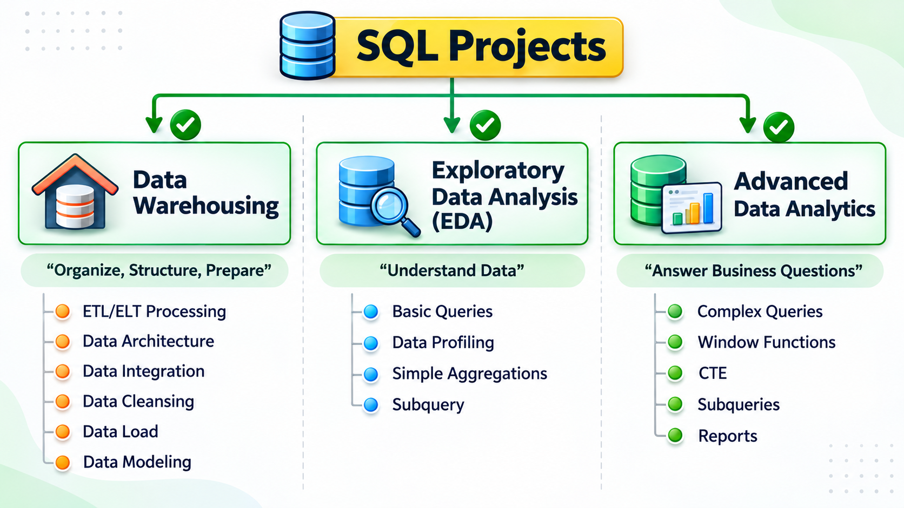

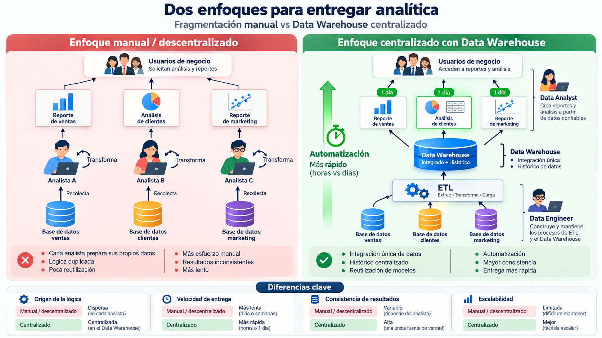

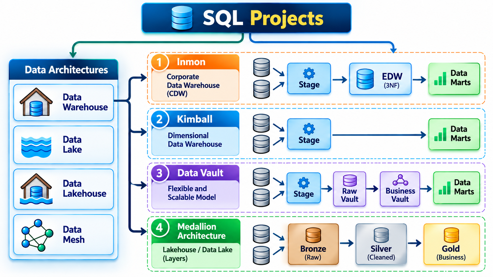

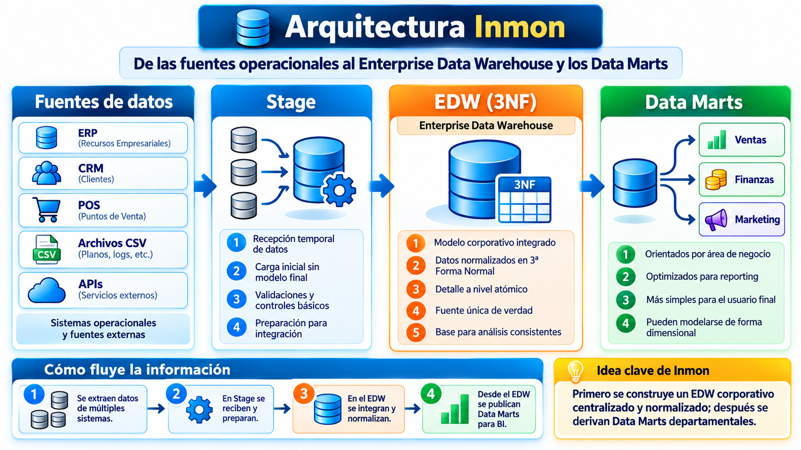

<details>
<summary>**Ejemplo de repaso de Normalización 3NF**</summary>
> 💡
### 0. Preparación del entorno en SQL Server

Primero creamos una base de datos para realizar la práctica.

```sql
CREATE DATABASE NormalizacionVentas;
GO

USE NormalizacionVentas;
GO
```

### Tabla inicial sin normalizar (0NF)

Nuestra empresa almacena los pedidos y sus productos en una tabla llamada `Ventas_0NF`.

```sql
CREATE TABLE Ventas_0NF (
    PedidoID INT PRIMARY KEY,
    ClienteNombre NVARCHAR(100),
    Ciudad NVARCHAR(100),
    Productos NVARCHAR(200),
    Cantidades NVARCHAR(100)
);

INSERT INTO Ventas_0NF
    (PedidoID, ClienteNombre, Ciudad, Productos, Cantidades)
VALUES
    (101, 'Ana García', 'Madrid', 'Teclado, Ratón', '1, 2'),
    (102, 'Luis Pérez', 'Sevilla', 'Monitor', '1'),
    (103, 'Ana García', 'Madrid', 'Teclado, Monitor', '2, 1');

SELECT * FROM Ventas_0NF;
```

**Resultado:**

| PedidoID | ClienteNombre | Ciudad | Productos | Cantidades |
| --- | --- | --- | --- | --- |
| 101 | Ana García | Madrid | Teclado, Ratón | 1, 2 |
| 102 | Luis Pérez | Sevilla | Monitor | 1 |
| 103 | Ana García | Madrid | Teclado, Monitor | 2, 1 |

El principal problema es que tenemos múltiples productos y cantidades almacenados en una misma celda como listas de texto.

Por ejemplo, para consultar los pedidos que contienen el producto `Ratón`, tendríamos que interpretar el texto contenido en `Productos`, en lugar de trabajar con una relación entre tablas.

---

## 1. Primera Forma Normal (1NF)

### ¿Qué debemos conseguir?

Una tabla en 1NF debe tener valores atómicos, sin grupos repetitivos, y cada fila debe ser identificable de manera única.

En nuestro ejemplo necesitamos:

1. Convertir cada producto vendido en una fila independiente.
2. Crear un identificador para cada cliente y producto.
3. Utilizar una clave primaria compuesta `(PedidoID, ProductoID)` para identificar las líneas de pedido.
### Paso 1. Crear la tabla en 1NF

```sql
CREATE TABLE Ventas_1NF (
    PedidoID INT NOT NULL,
    ClienteID VARCHAR(10) NOT NULL,
    ClienteNombre NVARCHAR(100) NOT NULL,
    Ciudad NVARCHAR(100),
    ProductoID VARCHAR(10) NOT NULL,
    ProductoNombre NVARCHAR(100) NOT NULL,
    Cantidad INT NOT NULL,

    CONSTRAINT PK_Ventas_1NF
        PRIMARY KEY (PedidoID, ProductoID),

    CONSTRAINT CK_Ventas_1NF_Cantidad
        CHECK (Cantidad > 0)
);
```

Observa dos aspectos importantes:

**`PRIMARY KEY (PedidoID, ProductoID)`****:** estamos definiendo una clave primaria compuesta. Así podemos tener varias filas con el mismo `PedidoID`, siempre que correspondan a productos diferentes.

**`Cantidad INT`****:** la cantidad ya es un valor numérico individual, no una lista de valores almacenada como texto.

### Paso 2. Insertar los datos normalizados

```sql
INSERT INTO Ventas_1NF
    (PedidoID, ClienteID, ClienteNombre, Ciudad,
     ProductoID, ProductoNombre, Cantidad)
VALUES
    (101, 'C01', 'Ana García', 'Madrid',
     'P01', 'Teclado', 1),

    (101, 'C01', 'Ana García', 'Madrid',
     'P02', 'Ratón', 2),

    (102, 'C02', 'Luis Pérez', 'Sevilla',
     'P03', 'Monitor', 1),

    (103, 'C01', 'Ana García', 'Madrid',
     'P01', 'Teclado', 2),

    (103, 'C01', 'Ana García', 'Madrid',
     'P03', 'Monitor', 1);
```

Estos registros reproducen la información de `Ventas_0NF`, pero ahora están representados correctamente como filas individuales. En una migración real automatizaríamos esta transformación desde los datos originales, utilizando reglas para asociar cada producto con su cantidad.

### Paso 3. Comprobar la tabla

```sql
SELECT
    PedidoID,
    ClienteNombre,
    ProductoNombre,
    Cantidad
FROM Ventas_1NF
ORDER BY PedidoID, ProductoID;
```

| PedidoID | ClienteNombre | ProductoNombre | Cantidad |
| --- | --- | --- | --- |
| 101 | Ana García | Teclado | 1 |
| 101 | Ana García | Ratón | 2 |
| 102 | Luis Pérez | Monitor | 1 |
| 103 | Ana García | Teclado | 2 |
| 103 | Ana García | Monitor | 1 |

### ¿Qué problema sigue existiendo?

Aunque ya cumplimos la 1NF, almacenamos datos redundantes:

- `ProductoNombre` se repite en cada venta del mismo producto.
- `ClienteNombre` y `Ciudad` se repiten en cada línea de pedido.
- `Cantidad` depende de ambos identificadores: `PedidoID` y `ProductoID`.
Las dependencias funcionales relevantes son:

- `PedidoID → ClienteID`
- `ProductoID → ProductoNombre`
- `(PedidoID, ProductoID) → Cantidad`
Como algunos atributos dependen solo de una parte de la clave primaria compuesta, todavía no estamos en 2NF.

---

## 2. Segunda Forma Normal (2NF)

### ¿Qué debemos conseguir?

Para cumplir 2NF, una tabla debe estar en 1NF y cada atributo no clave debe depender de toda la clave candidata, sin dependencias parciales.

Dividiremos nuestra tabla en:

- `Pedidos_2NF`
- `Productos_2NF`
- `DetallePedidos_2NF`
El objetivo es que los atributos propios de un producto no dependan de una parte de la clave de `DetallePedidos`.

### Paso 1. Crear las tablas

```sql
-- Tabla de pedidos
CREATE TABLE Pedidos_2NF (
    PedidoID INT PRIMARY KEY,
    ClienteID VARCHAR(10) NOT NULL,
    ClienteNombre NVARCHAR(100) NOT NULL,
    Ciudad NVARCHAR(100)
);

-- Tabla de productos
CREATE TABLE Productos_2NF (
    ProductoID VARCHAR(10) PRIMARY KEY,
    ProductoNombre NVARCHAR(100) NOT NULL
);

-- Tabla de detalle de pedidos
CREATE TABLE DetallePedidos_2NF (
    PedidoID INT NOT NULL,
    ProductoID VARCHAR(10) NOT NULL,
    Cantidad INT NOT NULL,

    CONSTRAINT PK_Detalle_2NF
        PRIMARY KEY (PedidoID, ProductoID),

    CONSTRAINT FK_Detalle_Pedidos_2NF
        FOREIGN KEY (PedidoID)
        REFERENCES Pedidos_2NF(PedidoID),

    CONSTRAINT FK_Detalle_Productos_2NF
        FOREIGN KEY (ProductoID)
        REFERENCES Productos_2NF(ProductoID),

    CONSTRAINT CK_Detalle_2NF_Cantidad
        CHECK (Cantidad > 0)
);
```

Hemos trasladado los atributos a las tablas donde corresponden. Además, las claves foráneas (`FOREIGN KEY`) impiden insertar una línea de pedido que haga referencia a un pedido o producto inexistente.

### Paso 2. Migrar los datos desde la tabla 1NF

Aquí utilizaremos `SELECT DISTINCT`, una operación muy útil en ingeniería de datos para obtener combinaciones únicas.

Primero cargamos los pedidos:

```sql
INSERT INTO Pedidos_2NF
    (PedidoID, ClienteID, ClienteNombre, Ciudad)
SELECT DISTINCT
    PedidoID,
    ClienteID,
    ClienteNombre,
    Ciudad
FROM Ventas_1NF;
```

Después cargamos los productos:

```sql
INSERT INTO Productos_2NF
    (ProductoID, ProductoNombre)
SELECT DISTINCT
    ProductoID,
    ProductoNombre
FROM Ventas_1NF;
```

Finalmente cargamos los detalles:

```sql
INSERT INTO DetallePedidos_2NF
    (PedidoID, ProductoID, Cantidad)
SELECT
    PedidoID,
    ProductoID,
    Cantidad
FROM Ventas_1NF;
```

**Importante:** `DISTINCT` elimina filas duplicadas, pero no resuelve conflictos entre datos. Si el mismo `ProductoID` aparece con dos nombres diferentes, primero debemos corregir esa inconsistencia. En este ejemplo partimos de datos coherentes.

### Paso 3. Comprobar las tres tablas

```sql
SELECT * FROM Pedidos_2NF;
SELECT * FROM Productos_2NF;
SELECT * FROM DetallePedidos_2NF;
```

**Pedidos_2NF**

| PedidoID | ClienteID | ClienteNombre | Ciudad |
| --- | --- | --- | --- |
| 101 | C01 | Ana García | Madrid |
| 102 | C02 | Luis Pérez | Sevilla |
| 103 | C01 | Ana García | Madrid |

**Productos_2NF**

| ProductoID | ProductoNombre |
| --- | --- |
| P01 | Teclado |
| P02 | Ratón |
| P03 | Monitor |

**DetallePedidos_2NF**

| PedidoID | ProductoID | Cantidad |
| --- | --- | --- |
| 101 | P01 | 1 |
| 101 | P02 | 2 |
| 102 | P03 | 1 |
| 103 | P01 | 2 |
| 103 | P03 | 1 |

### Paso 4. Recuperar los datos utilizando JOIN

Una duda habitual es: si dividimos los datos en varias tablas, ¿cómo volvemos a consultarlos juntos?

Utilizando `JOIN`:

```sql
SELECT
    p.PedidoID,
    p.ClienteNombre,
    pr.ProductoNombre,
    d.Cantidad
FROM Pedidos_2NF AS p
INNER JOIN DetallePedidos_2NF AS d
    ON p.PedidoID = d.PedidoID
INNER JOIN Productos_2NF AS pr
    ON d.ProductoID = pr.ProductoID
ORDER BY p.PedidoID, pr.ProductoID;
```

Este resultado reconstruye la información de ventas sin necesidad de repetir el nombre de cada producto en la tabla de detalle.

### ¿Qué problema queda pendiente?

Observa que `Pedidos_2NF` sigue conteniendo:

`PedidoID`, `ClienteID`, `ClienteNombre`, `Ciudad`

Y existe esta dependencia:

`PedidoID → ClienteID → ClienteNombre, Ciudad`

Esto significa que los datos descriptivos del cliente dependen de `ClienteID`, que a su vez depende de `PedidoID`.

Es una **dependencia transitiva** que debemos eliminar para alcanzar 3NF.

---

## 3. Tercera Forma Normal (3NF)

### ¿Qué debemos conseguir?

Una tabla cumple 3NF si está en 2NF y, formalmente, para cada dependencia funcional no trivial `X → A`, se cumple al menos una de estas condiciones: `X` es superclave o `A` es un atributo primo (pertenece a alguna clave candidata).

En nuestro ejemplo práctico, esto implica eliminar la dependencia transitiva entre pedido y datos descriptivos del cliente.

Crearemos una tabla `Clientes_3NF` y dejaremos únicamente `ClienteID` como clave foránea en `Pedidos_3NF`.

### Paso 1. Crear el modelo final

```sql
-- 1. Clientes
CREATE TABLE Clientes_3NF (
    ClienteID VARCHAR(10) PRIMARY KEY,
    ClienteNombre NVARCHAR(100) NOT NULL,
    Ciudad NVARCHAR(100)
);

-- 2. Productos
CREATE TABLE Productos_3NF (
    ProductoID VARCHAR(10) PRIMARY KEY,
    ProductoNombre NVARCHAR(100) NOT NULL
);

-- 3. Pedidos
CREATE TABLE Pedidos_3NF (
    PedidoID INT PRIMARY KEY,
    ClienteID VARCHAR(10) NOT NULL,

    CONSTRAINT FK_Pedidos_Clientes_3NF
        FOREIGN KEY (ClienteID)
        REFERENCES Clientes_3NF(ClienteID)
);

-- 4. Detalle de pedidos
CREATE TABLE DetallePedidos_3NF (
    PedidoID INT NOT NULL,
    ProductoID VARCHAR(10) NOT NULL,
    Cantidad INT NOT NULL,

    CONSTRAINT PK_Detalle_3NF
        PRIMARY KEY (PedidoID, ProductoID),

    CONSTRAINT FK_Detalle_Pedidos_3NF
        FOREIGN KEY (PedidoID)
        REFERENCES Pedidos_3NF(PedidoID),

    CONSTRAINT FK_Detalle_Productos_3NF
        FOREIGN KEY (ProductoID)
        REFERENCES Productos_3NF(ProductoID),

    CONSTRAINT CK_Detalle_3NF_Cantidad
        CHECK (Cantidad > 0)
);
```

### Paso 2. Cargar los clientes

Extraemos los clientes únicos desde la tabla de pedidos en 2NF.

```sql
INSERT INTO Clientes_3NF
    (ClienteID, ClienteNombre, Ciudad)
SELECT DISTINCT
    ClienteID,
    ClienteNombre,
    Ciudad
FROM Pedidos_2NF;
```

### Paso 3. Cargar productos y pedidos

```sql
-- Copiar productos
INSERT INTO Productos_3NF
    (ProductoID, ProductoNombre)
SELECT
    ProductoID,
    ProductoNombre
FROM Productos_2NF;

-- Copiar pedidos sin datos descriptivos del cliente
INSERT INTO Pedidos_3NF
    (PedidoID, ClienteID)
SELECT
    PedidoID,
    ClienteID
FROM Pedidos_2NF;
```

Observa que ya no incluimos `ClienteNombre` ni `Ciudad` en `Pedidos_3NF`.

### Paso 4. Cargar el detalle de pedidos

```sql
INSERT INTO DetallePedidos_3NF
    (PedidoID, ProductoID, Cantidad)
SELECT
    PedidoID,
    ProductoID,
    Cantidad
FROM DetallePedidos_2NF;
```

### Paso 5. Consultar el modelo normalizado

Ahora necesitamos cuatro tablas para reconstruir la información completa de las ventas:

```sql
SELECT
    p.PedidoID,
    c.ClienteNombre,
    c.Ciudad,
    pr.ProductoNombre,
    d.Cantidad
FROM Pedidos_3NF AS p
INNER JOIN Clientes_3NF AS c
    ON p.ClienteID = c.ClienteID
INNER JOIN DetallePedidos_3NF AS d
    ON p.PedidoID = d.PedidoID
INNER JOIN Productos_3NF AS pr
    ON d.ProductoID = pr.ProductoID
ORDER BY p.PedidoID, pr.ProductoID;
```

El resultado conserva las cinco líneas originales de venta, pero los datos ahora están distribuidos correctamente en entidades relacionadas.

---

## 4. Verificar por qué 3NF es más conveniente

Imagina que la clienta Ana García cambia de ciudad y ahora vive en Valencia.

### Antes de 3NF

En la tabla `Pedidos_2NF` tendríamos que actualizar todos los pedidos históricos que contienen los datos descriptivos de Ana.

```sql
UPDATE Pedidos_2NF
SET Ciudad = 'Valencia'
WHERE ClienteID = 'C01';
```

En este ejemplo se actualizan dos registros. En una empresa con miles de pedidos podrían verse afectadas miles de filas.

### Después de 3NF

Ahora basta con actualizar la información de la clienta una sola vez.

```sql
UPDATE Clientes_3NF
SET Ciudad = 'Valencia'
WHERE ClienteID = 'C01';

SELECT *
FROM Clientes_3NF
WHERE ClienteID = 'C01';
```

**Resultado:**

| ClienteID | ClienteNombre | Ciudad |
| --- | --- | --- |
| C01 | Ana García | Valencia |

Todos los pedidos relacionados consultarán automáticamente la ciudad actual de la clienta, porque utilizan la misma referencia `ClienteID`.

Este ejemplo supone que queremos almacenar la ciudad actual. Si necesitáramos conocer la ciudad que tenía la clienta en la fecha de cada pedido, deberíamos modelar también esa información histórica.

---

## 5. Resumen del proceso de normalización

4. **0NF — Datos sin normalizar:** una tabla contiene varios productos y cantidades en campos de texto.
5. **1NF — Valores atómicos:** convertimos cada producto vendido en una fila y establecemos la clave compuesta.
6. **2NF — Eliminar dependencias parciales:** separamos `Pedidos`, `Productos` y `DetallePedidos`.
7. **3NF — Eliminar dependencias transitivas:** separamos `Clientes` y utilizamos claves foráneas para relacionar las cuatro tablas.
| Forma normal | Número de tablas | Técnica SQL principal |
| --- | --- | --- |
| 0NF | 1 | `CREATE TABLE`, `INSERT` |
| 1NF | 1 | Clave primaria compuesta, filas atómicas |
| 2NF | 3 | `PRIMARY KEY`, `FOREIGN KEY`, `SELECT DISTINCT` |
| 3NF | 4 | Nuevas entidades, relaciones con `FOREIGN KEY`, `JOIN` |

## 6. Aplicación en un Enterprise Data Warehouse (EDW) de Inmon

En un proyecto real de ingeniería de datos, la normalización puede integrarse dentro de un proceso ETL/ELT.

Por ejemplo, podríamos recibir ventas desde un ERP y desde una tienda online, almacenarlas inicialmente en Stage y después transformarlas en entidades normalizadas dentro del EDW.

**Stage → EDW (3NF) → Data Mart**

- **Stage:** datos de sistemas de origen.
- **EDW (3NF):** `Clientes`, `Productos`, `Pedidos`, `DetallePedidos`.
- **Data Mart:** modelo dimensional con `FactVentas`, `DimClientes`, `DimProductos`.
En este escenario, nuestro modelo de cuatro tablas podría representar una parte del EDW. Posteriormente se construirían los Data Marts para responder preguntas como qué productos se venden más, qué clientes generan más ingresos o cómo evolucionan las ventas por región.

La diferencia fundamental es que **normalizar hasta 3NF busca una organización consistente de los datos, mientras que diseñar un Data Mart dimensional busca facilitar el análisis de negocio**.
</details>

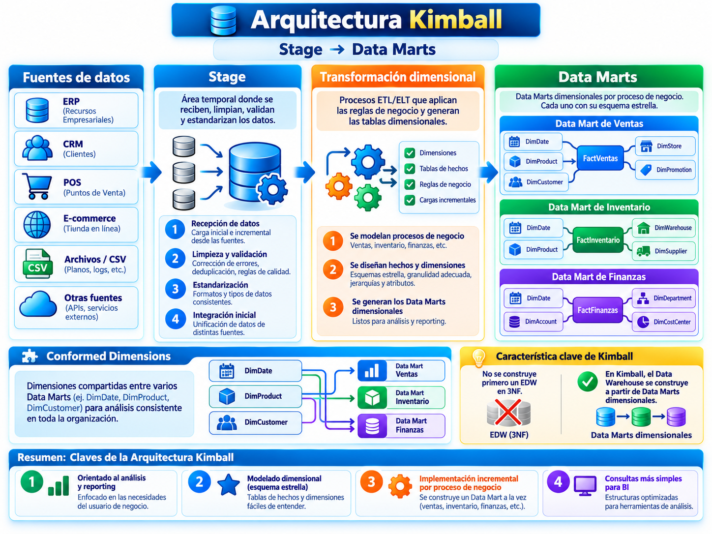

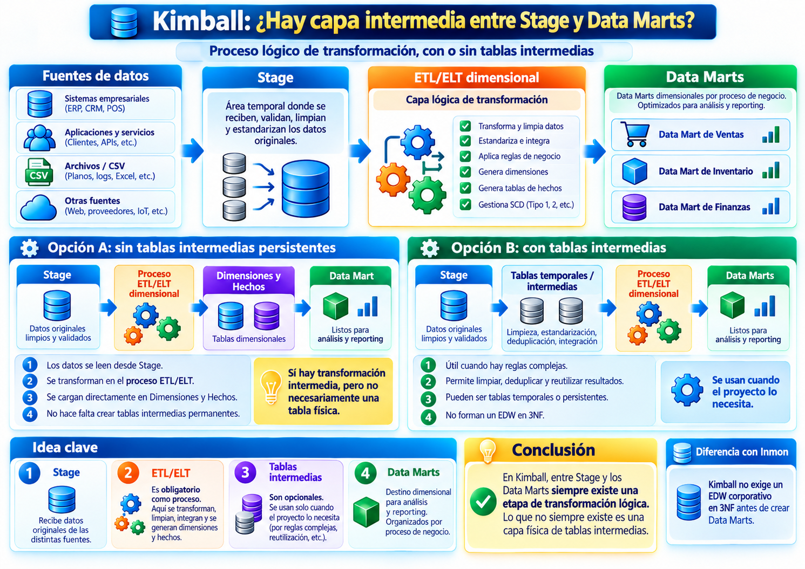

<details>
<summary>**Ejemplo de Kimball**</summary>
> 💡 Vamos a crear un ejemplo sencillo de un **Data Mart de Ventas utilizando la metodología Kimball**, ejecutable directamente en **SQL Server Management Studio (SSMS)**. Es decir, pasar de una tabla `Stage` a un modelo dimensional (*Star Schema*) mediante SQL.
## 1. Escenario

Una pequeña tienda vende tres productos y quiere analizar:

- ¿Cuántas unidades se han vendido?
- ¿Cuánto dinero se ha facturado?
- ¿Qué producto genera más ventas?
Construiremos un Data Mart con **dos dimensiones y una tabla de hechos**.

```plain text
Stage_Ventas
    |
    v
ETL con SQL (transformación y carga)
    |
    v
Data Mart de Ventas (Star Schema)
    |-- DimProducto
    |-- DimFecha
    `-- FactVentas
```

## 2. Crear la base de datos

```sql
CREATE DATABASE KimballTienda;
GO

USE KimballTienda;
GO
```

## 3. Crear Stage: recibir los datos

La tabla `Stage_Ventas` simula los datos procedentes de la aplicación de ventas.

```sql
CREATE TABLE Stage_Ventas (
    VentaID INT PRIMARY KEY,
    Fecha DATE,
    ProductoID INT,
    Producto NVARCHAR(50),
    Cantidad INT,
    Precio DECIMAL(10,2)
);

INSERT INTO Stage_Ventas VALUES
(1, '2026-10-01', 101, 'Teclado', 2, 25.00),
(2, '2026-10-01', 102, 'Ratón', 3, 15.00),
(3, '2026-10-02', 101, 'Teclado', 1, 25.00),
(4, '2026-10-02', 103, 'Monitor', 2, 150.00);

SELECT * FROM Stage_Ventas;
```

**Resultado de ****`Stage_Ventas`****:**

| VentaID | Fecha | ProductoID | Producto | Cantidad | Precio |
| --- | --- | --- | --- | --- | --- |
| 1 | 2026-10-01 | 101 | Teclado | 2 | 25.00 |
| 2 | 2026-10-01 | 102 | Ratón | 3 | 15.00 |
| 3 | 2026-10-02 | 101 | Teclado | 1 | 25.00 |
| 4 | 2026-10-02 | 103 | Monitor | 2 | 150.00 |

Todavía no tenemos un modelo dimensional: solo hemos recibido los datos.

## 4. Crear las dimensiones

Las dimensiones contienen atributos descriptivos para analizar los hechos.

### 4.1. DimProducto

```sql
CREATE TABLE DimProducto (
    ProductoKey INT IDENTITY(1,1) PRIMARY KEY,
    ProductoID INT,
    Producto NVARCHAR(50)
);

INSERT INTO DimProducto (ProductoID, Producto)
SELECT DISTINCT ProductoID, Producto
FROM Stage_Ventas;

SELECT * FROM DimProducto;
```

**Resultado ilustrativo** (los valores generados por `IDENTITY` pueden variar de orden):

| ProductoKey | ProductoID | Producto |
| --- | --- | --- |
| 1 | 101 | Teclado |
| 2 | 102 | Ratón |
| 3 | 103 | Monitor |

`ProductoKey` es una **surrogate key** (clave sustituta generada para el Data Warehouse); `ProductoID` es la clave de negocio procedente del sistema de origen.

### 4.2. DimFecha

Para simplificar usamos fechas de tipo `DATE` como claves. En proyectos reales es habitual utilizar una clave entera `YYYYMMDD` e incluir atributos del calendario.

```sql
CREATE TABLE DimFecha (
    FechaKey DATE PRIMARY KEY
);

INSERT INTO DimFecha (FechaKey)
SELECT DISTINCT Fecha
FROM Stage_Ventas;

SELECT * FROM DimFecha;
```

FechaKey

---

2026-10-01

---

2026-10-02

---

## 5. Crear la tabla de hechos FactVentas

La tabla de hechos almacena medidas de negocio:

- `Cantidad`: unidades vendidas.
- `Importe`: dinero facturado.
La **granularidad (*****grain*****)** es una fila por cada venta registrada en `Stage_Ventas`.

```sql
CREATE TABLE FactVentas (
    VentaID INT PRIMARY KEY,
    FechaKey DATE NOT NULL,
    ProductoKey INT NOT NULL,
    Cantidad INT,
    Importe DECIMAL(12,2),

    FOREIGN KEY (FechaKey)
        REFERENCES DimFecha(FechaKey),

    FOREIGN KEY (ProductoKey)
        REFERENCES DimProducto(ProductoKey)
);
```

## 6. Ejecutar el ETL: Stage → Data Mart

Leemos los datos de `Stage_Ventas`, buscamos las claves de las dimensiones, calculamos el importe e insertamos los resultados en la tabla de hechos.

```sql
INSERT INTO FactVentas
    (VentaID, FechaKey, ProductoKey, Cantidad, Importe)
SELECT
    s.VentaID,
    f.FechaKey,
    p.ProductoKey,
    s.Cantidad,
    s.Cantidad * s.Precio
FROM Stage_Ventas AS s
INNER JOIN DimProducto AS p
    ON s.ProductoID = p.ProductoID
INNER JOIN DimFecha AS f
    ON s.Fecha = f.FechaKey;
```

**¿Qué hace este ETL?**

1. Lee los registros desde Stage.
2. Busca la clave sustituta `ProductoKey` de cada producto.
3. Asocia cada venta con la fecha correspondiente.
4. Calcula `Importe = Cantidad × Precio`.
5. Inserta los resultados en `FactVentas`.
**Observación:** se realiza una transformación ETL sin crear tablas intermedias adicionales.

## 7. Consultar nuestro Data Mart

Calculamos las ventas por producto:

```sql
SELECT
    p.Producto,
    SUM(f.Cantidad) AS UnidadesVendidas,
    SUM(f.Importe) AS TotalVentas
FROM FactVentas AS f
INNER JOIN DimProducto AS p
    ON f.ProductoKey = p.ProductoKey
GROUP BY p.Producto
ORDER BY TotalVentas DESC;
```

**Resultado esperado de la consulta:**

| Producto | UnidadesVendidas | TotalVentas |
| --- | --- | --- |
| Monitor | 2 | 300.00 |
| Teclado | 3 | 75.00 |
| Ratón | 3 | 45.00 |

El total general, calculado a partir de esos resultados, es de **8 unidades** y **420,00** de importe vendido.

### Ventas totales por producto

```plain text
Monitor  | ████████████████████ 300,00
Teclado  | █████                 75,00
Ratón    | ███                   45,00
```

## 8. ¿Qué hemos aprendido de Kimball?

| Elemento | Objeto SQL Server | Función |
| --- | --- | --- |
| Stage | `Stage_Ventas` | Recibir los datos originales |
| Dimensión | `DimProducto` | Describir productos |
| Dimensión | `DimFecha` | Organizar las fechas |
| Hechos | `FactVentas` | Registrar cantidades e importes |
| ETL | `INSERT INTO ... SELECT` | Transformar y cargar los datos |
| Data Mart | Conjunto de dimensiones y hechos | Facilitar el análisis |

No hemos necesitado crear un EDW corporativo normalizado en 3NF ni tablas intermedias persistentes adicionales.

**¿Por qué es un ejemplo de Kimball?** Porque organizamos la información alrededor de un proceso de negocio —las ventas— usando tablas de hechos y dimensiones, en vez de comenzar con un EDW normalizado.

Este es un **Data Mart dimensional mínimo**. Una implementación empresarial de Kimball también consideraría dimensiones conformadas compartidas, cargas incrementales, cambios históricos (SCD) y controles de calidad.

> **Nota :** este script está diseñado para una primera ejecución secuencial en una base de datos nueva. Para ejecutarlo varias veces se necesitarían controles de existencia, prevención de duplicados y lógica de carga incremental. La inserción con `SELECT DISTINCT` supone que cada `ProductoID` tiene un único nombre coherente en Stage.
</details>

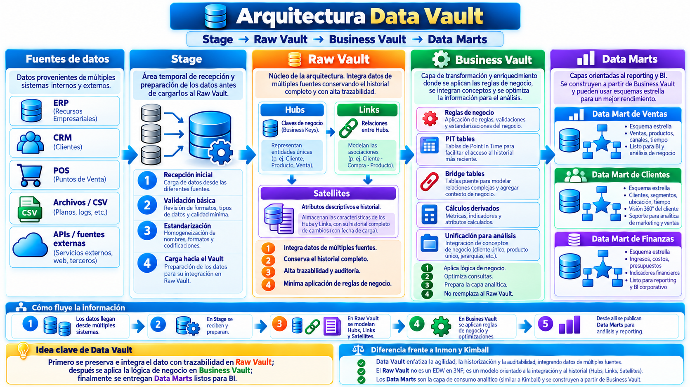

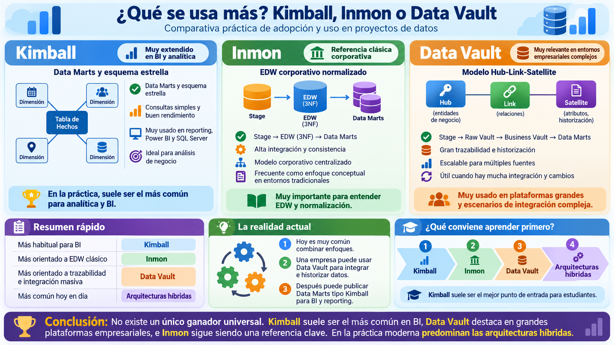

# **Ejemplo de un Data Vault en SQL Server 2025**

## Contexto

Una tienda recibe datos de ventas desde su aplicación. Cada venta indica **qué cliente** compró **qué producto**, la **fecha** y la **cantidad**. Queremos integrar los datos conservando su origen y el histórico de cambios de los nombres de clientes y productos.

Construirás un **Data Vault sencillo** en SQL Server 2025 siguiendo este recorrido:

```plain text
Stage_Ventas
   ├── Hub_Cliente ── Sat_Cliente
   ├── Hub_Producto ─ Sat_Producto
   └── Link_Venta ─── Sat_Venta
                         │
                         ▼
                 Vista_Mart_Ventas
```

En este ejercicio, `Link_Venta` identifica de forma única cada venta y relaciona al cliente con el producto. `Sat_Venta` guarda la fecha y la cantidad. Para mantener el ejercicio sencillo, usaremos claves enteras `IDENTITY`, no hash keys. En implementaciones Data Vault 2.0 es habitual utilizar claves hash y otras técnicas adicionales.

> **Importante:** esta es una práctica didáctica inspirada en los principios de Data Vault. Una arquitectura de producción requiere reglas adicionales de historización, integración de fuentes, deduplicación, auditoría y cargas incrementales.

## 1. Preparar SQL Server

Abre **SQL Server Management Studio (SSMS)**, conéctate a tu instancia de SQL Server 2025 y ejecuta los bloques en orden. El siguiente bloque crea una base de datos de práctica. Ejecuta el ejercicio en una instancia de laboratorio.

```sql
USE master;
GO

IF DB_ID(N'PracticaDataVault') IS NULL
    CREATE DATABASE PracticaDataVault;
GO

USE PracticaDataVault;
GO
```

La primera vez que ejecutes la práctica la base de datos estará vacía. Si ya has ejecutado el ejercicio, utiliza una base de datos nueva o elimina manualmente las tablas de laboratorio antes de repetir la carga: los bloques de `INSERT` no están diseñados para ejecutarse dos veces.

## 2. Stage: recibir los datos originales

Creamos una tabla que simula los datos que llegan de una aplicación de ventas. `FechaCarga` y `RecordSource` ayudan a rastrear cuándo llegaron los registros y de qué sistema proceden.

```sql
CREATE TABLE dbo.Stage_Ventas (
    VentaID       INT NOT NULL PRIMARY KEY,
    ClienteID     VARCHAR(10) NOT NULL,
    ClienteNombre NVARCHAR(100) NOT NULL,
    ProductoID    VARCHAR(10) NOT NULL,
    ProductoNombre NVARCHAR(100) NOT NULL,
    FechaVenta    DATE NOT NULL,
    Cantidad      INT NOT NULL,
    FechaCarga    DATETIME2(0) NOT NULL,
    RecordSource  VARCHAR(30) NOT NULL
);
GO

INSERT INTO dbo.Stage_Ventas
    (VentaID, ClienteID, ClienteNombre, ProductoID,
     ProductoNombre, FechaVenta, Cantidad, FechaCarga, RecordSource)
VALUES
    (1, 'C01', N'Ana García', 'P01', N'Teclado', '2026-10-01', 2, '2026-10-13T09:00:00', 'TIENDA'),
    (2, 'C02', N'Luis Pérez', 'P02', N'Ratón',   '2026-10-01', 1, '2026-10-13T09:00:00', 'TIENDA'),
    (3, 'C01', N'Ana García', 'P02', N'Ratón',   '2026-10-02', 3, '2026-10-13T09:00:00', 'TIENDA');
GO

SELECT * FROM dbo.Stage_Ventas ORDER BY VentaID;
```

**Comprueba:** deben aparecer **3 ventas**, con los clientes C01/C02 y los productos P01/P02.

## 3. Raw Vault: crear los Hubs

Un **Hub** guarda las *claves de negocio únicas* de una entidad. No almacena el nombre descriptivo, que puede cambiar; ese dato irá en un Satellite.

```sql
CREATE TABLE dbo.Hub_Cliente (
    HubClienteKey INT IDENTITY(1,1) PRIMARY KEY,
    ClienteID     VARCHAR(10) NOT NULL UNIQUE,
    FechaCarga    DATETIME2(0) NOT NULL,
    RecordSource  VARCHAR(30) NOT NULL
);

CREATE TABLE dbo.Hub_Producto (
    HubProductoKey INT IDENTITY(1,1) PRIMARY KEY,
    ProductoID     VARCHAR(10) NOT NULL UNIQUE,
    FechaCarga     DATETIME2(0) NOT NULL,
    RecordSource   VARCHAR(30) NOT NULL
);
GO
```

Insertamos una fila por clave de negocio. `ROW_NUMBER()` selecciona un registro estable por clave si aparece varias veces en Stage.

```sql
WITH Clientes AS (
    SELECT ClienteID, FechaCarga, RecordSource,
           ROW_NUMBER() OVER (
               PARTITION BY ClienteID
               ORDER BY FechaCarga, VentaID
           ) AS rn
    FROM dbo.Stage_Ventas
)
INSERT INTO dbo.Hub_Cliente (ClienteID, FechaCarga, RecordSource)
SELECT ClienteID, FechaCarga, RecordSource
FROM Clientes WHERE rn = 1;

WITH Productos AS (
    SELECT ProductoID, FechaCarga, RecordSource,
           ROW_NUMBER() OVER (
               PARTITION BY ProductoID
               ORDER BY FechaCarga, VentaID
           ) AS rn
    FROM dbo.Stage_Ventas
)
INSERT INTO dbo.Hub_Producto (ProductoID, FechaCarga, RecordSource)
SELECT ProductoID, FechaCarga, RecordSource
FROM Productos WHERE rn = 1;

SELECT * FROM dbo.Hub_Cliente;
SELECT * FROM dbo.Hub_Producto;
```

**Comprueba:** 2 clientes y 2 productos. `HubClienteKey` y `HubProductoKey` son claves técnicas generadas por SQL Server; `ClienteID` y `ProductoID` son claves de negocio.

## 4. Raw Vault: crear los Satellites descriptivos

Un **Satellite** conserva atributos y sus versiones a lo largo del tiempo. Usaremos una clave primaria formada por la clave del Hub y `FechaCarga`. Para simplificar, cada cambio se registra con una marca temporal diferente.

```sql
CREATE TABLE dbo.Sat_Cliente (
    HubClienteKey INT NOT NULL,
    FechaCarga    DATETIME2(0) NOT NULL,
    ClienteNombre NVARCHAR(100) NOT NULL,
    RecordSource  VARCHAR(30) NOT NULL,
    CONSTRAINT PK_Sat_Cliente PRIMARY KEY (HubClienteKey, FechaCarga),
    CONSTRAINT FK_Sat_Cliente_Hub FOREIGN KEY (HubClienteKey)
        REFERENCES dbo.Hub_Cliente(HubClienteKey)
);

CREATE TABLE dbo.Sat_Producto (
    HubProductoKey INT NOT NULL,
    FechaCarga     DATETIME2(0) NOT NULL,
    ProductoNombre NVARCHAR(100) NOT NULL,
    RecordSource   VARCHAR(30) NOT NULL,
    CONSTRAINT PK_Sat_Producto PRIMARY KEY (HubProductoKey, FechaCarga),
    CONSTRAINT FK_Sat_Producto_Hub FOREIGN KEY (HubProductoKey)
        REFERENCES dbo.Hub_Producto(HubProductoKey)
);
GO
```

Cargamos las descripciones sin duplicar las observaciones repetidas de Stage:

```sql
WITH Clientes AS (
    SELECT ClienteID, ClienteNombre, FechaCarga, RecordSource,
           ROW_NUMBER() OVER (
               PARTITION BY ClienteID, FechaCarga
               ORDER BY VentaID
           ) AS rn
    FROM dbo.Stage_Ventas
)
INSERT INTO dbo.Sat_Cliente
    (HubClienteKey, FechaCarga, ClienteNombre, RecordSource)
SELECT h.HubClienteKey, c.FechaCarga, c.ClienteNombre, c.RecordSource
FROM Clientes AS c
JOIN dbo.Hub_Cliente AS h ON h.ClienteID = c.ClienteID
WHERE c.rn = 1;

WITH Productos AS (
    SELECT ProductoID, ProductoNombre, FechaCarga, RecordSource,
           ROW_NUMBER() OVER (
               PARTITION BY ProductoID, FechaCarga
               ORDER BY VentaID
           ) AS rn
    FROM dbo.Stage_Ventas
)
INSERT INTO dbo.Sat_Producto
    (HubProductoKey, FechaCarga, ProductoNombre, RecordSource)
SELECT h.HubProductoKey, p.FechaCarga, p.ProductoNombre, p.RecordSource
FROM Productos AS p
JOIN dbo.Hub_Producto AS h ON h.ProductoID = p.ProductoID
WHERE p.rn = 1;

SELECT * FROM dbo.Sat_Cliente;
SELECT * FROM dbo.Sat_Producto;
```

**Comprueba:** 2 registros en cada Satellite.

## 5. Raw Vault: crear el Link y el Satellite de ventas

Un **Link** registra relaciones entre Hubs. Aquí también guardamos `VentaID` porque identifica el evento de negocio. `Sat_Venta` almacena atributos que describen ese evento.

```sql
CREATE TABLE dbo.Link_Venta (
    LinkVentaKey   INT IDENTITY(1,1) PRIMARY KEY,
    VentaID        INT NOT NULL UNIQUE,
    HubClienteKey  INT NOT NULL,
    HubProductoKey INT NOT NULL,
    FechaCarga     DATETIME2(0) NOT NULL,
    RecordSource   VARCHAR(30) NOT NULL,
    CONSTRAINT FK_Link_Cliente FOREIGN KEY (HubClienteKey)
        REFERENCES dbo.Hub_Cliente(HubClienteKey),
    CONSTRAINT FK_Link_Producto FOREIGN KEY (HubProductoKey)
        REFERENCES dbo.Hub_Producto(HubProductoKey)
);

CREATE TABLE dbo.Sat_Venta (
    LinkVentaKey INT NOT NULL,
    FechaCarga   DATETIME2(0) NOT NULL,
    FechaVenta   DATE NOT NULL,
    Cantidad     INT NOT NULL,
    RecordSource VARCHAR(30) NOT NULL,
    CONSTRAINT PK_Sat_Venta PRIMARY KEY (LinkVentaKey, FechaCarga),
    CONSTRAINT FK_Sat_Venta_Link FOREIGN KEY (LinkVentaKey)
        REFERENCES dbo.Link_Venta(LinkVentaKey),
    CONSTRAINT CK_Sat_Venta_Cantidad CHECK (Cantidad > 0)
);
GO

INSERT INTO dbo.Link_Venta
    (VentaID, HubClienteKey, HubProductoKey, FechaCarga, RecordSource)
SELECT s.VentaID, c.HubClienteKey, p.HubProductoKey,
       s.FechaCarga, s.RecordSource
FROM dbo.Stage_Ventas AS s
JOIN dbo.Hub_Cliente AS c ON s.ClienteID = c.ClienteID
JOIN dbo.Hub_Producto AS p ON s.ProductoID = p.ProductoID;

INSERT INTO dbo.Sat_Venta
    (LinkVentaKey, FechaCarga, FechaVenta, Cantidad, RecordSource)
SELECT l.LinkVentaKey, s.FechaCarga, s.FechaVenta,
       s.Cantidad, s.RecordSource
FROM dbo.Stage_Ventas AS s
JOIN dbo.Link_Venta AS l ON s.VentaID = l.VentaID;

SELECT * FROM dbo.Link_Venta;
SELECT * FROM dbo.Sat_Venta;
```

**Comprueba:** 3 filas en `Link_Venta` y 3 en `Sat_Venta`.

## 6. Simular un cambio y conservar el histórico

Supongamos que el sistema comunica que el nombre de la clienta C01 ha cambiado. En vez de sobrescribir el nombre anterior, añadimos una nueva versión en su Satellite:

```sql
INSERT INTO dbo.Sat_Cliente
    (HubClienteKey, FechaCarga, ClienteNombre, RecordSource)
SELECT HubClienteKey,
       '2026-10-14T10:00:00',
       N'Ana G. García',
       'TIENDA'
FROM dbo.Hub_Cliente
WHERE ClienteID = 'C01';

SELECT h.ClienteID, s.ClienteNombre, s.FechaCarga
FROM dbo.Hub_Cliente AS h
JOIN dbo.Sat_Cliente AS s ON h.HubClienteKey = s.HubClienteKey
WHERE h.ClienteID = 'C01'
ORDER BY s.FechaCarga;
```

**Resultado esperado:** dos versiones del nombre para C01: `Ana García` y `Ana G. García`.

En una carga real, antes de insertar otra versión comprobaríamos que el valor ha cambiado y aplicaríamos controles de calidad y deduplicación.

## 7. Business Vault: obtener el nombre vigente

El **Business Vault** incorpora reglas de negocio, cálculos y estructuras que simplifican las consultas. Para este laboratorio utilizamos una vista con `ROW_NUMBER()` que selecciona la última versión de cada cliente. La vista no copia los datos; consulta los Satellites existentes.

```sql
CREATE VIEW dbo.BV_ClienteActual AS
WITH Versiones AS (
    SELECT h.ClienteID,
           s.ClienteNombre,
           s.FechaCarga,
           ROW_NUMBER() OVER (
               PARTITION BY h.ClienteID
               ORDER BY s.FechaCarga DESC
           ) AS rn
    FROM dbo.Hub_Cliente AS h
    JOIN dbo.Sat_Cliente AS s
      ON s.HubClienteKey = h.HubClienteKey
)
SELECT ClienteID, ClienteNombre, FechaCarga
FROM Versiones
WHERE rn = 1;
GO

SELECT * FROM dbo.BV_ClienteActual ORDER BY ClienteID;
```

**Comprueba:** C01 aparece como `Ana G. García`. Los datos antiguos siguen disponibles en `Sat_Cliente`.

## 8. Data Mart: una vista sencilla para analizar ventas

Creamos una vista de consumo que une Link, Satellites y la regla de cliente vigente. En una plataforma más grande, esta capa podría materializarse como un esquema estrella con tablas de hechos y dimensiones.

```sql
CREATE VIEW dbo.Vista_Mart_Ventas AS
WITH ProductoActual AS (
    SELECT h.HubProductoKey,
           s.ProductoNombre,
           ROW_NUMBER() OVER (
               PARTITION BY h.HubProductoKey
               ORDER BY s.FechaCarga DESC
           ) AS rn
    FROM dbo.Hub_Producto AS h
    JOIN dbo.Sat_Producto AS s
      ON s.HubProductoKey = h.HubProductoKey
),
VentaActual AS (
    SELECT LinkVentaKey, FechaVenta, Cantidad,
           ROW_NUMBER() OVER (
               PARTITION BY LinkVentaKey
               ORDER BY FechaCarga DESC
           ) AS rn
    FROM dbo.Sat_Venta
)
SELECT l.VentaID,
       v.FechaVenta,
       c.ClienteNombre,
       p.ProductoNombre,
       v.Cantidad
FROM dbo.Link_Venta AS l
JOIN dbo.Hub_Cliente AS hc
  ON hc.HubClienteKey = l.HubClienteKey
JOIN dbo.BV_ClienteActual AS c
  ON c.ClienteID = hc.ClienteID
JOIN ProductoActual AS p
  ON p.HubProductoKey = l.HubProductoKey AND p.rn = 1
JOIN VentaActual AS v
  ON v.LinkVentaKey = l.LinkVentaKey AND v.rn = 1;
GO

SELECT * FROM dbo.Vista_Mart_Ventas ORDER BY VentaID;
```

Para responder a la pregunta **«¿cuántas unidades se han vendido por producto?»**, ejecuta:

```sql
SELECT ProductoNombre,
       SUM(Cantidad) AS UnidadesVendidas
FROM dbo.Vista_Mart_Ventas
GROUP BY ProductoNombre
ORDER BY UnidadesVendidas DESC;
```

**Resultado esperado:**

| ProductoNombre | UnidadesVendidas |
| --- | --- |
| Ratón | 4 |
| Teclado | 2 |

> Este Data Mart es una **vista de consumo simplificada**, no un esquema estrella completo. Permite comprender el recorrido hasta la capa analítica sin introducir todavía `FactVentas` y dimensiones dimensionales.

## 9. Comprobación final

Ejecuta este bloque para comprobar el número de registros:

```sql
SELECT 'Hub_Cliente' AS Tabla, COUNT(*) AS Filas FROM dbo.Hub_Cliente
UNION ALL SELECT 'Hub_Producto', COUNT(*) FROM dbo.Hub_Producto
UNION ALL SELECT 'Sat_Cliente', COUNT(*) FROM dbo.Sat_Cliente
UNION ALL SELECT 'Sat_Producto', COUNT(*) FROM dbo.Sat_Producto
UNION ALL SELECT 'Link_Venta', COUNT(*) FROM dbo.Link_Venta
UNION ALL SELECT 'Sat_Venta', COUNT(*) FROM dbo.Sat_Venta;
```

| Tabla | Filas esperadas |
| --- | --- |
| Hub_Cliente | 2 |
| Hub_Producto | 2 |
| Sat_Cliente | 3 |
| Sat_Producto | 2 |
| Link_Venta | 3 |
| Sat_Venta | 3 |

## 10. Responde a las siguientes preguntas

1. ¿Qué información almacena un **Hub** y qué información almacena un **Satellite**?
2. ¿Por qué `Link_Venta` necesita referencias a los Hubs de cliente y producto?
3. ¿Qué ocurre con el valor antiguo del nombre de Ana después de insertar la nueva versión?
4. ¿Por qué el Business Vault puede usar una vista sin copiar físicamente los datos?
5. ¿Qué diferencia existe entre una vista de Data Mart y un Data Mart dimensional con tablas de hechos y dimensiones?
6. ¿Por qué `FechaCarga` es importante para la trazabilidad?
## 11. Ejercicio

Añade una nueva venta en `Stage_Ventas` con `VentaID = 4`, cliente `C02`, producto `P01`, fecha `2026-10-03` y cantidad `5`. Diseña una **carga incremental** para insertar únicamente las claves, relaciones y versiones que aún no existen en el Raw Vault. No vuelvas a ejecutar directamente los `INSERT` iniciales porque pueden generar duplicados o errores de clave primaria.

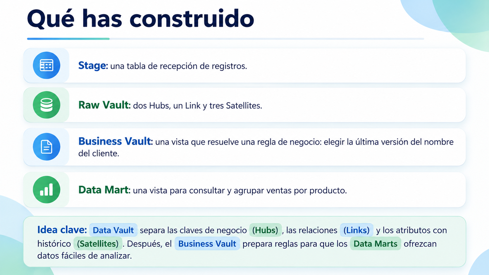

# Sesión 2: Arquitectura “Medallion”

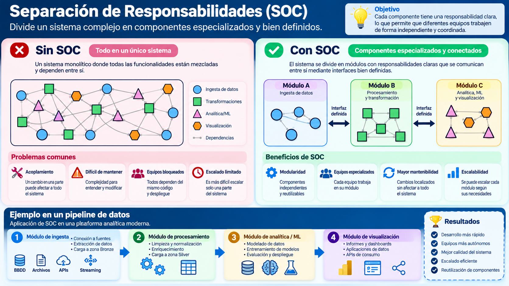

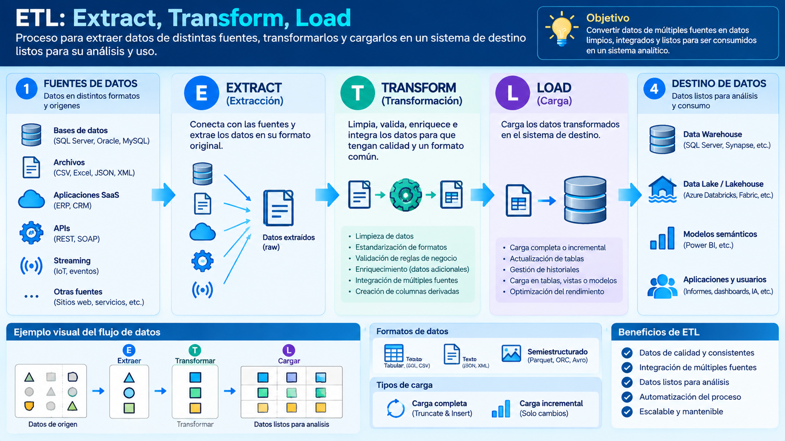

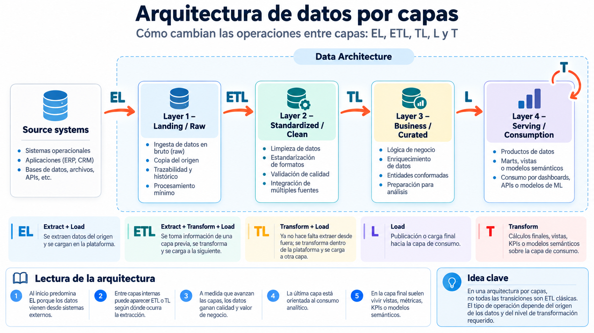

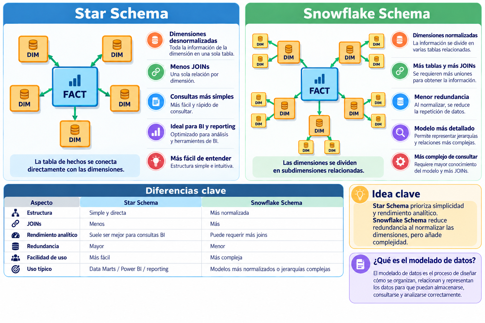

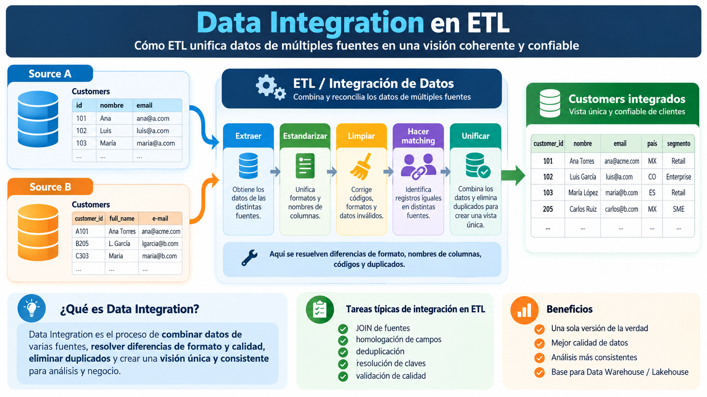

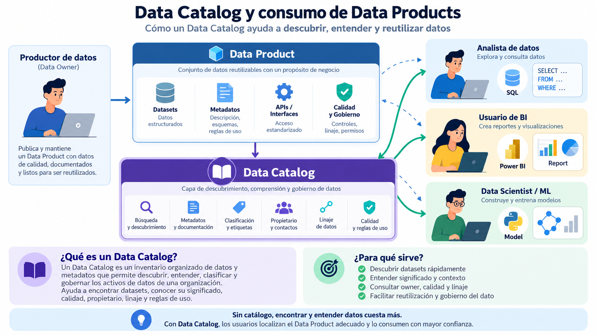

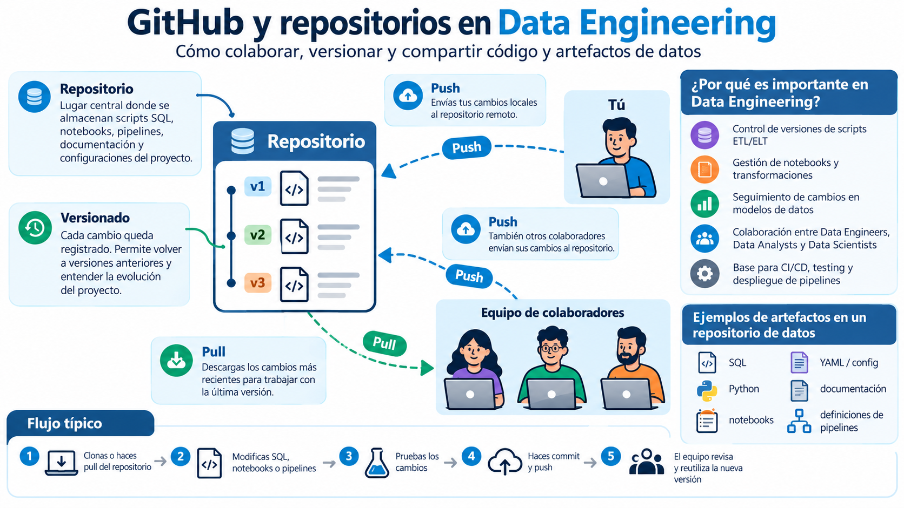

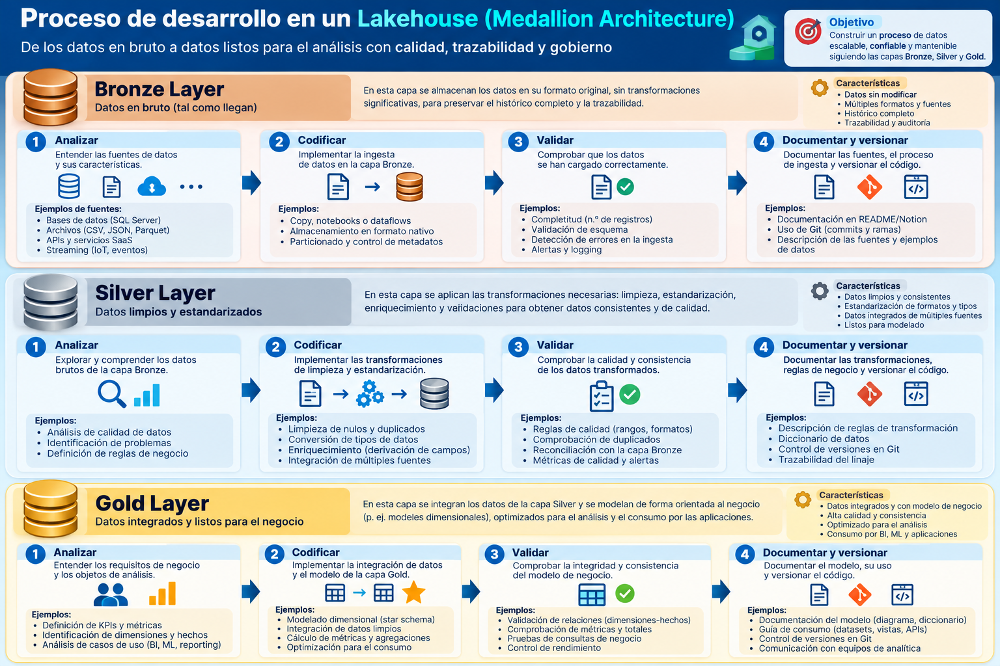

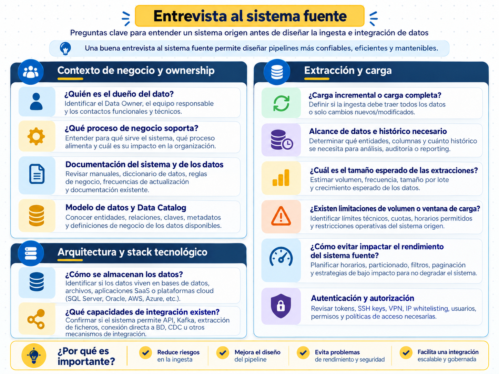

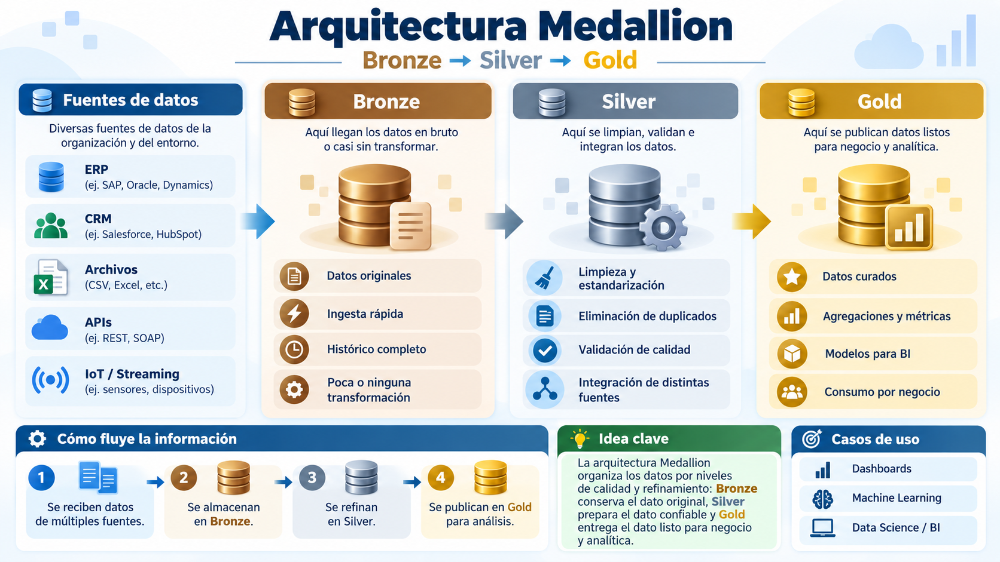

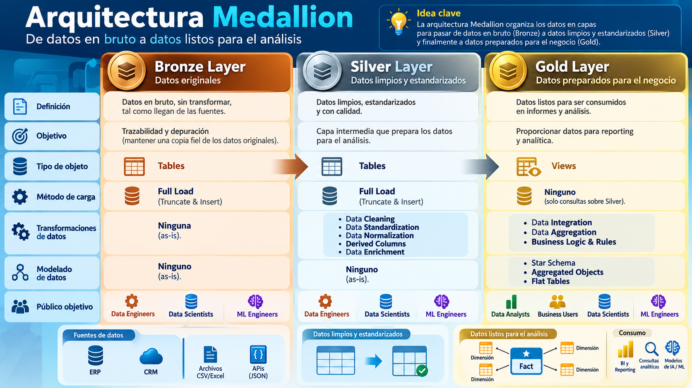

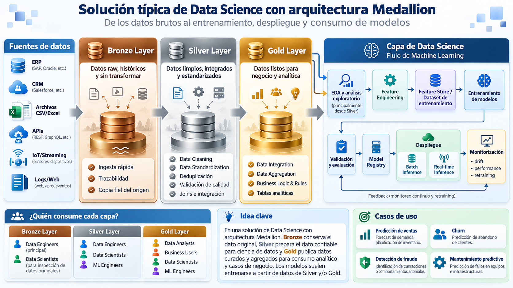

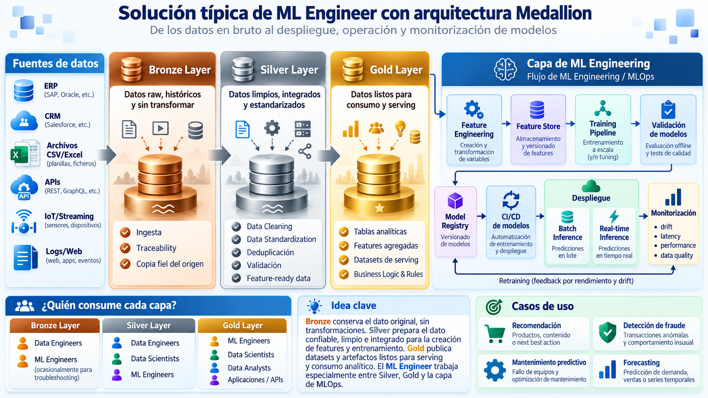

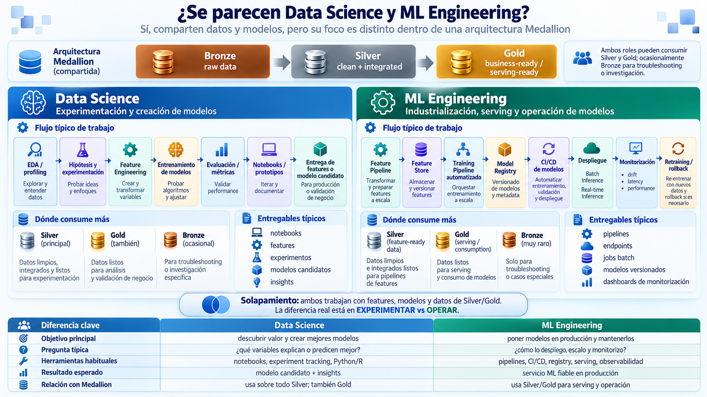


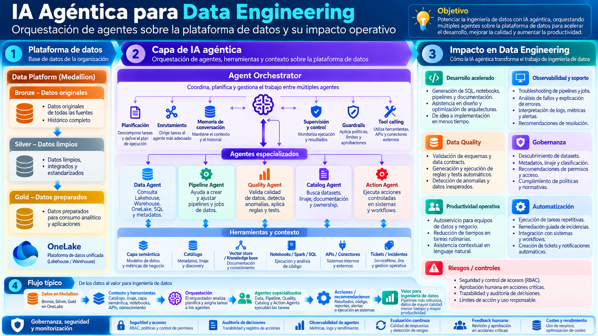

