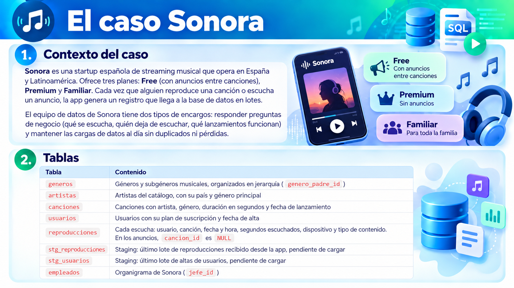
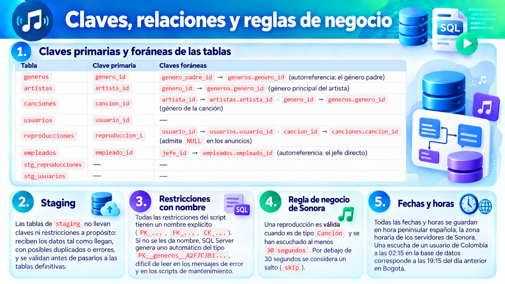
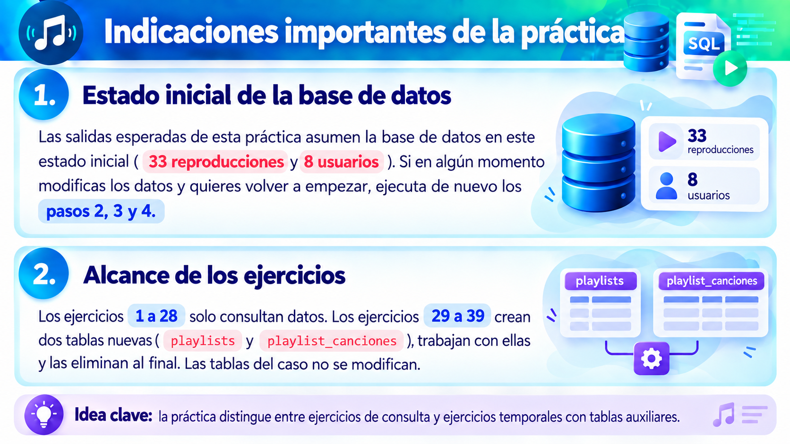

# 🧗🏽‍♂️ Practica 07 - Caso de Estudio SonoraDB

---

> 💡 Esta práctica repasa lo que se da por conocido antes de trabajar con subconsultas y CTE: consultas básicas, funciones, agregaciones, JOIN, DDL y DML. Todo se resuelve sobre `SonoraDB`, la base de datos que usaremos durante todas las sesiones de SQL.

---

## El caso Sonora




### Claves primarias y foráneas



---

## Preparación del entorno

### Paso 1. Comprobar la versión del motor

Abre SSMS 22, conéctate a tu instancia local y ejecuta:

```sql
SELECT @@VERSION AS version_completa,
       SERVERPROPERTY('ProductMajorVersion') AS version_principal;
```

**Salida esperada:** `version_principal` debe ser **17**, que corresponde a SQL Server 2025.

> Si al conectar aparece un error de certificado, en el diálogo de conexión de SSMS 22 marca la opción **Trust server certificate**.

### Paso 2. Crear la base de datos con nivel de compatibilidad 170

> **Atención:** este script borra `SonoraDB` si ya existe. Úsalo para crearla por primera vez o para resetearla.

```sql
USE master;
GO

IF DB_ID(N'SonoraDB') IS NOT NULL
BEGIN
    ALTER DATABASE SonoraDB SET SINGLE_USER WITH ROLLBACK IMMEDIATE;
    DROP DATABASE SonoraDB;
END;
GO

CREATE DATABASE SonoraDB;
GO

ALTER DATABASE SonoraDB SET COMPATIBILITY_LEVEL = 170;
GO

SELECT name, compatibility_level
FROM sys.databases
WHERE name = N'SonoraDB';
GO
```

**Salida esperada:**

| name | compatibility_level |
| --- | --- |
| SonoraDB | 170 |

### Paso 3. Crear las tablas con sus claves primarias y foráneas

Las tablas se crean en orden: primero las que no dependen de ninguna otra y después las que las referencian.

```sql
USE SonoraDB;
GO

CREATE TABLE dbo.generos (
    genero_id        int           NOT NULL,
    nombre           nvarchar(50)  NOT NULL,
    genero_padre_id  int           NULL,
    CONSTRAINT PK_generos PRIMARY KEY (genero_id),
    CONSTRAINT FK_generos_genero_padre FOREIGN KEY (genero_padre_id)
        REFERENCES dbo.generos (genero_id)
);

CREATE TABLE dbo.artistas (
    artista_id  int            NOT NULL,
    nombre      nvarchar(100)  NOT NULL,
    pais        char(2)        NOT NULL,
    genero_id   int            NOT NULL,
    CONSTRAINT PK_artistas PRIMARY KEY (artista_id),
    CONSTRAINT FK_artistas_generos FOREIGN KEY (genero_id)
        REFERENCES dbo.generos (genero_id)
);

CREATE TABLE dbo.canciones (
    cancion_id         int            NOT NULL,
    titulo             nvarchar(150)  NOT NULL,
    artista_id         int            NOT NULL,
    genero_id          int            NOT NULL,
    duracion_seg       int            NOT NULL,
    fecha_lanzamiento  date           NOT NULL,
    CONSTRAINT PK_canciones PRIMARY KEY (cancion_id),
    CONSTRAINT FK_canciones_artistas FOREIGN KEY (artista_id)
        REFERENCES dbo.artistas (artista_id),
    CONSTRAINT FK_canciones_generos FOREIGN KEY (genero_id)
        REFERENCES dbo.generos (genero_id)
);

CREATE TABLE dbo.usuarios (
    usuario_id        int            NOT NULL,
    nombre_usuario    nvarchar(50)   NOT NULL,
    email             nvarchar(150)  NOT NULL,
    pais              char(2)        NOT NULL,
    plan_suscripcion  nvarchar(20)   NOT NULL,
    fecha_alta        date           NOT NULL,
    CONSTRAINT PK_usuarios PRIMARY KEY (usuario_id)
);

CREATE TABLE dbo.reproducciones (
    reproduccion_id      int           NOT NULL,
    usuario_id           int           NOT NULL,
    cancion_id           int           NULL,
    fecha_hora           datetime2(0)  NOT NULL,
    segundos_escuchados  int           NOT NULL,
    dispositivo          nvarchar(20)  NOT NULL,
    tipo_contenido       nvarchar(10)  NOT NULL,
    CONSTRAINT PK_reproducciones PRIMARY KEY (reproduccion_id),
    CONSTRAINT FK_reproducciones_usuarios FOREIGN KEY (usuario_id)
        REFERENCES dbo.usuarios (usuario_id),
    CONSTRAINT FK_reproducciones_canciones FOREIGN KEY (cancion_id)
        REFERENCES dbo.canciones (cancion_id),
    CONSTRAINT CK_reproducciones_tipo_contenido
        CHECK (tipo_contenido IN (N'Canción', N'Anuncio'))
);

CREATE TABLE dbo.empleados (
    empleado_id  int            NOT NULL,
    nombre       nvarchar(100)  NOT NULL,
    puesto       nvarchar(50)   NOT NULL,
    jefe_id      int            NULL,
    CONSTRAINT PK_empleados PRIMARY KEY (empleado_id),
    CONSTRAINT FK_empleados_jefe FOREIGN KEY (jefe_id)
        REFERENCES dbo.empleados (empleado_id)
);

-- Tablas de staging: sin claves ni restricciones
CREATE TABLE dbo.stg_reproducciones (
    reproduccion_id      int,
    usuario_id           int,
    cancion_id           int,
    fecha_hora           datetime2(0),
    segundos_escuchados  int,
    dispositivo          nvarchar(20),
    tipo_contenido       nvarchar(10)
);

CREATE TABLE dbo.stg_usuarios (
    usuario_id        int,
    nombre_usuario    nvarchar(50),
    email             nvarchar(150),
    pais              char(2),
    plan_suscripcion  nvarchar(20),
    fecha_alta        date
);
GO
```

Comprueba las claves creadas:

```sql
SELECT OBJECT_NAME(parent_object_id) AS tabla,
       name AS restriccion,
       type_desc AS tipo
FROM sys.objects
WHERE type IN ('PK', 'F')
ORDER BY tabla, tipo DESC, restriccion;
```

**Salida esperada:**

| tabla | restriccion | tipo |
| --- | --- | --- |
| artistas | PK_artistas | PRIMARY_KEY_CONSTRAINT |
| artistas | FK_artistas_generos | FOREIGN_KEY_CONSTRAINT |
| canciones | PK_canciones | PRIMARY_KEY_CONSTRAINT |
| canciones | FK_canciones_artistas | FOREIGN_KEY_CONSTRAINT |
| canciones | FK_canciones_generos | FOREIGN_KEY_CONSTRAINT |
| empleados | PK_empleados | PRIMARY_KEY_CONSTRAINT |
| empleados | FK_empleados_jefe | FOREIGN_KEY_CONSTRAINT |
| generos | PK_generos | PRIMARY_KEY_CONSTRAINT |
| generos | FK_generos_genero_padre | FOREIGN_KEY_CONSTRAINT |
| reproducciones | PK_reproducciones | PRIMARY_KEY_CONSTRAINT |
| reproducciones | FK_reproducciones_canciones | FOREIGN_KEY_CONSTRAINT |
| reproducciones | FK_reproducciones_usuarios | FOREIGN_KEY_CONSTRAINT |
| usuarios | PK_usuarios | PRIMARY_KEY_CONSTRAINT |

### Paso 4. Cargar los datos

Los datos se insertan en el mismo orden que las tablas: una fila solo puede referenciar a otra que ya exista. Si cambias el orden (por ejemplo, insertas `canciones` antes que `artistas`), SQL Server lanza el error Msg 547 por conflicto con la clave foránea.

```sql
INSERT INTO dbo.generos (genero_id, nombre, genero_padre_id) VALUES
(1, N'Música', NULL),
(2, N'Pop', 1), (3, N'Urbano', 1), (4, N'Rock', 1), (5, N'Electrónica', 1),
(6, N'Reguetón', 3), (7, N'Trap', 3), (8, N'Hip Hop', 3),
(9, N'Indie', 4), (10, N'Metal', 4),
(11, N'House', 5), (12, N'Techno', 5),
(13, N'Dembow', 6);

INSERT INTO dbo.artistas (artista_id, nombre, pais, genero_id) VALUES
(1, N'Luna Roja', 'ES', 2),
(2, N'MC Brisa', 'PR', 6),
(3, N'Kaiser Beats', 'DE', 12),
(4, N'Los Voltios', 'AR', 9),
(5, N'Nébula', 'MX', 7),
(6, N'Hierro Fundido', 'ES', 10),
(7, N'DJ Coral', 'CO', 11),
(8, N'Verso Libre', 'ES', 8),
(9, N'Sara Cometa', 'ES', 2);

INSERT INTO dbo.canciones (cancion_id, titulo, artista_id, genero_id, duracion_seg, fecha_lanzamiento) VALUES
(101, N'Verano en Bucle',   1, 2,  185, '2026-06-12'),
(102, N'Neón',              1, 2,  201, '2025-11-03'),
(103, N'Perreo Lunar',      2, 6,  176, '2026-07-01'),
(104, N'Calle 23',          2, 6,  190, '2026-03-15'),
(105, N'Fábrica 4AM',       3, 12, 412, '2025-09-20'),
(106, N'Corriente Alterna', 4, 9,  234, '2026-02-10'),
(107, N'Cables Sueltos',    4, 9,  198, '2024-05-08'),
(108, N'Humo Violeta',      5, 7,  167, '2026-08-22'),
(109, N'Diamantes Rotos',   5, 7,  182, '2026-04-30'),
(110, N'Forja',             6, 10, 305, '2023-10-31'),
(111, N'Marea Alta',        7, 11, 356, '2026-05-19'),
(112, N'Rimas de Barrio',   8, 8,  214, '2025-12-01'),
(113, N'Galaxia Dembow',    2, 13, 158, '2026-09-04'),
(114, N'Sin Cobertura',     5, 7,  175, '2026-09-18'),
(115, N'Latido',            7, 11, 330, '2025-07-07');

INSERT INTO dbo.usuarios (usuario_id, nombre_usuario, email, pais, plan_suscripcion, fecha_alta) VALUES
(1, N'alexbeats',  N'alex.beats@mail.com',  'ES', N'Premium',  '2025-01-10'),
(2, N'marta_rock', N'marta.rock@mail.com',  'ES', N'Free',     '2025-06-02'),
(3, N'juanpi',     N'juanpi@mail.com',      'MX', N'Premium',  '2024-11-20'),
(4, N'sofi.trap',  N'sofi.trap@mail.com',   'AR', N'Familiar', '2026-02-14'),
(5, N'dani_dj',    N'dani.dj@mail.com',     'CO', N'Free',     '2026-08-30'),
(6, N'lucia.m',    N'lucia.m@mail.com',     'ES', N'Premium',  '2026-09-01'),
(7, N'nachox',     N'nachox@mail.com',      'MX', N'Free',     '2025-03-18'),
(8, N'vale_indie', N'vale.indie@mail.com',  'AR', N'Premium',  '2026-05-05');

INSERT INTO dbo.reproducciones (reproduccion_id, usuario_id, cancion_id, fecha_hora, segundos_escuchados, dispositivo, tipo_contenido) VALUES
(1,  1, 103,  '2026-09-14 08:15', 176, N'Móvil',      N'Canción'),
(2,  1, 108,  '2026-09-14 08:18', 167, N'Móvil',      N'Canción'),
(3,  1, 103,  '2026-09-14 09:55', 176, N'Web',        N'Canción'),
(4,  2, 106,  '2026-09-14 10:02', 234, N'Web',        N'Canción'),
(5,  2, NULL, '2026-09-14 10:06', 30,  N'Web',        N'Anuncio'),
(6,  2, 110,  '2026-09-14 10:07', 120, N'Web',        N'Canción'),
(7,  3, 105,  '2026-09-14 23:10', 412, N'Escritorio', N'Canción'),
(8,  3, 111,  '2026-09-15 00:05', 356, N'Escritorio', N'Canción'),
(9,  4, 108,  '2026-09-15 17:30', 167, N'Móvil',      N'Canción'),
(10, 4, 109,  '2026-09-15 17:33', 20,  N'Móvil',      N'Canción'),
(11, 4, 103,  '2026-09-15 17:35', 176, N'Móvil',      N'Canción'),
(12, 5, NULL, '2026-09-15 21:00', 30,  N'Móvil',      N'Anuncio'),
(13, 5, 111,  '2026-09-15 21:01', 356, N'Móvil',      N'Canción'),
(14, 1, 101,  '2026-09-16 07:50', 185, N'Móvil',      N'Canción'),
(15, 6, 101,  '2026-09-16 12:00', 185, N'Smart TV',   N'Canción'),
(16, 6, 102,  '2026-09-16 12:04', 201, N'Smart TV',   N'Canción'),
(17, 6, 101,  '2026-09-16 12:08', 15,  N'Smart TV',   N'Canción'),
(18, 7, 112,  '2026-09-16 16:20', 214, N'Móvil',      N'Canción'),
(19, 7, NULL, '2026-09-16 16:24', 30,  N'Móvil',      N'Anuncio'),
(20, 7, 104,  '2026-09-16 16:25', 190, N'Móvil',      N'Canción'),
(21, 3, 106,  '2026-09-17 09:10', 234, N'Web',        N'Canción'),
(22, 3, 107,  '2026-09-17 09:14', 198, N'Web',        N'Canción'),
(23, 2, 107,  '2026-09-17 18:45', 198, N'Móvil',      N'Canción'),
(24, 4, 113,  '2026-09-18 20:00', 158, N'Móvil',      N'Canción'),
(25, 4, 103,  '2026-09-18 20:03', 176, N'Móvil',      N'Canción'),
(26, 1, 113,  '2026-09-18 22:30', 158, N'Móvil',      N'Canción'),
(27, 5, 105,  '2026-09-19 02:15', 200, N'Móvil',      N'Canción'),
(28, 6, 109,  '2026-09-19 11:00', 182, N'Smart TV',   N'Canción'),
(29, 7, 103,  '2026-09-19 13:40', 176, N'Móvil',      N'Canción'),
(30, 1, 103,  '2026-09-20 09:05', 176, N'Móvil',      N'Canción'),
(31, 3, 112,  '2026-09-20 10:30', 214, N'Escritorio', N'Canción'),
(32, 2, NULL, '2026-09-20 18:00', 30,  N'Web',        N'Anuncio'),
(33, 2, 106,  '2026-09-20 18:01', 234, N'Web',        N'Canción');

-- Lote con las reproducciones del 21/09, recibido esa noche: las filas 32 y 33 llegan repetidas (ya estaban cargadas)
INSERT INTO dbo.stg_reproducciones (reproduccion_id, usuario_id, cancion_id, fecha_hora, segundos_escuchados, dispositivo, tipo_contenido) VALUES
(32, 2, NULL, '2026-09-20 18:00', 30,  N'Web',        N'Anuncio'),
(33, 2, 106,  '2026-09-20 18:01', 234, N'Web',        N'Canción'),
(34, 6, 113,  '2026-09-21 08:00', 158, N'Smart TV',   N'Canción'),
(35, 4, 114,  '2026-09-21 18:30', 22,  N'Móvil',      N'Canción'),
(36, 3, 110,  '2026-09-21 21:00', 305, N'Escritorio', N'Canción'),
(37, 5, NULL, '2026-09-21 22:00', 30,  N'Móvil',      N'Anuncio'),
(38, 5, 104,  '2026-09-21 22:01', 190, N'Móvil',      N'Canción');

-- Lote de altas: los usuarios 6 y 8 ya existen
INSERT INTO dbo.stg_usuarios (usuario_id, nombre_usuario, email, pais, plan_suscripcion, fecha_alta) VALUES
(6,  N'lucia.m',      N'lucia.m@mail.com',      'ES', N'Premium', '2026-09-01'),
(8,  N'vale_indie',   N'vale.indie@mail.com',   'AR', N'Premium', '2026-05-05'),
(9,  N'pau.synth',    N'pau.synth@mail.com',    'ES', N'Free',    '2026-09-21'),
(10, N'kiara_perreo', N'kiara.perreo@mail.com', 'PR', N'Premium', '2026-09-21');

INSERT INTO dbo.empleados (empleado_id, nombre, puesto, jefe_id) VALUES
(1,  N'Irene Salas',   N'CEO',               NULL),
(2,  N'Tomás Vidal',   N'CTO',               1),
(3,  N'Nuria Campos',  N'CMO',               1),
(4,  N'Raúl Benet',    N'Head of Data',      2),
(5,  N'Elena Ruiz',    N'Data Engineer',     4),
(6,  N'Pablo Ortega',  N'Data Engineer',     4),
(7,  N'Carmen Lozano', N'Data Analyst',      4),
(8,  N'Hugo Marín',    N'Backend Lead',      2),
(9,  N'Laura Gil',     N'Marketing Manager', 3),
(10, N'Andrés Pozo',   N'Community Manager', 9);
GO
```

### Paso 5. Verificar la carga

```sql
SELECT 'generos' AS tabla, COUNT(*) AS filas FROM dbo.generos
UNION ALL SELECT 'artistas', COUNT(*) FROM dbo.artistas
UNION ALL SELECT 'canciones', COUNT(*) FROM dbo.canciones
UNION ALL SELECT 'usuarios', COUNT(*) FROM dbo.usuarios
UNION ALL SELECT 'reproducciones', COUNT(*) FROM dbo.reproducciones
UNION ALL SELECT 'stg_reproducciones', COUNT(*) FROM dbo.stg_reproducciones
UNION ALL SELECT 'stg_usuarios', COUNT(*) FROM dbo.stg_usuarios
UNION ALL SELECT 'empleados', COUNT(*) FROM dbo.empleados;
```

**Salida esperada:**

| tabla | filas |
| --- | --- |
| generos | 13 |
| artistas | 9 |
| canciones | 15 |
| usuarios | 8 |
| reproducciones | 33 |
| stg_reproducciones | 7 |
| stg_usuarios | 4 |
| empleados | 10 |



## 1. Exploración de la base de datos

### Ejercicio 1

Comprueba que trabajas con SQL Server 2025 y que `SonoraDB` tiene el nivel de compatibilidad correcto. En una sola consulta, muestra la versión principal del motor (`SERVERPROPERTY`) y el nivel de compatibilidad de `SonoraDB` (`sys.databases`).

**Salida esperada:**

| version_principal | compatibility_level |
| --- | --- |
| 17 | 170 |

### Ejercicio 2

Lista los nombres de las tablas de usuario de `SonoraDB` usando la vista de catálogo `sys.tables`, ordenados alfabéticamente.

**Salida esperada:**

| name |
| --- |
| artistas |
| canciones |
| empleados |
| generos |
| reproducciones |
| stg_reproducciones |
| stg_usuarios |
| usuarios |

---

### Ejercicio 3

Usando `INFORMATION_SCHEMA.COLUMNS`, muestra las columnas de la tabla `reproducciones` con su tipo de dato, su longitud máxima y si admiten nulos, en el orden en que están definidas.

**Salida esperada:**

| COLUMN_NAME | DATA_TYPE | CHARACTER_MAXIMUM_LENGTH | IS_NULLABLE |
| --- | --- | --- | --- |
| reproduccion_id | int | NULL | NO |
| usuario_id | int | NULL | NO |
| cancion_id | int | NULL | YES |
| fecha_hora | datetime2 | NULL | NO |
| segundos_escuchados | int | NULL | NO |
| dispositivo | nvarchar | 20 | NO |
| tipo_contenido | nvarchar | 10 | NO |

---

## 2. Consultas básicas: SELECT, WHERE y ORDER BY

### Ejercicio 4

Muestra el nombre de usuario, el plan y la fecha de alta de los usuarios de España (`ES`), del más antiguo al más reciente.

**Salida esperada:**

| nombre_usuario | plan_suscripcion | fecha_alta |
| --- | --- | --- |
| alexbeats | Premium | 2025-01-10 |
| marta_rock | Free | 2025-06-02 |
| lucia.m | Premium | 2026-09-01 |

### Ejercicio 5

El equipo editorial busca canciones lanzadas en 2026 que duren entre 170 y 200 segundos (ambos incluidos) para una playlist de radio. Muestra título, duración y fecha de lanzamiento, ordenadas por fecha. Filtra el año con un rango de fechas, sin aplicar funciones sobre la columna.

**Salida esperada:**

| titulo | duracion_seg | fecha_lanzamiento |
| --- | --- | --- |
| Calle 23 | 190 | 2026-03-15 |
| Diamantes Rotos | 182 | 2026-04-30 |
| Verano en Bucle | 185 | 2026-06-12 |
| Perreo Lunar | 176 | 2026-07-01 |
| Sin Cobertura | 175 | 2026-09-18 |

### Ejercicio 6

Obtén los usuarios cuyo nombre de usuario contiene un guion bajo (`_`), ordenados alfabéticamente. Antes de escribir la solución correcta, prueba `LIKE '%_%'` y explica por qué devuelve los 8 usuarios.

**Salida esperada:**

| nombre_usuario |
| --- |
| dani_dj |
| marta_rock |
| vale_indie |

### Ejercicio 7

¿Desde qué dispositivos se han hecho reproducciones? Muestra cada dispositivo una sola vez, ordenado alfabéticamente.

**Salida esperada:**

| dispositivo |
| --- |
| Escritorio |
| Móvil |
| Smart TV |
| Web |

### Ejercicio 8

Lista las reproducciones que corresponden a anuncios filtrando por la columna `cancion_id`. Muestra el id de reproducción, el usuario y la fecha y hora. Comprueba también qué devuelve la condición `cancion_id = NULL` y explica el resultado.

**Salida esperada:**

| reproduccion_id | usuario_id | fecha_hora |
| --- | --- | --- |
| 5 | 2 | 2026-09-14 10:06:00 |
| 12 | 5 | 2026-09-15 21:00:00 |
| 19 | 7 | 2026-09-16 16:24:00 |
| 32 | 2 | 2026-09-20 18:00:00 |

### Ejercicio 9

Obtén las 2 reproducciones con más segundos escuchados, pero incluyendo cualquier otra que empate con la última. Muestra id de reproducción, usuario, canción y segundos escuchados.

**Salida esperada (3 filas; las dos de 356 segundos pueden salir en cualquier orden):**

| reproduccion_id | usuario_id | cancion_id | segundos_escuchados |
| --- | --- | --- | --- |
| 7 | 3 | 105 | 412 |
| 8 | 3 | 111 | 356 |
| 13 | 5 | 111 | 356 |

### Ejercicio 10

La app muestra el catálogo en páginas de 5 canciones ordenadas por título. Obtén los títulos de la **página 2** con `OFFSET ... FETCH`.

**Salida esperada:**

| titulo |
| --- |
| Forja |
| Galaxia Dembow |
| Humo Violeta |
| Latido |
| Marea Alta |

---

## 3. Expresiones y funciones

### Ejercicio 11

Clasifica las canciones de Nébula (artista 5) por duración: `Corta` si dura menos de 180 segundos, `Media` si dura entre 180 y 240 (ambos incluidos) y `Larga` si dura más de 240. Ordena por título.

**Salida esperada:**

| titulo | duracion_seg | categoria |
| --- | --- | --- |
| Diamantes Rotos | 182 | Media |
| Humo Violeta | 167 | Corta |
| Sin Cobertura | 175 | Corta |

### Ejercicio 12

Para la ficha de artista de la app, genera una etiqueta con el formato `Nombre (PAÍS)` y la longitud del nombre en caracteres. Resuélvelo con `CONCAT` y después con el operador `||`, novedad de SQL Server 2025. Ordena por nombre.

**Salida esperada:**

| nombre | etiqueta | longitud |
| --- | --- | --- |
| DJ Coral | DJ Coral (CO) | 8 |
| Hierro Fundido | Hierro Fundido (ES) | 14 |
| Kaiser Beats | Kaiser Beats (DE) | 12 |
| Los Voltios | Los Voltios (AR) | 11 |
| Luna Roja | Luna Roja (ES) | 9 |
| MC Brisa | MC Brisa (PR) | 8 |
| Nébula | Nébula (MX) | 6 |
| Sara Cometa | Sara Cometa (ES) | 11 |
| Verso Libre | Verso Libre (ES) | 11 |

### Ejercicio 13

Calcula la antigüedad en días de cada usuario a fecha de 24/09/2026, ordenados de más a menos antiguo.

**Salida esperada:**

| nombre_usuario | fecha_alta | dias_antiguedad |
| --- | --- | --- |
| juanpi | 2024-11-20 | 673 |
| alexbeats | 2025-01-10 | 622 |
| nachox | 2025-03-18 | 555 |
| marta_rock | 2025-06-02 | 479 |
| sofi.trap | 2026-02-14 | 222 |
| vale_indie | 2026-05-05 | 142 |
| dani_dj | 2026-08-30 | 25 |
| lucia.m | 2026-09-01 | 23 |

### Ejercicio 14

Para las reproducciones del usuario 3, separa `fecha_hora` en dos columnas: la fecha (`date`) y la hora sin fracciones de segundo (`time(0)`). Muestra también los segundos escuchados. Ordena por fecha y hora.

**Salida esperada:**

| reproduccion_id | fecha | hora | segundos_escuchados |
| --- | --- | --- | --- |
| 7 | 2026-09-14 | 23:10:00 | 412 |
| 8 | 2026-09-15 | 00:05:00 | 356 |
| 21 | 2026-09-17 | 09:10:00 | 234 |
| 22 | 2026-09-17 | 09:14:00 | 198 |
| 31 | 2026-09-20 | 10:30:00 | 214 |

---

## 4. Funciones de agregación, GROUP BY y HAVING

### Ejercicio 15

Obtén un resumen del catálogo: número de canciones, duración mínima, duración máxima y duración media. Calcula la media dos veces, sobre la columna tal cual y forzando decimales, y explica la diferencia.

**Salida esperada:**

| num_canciones | duracion_min | duracion_max | media_entera | media_decimal |
| --- | --- | --- | --- | --- |
| 15 | 158 | 412 | 232 | 232.200000 |

### Ejercicio 16

Sobre la tabla `reproducciones`, calcula en una sola consulta: `COUNT(*)`, `COUNT(cancion_id)`, el número de canciones distintas reproducidas y el número de usuarios distintos. Explica por qué las dos primeras cifras no coinciden.

**Salida esperada:**

| total_filas | con_cancion | canciones_distintas | usuarios_distintos |
| --- | --- | --- | --- |
| 33 | 29 | 13 | 7 |

### Ejercicio 17

Para cada dispositivo, obtén el número de reproducciones (de cualquier tipo), el total de segundos y el total de minutos con un decimal. Ordena por número de reproducciones de mayor a menor.

**Salida esperada:**

| dispositivo | reproducciones | segundos | minutos |
| --- | --- | --- | --- |
| Móvil | 18 | 2953 | 49.2 |
| Web | 8 | 1256 | 20.9 |
| Smart TV | 4 | 583 | 9.7 |
| Escritorio | 3 | 982 | 16.4 |

### Ejercicio 18

Usando la clasificación del Ejercicio 11 (`Corta`, `Media`, `Larga`) sobre **todo** el catálogo, obtén cuántas canciones hay en cada categoría y su duración media. Ordena por número de canciones descendente y por categoría.

**Salida esperada:**

| categoria | num_canciones | duracion_media |
| --- | --- | --- |
| Media | 7 | 200 |
| Corta | 4 | 169 |
| Larga | 4 | 350 |

### Ejercicio 19

Marketing busca "superoyentes": usuarios con más de 3 reproducciones de tipo `Canción` y más de 800 segundos escuchados en total. Muestra el nombre de usuario, el número de reproducciones y los segundos. Ordena por segundos de mayor a menor.

**Salida esperada:**

| nombre_usuario | reproducciones | segundos |
| --- | --- | --- |
| juanpi | 5 | 1414 |
| alexbeats | 6 | 1038 |

### Ejercicio 20

Obtén el número de reproducciones por plan de suscripción y tipo de contenido. Ordena por plan y tipo.

**Salida esperada:**

| plan_suscripcion | tipo_contenido | reproducciones |
| --- | --- | --- |
| Familiar | Canción | 5 |
| Free | Anuncio | 4 |
| Free | Canción | 9 |
| Premium | Canción | 15 |

---

## 5. JOIN y UNION

### Ejercicio 21

Lista las canciones de artistas españoles con el nombre del artista y el nombre del género de la canción. Ordena por artista y título.

**Salida esperada:**

| artista | titulo | genero |
| --- | --- | --- |
| Hierro Fundido | Forja | Metal |
| Luna Roja | Neón | Pop |
| Luna Roja | Verano en Bucle | Pop |
| Verso Libre | Rimas de Barrio | Hip Hop |

### Ejercicio 22

Muestra la actividad del 16/09/2026 con `INNER JOIN`: hora, usuario, título y artista, ordenada por fecha y hora. Filtra el día con un rango de fechas.

**Salida esperada:**

| fecha_hora | nombre_usuario | titulo | artista |
| --- | --- | --- | --- |
| 2026-09-16 07:50:00 | alexbeats | Verano en Bucle | Luna Roja |
| 2026-09-16 12:00:00 | lucia.m | Verano en Bucle | Luna Roja |
| 2026-09-16 12:04:00 | lucia.m | Neón | Luna Roja |
| 2026-09-16 12:08:00 | lucia.m | Verano en Bucle | Luna Roja |
| 2026-09-16 16:20:00 | nachox | Rimas de Barrio | Verso Libre |
| 2026-09-16 16:25:00 | nachox | Calle 23 | MC Brisa |

### Ejercicio 23

Ese día hubo 7 reproducciones, pero el Ejercicio 22 solo devuelve 6. Explica qué fila falta y por qué. Reescribe la consulta para que aparezcan todas, mostrando `(Anuncio)` en el título y `-` en el artista cuando no haya canción.

**Salida esperada:**

| fecha_hora | nombre_usuario | titulo | artista |
| --- | --- | --- | --- |
| 2026-09-16 07:50:00 | alexbeats | Verano en Bucle | Luna Roja |
| 2026-09-16 12:00:00 | lucia.m | Verano en Bucle | Luna Roja |
| 2026-09-16 12:04:00 | lucia.m | Neón | Luna Roja |
| 2026-09-16 12:08:00 | lucia.m | Verano en Bucle | Luna Roja |
| 2026-09-16 16:20:00 | nachox | Rimas de Barrio | Verso Libre |
| 2026-09-16 16:24:00 | nachox | (Anuncio) | - |
| 2026-09-16 16:25:00 | nachox | Calle 23 | MC Brisa |

### Ejercicio 24

Con `LEFT JOIN` e `IS NULL`, obtén los usuarios que no tienen ninguna reproducción. Muestra el nombre de usuario, el plan y la fecha de alta.

**Salida esperada:**

| nombre_usuario | plan_suscripcion | fecha_alta |
| --- | --- | --- |
| vale_indie | Premium | 2026-05-05 |

### Ejercicio 25

Obtén el número de reproducciones de cada artista, **incluidos los que no tienen ninguna**. Ordena por reproducciones descendente y por nombre. Después cambia el conteo a `COUNT(*)` y explica por qué Sara Cometa pasa a tener 1.

**Salida esperada:**

| artista | reproducciones |
| --- | --- |
| MC Brisa | 9 |
| Los Voltios | 5 |
| Luna Roja | 4 |
| Nébula | 4 |
| DJ Coral | 2 |
| Kaiser Beats | 2 |
| Verso Libre | 2 |
| Hierro Fundido | 1 |
| Sara Cometa | 0 |

### Ejercicio 26

Con un self join sobre `empleados`, muestra cada empleado con su puesto y el nombre de su jefe directo. Para quien no tiene jefe, muestra `(sin jefe)`. Ordena por id de empleado.

**Salida esperada:**

| empleado | puesto | jefe |
| --- | --- | --- |
| Irene Salas | CEO | (sin jefe) |
| Tomás Vidal | CTO | Irene Salas |
| Nuria Campos | CMO | Irene Salas |
| Raúl Benet | Head of Data | Tomás Vidal |
| Elena Ruiz | Data Engineer | Raúl Benet |
| Pablo Ortega | Data Engineer | Raúl Benet |
| Carmen Lozano | Data Analyst | Raúl Benet |
| Hugo Marín | Backend Lead | Tomás Vidal |
| Laura Gil | Marketing Manager | Nuria Campos |
| Andrés Pozo | Community Manager | Laura Gil |

### Ejercicio 27

Obtén los géneros (de la canción) con más de 3 reproducciones válidas, con el número de reproducciones y los minutos escuchados con un decimal. Ordena por reproducciones descendente.

**Salida esperada:**

| genero | reproducciones_validas | minutos |
| --- | --- | --- |
| Reguetón | 7 | 20.8 |
| Indie | 5 | 18.3 |

### Ejercicio 28

Sonora quiere saber en qué países tiene presencia, ya sea por artistas o por usuarios. Obtén la lista de países sin repetir, ordenada. Después cambia a `UNION ALL`, cuenta las filas y explica la diferencia.

**Salida esperada con ****`UNION`**** (con ****`UNION ALL`**** salen 17 filas):**

| pais |
| --- |
| AR |
| CO |
| DE |
| ES |
| MX |
| PR |

---

## 6. DDL: crear y modificar tablas

Sonora va a lanzar la función de **playlists de usuario**. Vas a crear las tablas que la soportan.

### Ejercicio 29

Crea la tabla `dbo.playlists` con estas columnas y restricciones. Da nombre explícito a cada restricción.

| Columna | Tipo | Reglas |
| --- | --- | --- |
| playlist_id | int | Clave primaria, autonumérica empezando en 1 |
| usuario_id | int | Obligatoria. Clave foránea a `usuarios` |
| nombre | nvarchar(100) | Obligatoria |
| es_publica | bit | Obligatoria. Por defecto 0 |
| fecha_creacion | datetime2(0) | Obligatoria. Por defecto, la fecha y hora actuales |

Además, un mismo usuario no puede tener dos playlists con el mismo nombre.

### Ejercicio 30

Crea la tabla `dbo.playlist_canciones`, que relaciona cada playlist con sus canciones:

| Columna | Tipo | Reglas |
| --- | --- | --- |
| playlist_id | int | Obligatoria. Clave foránea a `playlists` |
| cancion_id | int | Obligatoria. Clave foránea a `canciones` |
| fecha_agregada | datetime2(0) | Obligatoria. Por defecto, la fecha y hora actuales |

La clave primaria es compuesta (`playlist_id`, `cancion_id`): una canción no puede estar dos veces en la misma playlist.

### Ejercicio 31

Tras una reunión con Producto, hay dos cambios en `playlists`. Aplícalos con `ALTER TABLE`:

- Añadir la columna opcional `descripcion` de tipo `nvarchar(200)`.
- Añadir una restricción que obligue a que el nombre tenga al menos 3 caracteres.
Comprueba el resultado consultando `INFORMATION_SCHEMA.COLUMNS` para la tabla `playlists`.

**Salida esperada:**

| COLUMN_NAME | DATA_TYPE | IS_NULLABLE |
| --- | --- | --- |
| playlist_id | int | NO |
| usuario_id | int | NO |
| nombre | nvarchar | NO |
| es_publica | bit | NO |
| fecha_creacion | datetime2 | NO |
| descripcion | nvarchar | YES |

---

## 7. DML: insertar, actualizar y borrar

### Ejercicio 32

Inserta en una sola instrucción estas tres playlists, sin indicar `playlist_id`, `es_publica` ni `fecha_creacion`. Después consulta la tabla.

| usuario | nombre |
| --- | --- |
| alexbeats (1) | Perreo Mañanero |
| marta_rock (2) | Rock para currar |
| juanpi (3) | Code & Techno |

**Salida esperada** (la columna `fecha_creacion` mostrará la fecha y hora de tu ejecución):

| playlist_id | usuario_id | nombre | es_publica | descripcion |
| --- | --- | --- | --- | --- |
| 1 | 1 | Perreo Mañanero | 0 | NULL |
| 2 | 2 | Rock para currar | 0 | NULL |
| 3 | 3 | Code & Techno | 0 | NULL |

### Ejercicio 33

Añade canciones a las playlists:

- A la playlist 1, las canciones 103, 104 y 113, con un `INSERT` de varias filas.
- A la playlist 2, las canciones 106, 107 y 110, con un `INSERT` de varias filas.
- A la playlist 3, todas las canciones de los géneros `House` y `Techno`, con un `INSERT ... SELECT` que use un JOIN con `generos` (sin escribir los ids de las canciones a mano).
**Salida esperada:** `(3 rows affected)` en cada una de las tres instrucciones. La tabla `playlist_canciones` queda con 9 filas; la playlist 3 contiene las canciones 105, 111 y 115.

### Ejercicio 34

Comprueba que las restricciones protegen los datos. Ejecuta cada intento por separado, anota el número de error y qué restricción lo provoca:

1. Añadir otra vez la canción 103 a la playlist 1.
2. Añadir la canción 999 a la playlist 1.
3. Crear una playlist para alexbeats llamada `AB`.
4. Crear otra playlist para alexbeats llamada `Perreo Mañanero`.
**Salida esperada:**

| Intento | Error | Motivo |
| --- | --- | --- |
| 1 | Msg 2627 | Violación de la clave primaria de `playlist_canciones` |
| 2 | Msg 547 | Conflicto con la clave foránea hacia `canciones` |
| 3 | Msg 547 | Conflicto con la restricción CHECK del nombre |
| 4 | Msg 2627 | Violación de la restricción UNIQUE (usuario, nombre) |

> Los intentos 3 y 4 fallan, pero consumen valores de la columna IDENTITY. Si ahora insertaras una playlist válida, recibiría un id mayor que 4, no el 4. Es un comportamiento normal: IDENTITY no garantiza números consecutivos.

### Ejercicio 35

Aplica dos actualizaciones:

- Añade a la playlist 2 la descripción `Guitarras para la oficina`.
- Con un `UPDATE` que haga JOIN con `usuarios`, haz públicas todas las playlists cuyo dueño tenga plan `Premium`.
**Salida esperada:** `(1 row affected)` en la primera actualización y `(2 rows affected)` en la segunda (playlists 1 y 3).

### Ejercicio 36

Obtén un resumen de las playlists: id, dueño, nombre, si es pública y número de canciones. Ordena por id.

**Salida esperada:**

| playlist_id | nombre_usuario | nombre | es_publica | num_canciones |
| --- | --- | --- | --- | --- |
| 1 | alexbeats | Perreo Mañanero | 1 | 3 |
| 2 | marta_rock | Rock para currar | 0 | 3 |
| 3 | juanpi | Code & Techno | 1 | 3 |

### Ejercicio 37

Aplica estos borrados:

5. Quita la canción `Forja` (110) de la playlist 2.
6. Intenta borrar la playlist 3 directamente. Anota el error.
7. Borra la playlist 3 correctamente, en el orden necesario.
**Salida esperada:**

| Paso | Resultado |
| --- | --- |
| 1 | `(1 row affected)` |
| 2 | Msg 547: la sentencia DELETE entra en conflicto con la restricción REFERENCE de `playlist_canciones` |
| 3 | `(3 rows affected)` al borrar sus canciones y `(1 row affected)` al borrar la playlist |

### Ejercicio 38

Soporte quiere probar qué pasaría si marta_rock (usuario 2) pasara a Premium, sin que el cambio quede guardado. Dentro de una transacción explícita, actualiza su plan, consulta el valor, deshaz el cambio y vuelve a consultarlo.

**Salida esperada:**

| Momento | plan_suscripcion |
| --- | --- |
| Dentro de la transacción, tras el UPDATE | Premium |
| Después del ROLLBACK | Free |

### Ejercicio 39

Deja `SonoraDB` como estaba: elimina las tablas `playlist_canciones` y `playlists` en el orden correcto y de forma que el script no falle si ya no existen. Comprueba con `sys.tables` que vuelven a quedar las 8 tablas del Ejercicio 2.

---

