# 👩🏽‍💻Examen Práctico 2 - SQL · Soluciones

**Puntuación:** 2/3 cada pregunta.

> Las soluciones parten de `SerbalDB` recién creada con el script `SerbalDB.sql`. Se corrige por resultado, siempre que se use la técnica que pide el enunciado. Cada pregunta admite más de una forma correcta de escribirse.

---

## Sección 1 · Consultas con JOIN

### Pregunta 1

**Solución:**

```sql
SELECT s.siniestro_id,
       s.fecha_ocurrencia,
       c.nombre  AS cliente,
       pr.nombre AS producto,
       s.causa,
       s.importe_valorado
FROM dbo.siniestros AS s
JOIN dbo.polizas    AS p  ON p.poliza_id    = s.poliza_id
JOIN dbo.clientes   AS c  ON c.cliente_id   = p.cliente_id
JOIN dbo.productos  AS pr ON pr.producto_id = p.producto_id
WHERE pr.ramo = N'Auto'
  AND s.fecha_ocurrencia >= '2026-07-01'
  AND s.fecha_ocurrencia <= '2026-09-30'
  AND s.importe_valorado >= 4000
ORDER BY s.importe_valorado DESC;
```

**Salida aproximada:**

| siniestro_id | fecha_ocurrencia | cliente | producto | causa | importe_valorado |
| --- | --- | --- | --- | --- | --- |
| 23 | 2026-07-12 | Frutas Campo de Cartagena S.C.L. | Flotas Empresa | Colisión | 9600.00 |
| 30 | 2026-08-26 | Talleres Barakaldo Motor S.L. | Flotas Empresa | Colisión | 5500.00 |
| 32 | 2026-09-07 | Estrella Molina Cano | Auto Todo Riesgo | Colisión | 4400.00 |
| 29 | 2026-08-19 | Tomás Garrido Peñalver | Auto Terceros | Daños a terceros | 4300.00 |

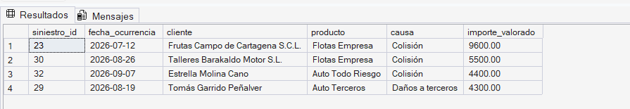

**Claves de la solución:**

- Son tres `JOIN` sobre cuatro tablas. El siniestro no conoce a su cliente ni a su producto: los dos se alcanzan a través de la póliza.
- Los filtros actúan sobre tablas distintas: el ramo es del producto, mientras que la fecha y el importe son del siniestro.
- `clientes` y `productos` tienen una columna `nombre` cada una. Sin alias de columna, el resultado tendría dos columnas con el mismo nombre.
- El filtro de fechas se escribe como rango sobre la columna (`>=` y `<=`), sin aplicar funciones a `fecha_ocurrencia`.
---

## Sección 2 · Subconsultas

### Pregunta 2

**Solución:**

```sql
SELECT siniestro_id,
       fecha_ocurrencia,
       causa,
       importe_valorado
FROM dbo.siniestros
WHERE importe_valorado > (SELECT AVG(importe_valorado) FROM dbo.siniestros)
ORDER BY importe_valorado DESC;
```

**Salida aproximada:**

| siniestro_id | fecha_ocurrencia | causa | importe_valorado |
| --- | --- | --- | --- |
| 21 | 2026-06-26 | Incendio | 52000.00 |
| 15 | 2026-05-07 | Incendio | 27000.00 |
| 31 | 2026-09-02 | Responsabilidad civil | 12400.00 |
| 18 | 2026-06-03 | Responsabilidad civil | 11500.00 |
| 5 | 2026-02-19 | Daños por agua | 9800.00 |
| 23 | 2026-07-12 | Colisión | 9600.00 |
| 9 | 2026-03-24 | Colisión | 8300.00 |
| 28 | 2026-08-11 | Intervención quirúrgica | 8200.00 |
| 11 | 2026-04-02 | Hospitalización | 7300.00 |

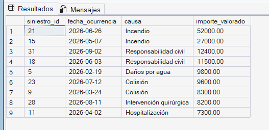

**Claves de la solución:**

- La subconsulta devuelve un único valor (1 fila × 1 columna), por eso puede compararse con `>`. El importe valorado medio de los 36 siniestros es 7.231,94 €.
- La subconsulta no depende de la fila externa: se calcula una sola vez.
- El umbral no se escribe a mano. Si mañana se cargan más siniestros, la consulta sigue siendo válida sin tocarla.
### Pregunta 3

**Solución:**

```sql
SELECT destinatario,
       COUNT(*)     AS pagos,
       SUM(importe) AS importe_pagado
FROM dbo.pagos
WHERE siniestro_id IN (
    SELECT siniestro_id                    -- Nivel 1: siniestros de esas pólizas
    FROM dbo.siniestros
    WHERE poliza_id IN (
        SELECT poliza_id                   -- Nivel 2: pólizas de esos clientes
        FROM dbo.polizas
        WHERE cliente_id IN (
            SELECT cliente_id              -- Nivel 3: clientes con perfil D
            FROM dbo.clientes
            WHERE perfil_riesgo = 'D'
        )
    )
)
GROUP BY destinatario
ORDER BY importe_pagado DESC;
```

**Salida aproximada:**

| destinatario | pagos | importe_pagado |
| --- | --- | --- |
| Asegurado | 4 | 29800.00 |
| Taller | 5 | 22050.00 |
| Tercero perjudicado | 2 | 6600.00 |

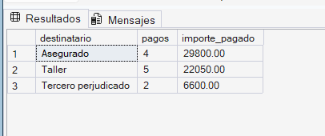

**Claves de la solución:**

- Se lee de dentro hacia fuera: clientes con perfil `D` (son tres) → sus pólizas → los siniestros de esas pólizas → los pagos de esos siniestros.
- Cada nivel devuelve una lista de una sola columna, que es lo que exige `IN`.
- La agregación se hace en la consulta externa, una vez filtrados los pagos.
- Los siniestros de esos clientes que todavía no tienen ningún pago no aportan nada al resultado.
---

## Sección 3 · CTE

### Pregunta 4

**Solución:**

```sql
WITH pagado_siniestro AS (
    SELECT siniestro_id, SUM(importe) AS pagado
    FROM dbo.pagos
    GROUP BY siniestro_id
)
SELECT s.siniestro_id,
       s.causa,
       s.importe_valorado,
       ps.pagado,
       s.importe_valorado - ps.pagado AS reserva_pendiente
FROM dbo.siniestros AS s
JOIN pagado_siniestro AS ps ON ps.siniestro_id = s.siniestro_id
WHERE ps.pagado < s.importe_valorado
ORDER BY reserva_pendiente DESC, s.siniestro_id;
```

**Salida aproximada:**

| siniestro_id | causa | importe_valorado | pagado | reserva_pendiente |
| --- | --- | --- | --- | --- |
| 21 | Incendio | 52000.00 | 37000.00 | 15000.00 |
| 15 | Incendio | 27000.00 | 20000.00 | 7000.00 |
| 23 | Colisión | 9600.00 | 4000.00 | 5600.00 |
| 18 | Responsabilidad civil | 11500.00 | 6000.00 | 5500.00 |
| 28 | Intervención quirúrgica | 8200.00 | 5000.00 | 3200.00 |
| 30 | Colisión | 5500.00 | 2500.00 | 3000.00 |
| 17 | Colisión | 5900.00 | 3000.00 | 2900.00 |

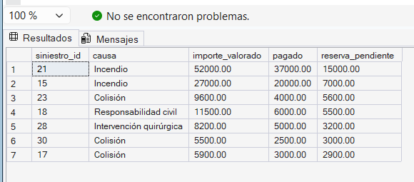

**Claves de la solución:**

- La CTE agrega `pagos` a una fila por siniestro. Si se uniera `pagos` directamente con `siniestros`, los siniestros con varios pagos aparecerían repetidos.
- El `JOIN` (interno) con la CTE ya garantiza «ha recibido algún pago»: los siniestros sin pagos no están en `pagado_siniestro`.
- `ps.pagado < s.importe_valorado` descarta los siniestros ya liquidados.
- De los 36 siniestros, 7 tienen pago parcial.
### Pregunta 5

**Solución:**

```sql
WITH recibos_t3 AS (          -- 1. Limpiar: solo los recibos del T3
    SELECT recibo_id, poliza_id, importe
    FROM dbo.recibos
    WHERE fecha_emision >= '2026-07-01'
      AND fecha_emision <= '2026-09-30'
),
enriquecidos AS (             -- 2. Enriquecer: añadir el ramo
    SELECT r.recibo_id, r.importe, pr.ramo
    FROM recibos_t3 AS r
    JOIN dbo.polizas   AS p  ON p.poliza_id    = r.poliza_id
    JOIN dbo.productos AS pr ON pr.producto_id = p.producto_id
),
por_ramo AS (                 -- 3. Agregar: totales por ramo
    SELECT ramo,
           COUNT(*)     AS recibos,
           SUM(importe) AS primas
    FROM enriquecidos
    GROUP BY ramo
)
SELECT ramo, recibos, primas
FROM por_ramo
WHERE primas >= 5000
ORDER BY primas DESC;
```

**Salida aproximada:**

| ramo | recibos | primas |
| --- | --- | --- |
| Empresas | 7 | 39980.00 |
| Salud | 5 | 24870.00 |
| Auto | 8 | 22430.00 |

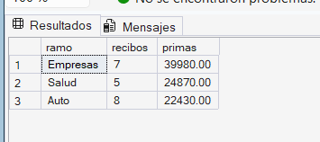

**Claves de la solución:**

- Es el patrón limpiar → enriquecer → agregar. Hay tres niveles de dependencia: `enriquecidos` lee de `recibos_t3` y `por_ramo` lee de `enriquecidos`.
- SQL Server no permite definir una CTE dentro de otra. Las CTE se encadenan con comas y un solo `WITH`.
- El ramo no está en el recibo ni en la póliza: hay que llegar hasta `productos` pasando por `polizas`.
- El filtro `primas >= 5000` va en la consulta final con `WHERE` porque `primas` ya es una columna de `por_ramo`. Dentro de la tercera CTE habría que usar `HAVING SUM(importe) >= 5000`.
- `por_ramo` tiene 4 filas. El filtro deja fuera a Hogar (1.000,00 €). El ramo Vida no aparece porque no tuvo recibos en el T3.
### Pregunta 6

**Solución:**

```sql
WITH arbol AS (
    -- Miembro ancla: el centro raíz
    SELECT centro_id,
           nombre,
           tipo,
           0 AS nivel,
           CAST(nombre AS nvarchar(400)) AS ruta
    FROM dbo.centros
    WHERE centro_padre_id IS NULL

    UNION ALL

    -- Miembro recursivo: los centros hijos de los ya encontrados
    SELECT c.centro_id,
           c.nombre,
           c.tipo,
           a.nivel + 1,
           CAST(CONCAT(a.ruta, N' > ', c.nombre) AS nvarchar(400))
    FROM dbo.centros AS c
    JOIN arbol AS a ON c.centro_padre_id = a.centro_id
)
SELECT centro_id, nombre, tipo, nivel, ruta
FROM arbol
ORDER BY ruta;
```

**Salida aproximada:**

| centro_id | nombre | tipo | nivel | ruta |
| --- | --- | --- | --- | --- |
| 1 | Serbal Seguros | Compañía | 0 | Serbal Seguros |
| 2 | Territorial Centro | Dirección territorial | 1 | Serbal Seguros > Territorial Centro |
| 5 | Delegación Madrid | Delegación | 2 | Serbal Seguros > Territorial Centro > Delegación Madrid |
| 13 | Oficina Alcalá de Henares | Oficina | 3 | Serbal Seguros > Territorial Centro > Delegación Madrid > Oficina Alcalá de Henares |
| 11 | Oficina Madrid Chamberí | Oficina | 3 | Serbal Seguros > Territorial Centro > Delegación Madrid > Oficina Madrid Chamberí |
| 12 | Oficina Madrid Vallecas | Oficina | 3 | Serbal Seguros > Territorial Centro > Delegación Madrid > Oficina Madrid Vallecas |
| 6 | Delegación Toledo | Delegación | 2 | Serbal Seguros > Territorial Centro > Delegación Toledo |
| 14 | Oficina Talavera | Oficina | 3 | Serbal Seguros > Territorial Centro > Delegación Toledo > Oficina Talavera |
| 4 | Territorial Levante | Dirección territorial | 1 | Serbal Seguros > Territorial Levante |
| 10 | Delegación Murcia | Delegación | 2 | Serbal Seguros > Territorial Levante > Delegación Murcia |
| 20 | Oficina Cartagena | Oficina | 3 | Serbal Seguros > Territorial Levante > Delegación Murcia > Oficina Cartagena |
| 9 | Delegación Valencia | Delegación | 2 | Serbal Seguros > Territorial Levante > Delegación Valencia |
| 18 | Oficina Gandía | Oficina | 3 | Serbal Seguros > Territorial Levante > Delegación Valencia > Oficina Gandía |
| 19 | Oficina Valencia Ruzafa | Oficina | 3 | Serbal Seguros > Territorial Levante > Delegación Valencia > Oficina Valencia Ruzafa |
| 3 | Territorial Norte | Dirección territorial | 1 | Serbal Seguros > Territorial Norte |
| 7 | Delegación Bilbao | Delegación | 2 | Serbal Seguros > Territorial Norte > Delegación Bilbao |
| 16 | Oficina Barakaldo | Oficina | 3 | Serbal Seguros > Territorial Norte > Delegación Bilbao > Oficina Barakaldo |
| 15 | Oficina Getxo | Oficina | 3 | Serbal Seguros > Territorial Norte > Delegación Bilbao > Oficina Getxo |
| 8 | Delegación Zaragoza | Delegación | 2 | Serbal Seguros > Territorial Norte > Delegación Zaragoza |
| 17 | Oficina Zaragoza Delicias | Oficina | 3 | Serbal Seguros > Territorial Norte > Delegación Zaragoza > Oficina Zaragoza Delicias |

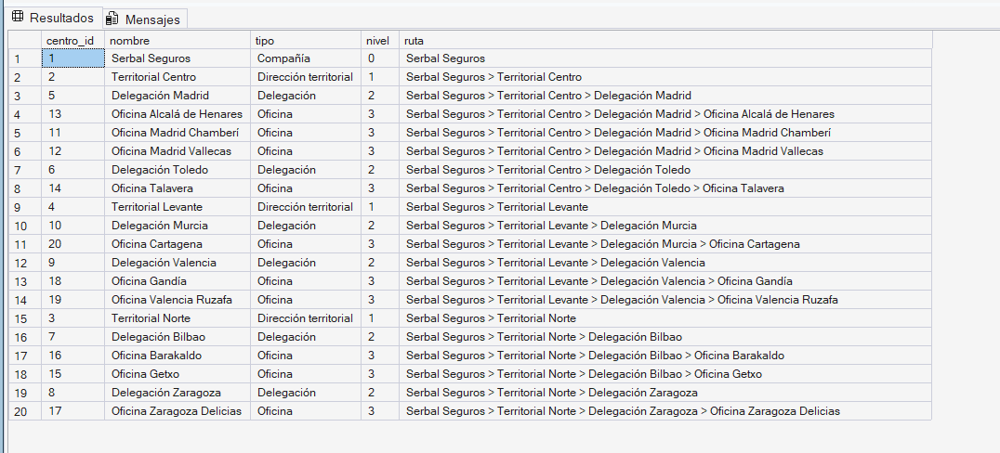

**Claves de la solución:**

- El ancla localiza la raíz con `centro_padre_id IS NULL`, sin escribir su identificador a mano.
- El miembro recursivo une cada centro con su padre ya encontrado (`c.centro_padre_id = a.centro_id`) y le suma 1 al nivel.
- `ruta` lleva el mismo `CAST` en el ancla y en el miembro recursivo. Si los tipos no coinciden exactamente, SQL Server devuelve el error Msg 240.
- La jerarquía tiene 4 niveles (0 a 3), muy por debajo del límite de 100 recursiones, así que no hace falta `OPTION (MAXRECURSION)`.
- Ordenar por `ruta` coloca cada centro justo debajo de su centro padre.
---

## Sección 4 · Vistas

### Pregunta 7

**Solución:**

```sql
CREATE OR ALTER VIEW dbo.vw_resultado_tecnico
AS
WITH movimientos AS (
    SELECT fecha_emision AS fecha, N'Primas' AS concepto, importe FROM dbo.recibos
    UNION ALL
    SELECT fecha_pago, N'Siniestros', importe FROM dbo.pagos
)
SELECT p.ejercicio,
       p.trimestre,
       m.concepto,
       SUM(m.importe) AS importe
FROM movimientos AS m
JOIN dbo.periodos AS p ON m.fecha BETWEEN p.fecha_inicio AND p.fecha_fin
GROUP BY p.ejercicio, p.trimestre, m.concepto;
GO

-- Comprobación
SELECT trimestre, concepto, importe
FROM dbo.vw_resultado_tecnico
WHERE ejercicio = 2026
ORDER BY trimestre, concepto;
```

**Salida aproximada de la comprobación:**

| trimestre | concepto | importe |
| --- | --- | --- |
| 1 | Primas | 77885.00 |
| 1 | Siniestros | 27350.00 |
| 2 | Primas | 77490.00 |
| 2 | Siniestros | 60200.00 |
| 3 | Primas | 88280.00 |
| 3 | Siniestros | 95900.00 |

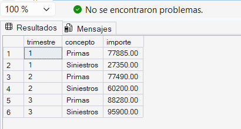

**Claves de la solución:**

- `CREATE OR ALTER VIEW` debe ser la primera instrucción de su lote, por eso lleva un `GO` detrás (y otro delante si hay código previo en el mismo script).
- `UNION ALL` apila recibos y pagos con la misma estructura. La columna `concepto` no existe en las tablas: es un literal que identifica de dónde viene cada fila.
- `UNION` a secas eliminaría movimientos que coincidan en fecha, concepto e importe, y falsearía los totales.
- Cada movimiento se une con su trimestre por rango de fechas, como indica la regla de negocio.
- Una vista no admite `ORDER BY` (salvo con `TOP` u `OFFSET`); el orden lo pone quien la consulta.
- Lectura para el analista: en el T1 y el T2 las primas superan a los siniestros pagados; en el T3 ocurre lo contrario y el resultado técnico es de −7.620,00 €.
### Pregunta 8

**Solución:**

```sql
CREATE OR ALTER VIEW dbo.vw_presupuesto_primas
AS
WITH real_trimestre AS (
    SELECT pe.periodo_id,
           p.centro_id,
           pr.ramo,
           SUM(r.importe) AS primas_reales
    FROM dbo.recibos   AS r
    JOIN dbo.polizas   AS p  ON p.poliza_id    = r.poliza_id
    JOIN dbo.productos AS pr ON pr.producto_id = p.producto_id
    JOIN dbo.periodos  AS pe ON r.fecha_emision BETWEEN pe.fecha_inicio AND pe.fecha_fin
    GROUP BY pe.periodo_id, p.centro_id, pr.ramo
)
SELECT pe.ejercicio,
       pe.trimestre,
       c.nombre  AS centro,
       b.ramo,
       b.importe AS presupuesto,
       COALESCE(rt.primas_reales, 0)             AS primas_reales,
       COALESCE(rt.primas_reales, 0) - b.importe AS desviacion
FROM dbo.presupuestos AS b
JOIN dbo.periodos AS pe ON pe.periodo_id = b.periodo_id
JOIN dbo.centros  AS c  ON c.centro_id   = b.centro_id
LEFT JOIN real_trimestre AS rt
       ON rt.periodo_id = b.periodo_id
      AND rt.centro_id  = b.centro_id
      AND rt.ramo       = b.ramo;
GO

-- Comprobación
SELECT centro, ramo, presupuesto, primas_reales, desviacion
FROM dbo.vw_presupuesto_primas
WHERE ejercicio = 2026
  AND trimestre = 3
  AND desviacion < -500
ORDER BY desviacion;
```

**Salida aproximada de la comprobación:**

| centro | ramo | presupuesto | primas_reales | desviacion |
| --- | --- | --- | --- | --- |
| Oficina Cartagena | Empresas | 11500.00 | 9200.00 | -2300.00 |
| Oficina Madrid Vallecas | Empresas | 3000.00 | 980.00 | -2020.00 |
| Oficina Valencia Ruzafa | Salud | 2000.00 | 0.00 | -2000.00 |
| Oficina Getxo | Salud | 14350.00 | 13290.00 | -1060.00 |
| Delegación Madrid | Auto | 10560.00 | 9600.00 | -960.00 |
| Delegación Bilbao | Empresas | 14070.00 | 13400.00 | -670.00 |

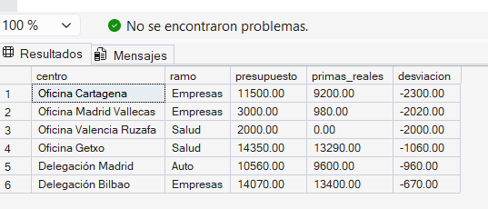

**Claves de la solución:**

- La vista parte de `dbo.presupuestos` porque el enunciado pide una fila por línea de presupuesto. El `LEFT JOIN` conserva las líneas sin recibos (por ejemplo, todo el T4) y `COALESCE` convierte su `NULL` en 0.
- Las primas reales se agregan **antes** de unirlas con el presupuesto. Si se unieran los recibos sin agregar, el presupuesto se repetiría en cada recibo.
- El centro y el ramo de un recibo se obtienen de su póliza y del producto de esa póliza, como indica la regla de negocio.
- El `LEFT JOIN` necesita las tres columnas de la clave (periodo, centro y ramo). Con una menos, las filas se multiplican.
- La vista no incluye las primas sin línea presupuestaria (por ejemplo, la flota contratada en febrero en la Oficina Barakaldo). Detectarlas sería otra consulta, con `NOT EXISTS`.
- Lectura para la analista: Oficina Valencia Ruzafa tenía presupuesto de Salud y no ha emitido ningún recibo de ese ramo en el trimestre.
### Pregunta 9

**Solución:**

```sql
CREATE OR ALTER VIEW dbo.vw_reservas_cliente
AS
WITH pagado_siniestro AS (
    SELECT siniestro_id, SUM(importe) AS pagado
    FROM dbo.pagos
    GROUP BY siniestro_id
),
reservas AS (
    SELECT p.cliente_id,
           s.fecha_apertura,
           s.importe_valorado - COALESCE(ps.pagado, 0) AS reserva
    FROM dbo.siniestros AS s
    JOIN dbo.polizas    AS p ON p.poliza_id = s.poliza_id
    LEFT JOIN pagado_siniestro AS ps ON ps.siniestro_id = s.siniestro_id
)
SELECT c.cliente_id,
       c.nombre,
       c.perfil_riesgo,
       COALESCE(SUM(r.reserva), 0) AS reserva_pendiente,
       SUM(CASE WHEN r.fecha_apertura < '2026-07-01' THEN r.reserva ELSE 0 END) AS reserva_antigua
FROM dbo.clientes AS c
LEFT JOIN reservas AS r ON r.cliente_id = c.cliente_id
GROUP BY c.cliente_id, c.nombre, c.perfil_riesgo;
GO

-- Comprobación
SELECT nombre, perfil_riesgo, reserva_pendiente, reserva_antigua
FROM dbo.vw_reservas_cliente
WHERE reserva_pendiente > 5000
ORDER BY reserva_pendiente DESC;
```

**Salida aproximada de la comprobación:**

| nombre | perfil_riesgo | reserva_pendiente | reserva_antigua |
| --- | --- | --- | --- |
| Cerámicas La Safor S.L. | C | 27400.00 | 15000.00 |
| Frutas Campo de Cartagena S.C.L. | D | 17800.00 | 7000.00 |
| Estrella Molina Cano | D | 7300.00 | 2900.00 |
| Hotel Mirador del Tajo S.L. | B | 6500.00 | 0.00 |
| Transportes Henares S.L. | C | 5500.00 | 5500.00 |

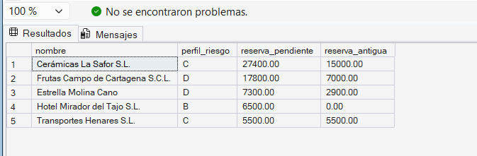

**Claves de la solución:**

- Una vista puede contener varias CTE encadenadas. La definición empieza en `WITH` justo después de `AS`.
- Hay dos `LEFT JOIN` y cada uno resuelve un caso distinto. El de `reservas` conserva los siniestros sin ningún pago, cuya reserva es el importe valorado completo. El de la consulta final conserva a los clientes sin siniestros, con reserva 0.
- El siniestro no guarda el cliente: se obtiene a través de la póliza.
- `COALESCE(SUM(r.reserva), 0)` evita que los clientes sin siniestros aparezcan con `NULL`.
- `reserva_antigua` es una suma condicional: el `CASE` deja pasar la reserva solo cuando el siniestro se abrió antes del 01/07/2026. Los siniestros ya liquidados suman 0.
- Lectura para el analista: cuatro de los cinco clientes de la lista tienen perfil C o D.
---

## Sección 5 · SELECT INTO

### Pregunta 10

**Solución:**

```sql
DROP TABLE IF EXISTS dbo.recibos_2026_t3;

SELECT recibo_id,
       poliza_id,
       fecha_emision,
       importe,
       estado
INTO dbo.recibos_2026_t3
FROM dbo.recibos
WHERE fecha_emision >= '2026-07-01'
  AND fecha_emision <= '2026-09-30';

-- Comprobación
SELECT COUNT(*)           AS recibos,
       SUM(importe)       AS importe_total,
       MIN(fecha_emision) AS primera_emision,
       MAX(fecha_emision) AS ultima_emision
FROM dbo.recibos_2026_t3;
```

**Salida aproximada de la comprobación:**

| recibos | importe_total | primera_emision | ultima_emision |
| --- | --- | --- | --- |
| 22 | 88280.00 | 2026-07-01 | 2026-09-12 |

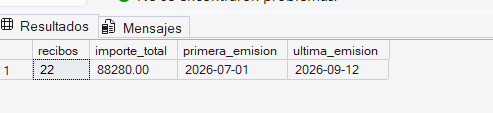

**Claves de la solución:**

- `SELECT ... INTO` crea la tabla y la carga en una sola instrucción. Es el equivalente en SQL Server de `CREATE TABLE ... AS SELECT` (CTAS), que solo existe en Azure Synapse y Microsoft Fabric.
- La tabla destino **no puede existir**: por eso el script empieza con `DROP TABLE IF EXISTS`. Sin esa línea, la segunda ejecución falla con el error Msg 2714.
- La tabla nueva hereda nombres y tipos de las columnas, pero **no** hereda la clave primaria, la clave foránea ni las restricciones `CHECK`.
- Es una copia: si después cambia `dbo.recibos`, `dbo.recibos_2026_t3` no se entera.
### Pregunta 11

**Solución:**

```sql
DROP TABLE IF EXISTS dbo.siniestros_enriquecidos;

WITH pagado_siniestro AS (
    SELECT siniestro_id, SUM(importe) AS pagado
    FROM dbo.pagos
    GROUP BY siniestro_id
)
SELECT s.siniestro_id,
       s.causa,
       s.fecha_apertura,
       e.nombre AS tramitador,
       s.importe_valorado,
       COALESCE(ps.pagado, 0)                      AS pagado,
       s.importe_valorado - COALESCE(ps.pagado, 0) AS reserva_pendiente,
       CASE WHEN ps.pagado IS NULL               THEN N'Sin pagos'
            WHEN ps.pagado < s.importe_valorado  THEN N'Pago parcial'
            ELSE N'Liquidado'
       END AS estado_pago
INTO dbo.siniestros_enriquecidos
FROM dbo.siniestros AS s
LEFT JOIN dbo.empleados    AS e  ON e.empleado_id  = s.tramitador_id
LEFT JOIN pagado_siniestro AS ps ON ps.siniestro_id = s.siniestro_id;

-- Comprobación
SELECT estado_pago,
       COUNT(*)               AS siniestros,
       SUM(importe_valorado)  AS importe_valorado,
       SUM(reserva_pendiente) AS reserva_pendiente
FROM dbo.siniestros_enriquecidos
GROUP BY estado_pago
ORDER BY siniestros DESC;
```

**Salida aproximada de la comprobación:**

| estado_pago | siniestros | importe_valorado | reserva_pendiente |
| --- | --- | --- | --- |
| Liquidado | 23 | 105950.00 | 0.00 |
| Pago parcial | 7 | 119700.00 | 42200.00 |
| Sin pagos | 6 | 34700.00 | 34700.00 |

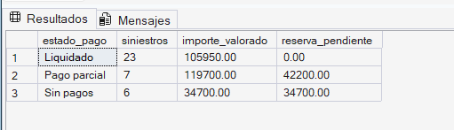

**Claves de la solución:**

- `INTO` va entre la lista de columnas y el `FROM`, y solo una vez, aunque la consulta empiece con una CTE.
- Como la instrucción anterior termina en punto y coma, el `WITH` no da el error Msg 319.
- Todas las columnas calculadas necesitan alias: `SELECT ... INTO` no puede crear una columna sin nombre.
- Los dos cruces son `LEFT JOIN`. Con un `JOIN` interno a `empleados` se perderían los 2 siniestros sin tramitador, y con un `JOIN` interno a la CTE, los 6 que no tienen pagos. La tabla debe tener 36 filas.
- La suma de la columna `reserva_pendiente` (76.900,00 €) es la reserva total de la compañía a 30/09/2026.
---

## Sección 6 · Tablas temporales

### Pregunta 12

**Solución:**

```sql
DROP TABLE IF EXISTS #pagos_t3;

SELECT pg.pago_id,
       s.causa,
       pg.fecha_pago,
       pg.importe,
       pg.destinatario
INTO #pagos_t3
FROM dbo.pagos      AS pg
JOIN dbo.siniestros AS s ON s.siniestro_id = pg.siniestro_id
WHERE pg.fecha_pago >= '2026-07-01'
  AND pg.fecha_pago <= '2026-09-30';

-- Consulta A
SELECT destinatario,
       COUNT(*)     AS pagos,
       SUM(importe) AS importe_pagado
FROM #pagos_t3
GROUP BY destinatario
ORDER BY importe_pagado DESC;

-- Consulta B
SELECT TOP (3) causa,
       SUM(importe) AS importe_pagado
FROM #pagos_t3
GROUP BY causa
ORDER BY importe_pagado DESC;
```

**Salida aproximada de la consulta A:**

| destinatario | pagos | importe_pagado |
| --- | --- | --- |
| Asegurado | 7 | 56550.00 |
| Taller | 5 | 18050.00 |
| Centro médico | 3 | 15300.00 |
| Tercero perjudicado | 1 | 6000.00 |

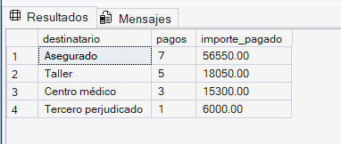

**Salida aproximada de la consulta B:**

| causa | importe_pagado |
| --- | --- |
| Incendio | 45000.00 |
| Colisión | 18050.00 |
| Hospitalización | 10300.00 |

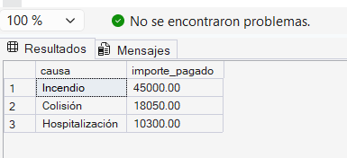

**Claves de la solución:**

- El prefijo `#` crea una tabla temporal local: vive en `tempdb`, solo la ve la sesión que la crea y se elimina sola al cerrar esa sesión.
- La tabla temporal materializa el cruce una vez y se lee dos veces. Una CTE no serviría: solo existe durante la instrucción que la sigue y la consulta B ya no la encontraría.
- `DROP TABLE IF EXISTS #pagos_t3` permite relanzar el script en la misma ventana de SSMS sin el error Msg 2714.
- Se filtra por `fecha_pago`, no por la fecha del siniestro: en el T3 se pagan siniestros ocurridos en trimestres anteriores.
- La tabla temporal tiene 16 filas.
### Pregunta 13

**Solución:**

```sql
DROP TABLE IF EXISTS #lote_unico;
DROP TABLE IF EXISTS #lote_valido;

-- Paso 1: eliminar las filas repetidas del lote
SELECT DISTINCT pago_id, siniestro_id, fecha_pago, importe, destinatario
INTO #lote_unico
FROM dbo.stg_pagos;

-- Paso 2: quedarse con las filas que se pueden cargar
SELECT l.pago_id, l.siniestro_id, l.fecha_pago, l.importe, l.destinatario
INTO #lote_valido
FROM #lote_unico AS l
WHERE l.importe > 0
  AND NOT EXISTS (SELECT 1 FROM dbo.pagos      AS p WHERE p.pago_id      = l.pago_id)
  AND EXISTS     (SELECT 1 FROM dbo.siniestros AS s WHERE s.siniestro_id = l.siniestro_id);

-- Consulta A
SELECT 'stg_pagos' AS etapa, COUNT(*) AS filas FROM dbo.stg_pagos
UNION ALL
SELECT '#lote_unico', COUNT(*) FROM #lote_unico
UNION ALL
SELECT '#lote_valido', COUNT(*) FROM #lote_valido
ORDER BY filas DESC;

-- Consulta B
SELECT pago_id, siniestro_id, fecha_pago, importe, destinatario
FROM #lote_valido
ORDER BY pago_id;
```

**Salida aproximada de la consulta A:**

| etapa | filas |
| --- | --- |
| stg_pagos | 13 |
| #lote_unico | 11 |
| #lote_valido | 5 |

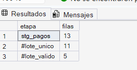

**Salida aproximada de la consulta B:**

| pago_id | siniestro_id | fecha_pago | importe | destinatario |
| --- | --- | --- | --- | --- |
| 36 | 29 | 2026-10-01 | 4300.00 | Tercero perjudicado |
| 37 | 31 | 2026-10-01 | 6000.00 | Tercero perjudicado |
| 38 | 17 | 2026-10-01 | 2900.00 | Taller |
| 40 | 33 | 2026-10-02 | 6500.00 | Tercero perjudicado |
| 42 | 36 | 2026-10-02 | 1900.00 | Tercero perjudicado |

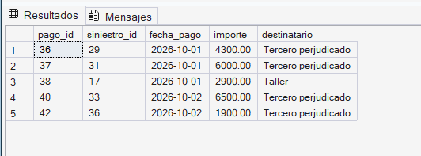

**Claves de la solución:**

- El lote trae 13 filas. `SELECT DISTINCT` deja 11: los pagos 37 y 42 venían repetidos.
- De las 11, se descartan 6: los pagos 33, 34 y 35 ya están en `dbo.pagos`, el 39 apunta a un siniestro que no existe (el 9999), el 41 trae importe 0 y el 43, un importe negativo.
- `NOT EXISTS` es el anti-join de la carga incremental: filas del origen que aún no están en el destino. `EXISTS` comprueba la integridad referencial que la tabla de staging no tiene.
- La condición es `importe > 0`, no `importe <> 0`: debe descartar tanto el importe 0 como el negativo.
- Cada tabla temporal es una etapa del pipeline (deduplicar → validar) y puede revisarse por separado con un `SELECT *`.
---

## Sección 7 · Decisiones de diseño

### Pregunta 14

**Decisión: CTE (recursiva).**

Una subconsulta solo puede bajar un número fijo de niveles: para llegar a quienes dependen de los subordinados del director hay que anidar una subconsulta dentro de otra, y cada nivel de mando nuevo obliga a reescribir la consulta. Si una delegación incorpora un mando entre su director y los gestores, una solución con subconsultas dejaría fuera a parte del equipo **sin dar ningún error**. La CTE recursiva se referencia a sí misma y sigue bajando mientras encuentre subordinados, sea cual sea la profundidad.

**Solución:**

```sql
WITH equipo AS (
    -- Miembro ancla: el director territorial, punto de partida
    SELECT empleado_id, nombre, puesto, 0 AS nivel
    FROM dbo.empleados
    WHERE nombre = N'Andrés Villalba'

    UNION ALL

    -- Miembro recursivo: quienes tienen como jefe a alguien ya encontrado
    SELECT e.empleado_id, e.nombre, e.puesto, q.nivel + 1
    FROM dbo.empleados AS e
    JOIN equipo AS q ON e.jefe_id = q.empleado_id
)
SELECT nombre, puesto, nivel
FROM equipo
WHERE nivel > 0
ORDER BY nivel, nombre;
```

**Salida aproximada:**

| nombre | puesto | nivel |
| --- | --- | --- |
| Marcos Peña | Director de Delegación | 1 |
| Teresa Quiroga | Directora de Delegación | 1 |
| Fabián Rosales | Gestor Comercial | 2 |
| Iker Barrena | Gestor Comercial | 2 |
| Nuria Escalona | Gestora Comercial | 2 |
| Olga Trujillo | Gestora Comercial | 2 |
| Paula Herrero | Gestora Comercial Junior | 3 |

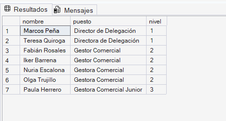

**Claves de la solución:**

- El ancla localiza al director por su nombre y le asigna el nivel 0. El miembro recursivo añade a quienes tienen como jefe a alguien ya encontrado y suma 1 al nivel.
- `WHERE nivel > 0` excluye al propio director en la consulta final. Excluirlo en el ancla rompería la recursión: no habría punto de partida.
- El resultado baja tres niveles. Una solución con dos subconsultas anidadas, que es lo que sugiere el organigrama a primera vista (directores de delegación y gestores), dejaría fuera a Paula Herrero, que depende de una gestora.
- La jerarquía tiene pocos niveles, muy por debajo del límite de 100 recursiones, así que no hace falta `OPTION (MAXRECURSION)`.
### Pregunta 15

**Decisión: tabla temporal.**

| Opción | Requisito 1: resultado fijo | Requisito 2: no deja objetos | Requisito 3: ejecuciones simultáneas | ¿Válida? |
| --- | --- | --- | --- | --- |
| Vista | No. No guarda datos: se recalcula en cada consulta y reflejaría los pagos que se carguen entre una comprobación y otra | No. Queda creada hasta que alguien la elimina | No. Todos compartirían el mismo objeto | No |
| `SELECT ... INTO` en `dbo` | Sí | No. Es una tabla permanente | No. La segunda ejecución falla porque la tabla ya existe, o un ingeniero borra la del otro | No |
| Tabla temporal | Sí. Los datos quedan copiados | Sí. Se elimina sola al cerrar la sesión | Sí. Cada sesión ve solo su propia tabla | **Sí** |

**Solución:**

```sql
DROP TABLE IF EXISTS #pagado_siniestro;

SELECT s.siniestro_id,
       s.causa,
       s.importe_valorado,
       SUM(pg.importe) AS pagado
INTO #pagado_siniestro
FROM dbo.siniestros AS s
JOIN dbo.pagos      AS pg ON pg.siniestro_id = s.siniestro_id
GROUP BY s.siniestro_id, s.causa, s.importe_valorado;

-- Comprobación
SELECT COUNT(*)    AS siniestros,
       SUM(pagado) AS importe_pagado
FROM #pagado_siniestro;
```

**Salida aproximada de la comprobación:**

| siniestros | importe_pagado |
| --- | --- |
| 30 | 183450.00 |

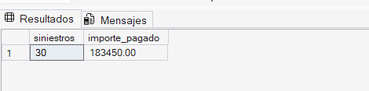

**Claves de la solución:**

- La vista es la opción correcta cuando se quiere el dato **siempre actualizado** y disponible para todos. La tabla creada con `SELECT ... INTO` en `dbo` lo es cuando el dato debe **persistir** y compartirse. Aquí se pide un resultado de trabajo, fijo y privado.
- Dos sesiones pueden crear a la vez una tabla `#pagado_siniestro` sin conflicto: cada sesión tiene la suya.
- La tabla temporal también se crea con `SELECT ... INTO`; lo que cambia es el destino (`#`), que la sitúa en `tempdb` y la liga a la sesión.
- El `JOIN` interno deja fuera a los 6 siniestros sin pagos, como pide el enunciado.
- El total pagado (183.450,00 €) coincide con la suma de `dbo.pagos`: es una buena comprobación de que el cruce no duplica filas.
---

## Limpieza

Para dejar la base de datos como al principio sin volver a crearla, elimina los objetos del examen:

```sql
DROP VIEW  IF EXISTS dbo.vw_resultado_tecnico;
DROP VIEW  IF EXISTS dbo.vw_presupuesto_primas;
DROP VIEW  IF EXISTS dbo.vw_reservas_cliente;
DROP TABLE IF EXISTS dbo.recibos_2026_t3;
DROP TABLE IF EXISTS dbo.siniestros_enriquecidos;
DROP TABLE IF EXISTS #pagos_t3;
DROP TABLE IF EXISTS #lote_unico;
DROP TABLE IF EXISTS #lote_valido;
DROP TABLE IF EXISTS #pagado_siniestro;
```

